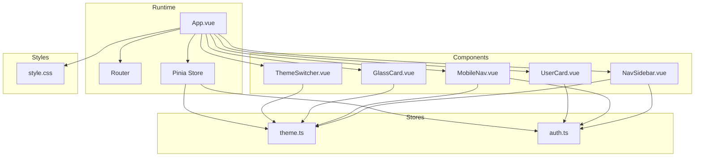
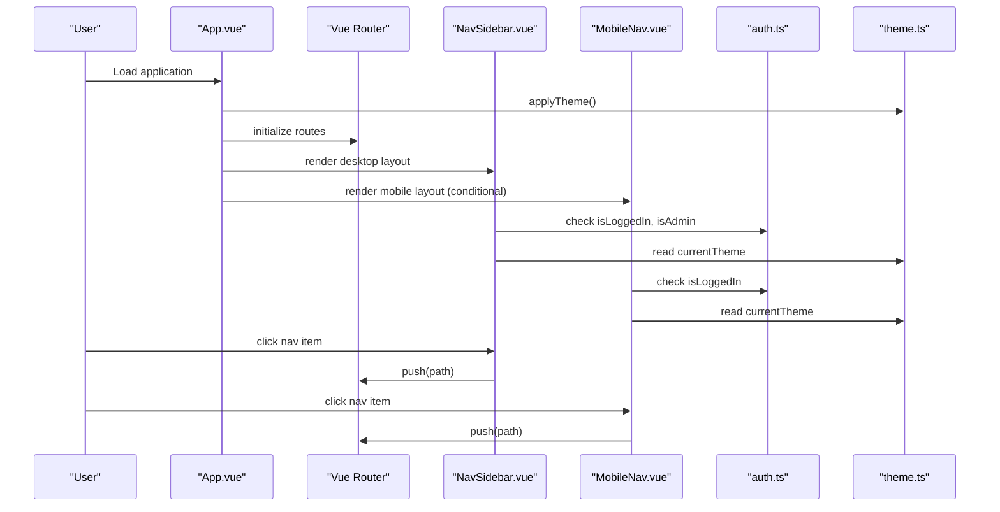
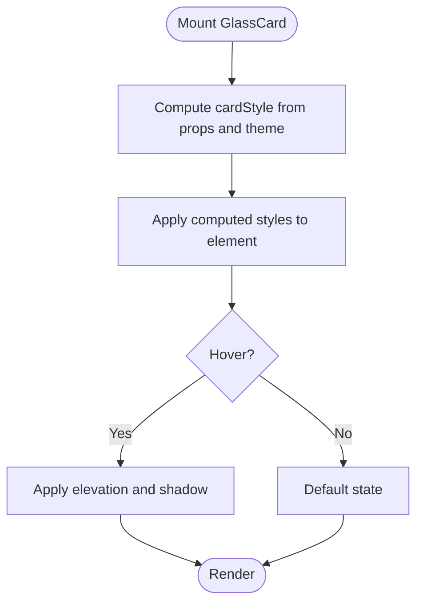
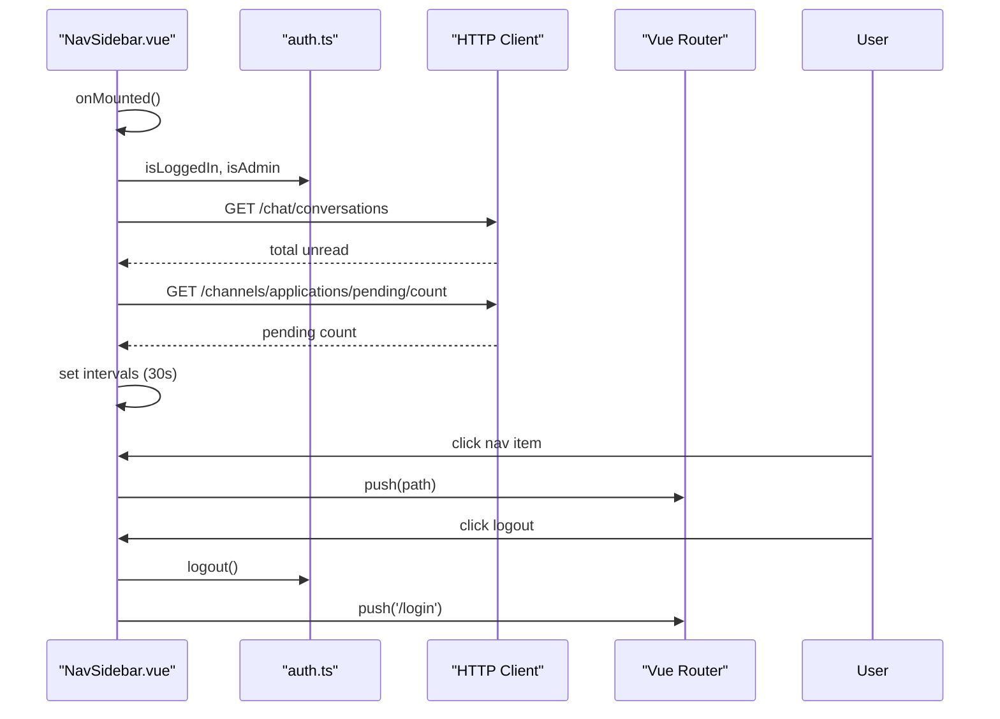
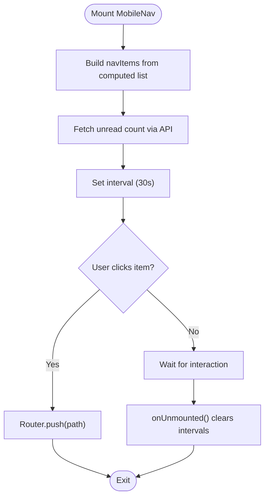
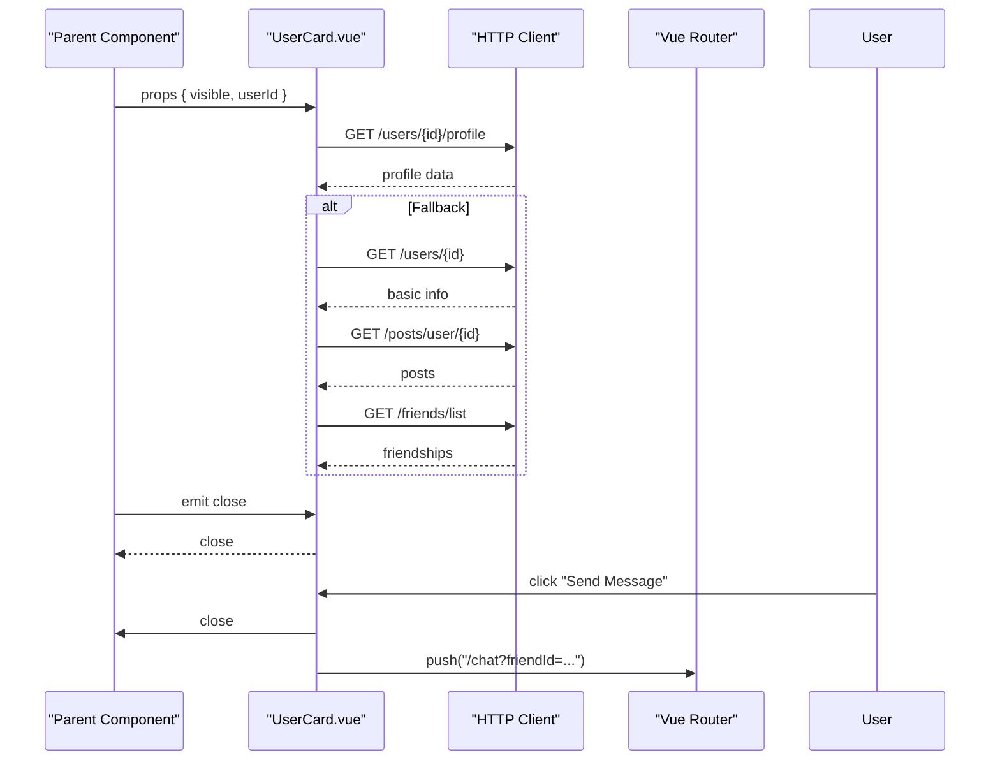
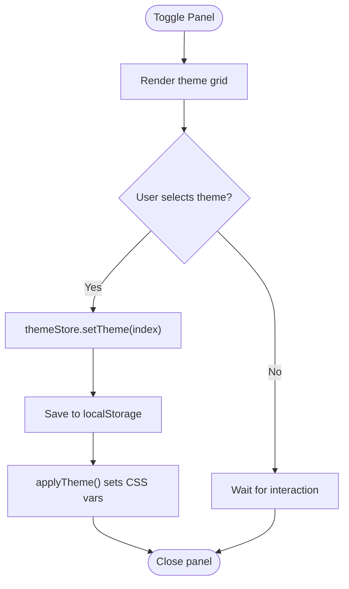
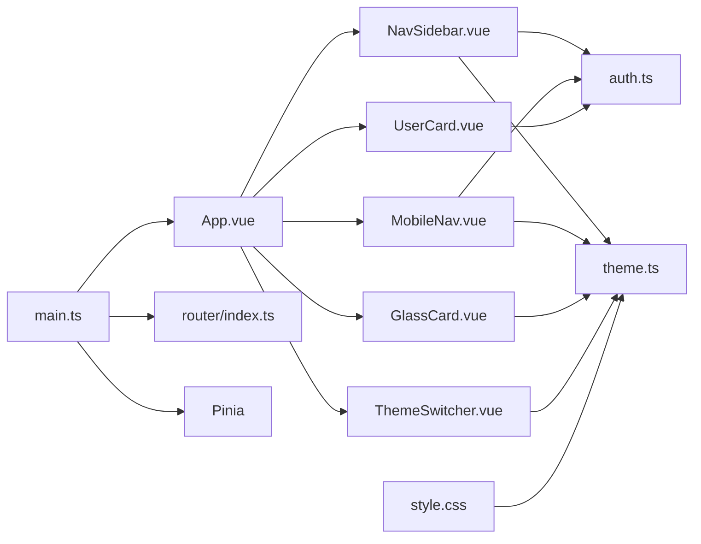

# Component Architecture and Design System

<cite>
**Referenced Files in This Document**
- [App.vue](file://camp-channel-client-pc/src/App.vue)
- [GlassCard.vue](file://camp-channel-client-pc/src/components/GlassCard.vue)
- [NavSidebar.vue](file://camp-channel-client-pc/src/components/NavSidebar.vue)
- [MobileNav.vue](file://camp-channel-client-pc/src/components/MobileNav.vue)
- [UserCard.vue](file://camp-channel-client-pc/src/components/UserCard.vue)
- [ThemeSwitcher.vue](file://camp-channel-client-pc/src/components/ThemeSwitcher.vue)
- [theme.ts](file://camp-channel-client-pc/src/stores/theme.ts)
- [auth.ts](file://camp-channel-client-pc/src/stores/auth.ts)
- [style.css](file://camp-channel-client-pc/src/style.css)
- [index.ts](file://camp-channel-client-pc/src/router/index.ts)
- [index.ts](file://camp-channel-client-pc/src/types/index.ts)
- [main.ts](file://camp-channel-client-pc/src/main.ts)
- [package.json](file://camp-channel-client-pc/package.json)
</cite>

## Table of Contents
1. [Introduction](#introduction)
2. [Project Structure](#project-structure)
3. [Core Components](#core-components)
4. [Architecture Overview](#architecture-overview)
5. [Detailed Component Analysis](#detailed-component-analysis)
6. [Dependency Analysis](#dependency-analysis)
7. [Performance Considerations](#performance-considerations)
8. [Troubleshooting Guide](#troubleshooting-guide)
9. [Conclusion](#conclusion)
10. [Appendices](#appendices)

## Introduction
This document describes the component architecture and design system of the PC client for the campus channel application. It explains how reusable components, page-level components, and widget-like components are organized, how the glass morphism design system is implemented, and how component props, events, and lifecycle management work together. Concrete examples from GlassCard.vue, NavSidebar.vue, and MobileNav.vue illustrate usage patterns and composition. The document also covers component reusability principles, naming conventions, folder structure, and integration with Tailwind-inspired CSS and custom theming.

## Project Structure
The PC client is a Vue 3 application using TypeScript, Pinia for state management, and Vue Router for navigation. The component architecture follows a clear separation:
- Reusable components: small, focused UI primitives such as cards, overlays, and controls.
- Page components: route-bound views that compose reusable components.
- Widget components: interactive elements that encapsulate behavior and styling (e.g., navigation bars, theme switchers).

Key folders and files:
- src/components: reusable UI primitives and widgets.
- src/pages: route-level views.
- src/stores: global state (theme, auth).
- src/router: route definitions and guards.
- src/types: shared TypeScript interfaces.
- src/style.css: global CSS variables and base styles.
- src/main.ts: application bootstrap and initialization.

**Diagram sources**
- [App.vue:1-85](file://camp-channel-client-pc/src/App.vue#L1-L85)
- [NavSidebar.vue:1-213](file://camp-channel-client-pc/src/components/NavSidebar.vue#L1-L213)
- [MobileNav.vue:1-193](file://camp-channel-client-pc/src/components/MobileNav.vue#L1-L193)
- [GlassCard.vue:1-61](file://camp-channel-client-pc/src/components/GlassCard.vue#L1-L61)
- [UserCard.vue:1-151](file://camp-channel-client-pc/src/components/UserCard.vue#L1-L151)
- [ThemeSwitcher.vue:1-132](file://camp-channel-client-pc/src/components/ThemeSwitcher.vue#L1-L132)
- [theme.ts:1-295](file://camp-channel-client-pc/src/stores/theme.ts#L1-L295)
- [auth.ts:1-61](file://camp-channel-client-pc/src/stores/auth.ts#L1-L61)
- [style.css:1-35](file://camp-channel-client-pc/src/style.css#L1-L35)

**Section sources**
- [main.ts:1-19](file://camp-channel-client-pc/src/main.ts#L1-L19)
- [index.ts:1-46](file://camp-channel-client-pc/src/router/index.ts#L1-L46)
- [style.css:1-35](file://camp-channel-client-pc/src/style.css#L1-L35)

## Core Components
This section documents the core building blocks of the design system and their roles.

- GlassCard.vue
  - Purpose: A reusable container with glass morphism styling and theme-aware colors.
  - Props: padding (string), hover (boolean).
  - Composition: Uses a theme store to compute background, border, and text colors; applies hover and pseudo-element gradients.
  - Usage pattern: Wrap content inside a slot; pass optional padding and hover behavior.

- NavSidebar.vue
  - Purpose: Desktop navigation sidebar with active-state indicators, badges, and user avatar.
  - Props: None (uses router and stores internally).
  - Behavior: Dynamically builds navigation items based on auth state; periodically refreshes unread counts and pending applications; handles logout.
  - Lifecycle: Mounted intervals for periodic updates; unmounted to clear intervals.

- MobileNav.vue
  - Purpose: Bottom mobile navigation bar with active-state labels and badges.
  - Props: None (uses router and stores internally).
  - Behavior: Similar to NavSidebar but tailored for mobile; includes a download button placeholder.
  - Lifecycle: Mounted intervals for unread count; unmounted to clear intervals.

- UserCard.vue
  - Purpose: Overlay profile card with actions and posts preview.
  - Props: visible (boolean), userId (number).
  - Events: close (emitted when overlay is dismissed).
  - Behavior: Fetches profile data via API, supports fallback endpoints, and provides actions like adding friends or starting a chat.

- ThemeSwitcher.vue
  - Purpose: Floating panel to switch themes dynamically.
  - Props: None.
  - Behavior: Toggles a panel that lists available themes; applies selected theme via store.

**Section sources**
- [GlassCard.vue:1-61](file://camp-channel-client-pc/src/components/GlassCard.vue#L1-L61)
- [NavSidebar.vue:1-213](file://camp-channel-client-pc/src/components/NavSidebar.vue#L1-L213)
- [MobileNav.vue:1-193](file://camp-channel-client-pc/src/components/MobileNav.vue#L1-L193)
- [UserCard.vue:1-151](file://camp-channel-client-pc/src/components/UserCard.vue#L1-L151)
- [ThemeSwitcher.vue:1-132](file://camp-channel-client-pc/src/components/ThemeSwitcher.vue#L1-L132)

## Architecture Overview
The application composes a responsive layout around a central App.vue shell. Desktop devices render NavSidebar and a main content area; mobile devices render MobileNav at the bottom. Both navigation components rely on the auth store for dynamic menu items and on the theme store for consistent visuals. The theme store manages CSS variables applied to :root, enabling global theme switching without remounting components.

**Diagram sources**
- [App.vue:1-85](file://camp-channel-client-pc/src/App.vue#L1-L85)
- [NavSidebar.vue:1-213](file://camp-channel-client-pc/src/components/NavSidebar.vue#L1-L213)
- [MobileNav.vue:1-193](file://camp-channel-client-pc/src/components/MobileNav.vue#L1-L193)
- [auth.ts:1-61](file://camp-channel-client-pc/src/stores/auth.ts#L1-L61)
- [theme.ts:1-295](file://camp-channel-client-pc/src/stores/theme.ts#L1-L295)
- [index.ts:1-46](file://camp-channel-client-pc/src/router/index.ts#L1-L46)

## Detailed Component Analysis

### GlassCard.vue
GlassCard is a minimal, theme-aware container that encapsulates glass morphism styling. It computes inline styles from the theme store and exposes a slot for children. Props:
- padding: Controls inner spacing.
- hover: Enables hover elevation and shadow.

Lifecycle and styling:
- Computed cardStyle reacts to prop changes and theme updates.
- Scoped styles define blur, border radius, gradient overlay, and hover transform.

**Diagram sources**
- [GlassCard.vue:11-27](file://camp-channel-client-pc/src/components/GlassCard.vue#L11-L27)

**Section sources**
- [GlassCard.vue:1-61](file://camp-channel-client-pc/src/components/GlassCard.vue#L1-L61)

### NavSidebar.vue
NavSidebar provides a fixed vertical sidebar with navigation items, badges, and user controls. It:
- Builds navItems from a static list augmented by admin privileges.
- Computes active state per route.
- Periodically fetches unread counts and pending application counts.
- Emits logout and navigates to settings/profile.

**Diagram sources**
- [NavSidebar.vue:65-98](file://camp-channel-client-pc/src/components/NavSidebar.vue#L65-L98)
- [NavSidebar.vue:105-129](file://camp-channel-client-pc/src/components/NavSidebar.vue#L105-L129)
- [auth.ts:1-61](file://camp-channel-client-pc/src/stores/auth.ts#L1-L61)

**Section sources**
- [NavSidebar.vue:1-213](file://camp-channel-client-pc/src/components/NavSidebar.vue#L1-L213)

### MobileNav.vue
MobileNav mirrors NavSidebar’s navigation for mobile, with a bottom-fixed bar and labels. It:
- Builds navItems similarly, conditionally adding admin.
- Computes active state across routes.
- Fetches unread counts and cleans up intervals on unmount.

**Diagram sources**
- [MobileNav.vue:37-53](file://camp-channel-client-pc/src/components/MobileNav.vue#L37-L53)
- [MobileNav.vue:60-84](file://camp-channel-client-pc/src/components/MobileNav.vue#L60-L84)

**Section sources**
- [MobileNav.vue:1-193](file://camp-channel-client-pc/src/components/MobileNav.vue#L1-L193)

### UserCard.vue
UserCard is a teleport-based overlay that displays a user’s profile and recent posts. It:
- Accepts visible and userId props.
- Emits a close event to dismiss.
- Fetches profile, posts, and friendship status via multiple endpoints with fallbacks.
- Provides actions to start a chat or send a friend request.

**Diagram sources**
- [UserCard.vue:47-116](file://camp-channel-client-pc/src/components/UserCard.vue#L47-L116)

**Section sources**
- [UserCard.vue:1-151](file://camp-channel-client-pc/src/components/UserCard.vue#L1-L151)

### ThemeSwitcher.vue
ThemeSwitcher is a floating panel that toggles a grid of theme previews and applies the selected theme via the theme store. It:
- Reads themeList from the store.
- Updates currentTheme and persists selection to localStorage.
- Applies theme immediately by updating CSS variables.

**Diagram sources**
- [ThemeSwitcher.vue:32-37](file://camp-channel-client-pc/src/components/ThemeSwitcher.vue#L32-L37)
- [theme.ts:268-291](file://camp-channel-client-pc/src/stores/theme.ts#L268-L291)

**Section sources**
- [ThemeSwitcher.vue:1-132](file://camp-channel-client-pc/src/components/ThemeSwitcher.vue#L1-L132)
- [theme.ts:1-295](file://camp-channel-client-pc/src/stores/theme.ts#L1-L295)

## Dependency Analysis
The design system relies on a small set of cohesive dependencies:
- Vue 3 runtime and composition API.
- Vue Router for navigation and guards.
- Pinia for global state (auth and theme).
- Axios for HTTP requests.
- Three.js and STOMP/SockJS for advanced features (referenced in package.json).

**Diagram sources**
- [main.ts:1-19](file://camp-channel-client-pc/src/main.ts#L1-L19)
- [App.vue:16-24](file://camp-channel-client-pc/src/App.vue#L16-L24)
- [index.ts:1-46](file://camp-channel-client-pc/src/router/index.ts#L1-L46)
- [auth.ts:1-61](file://camp-channel-client-pc/src/stores/auth.ts#L1-L61)
- [theme.ts:1-295](file://camp-channel-client-pc/src/stores/theme.ts#L1-L295)
- [style.css:1-35](file://camp-channel-client-pc/src/style.css#L1-L35)

**Section sources**
- [package.json:1-28](file://camp-channel-client-pc/package.json#L1-L28)

## Performance Considerations
- Navigation polling: NavSidebar and MobileNav poll every 30 seconds. Consider debouncing or WebSocket-based updates for unread counts to reduce network overhead.
- Teleport usage: UserCard uses teleport to avoid stacking context issues; ensure overlays are conditionally rendered to minimize DOM churn.
- Theme computation: ThemeSwitcher recomputes CSS variables on each change; keep the number of themes manageable to avoid layout thrashing.
- Route lazy loading: Routes are lazy-loaded, which helps initial load performance.

## Troubleshooting Guide
Common issues and resolutions:
- Navigation items not updating:
  - Verify auth store state (isLoggedIn, isAdmin) and route guards.
  - Check that intervals are cleared on unmount to prevent memory leaks.
- Badges not appearing:
  - Confirm unread count and pending application endpoints return expected shapes.
- Theme not applying:
  - Ensure applyTheme is called during mount and that CSS variables are present in :root.
- UserCard not fetching data:
  - Inspect fallback endpoints and error handling; confirm userId prop is valid.

**Section sources**
- [NavSidebar.vue:83-93](file://camp-channel-client-pc/src/components/NavSidebar.vue#L83-L93)
- [MobileNav.vue:46-53](file://camp-channel-client-pc/src/components/MobileNav.vue#L46-L53)
- [theme.ts:278-291](file://camp-channel-client-pc/src/stores/theme.ts#L278-L291)
- [UserCard.vue:61-97](file://camp-channel-client-pc/src/components/UserCard.vue#L61-L97)

## Conclusion
The component architecture emphasizes composability and theme-driven styling. GlassCard provides a reusable foundation for glass containers, while NavSidebar and MobileNav deliver responsive navigation experiences. UserCard demonstrates a practical overlay pattern with robust fallbacks. ThemeSwitcher enables dynamic theming across the app. Together, these components form a cohesive design system that balances maintainability, performance, and user experience.

## Appendices

### Component Prop and Event Reference
- GlassCard
  - Props: padding (string), hover (boolean)
  - Slots: default slot for content
- NavSidebar
  - Props: none
  - Events: none (uses router and stores internally)
- MobileNav
  - Props: none
  - Events: none (uses router and stores internally)
- UserCard
  - Props: visible (boolean), userId (number)
  - Emits: close
- ThemeSwitcher
  - Props: none
  - Events: none (uses store internally)

**Section sources**
- [GlassCard.vue:11-17](file://camp-channel-client-pc/src/components/GlassCard.vue#L11-L17)
- [UserCard.vue:47-48](file://camp-channel-client-pc/src/components/UserCard.vue#L47-L48)
- [NavSidebar.vue:105-119](file://camp-channel-client-pc/src/components/NavSidebar.vue#L105-L119)
- [MobileNav.vue:60-73](file://camp-channel-client-pc/src/components/MobileNav.vue#L60-L73)

### Naming Conventions and Folder Organization
- Components: PascalCase filenames (e.g., GlassCard.vue, NavSidebar.vue).
- Pages: Route-focused views under src/pages.
- Stores: Feature-scoped Pinia stores under src/stores.
- Types: Shared interfaces under src/types.
- Styles: Global CSS variables in src/style.css.

**Section sources**
- [index.ts:1-87](file://camp-channel-client-pc/src/types/index.ts#L1-L87)
- [style.css:1-35](file://camp-channel-client-pc/src/style.css#L1-L35)