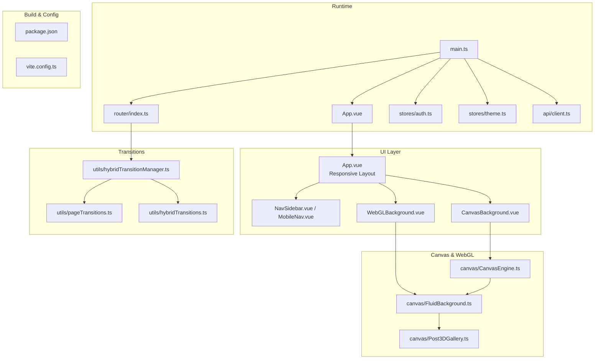
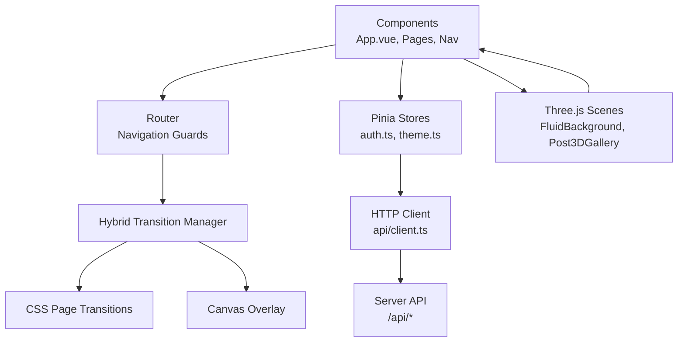
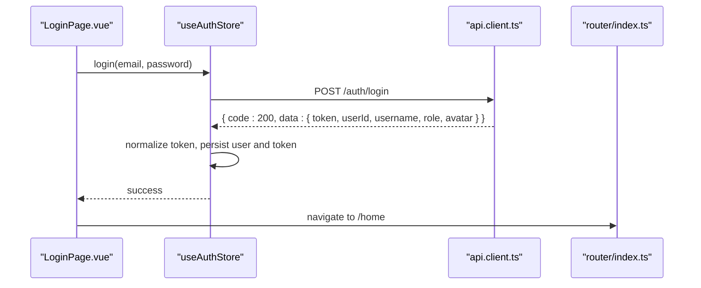
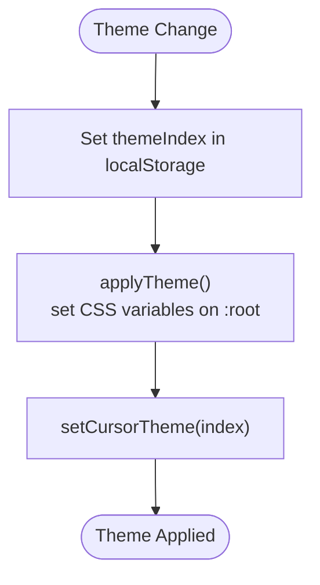
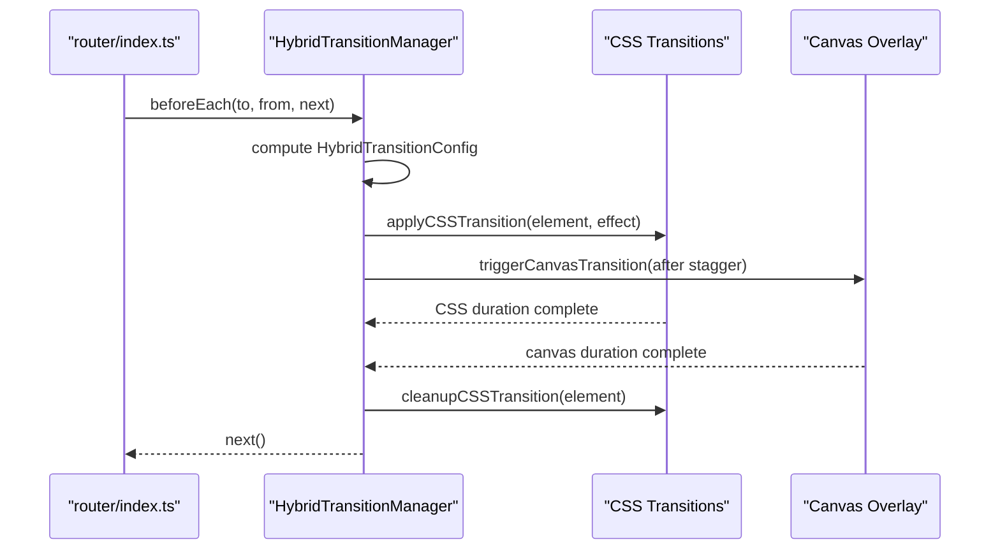
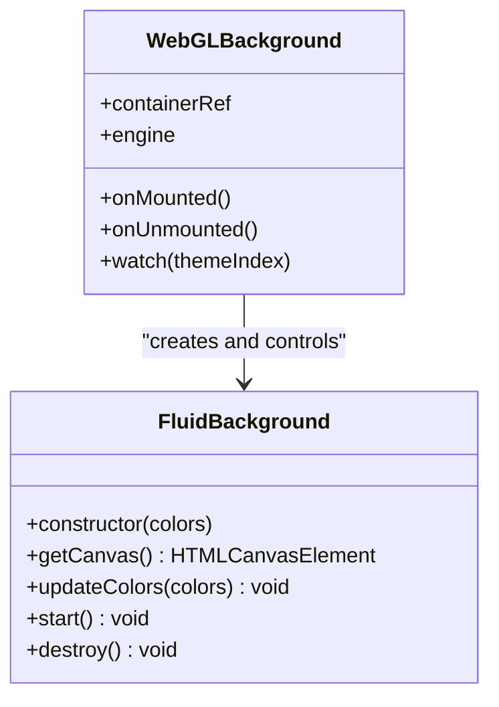
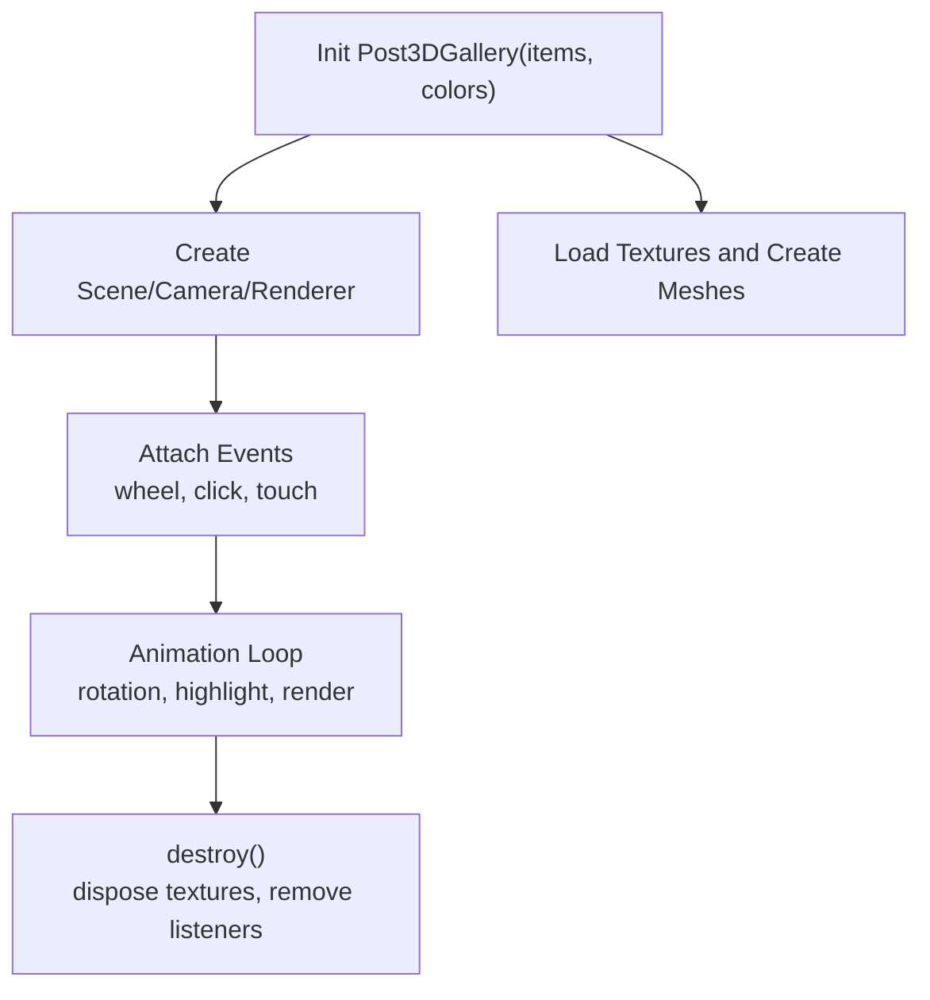
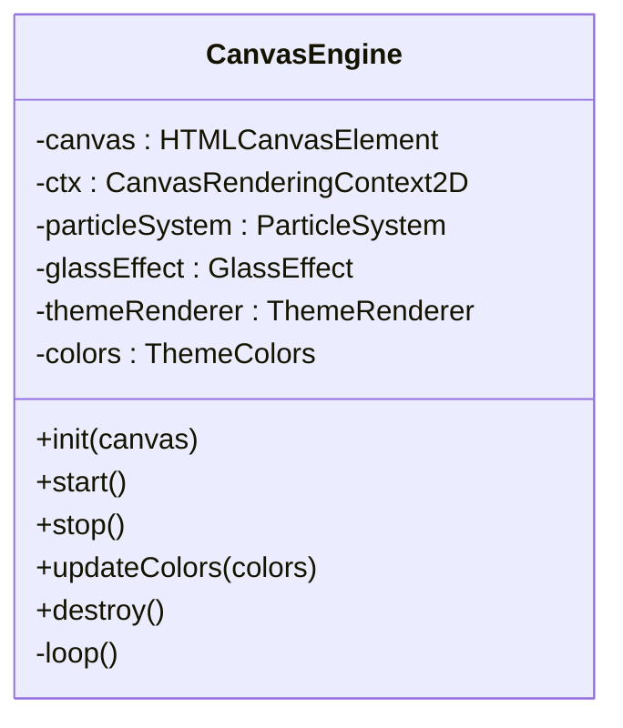
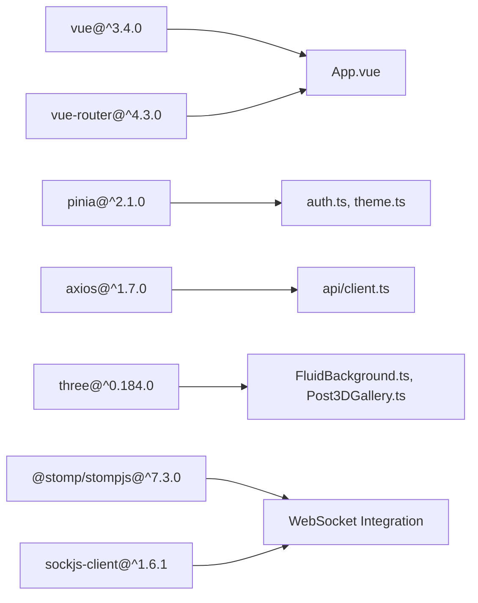

# Frontend Architecture - PC Web Client

<cite>
**Referenced Files in This Document**
- [main.ts](file://camp-channel-client-pc/src/main.ts)
- [App.vue](file://camp-channel-client-pc/src/App.vue)
- [router/index.ts](file://camp-channel-client-pc/src/router/index.ts)
- [stores/auth.ts](file://camp-channel-client-pc/src/stores/auth.ts)
- [stores/theme.ts](file://camp-channel-client-pc/src/stores/theme.ts)
- [api/client.ts](file://camp-channel-client-pc/src/api/client.ts)
- [package.json](file://camp-channel-client-pc/package.json)
- [vite.config.ts](file://camp-channel-client-pc/vite.config.ts)
- [utils/pageTransitions.ts](file://camp-channel-client-pc/src/utils/pageTransitions.ts)
- [utils/hybridTransitions.ts](file://camp-channel-client-pc/src/utils/hybridTransitions.ts)
- [utils/hybridTransitionManager.ts](file://camp-channel-client-pc/src/utils/hybridTransitionManager.ts)
- [components/WebGLBackground.vue](file://camp-channel-client-pc/src/components/WebGLBackground.vue)
- [components/CanvasBackground.vue](file://camp-channel-client-pc/src/components/CanvasBackground.vue)
- [canvas/CanvasEngine.ts](file://camp-channel-client-pc/src/canvas/CanvasEngine.ts)
- [canvas/FluidBackground.ts](file://camp-channel-client-pc/src/canvas/FluidBackground.ts)
- [canvas/Post3DGallery.ts](file://camp-channel-client-pc/src/canvas/Post3DGallery.ts)
</cite>

## Table of Contents
1. [Introduction](#introduction)
2. [Project Structure](#project-structure)
3. [Core Components](#core-components)
4. [Architecture Overview](#architecture-overview)
5. [Detailed Component Analysis](#detailed-component-analysis)
6. [Dependency Analysis](#dependency-analysis)
7. [Performance Considerations](#performance-considerations)
8. [Troubleshooting Guide](#troubleshooting-guide)
9. [Conclusion](#conclusion)
10. [Appendices](#appendices)

## Introduction
This document describes the modern single-page application (SPA) architecture for the PC web client built with Vue 3.4.0 and the Composition API. It covers component-based architecture, reactive state management via Pinia, routing and navigation, page transition effects, HTTP client configuration and authentication token management, build and deployment configuration, and the integration with canvas and WebGL effects. It also addresses performance, state synchronization, cross-browser compatibility, and best practices for reusability, styling consistency, and responsive design. Finally, it documents the integration with Three.js for 3D graphics and custom animation systems.

## Project Structure
The client is organized around a clear separation of concerns:
- Application bootstrap and plugin registration
- Root layout and responsive navigation
- Routing with guards and lazy-loaded pages
- Pinia stores for authentication and theme
- HTTP client with interceptors and token management
- Utilities for page transitions (CSS + Canvas hybrid)
- Canvas/WebGL engines for fluid backgrounds and interactive galleries
- Build configuration for development and production

**Diagram sources**
- [main.ts:1-19](file://camp-channel-client-pc/src/main.ts#L1-L19)
- [App.vue:1-85](file://camp-channel-client-pc/src/App.vue#L1-L85)
- [router/index.ts:1-46](file://camp-channel-client-pc/src/router/index.ts#L1-L46)
- [stores/auth.ts:1-61](file://camp-channel-client-pc/src/stores/auth.ts#L1-L61)
- [stores/theme.ts:1-295](file://camp-channel-client-pc/src/stores/theme.ts#L1-L295)
- [api/client.ts:1-35](file://camp-channel-client-pc/src/api/client.ts#L1-L35)
- [utils/pageTransitions.ts:1-205](file://camp-channel-client-pc/src/utils/pageTransitions.ts#L1-L205)
- [utils/hybridTransitions.ts:1-26](file://camp-channel-client-pc/src/utils/hybridTransitions.ts#L1-L26)
- [utils/hybridTransitionManager.ts:1-236](file://camp-channel-client-pc/src/utils/hybridTransitionManager.ts#L1-L236)
- [components/WebGLBackground.vue:1-56](file://camp-channel-client-pc/src/components/WebGLBackground.vue#L1-L56)
- [components/CanvasBackground.vue:1-68](file://camp-channel-client-pc/src/components/CanvasBackground.vue#L1-L68)
- [canvas/CanvasEngine.ts:1-103](file://camp-channel-client-pc/src/canvas/CanvasEngine.ts#L1-L103)
- [canvas/FluidBackground.ts:1-150](file://camp-channel-client-pc/src/canvas/FluidBackground.ts#L1-L150)
- [canvas/Post3DGallery.ts:1-285](file://camp-channel-client-pc/src/canvas/Post3DGallery.ts#L1-L285)
- [package.json:1-28](file://camp-channel-client-pc/package.json#L1-L28)
- [vite.config.ts:1-35](file://camp-channel-client-pc/vite.config.ts#L1-L35)

**Section sources**
- [main.ts:1-19](file://camp-channel-client-pc/src/main.ts#L1-L19)
- [App.vue:1-85](file://camp-channel-client-pc/src/App.vue#L1-L85)
- [router/index.ts:1-46](file://camp-channel-client-pc/src/router/index.ts#L1-L46)
- [stores/auth.ts:1-61](file://camp-channel-client-pc/src/stores/auth.ts#L1-L61)
- [stores/theme.ts:1-295](file://camp-channel-client-pc/src/stores/theme.ts#L1-L295)
- [api/client.ts:1-35](file://camp-channel-client-pc/src/api/client.ts#L1-L35)
- [package.json:1-28](file://camp-channel-client-pc/package.json#L1-L28)
- [vite.config.ts:1-35](file://camp-channel-client-pc/vite.config.ts#L1-L35)

## Core Components
- Application bootstrap initializes Vue, Pinia, and Vue Router, then sets up global cursor and hybrid transition effects.
- Root layout conditionally renders either a full layout with desktop sidebar and mobile navigation, or an auth-only wrapper depending on route path.
- Router defines routes with lazy loading and guards for authentication and redirection.
- Pinia stores manage authentication state and persisted user info, and theme selection with dynamic CSS variables.
- HTTP client centralizes base URL, request headers, and response handling including automatic 401 logout.
- Transition utilities coordinate theme-aware CSS page transitions with Canvas/WebGL overlays.
- Canvas/WebGL engines provide fluid backgrounds and interactive 3D galleries with mouse/touch interactivity.

**Section sources**
- [main.ts:1-19](file://camp-channel-client-pc/src/main.ts#L1-L19)
- [App.vue:16-51](file://camp-channel-client-pc/src/App.vue#L16-L51)
- [router/index.ts:4-46](file://camp-channel-client-pc/src/router/index.ts#L4-L46)
- [stores/auth.ts:6-60](file://camp-channel-client-pc/src/stores/auth.ts#L6-L60)
- [stores/theme.ts:261-294](file://camp-channel-client-pc/src/stores/theme.ts#L261-L294)
- [api/client.ts:4-35](file://camp-channel-client-pc/src/api/client.ts#L4-L35)
- [utils/hybridTransitionManager.ts:10-76](file://camp-channel-client-pc/src/utils/hybridTransitionManager.ts#L10-L76)

## Architecture Overview
The SPA follows a layered architecture:
- Presentation layer: Vue components and router-driven page rendering
- State layer: Pinia stores for auth and theme
- Services layer: Axios-based HTTP client with interceptors
- Effects layer: CSS transitions and hybrid Canvas/WebGL animations
- Rendering layer: Three.js for 3D scenes and shader-based fluid backgrounds

**Diagram sources**
- [App.vue:1-85](file://camp-channel-client-pc/src/App.vue#L1-L85)
- [router/index.ts:34-43](file://camp-channel-client-pc/src/router/index.ts#L34-L43)
- [utils/hybridTransitionManager.ts:18-76](file://camp-channel-client-pc/src/utils/hybridTransitionManager.ts#L18-L76)
- [utils/pageTransitions.ts:15-205](file://camp-channel-client-pc/src/utils/pageTransitions.ts#L15-L205)
- [stores/auth.ts:14-37](file://camp-channel-client-pc/src/stores/auth.ts#L14-L37)
- [api/client.ts:10-32](file://camp-channel-client-pc/src/api/client.ts#L10-L32)
- [canvas/FluidBackground.ts:18-149](file://camp-channel-client-pc/src/canvas/FluidBackground.ts#L18-L149)
- [canvas/Post3DGallery.ts:32-284](file://camp-channel-client-pc/src/canvas/Post3DGallery.ts#L32-L284)

## Detailed Component Analysis

### Authentication Store and Token Management
The authentication store encapsulates login, registration, logout, and persistence. It integrates with the HTTP client to attach Authorization headers and handles 401 responses by clearing stored tokens and redirecting to login.

**Diagram sources**
- [stores/auth.ts:14-37](file://camp-channel-client-pc/src/stores/auth.ts#L14-L37)
- [api/client.ts:10-16](file://camp-channel-client-pc/src/api/client.ts#L10-L16)
- [router/index.ts:34-43](file://camp-channel-client-pc/src/router/index.ts#L34-L43)

**Section sources**
- [stores/auth.ts:6-60](file://camp-channel-client-pc/src/stores/auth.ts#L6-L60)
- [api/client.ts:10-32](file://camp-channel-client-pc/src/api/client.ts#L10-L32)
- [router/index.ts:34-43](file://camp-channel-client-pc/src/router/index.ts#L34-L43)

### Theme Store and Dynamic CSS Variables
The theme store manages a curated palette of themes and applies them by setting CSS variables on the root element. It persists the selected theme index and updates cursor effects.

**Diagram sources**
- [stores/theme.ts:268-291](file://camp-channel-client-pc/src/stores/theme.ts#L268-L291)

**Section sources**
- [stores/theme.ts:261-294](file://camp-channel-client-pc/src/stores/theme.ts#L261-L294)

### Page Transition System (CSS + Canvas Hybrid)
The hybrid transition manager coordinates CSS page transitions with Canvas/WebGL overlays. It computes a transition configuration per theme, applies CSS transforms/filters, triggers canvas effects after a stagger delay, and cleans up after completion.

**Diagram sources**
- [utils/hybridTransitionManager.ts:18-76](file://camp-channel-client-pc/src/utils/hybridTransitionManager.ts#L18-L76)
- [utils/hybridTransitions.ts:16-25](file://camp-channel-client-pc/src/utils/hybridTransitions.ts#L16-L25)
- [utils/pageTransitions.ts:202-204](file://camp-channel-client-pc/src/utils/pageTransitions.ts#L202-L204)

**Section sources**
- [utils/hybridTransitionManager.ts:10-236](file://camp-channel-client-pc/src/utils/hybridTransitionManager.ts#L10-L236)
- [utils/hybridTransitions.ts:1-26](file://camp-channel-client-pc/src/utils/hybridTransitions.ts#L1-L26)
- [utils/pageTransitions.ts:6-205](file://camp-channel-client-pc/src/utils/pageTransitions.ts#L6-L205)

### WebGL Background Engine
The WebGL background component initializes a Three.js shader-based fluid background, updates colors based on theme, and gracefully falls back to a CSS background if initialization fails.

**Diagram sources**
- [canvas/FluidBackground.ts:9-149](file://camp-channel-client-pc/src/canvas/FluidBackground.ts#L9-L149)
- [components/WebGLBackground.vue:19-42](file://camp-channel-client-pc/src/components/WebGLBackground.vue#L19-L42)

**Section sources**
- [components/WebGLBackground.vue:1-56](file://camp-channel-client-pc/src/components/WebGLBackground.vue#L1-L56)
- [canvas/FluidBackground.ts:18-149](file://camp-channel-client-pc/src/canvas/FluidBackground.ts#L18-L149)

### 3D Post Gallery with Three.js
The 3D gallery renders a ring of textured planes in a 3D scene, supports mouse wheel and touch gestures, and highlights the selected item. It updates materials dynamically and cleans up event listeners and resources.

**Diagram sources**
- [canvas/Post3DGallery.ts:32-284](file://camp-channel-client-pc/src/canvas/Post3DGallery.ts#L32-L284)

**Section sources**
- [canvas/Post3DGallery.ts:11-285](file://camp-channel-client-pc/src/canvas/Post3DGallery.ts#L11-L285)

### Canvas Engine (2D Particles and Glass Effect)
The CanvasEngine composes a theme renderer, glass effect, and particle system. It handles resize/mouse events, updates colors, and runs the animation loop.

**Diagram sources**
- [canvas/CanvasEngine.ts:19-102](file://camp-channel-client-pc/src/canvas/CanvasEngine.ts#L19-L102)

**Section sources**
- [canvas/CanvasEngine.ts:19-103](file://camp-channel-client-pc/src/canvas/CanvasEngine.ts#L19-L103)

## Dependency Analysis
External libraries and their roles:
- Vue 3.4.0 and Vue Router for SPA navigation
- Pinia for reactive state management
- Axios for HTTP requests with interceptors
- Three.js for WebGL 3D rendering
- STOMP/SockJS for WebSocket messaging

**Diagram sources**
- [package.json:10-26](file://camp-channel-client-pc/package.json#L10-L26)

**Section sources**
- [package.json:10-26](file://camp-channel-client-pc/package.json#L10-L26)

## Performance Considerations
- Animation loops: Use requestAnimationFrame consistently and cancel on destroy to prevent memory leaks.
- Event listeners: Always remove listeners in onUnmounted or destroy hooks.
- Resize handling: Debounce or coalesce resize handlers; limit heavy recalculations.
- WebGL pixel ratio: Cap devicePixelRatio to avoid excessive resolution on high-DPI displays.
- Lazy loading: Routes are lazy-loaded to reduce initial bundle size.
- Proxy and CORS: Configure Vite proxy to avoid preflight overhead and cross-origin issues during development.
- CSS vs Canvas: Prefer CSS transitions for simple effects; reserve Canvas/WebGL for intensive, interactive scenarios.

[No sources needed since this section provides general guidance]

## Troubleshooting Guide
Common issues and resolutions:
- Authentication redirects on 401: The HTTP interceptor clears tokens and navigates to login automatically. Verify token presence and header injection.
- Navigation guards blocking routes: Ensure tokens exist for protected routes and that login state is persisted.
- WebGL initialization failures: The background component falls back to a CSS background; check console for errors and verify WebGL support.
- Transition conflicts: The hybrid manager prevents concurrent animations; ensure router exposes itself globally for transition coordination.
- Build proxy misconfiguration: Confirm Vite proxy targets the correct backend origin and enables WebSocket upgrades when needed.

**Section sources**
- [api/client.ts:18-32](file://camp-channel-client-pc/src/api/client.ts#L18-L32)
- [router/index.ts:34-43](file://camp-channel-client-pc/src/router/index.ts#L34-L43)
- [components/WebGLBackground.vue:28-33](file://camp-channel-client-pc/src/components/WebGLBackground.vue#L28-L33)
- [utils/hybridTransitionManager.ts:18-23](file://camp-channel-client-pc/src/utils/hybridTransitionManager.ts#L18-L23)
- [vite.config.ts:19-33](file://camp-channel-client-pc/vite.config.ts#L19-L33)

## Conclusion
The PC web client leverages Vue 3’s Composition API, Pinia for state, and a robust routing system with guards to deliver a modern SPA. The hybrid transition system blends CSS and Canvas/WebGL for immersive page changes, while Three.js powers advanced 3D experiences. The HTTP client centralizes authentication and error handling, and the build configuration streamlines development and deployment. Following the best practices outlined here ensures maintainability, performance, and a consistent user experience.

[No sources needed since this section summarizes without analyzing specific files]

## Appendices

### Build and Deployment Configuration
- Scripts: dev, build, preview
- Aliases: @ -> src
- Dev server: host 0.0.0.0, port 3000
- Proxy: /api, /uploads, /ws to backend origin
- Global define: polyfill globalThis

**Section sources**
- [package.json:5-8](file://camp-channel-client-pc/package.json#L5-L8)
- [vite.config.ts:5-35](file://camp-channel-client-pc/vite.config.ts#L5-L35)

### API Integration Patterns
- Centralized client with base URL and JSON headers
- Request interceptor attaches Authorization header
- Response interceptor handles 401 by clearing tokens and redirecting

**Section sources**
- [api/client.ts:4-35](file://camp-channel-client-pc/src/api/client.ts#L4-L35)

### Navigation and Routing Patterns
- Hash history with beforeEach guards
- Redirects for login/home and device management aliases
- Protected routes via meta.requiresAuth and optional admin checks

**Section sources**
- [router/index.ts:25-43](file://camp-channel-client-pc/src/router/index.ts#L25-L43)

### State Synchronization and Persistence
- Auth store persists token and user in localStorage
- Theme store persists themeIndex and applies CSS variables
- App loads persisted auth state on mount

**Section sources**
- [stores/auth.ts:52-57](file://camp-channel-client-pc/src/stores/auth.ts#L52-L57)
- [stores/theme.ts:262-276](file://camp-channel-client-pc/src/stores/theme.ts#L262-L276)
- [App.vue:33-35](file://camp-channel-client-pc/src/App.vue#L33-L35)

### Responsive Design and Layout
- Media queries detect mobile viewport and toggle navigation
- Main content margins and paddings adapt for mobile
- Fixed-position background layers with z-index management

**Section sources**
- [App.vue:30-51](file://camp-channel-client-pc/src/App.vue#L30-L51)

### Cross-Browser Compatibility
- Three.js shaders and WebGL features require modern browsers; graceful fallbacks are present
- CSS variables applied by theme store ensure consistent styling across compatible browsers
- Vite polyfills globalThis for broader compatibility

**Section sources**
- [stores/theme.ts:278-291](file://camp-channel-client-pc/src/stores/theme.ts#L278-L291)
- [vite.config.ts:6-8](file://camp-channel-client-pc/vite.config.ts#L6-L8)

### Best Practices
- Component reusability: Extract shared UI into reusable components (e.g., cards, overlays)
- Styling consistency: Use CSS variables from theme store for colors and gradients
- Responsive design: Leverage media queries and safe-area insets for mobile layouts
- Performance: Avoid unnecessary reflows, cancel animation frames, and dispose resources

[No sources needed since this section provides general guidance]