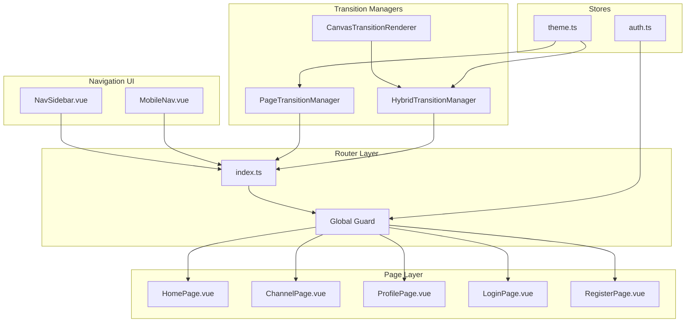
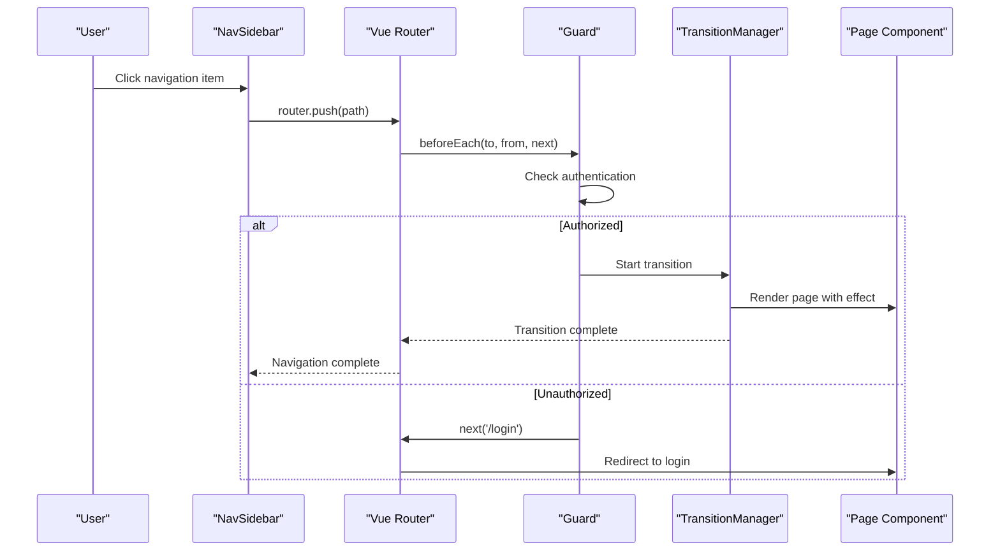
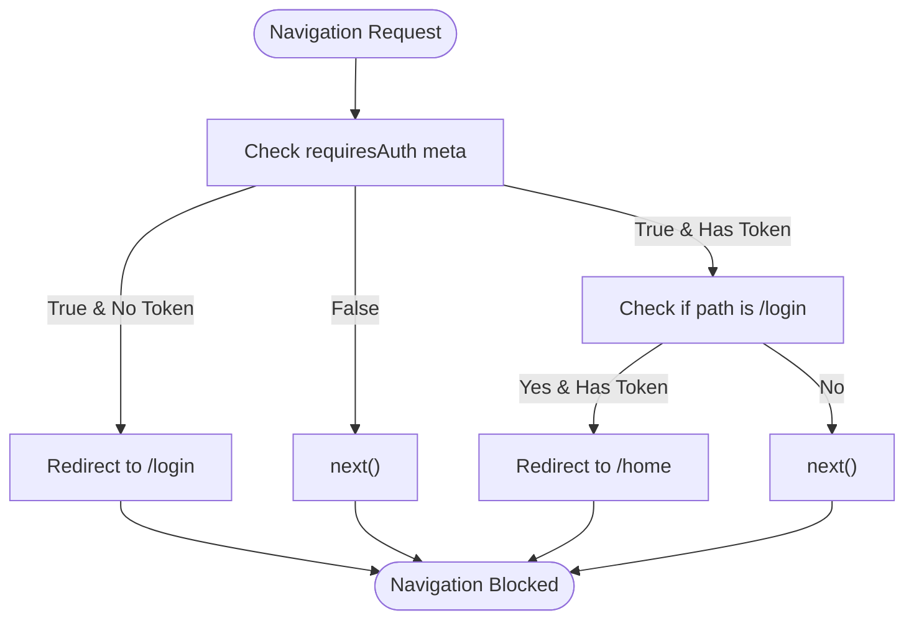
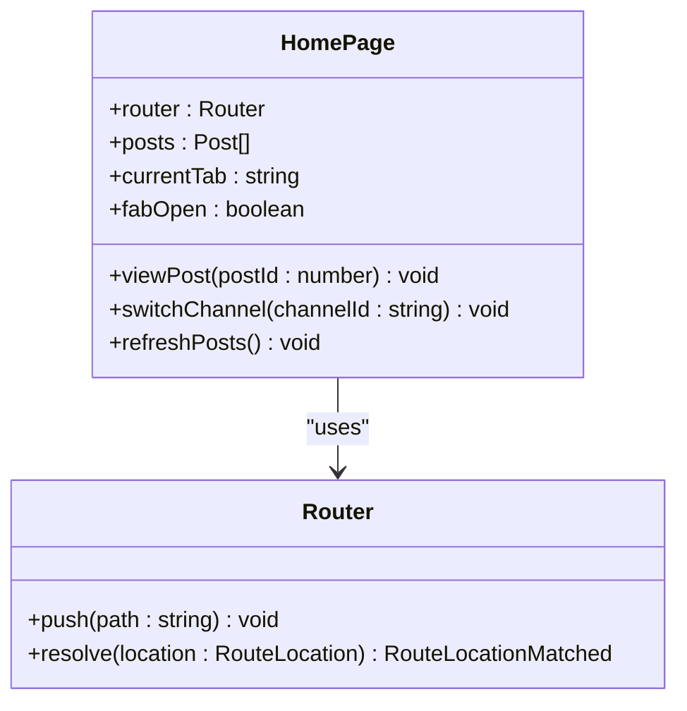
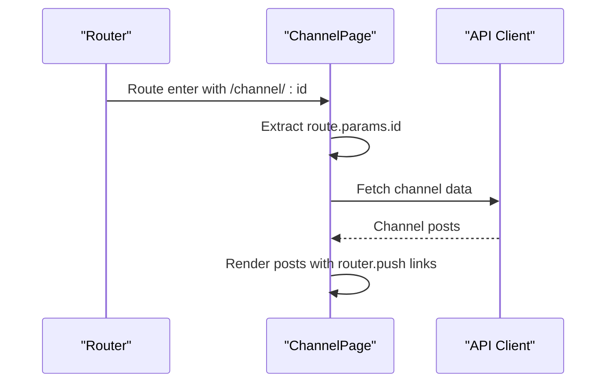
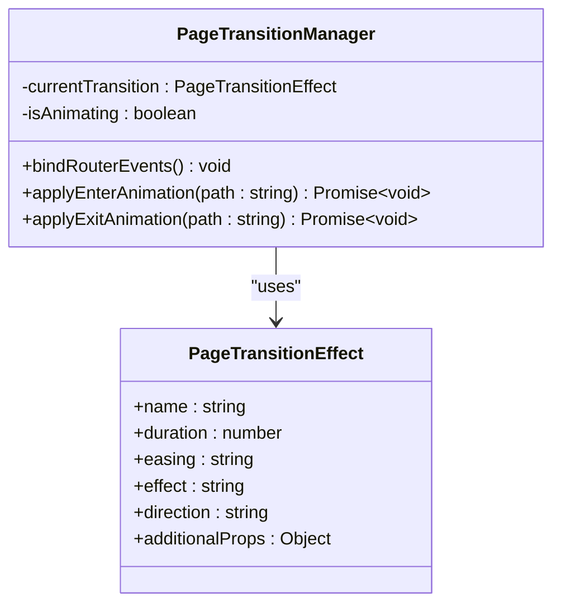
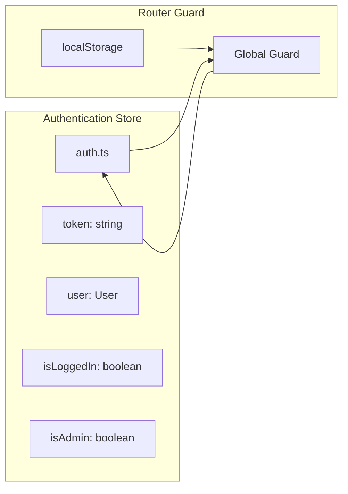
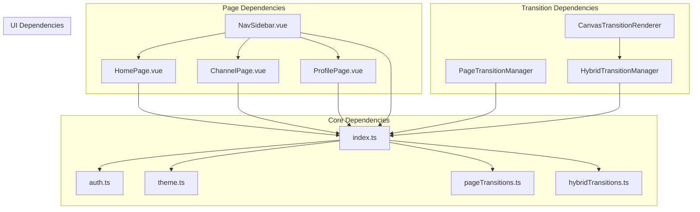

# Routing and Navigation System

<cite>
**Referenced Files in This Document**
- [index.ts](file://camp-channel-client-pc/src/router/index.ts)
- [main.ts](file://camp-channel-client-pc/src/main.ts)
- [auth.ts](file://camp-channel-client-pc/src/stores/auth.ts)
- [App.vue](file://camp-channel-client-pc/src/App.vue)
- [HomePage.vue](file://camp-channel-client-pc/src/pages/HomePage.vue)
- [ChannelPage.vue](file://camp-channel-client-pc/src/pages/ChannelPage.vue)
- [ProfilePage.vue](file://camp-channel-client-pc/src/pages/ProfilePage.vue)
- [NavSidebar.vue](file://camp-channel-client-pc/src/components/NavSidebar.vue)
- [pageTransitionManager.ts](file://camp-channel-client-pc/src/utils/pageTransitionManager.ts)
- [hybridTransitionManager.ts](file://camp-channel-client-pc/src/utils/hybridTransitionManager.ts)
- [pageTransitions.ts](file://camp-channel-client-pc/src/utils/pageTransitions.ts)
- [hybridTransitions.ts](file://camp-channel-client-pc/src/utils/hybridTransitions.ts)
- [canvasTransitionRenderer.ts](file://camp-channel-client-pc/src/utils/canvasTransitionRenderer.ts)
- [canvasTransitions.ts](file://camp-channel-client-pc/src/utils/canvasTransitions.ts)
- [theme.ts](file://camp-channel-client-pc/src/stores/theme.ts)
</cite>

## Table of Contents
1. [Introduction](#introduction)
2. [Project Structure](#project-structure)
3. [Core Components](#core-components)
4. [Architecture Overview](#architecture-overview)
5. [Detailed Component Analysis](#detailed-component-analysis)
6. [Dependency Analysis](#dependency-analysis)
7. [Performance Considerations](#performance-considerations)
8. [Troubleshooting Guide](#troubleshooting-guide)
9. [Conclusion](#conclusion)

## Introduction
This document provides comprehensive documentation for the Vue Router implementation and navigation system used in the PC client application. It covers routing configuration, route guards, page-based architecture with dedicated components for major features, programmatic navigation patterns, route parameters and query handling, authentication integration, and advanced page transition effects. The system leverages lazy-loaded route components, global navigation guards, and a sophisticated hybrid transition manager that combines CSS animations with HTML-in-Canvas effects for immersive navigation experiences.

## Project Structure
The routing system is organized around a centralized router configuration that defines all application routes, guarded by a global navigation guard. Pages are structured as dedicated Vue components under the pages directory, while navigation UI is provided by sidebar and mobile navigation components. Transitions are managed through separate managers that coordinate CSS and Canvas effects based on the selected theme.

**Diagram sources**
- [index.ts:1-46](file://camp-channel-client-pc/src/router/index.ts#L1-L46)
- [App.vue:1-85](file://camp-channel-client-pc/src/App.vue#L1-L85)
- [NavSidebar.vue:1-213](file://camp-channel-client-pc/src/components/NavSidebar.vue#L1-L213)
- [pageTransitionManager.ts:1-332](file://camp-channel-client-pc/src/utils/pageTransitionManager.ts#L1-L332)
- [hybridTransitionManager.ts:1-236](file://camp-channel-client-pc/src/utils/hybridTransitionManager.ts#L1-L236)
- [canvasTransitionRenderer.ts:1-665](file://camp-channel-client-pc/src/utils/canvasTransitionRenderer.ts#L1-L665)
- [auth.ts:1-61](file://camp-channel-client-pc/src/stores/auth.ts#L1-L61)
- [theme.ts:1-295](file://camp-channel-client-pc/src/stores/theme.ts#L1-L295)

**Section sources**
- [index.ts:1-46](file://camp-channel-client-pc/src/router/index.ts#L1-L46)
- [main.ts:1-19](file://camp-channel-client-pc/src/main.ts#L1-L19)

## Core Components
The routing system consists of several interconnected components working together to provide seamless navigation:

### Router Configuration
The central router configuration defines all application routes with lazy-loaded components and metadata for authentication requirements. Routes are organized by feature areas including authentication, home feed, channels, posts, messaging, social features, and administrative functions.

### Navigation Guards
A global beforeEach guard enforces authentication policies by checking for stored tokens and redirecting unauthorized users appropriately. The guard also handles automatic redirection from login to home when users are already authenticated.

### Page-Based Architecture
Each major feature area has a dedicated page component that encapsulates specific functionality, route parameters, and navigation patterns. Pages utilize Vue Router's composables for programmatic navigation and route parameter extraction.

### Transition Management
Two complementary transition managers coordinate page navigation effects: a CSS-based manager for smooth transitions and a hybrid manager that adds HTML-in-Canvas effects for enhanced visual impact.

**Section sources**
- [index.ts:4-23](file://camp-channel-client-pc/src/router/index.ts#L4-L23)
- [index.ts:34-43](file://camp-channel-client-pc/src/router/index.ts#L34-L43)
- [App.vue:48-51](file://camp-channel-client-pc/src/App.vue#L48-L51)

## Architecture Overview
The navigation system follows a layered architecture with clear separation of concerns between routing, authentication, page presentation, and visual effects.

**Diagram sources**
- [NavSidebar.vue:10-10](file://camp-channel-client-pc/src/components/NavSidebar.vue#L10-L10)
- [index.ts:34-43](file://camp-channel-client-pc/src/router/index.ts#L34-L43)
- [pageTransitionManager.ts:17-48](file://camp-channel-client-pc/src/utils/pageTransitionManager.ts#L17-L48)

The architecture integrates three key systems:
- **Routing Layer**: Centralized route definitions with lazy loading
- **Authentication Layer**: Token-based authentication with role checks
- **Presentation Layer**: Theme-aware transitions with CSS and Canvas effects

## Detailed Component Analysis

### Router Configuration and Route Definitions
The router configuration establishes the application's navigation structure with 17 distinct routes covering all major features. Each route definition includes:

- **Path patterns**: Static and dynamic paths supporting route parameters
- **Lazy-loaded components**: Dynamic imports for optimal bundle splitting
- **Meta information**: Authentication requirements and role-based access control
- **Redirects**: Simplified navigation for common paths

Key route categories include:
- **Authentication routes**: Login and registration with no layout wrapper
- **Protected routes**: Home feed, channels, posts, messaging, and profile
- **Administrative routes**: Admin panel with role-based restrictions
- **Utility routes**: Settings, device management, and search functionality

**Section sources**
- [index.ts:4-23](file://camp-channel-client-pc/src/router/index.ts#L4-L23)

### Global Navigation Guard Implementation
The global beforeEach guard implements comprehensive authentication and authorization logic:

**Diagram sources**
- [index.ts:34-43](file://camp-channel-client-pc/src/router/index.ts#L34-L43)

The guard ensures:
- Unauthenticated users cannot access protected routes
- Authenticated users are redirected away from login/register pages
- Automatic token validation using localStorage persistence

**Section sources**
- [index.ts:34-43](file://camp-channel-client-pc/src/router/index.ts#L34-L43)

### Page-Based Architecture Components

#### HomePage Component
The HomePage serves as the primary content hub with integrated navigation patterns:

**Diagram sources**
- [HomePage.vue:99-107](file://camp-channel-client-pc/src/pages/HomePage.vue#L99-L107)
- [HomePage.vue:264-266](file://camp-channel-client-pc/src/pages/HomePage.vue#L264-L266)

Key navigation patterns include:
- Programmatic navigation using `router.push()` for post detail views
- Route parameter handling for channel switching
- Floating action buttons triggering navigation to creation pages

**Section sources**
- [HomePage.vue:66-67](file://camp-channel-client-pc/src/pages/HomePage.vue#L66-L67)
- [HomePage.vue:257-266](file://camp-channel-client-pc/src/pages/HomePage.vue#L257-L266)

#### ChannelPage Component
ChannelPage demonstrates route parameter extraction and dynamic content loading:

**Diagram sources**
- [ChannelPage.vue:64-70](file://camp-channel-client-pc/src/pages/ChannelPage.vue#L64-L70)
- [ChannelPage.vue:81-93](file://camp-channel-client-pc/src/pages/ChannelPage.vue#L81-L93)

**Section sources**
- [ChannelPage.vue:81-93](file://camp-channel-client-pc/src/pages/ChannelPage.vue#L81-L93)
- [ChannelPage.vue:45-45](file://camp-channel-client-pc/src/pages/ChannelPage.vue#L45-L45)

#### ProfilePage Component
ProfilePage showcases user-centric navigation patterns and logout functionality:

**Section sources**
- [ProfilePage.vue:104-104](file://camp-channel-client-pc/src/pages/ProfilePage.vue#L104-L104)
- [ProfilePage.vue:65-65](file://camp-channel-client-pc/src/pages/ProfilePage.vue#L65-L65)

### Navigation UI Components

#### Sidebar Navigation
The NavSidebar component provides centralized navigation with active state management and badge indicators:

**Section sources**
- [NavSidebar.vue:10-10](file://camp-channel-client-pc/src/components/NavSidebar.vue#L10-L10)
- [NavSidebar.vue:121-128](file://camp-channel-client-pc/src/components/NavSidebar.vue#L121-L128)

#### Layout Management
The App component manages layout rendering based on route paths, applying different layouts for authentication versus application pages.

**Section sources**
- [App.vue:48-51](file://camp-channel-client-pc/src/App.vue#L48-L51)

### Transition System Architecture

#### Page Transition Manager
The PageTransitionManager coordinates theme-aware CSS transitions during navigation:

**Diagram sources**
- [pageTransitionManager.ts:9-15](file://camp-channel-client-pc/src/utils/pageTransitionManager.ts#L9-L15)
- [pageTransitions.ts:6-13](file://camp-channel-client-pc/src/utils/pageTransitions.ts#L6-L13)

**Section sources**
- [pageTransitionManager.ts:17-48](file://camp-channel-client-pc/src/utils/pageTransitionManager.ts#L17-L48)
- [pageTransitions.ts:202-204](file://camp-channel-client-pc/src/utils/pageTransitions.ts#L202-L204)

#### Hybrid Transition Manager
The HybridTransitionManager combines CSS transitions with HTML-in-Canvas effects for enhanced visual impact:

**Section sources**
- [hybridTransitionManager.ts:18-46](file://camp-channel-client-pc/src/utils/hybridTransitionManager.ts#L18-L46)
- [hybridTransitions.ts:16-25](file://camp-channel-client-pc/src/utils/hybridTransitions.ts#L16-L25)

#### Canvas Transition Renderer
The CanvasTransitionRenderer provides HTML-in-Canvas effects synchronized with CSS transitions:

**Section sources**
- [canvasTransitionRenderer.ts:64-88](file://camp-channel-client-pc/src/utils/canvasTransitionRenderer.ts#L64-L88)
- [canvasTransitions.ts:242-244](file://camp-channel-client-pc/src/utils/canvasTransitions.ts#L242-L244)

### Authentication Integration
The routing system integrates tightly with the authentication store for seamless user experience:

**Diagram sources**
- [auth.ts:6-12](file://camp-channel-client-pc/src/stores/auth.ts#L6-L12)
- [index.ts:34-43](file://camp-channel-client-pc/src/router/index.ts#L34-L43)

**Section sources**
- [auth.ts:6-12](file://camp-channel-client-pc/src/stores/auth.ts#L6-L12)
- [index.ts:34-43](file://camp-channel-client-pc/src/router/index.ts#L34-L43)

## Dependency Analysis
The routing system exhibits clear dependency relationships with minimal coupling between components:

**Diagram sources**
- [index.ts:1-3](file://camp-channel-client-pc/src/router/index.ts#L1-L3)
- [pageTransitionManager.ts:6-7](file://camp-channel-client-pc/src/utils/pageTransitionManager.ts#L6-L7)
- [hybridTransitionManager.ts:6-8](file://camp-channel-client-pc/src/utils/hybridTransitionManager.ts#L6-L8)

The dependency analysis reveals:
- **Router-to-store coupling**: Minimal, only accessing authentication state for guard logic
- **Page-to-router coupling**: Direct but controlled via Vue Router composables
- **Transition-to-theme coupling**: Explicit and intentional for coordinated visual effects
- **UI-to-navigation coupling**: Through programmatic navigation calls

**Section sources**
- [index.ts:1-3](file://camp-channel-client-pc/src/router/index.ts#L1-L3)
- [pageTransitionManager.ts:6-7](file://camp-channel-client-pc/src/utils/pageTransitionManager.ts#L6-L7)

## Performance Considerations
The navigation system implements several performance optimization strategies:

### Lazy Loading Implementation
Routes utilize dynamic imports for component lazy loading, reducing initial bundle size and improving startup performance. Each page component is loaded only when its route is accessed.

### Transition Performance
- **CSS transitions**: Hardware-accelerated animations using transform and opacity properties
- **Canvas effects**: Optimized particle systems with requestAnimationFrame coordination
- **Theme-based optimization**: Predefined transition configurations prevent runtime calculation overhead

### Memory Management
- **Singleton pattern**: Transition managers are singletons preventing memory leaks
- **Animation cleanup**: Proper cleanup of canvas contexts and animation frames
- **Store persistence**: Efficient localStorage usage for authentication state

### Navigation Optimization
- **Guard caching**: Authentication checks avoid repeated API calls
- **Route reuse**: Vue Router's built-in component caching for frequently visited pages
- **Event delegation**: Navigation events use efficient event delegation patterns

## Troubleshooting Guide

### Common Navigation Issues
**Authentication Redirect Loops**
- Verify localStorage token presence and validity
- Check guard logic for conflicting redirect conditions
- Ensure proper token stripping of "Bearer " prefixes

**Route Parameter Access Problems**
- Confirm route parameter names match route definitions
- Verify useRoute composable usage in page components
- Check for parameter type conversion requirements

**Transition Animation Issues**
- Validate theme index consistency between stores and transition managers
- Check canvas element initialization and cleanup
- Verify CSS transition property compatibility

### Debugging Strategies
1. **Enable Vue DevTools** to inspect router state and component lifecycle
2. **Monitor localStorage** for token persistence across sessions
3. **Check browser console** for transition manager warnings
4. **Validate route guards** using browser developer tools network tab

**Section sources**
- [index.ts:34-43](file://camp-channel-client-pc/src/router/index.ts#L34-L43)
- [pageTransitionManager.ts:19-23](file://camp-channel-client-pc/src/utils/pageTransitionManager.ts#L19-L23)

## Conclusion
The Vue Router implementation demonstrates a well-architected navigation system that balances functionality, performance, and user experience. Key strengths include comprehensive route coverage with lazy loading, robust authentication integration, and sophisticated transition effects. The modular design enables easy maintenance and extension while maintaining optimal performance through strategic optimizations. The system successfully coordinates multiple navigation patterns, from simple programmatic navigation to complex hybrid transition sequences, providing a cohesive user experience across all application features.