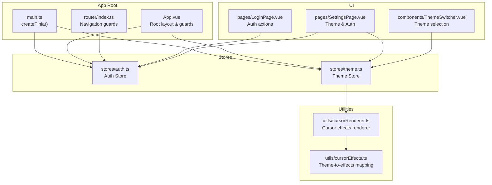
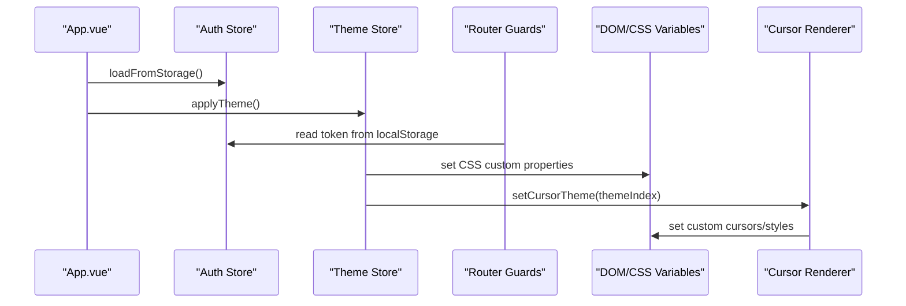
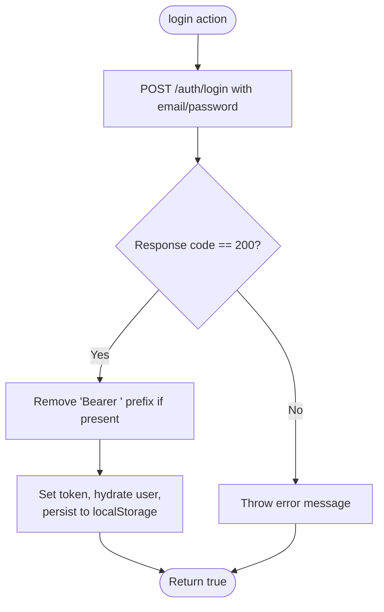
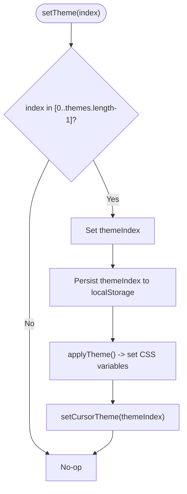
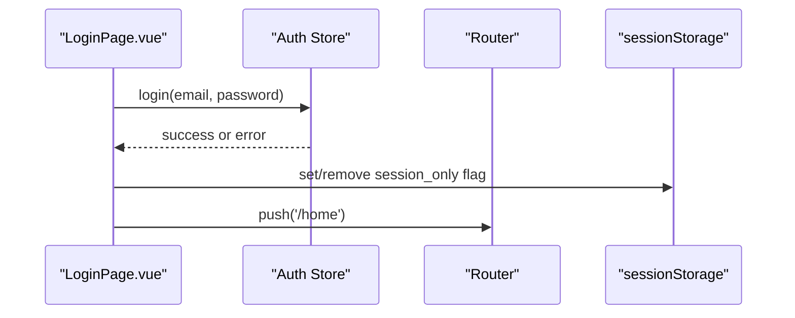
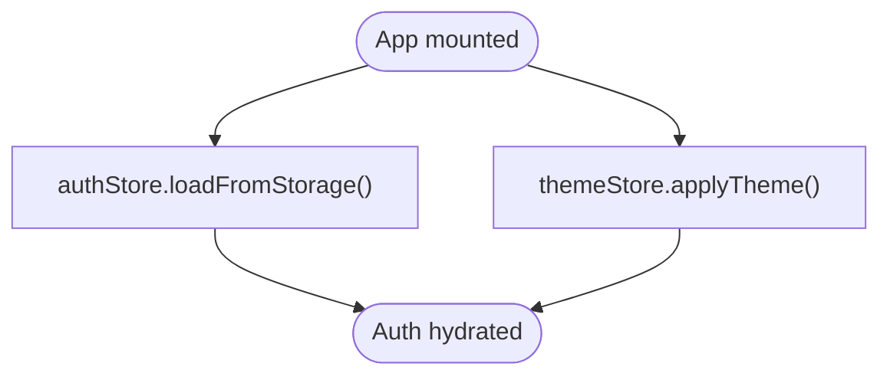
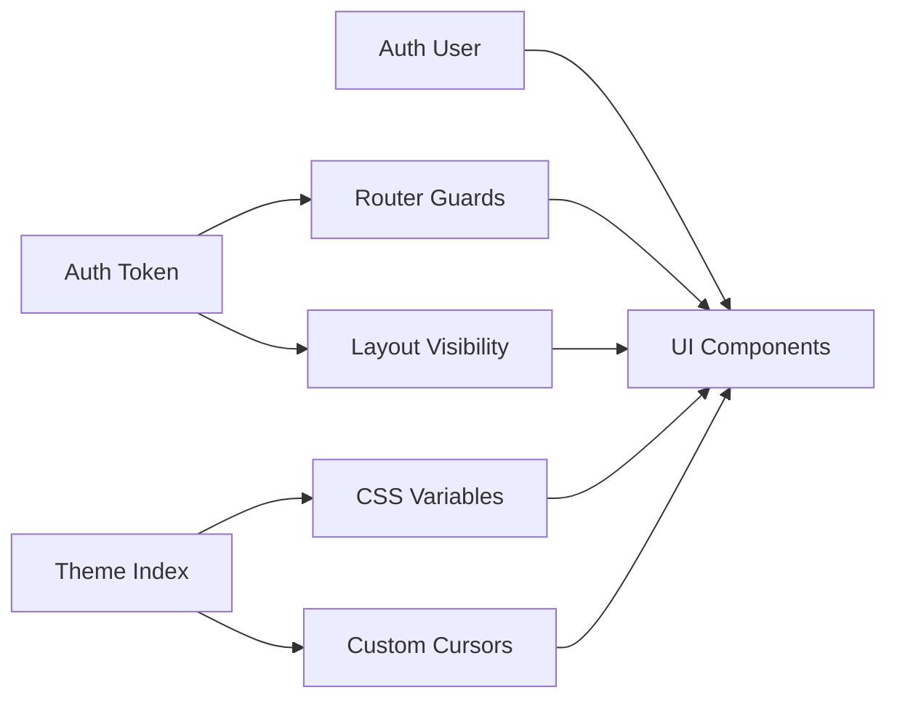
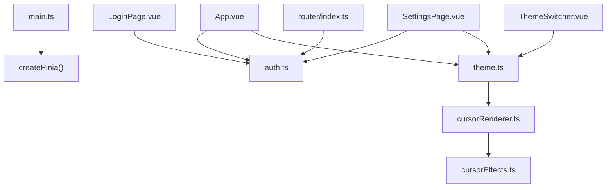

# State Management with Pinia

<cite>
**Referenced Files in This Document**
- [auth.ts](file://camp-channel-client-pc/src/stores/auth.ts)
- [theme.ts](file://camp-channel-client-pc/src/stores/theme.ts)
- [main.ts](file://camp-channel-client-pc/src/main.ts)
- [App.vue](file://camp-channel-client-pc/src/App.vue)
- [ThemeSwitcher.vue](file://camp-channel-client-pc/src/components/ThemeSwitcher.vue)
- [LoginPage.vue](file://camp-channel-client-pc/src/pages/LoginPage.vue)
- [SettingsPage.vue](file://camp-channel-client-pc/src/pages/SettingsPage.vue)
- [cursorRenderer.ts](file://camp-channel-client-pc/src/utils/cursorRenderer.ts)
- [cursorEffects.ts](file://camp-channel-client-pc/src/utils/cursorEffects.ts)
- [index.ts](file://camp-channel-client-pc/src/router/index.ts)
</cite>

## Table of Contents
1. [Introduction](#introduction)
2. [Project Structure](#project-structure)
3. [Core Components](#core-components)
4. [Architecture Overview](#architecture-overview)
5. [Detailed Component Analysis](#detailed-component-analysis)
6. [Dependency Analysis](#dependency-analysis)
7. [Performance Considerations](#performance-considerations)
8. [Troubleshooting Guide](#troubleshooting-guide)
9. [Conclusion](#conclusion)
10. [Appendices](#appendices)

## Introduction
This document explains the Pinia state management implementation for the PC client. It focuses on two stores:
- Auth store: manages user authentication state, session persistence, and user metadata.
- Theme store: manages UI theme selection, CSS custom property application, and cursor effects synchronized with theme choices.

It documents store actions, getters, and state mutations, integrates stores with Vue components using the Composition API, and explains state persistence, hydration, and cross-component synchronization. It also covers best practices for store organization, naming conventions, and modular design, and highlights the relationship between authentication state and theme preferences.

## Project Structure
The state management is organized under the stores directory with dedicated files for each store. Stores are initialized at the application root and consumed by components and pages via the Composition API.

**Diagram sources**
- [main.ts:1-19](file://camp-channel-client-pc/src/main.ts#L1-L19)
- [App.vue:16-52](file://camp-channel-client-pc/src/App.vue#L16-L52)
- [auth.ts:6-60](file://camp-channel-client-pc/src/stores/auth.ts#L6-L60)
- [theme.ts:261-294](file://camp-channel-client-pc/src/stores/theme.ts#L261-L294)
- [LoginPage.vue:68-100](file://camp-channel-client-pc/src/pages/LoginPage.vue#L68-L100)
- [SettingsPage.vue:135-144](file://camp-channel-client-pc/src/pages/SettingsPage.vue#L135-L144)
- [ThemeSwitcher.vue:31-37](file://camp-channel-client-pc/src/components/ThemeSwitcher.vue#L31-L37)
- [cursorRenderer.ts:444-464](file://camp-channel-client-pc/src/utils/cursorRenderer.ts#L444-L464)
- [cursorEffects.ts:17-209](file://camp-channel-client-pc/src/utils/cursorEffects.ts#L17-L209)

**Section sources**
- [main.ts:1-19](file://camp-channel-client-pc/src/main.ts#L1-L19)
- [auth.ts:6-60](file://camp-channel-client-pc/src/stores/auth.ts#L6-L60)
- [theme.ts:261-294](file://camp-channel-client-pc/src/stores/theme.ts#L261-L294)

## Core Components
- Auth Store
  - State: token, user
  - Getters: isLoggedIn, isAdmin, username
  - Actions: login, register, logout, loadFromStorage
  - Persistence: localStorage for token and user
- Theme Store
  - State: themeIndex
  - Getters: currentTheme, themeList
  - Actions: setTheme, applyTheme
  - Persistence: localStorage for themeIndex
  - Integration: applies CSS custom properties and updates cursor effects

Key behaviors:
- Hydration: On app mount, user data is loaded from localStorage and theme CSS variables are applied.
- Cross-store synchronization: Theme changes update CSS variables and cursor effects; authentication state influences navigation and UI availability.

**Section sources**
- [auth.ts:6-60](file://camp-channel-client-pc/src/stores/auth.ts#L6-L60)
- [theme.ts:261-294](file://camp-channel-client-pc/src/stores/theme.ts#L261-L294)
- [App.vue:33-42](file://camp-channel-client-pc/src/App.vue#L33-L42)

## Architecture Overview
The stores are initialized at the application root and accessed by components and pages. Navigation guards rely on token presence for protected routes. Theme changes propagate to CSS variables and cursor effects.

**Diagram sources**
- [App.vue:33-42](file://camp-channel-client-pc/src/App.vue#L33-L42)
- [auth.ts:52-57](file://camp-channel-client-pc/src/stores/auth.ts#L52-L57)
- [theme.ts:278-291](file://camp-channel-client-pc/src/stores/theme.ts#L278-L291)
- [index.ts:34-43](file://camp-channel-client-pc/src/router/index.ts#L34-L43)
- [cursorRenderer.ts:451-456](file://camp-channel-client-pc/src/utils/cursorRenderer.ts#L451-L456)

## Detailed Component Analysis

### Auth Store
- Purpose: Manage authentication state and persistence.
- State
  - token: string, persisted in localStorage
  - user: User|null, persisted in localStorage
- Getters
  - isLoggedIn: boolean derived from token
  - isAdmin: boolean derived from user role
  - username: string derived from user
- Actions
  - login(email, password): posts credentials, parses response, strips bearer prefix, persists token and user, throws on failure
  - register(email, username, password, code, realName?): posts registration payload, returns true on success
  - logout(): clears token and user, removes entries from localStorage
  - loadFromStorage(): restores user from localStorage if present

**Diagram sources**
- [auth.ts:14-37](file://camp-channel-client-pc/src/stores/auth.ts#L14-L37)

**Section sources**
- [auth.ts:6-60](file://camp-channel-client-pc/src/stores/auth.ts#L6-L60)

### Theme Store
- Purpose: Manage theme selection and UI appearance.
- State
  - themeIndex: number, persisted in localStorage
- Getters
  - currentTheme: computed theme object
  - themeList: computed list of available themes
- Actions
  - setTheme(index): validates index, updates themeIndex, persists to localStorage, applies theme, sets cursor theme
  - applyTheme(): writes CSS custom properties to document element

**Diagram sources**
- [theme.ts:268-276](file://camp-channel-client-pc/src/stores/theme.ts#L268-L276)
- [theme.ts:278-291](file://camp-channel-client-pc/src/stores/theme.ts#L278-L291)

**Section sources**
- [theme.ts:261-294](file://camp-channel-client-pc/src/stores/theme.ts#L261-L294)

### Integration with Vue Components (Composition API)
- App.vue
  - Hydrates auth and theme on mount
  - Controls layout visibility based on route
- LoginPage.vue
  - Uses useAuthStore to call login
  - Persists rememberMe choice in sessionStorage
- SettingsPage.vue
  - Uses both useAuthStore and useThemeStore
  - Updates user avatar and toggles email notifications
- ThemeSwitcher.vue
  - Uses useThemeStore to render theme grid and set selected theme

**Diagram sources**
- [LoginPage.vue:68-100](file://camp-channel-client-pc/src/pages/LoginPage.vue#L68-L100)
- [auth.ts:14-37](file://camp-channel-client-pc/src/stores/auth.ts#L14-L37)

**Section sources**
- [App.vue:33-42](file://camp-channel-client-pc/src/App.vue#L33-L42)
- [LoginPage.vue:68-100](file://camp-channel-client-pc/src/pages/LoginPage.vue#L68-L100)
- [SettingsPage.vue:135-144](file://camp-channel-client-pc/src/pages/SettingsPage.vue#L135-L144)
- [ThemeSwitcher.vue:31-37](file://camp-channel-client-pc/src/components/ThemeSwitcher.vue#L31-L37)

### State Persistence and Hydration
- Auth hydration
  - On mount, user is restored from localStorage via loadFromStorage
  - Token is restored from localStorage during store creation
- Theme persistence
  - themeIndex is restored from localStorage during store creation
  - applyTheme writes CSS variables to document element for immediate UI update
- Cursor effects
  - setCursorTheme updates both CSS variables and custom cursor styles based on theme

**Diagram sources**
- [App.vue:33-42](file://camp-channel-client-pc/src/App.vue#L33-L42)
- [auth.ts:52-57](file://camp-channel-client-pc/src/stores/auth.ts#L52-L57)
- [theme.ts:278-291](file://camp-channel-client-pc/src/stores/theme.ts#L278-L291)

**Section sources**
- [auth.ts:52-57](file://camp-channel-client-pc/src/stores/auth.ts#L52-L57)
- [theme.ts:262-263](file://camp-channel-client-pc/src/stores/theme.ts#L262-L263)
- [App.vue:33-42](file://camp-channel-client-pc/src/App.vue#L33-L42)

### Relationship Between Authentication State and Theme Preferences
- Authentication state determines:
  - Navigation guards: protected routes require token
  - UI availability: layout renders only for non-auth pages
  - User-specific data: avatar, roles, preferences
- Theme preferences influence:
  - Visual appearance via CSS variables
  - Cursor effects and interactions
  - User experience consistency across authenticated and unauthenticated states

**Diagram sources**
- [index.ts:34-43](file://camp-channel-client-pc/src/router/index.ts#L34-L43)
- [App.vue:48-51](file://camp-channel-client-pc/src/App.vue#L48-L51)
- [auth.ts:10-12](file://camp-channel-client-pc/src/stores/auth.ts#L10-L12)
- [theme.ts:265-266](file://camp-channel-client-pc/src/stores/theme.ts#L265-L266)

**Section sources**
- [index.ts:34-43](file://camp-channel-client-pc/src/router/index.ts#L34-L43)
- [App.vue:48-51](file://camp-channel-client-pc/src/App.vue#L48-L51)
- [auth.ts:10-12](file://camp-channel-client-pc/src/stores/auth.ts#L10-L12)
- [theme.ts:265-266](file://camp-channel-client-pc/src/stores/theme.ts#L265-L266)

## Dependency Analysis
- Initialization
  - main.ts creates Pinia and mounts the app
- Runtime dependencies
  - App.vue depends on both stores for hydration and layout
  - LoginPage.vue depends on Auth store for login
  - SettingsPage.vue depends on both Auth and Theme stores
  - ThemeSwitcher.vue depends on Theme store
  - Router guards depend on token presence in localStorage
  - Theme store depends on cursor renderer and cursor effects utilities

**Diagram sources**
- [main.ts:9-10](file://camp-channel-client-pc/src/main.ts#L9-L10)
- [App.vue:19-28](file://camp-channel-client-pc/src/App.vue#L19-L28)
- [LoginPage.vue:72-75](file://camp-channel-client-pc/src/pages/LoginPage.vue#L72-L75)
- [SettingsPage.vue:138-144](file://camp-channel-client-pc/src/pages/SettingsPage.vue#L138-L144)
- [ThemeSwitcher.vue:33-36](file://camp-channel-client-pc/src/components/ThemeSwitcher.vue#L33-L36)
- [index.ts:34-43](file://camp-channel-client-pc/src/router/index.ts#L34-L43)
- [cursorRenderer.ts:444-464](file://camp-channel-client-pc/src/utils/cursorRenderer.ts#L444-L464)
- [cursorEffects.ts:17-209](file://camp-channel-client-pc/src/utils/cursorEffects.ts#L17-L209)

**Section sources**
- [main.ts:9-10](file://camp-channel-client-pc/src/main.ts#L9-L10)
- [App.vue:19-28](file://camp-channel-client-pc/src/App.vue#L19-L28)
- [LoginPage.vue:72-75](file://camp-channel-client-pc/src/pages/LoginPage.vue#L72-L75)
- [SettingsPage.vue:138-144](file://camp-channel-client-pc/src/pages/SettingsPage.vue#L138-L144)
- [ThemeSwitcher.vue:33-36](file://camp-channel-client-pc/src/components/ThemeSwitcher.vue#L33-L36)
- [index.ts:34-43](file://camp-channel-client-pc/src/router/index.ts#L34-L43)
- [cursorRenderer.ts:444-464](file://camp-channel-client-pc/src/utils/cursorRenderer.ts#L444-L464)
- [cursorEffects.ts:17-209](file://camp-channel-client-pc/src/utils/cursorEffects.ts#L17-L209)

## Performance Considerations
- Minimize unnecessary reactivity: keep state minimal and derived via computed getters.
- Debounce heavy UI updates: theme switching already persists and applies CSS variables efficiently.
- Avoid redundant localStorage writes: actions already batch persistence.
- Efficient cursor rendering: cursor effects are implemented with a single canvas and requestAnimationFrame loop.

[No sources needed since this section provides general guidance]

## Troubleshooting Guide
Common issues and resolutions:
- Login fails silently
  - Verify error handling in login action and component catch blocks.
  - Check backend response codes and messages.
- Theme not applying
  - Confirm themeIndex validity and localStorage persistence.
  - Ensure applyTheme is called on mount and after setTheme.
- Cursor effects not updating
  - Ensure setCursorTheme is invoked after theme changes.
  - Verify cursor renderer initialization order.
- Navigation guard blocking legitimate users
  - Confirm token presence in localStorage and router guards logic.

**Section sources**
- [auth.ts:14-37](file://camp-channel-client-pc/src/stores/auth.ts#L14-L37)
- [theme.ts:268-276](file://camp-channel-client-pc/src/stores/theme.ts#L268-L276)
- [index.ts:34-43](file://camp-channel-client-pc/src/router/index.ts#L34-L43)

## Conclusion
The Pinia stores provide a clean separation of concerns:
- Auth store centralizes authentication state and persistence.
- Theme store encapsulates UI preferences and cross-cutting effects like cursor styling.
Integration via Composition API ensures predictable, reactive updates across components. Persistence and hydration are handled consistently at startup, while navigation guards enforce access control based on authentication state.

[No sources needed since this section summarizes without analyzing specific files]

## Appendices

### Best Practices for Store Organization and Naming
- Use concise, descriptive store names (e.g., auth, theme).
- Keep state minimal; derive computed values via getters.
- Encapsulate persistence inside stores (e.g., localStorage).
- Export typed getters/actions for better IDE support.
- Avoid tight coupling between stores; pass data via actions or shared utilities.

[No sources needed since this section provides general guidance]

### Common Patterns and Anti-Patterns
- Patterns
  - Centralized auth state with token-based guards
  - Derived getters for computed UI state
  - Persistence in localStorage with hydration on mount
- Anti-patterns
  - Mutating state outside actions
  - Duplicated persistence logic across components
  - Hardcoding theme values in components instead of stores

[No sources needed since this section provides general guidance]