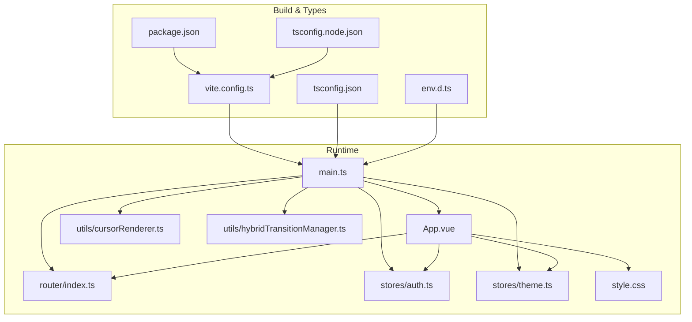
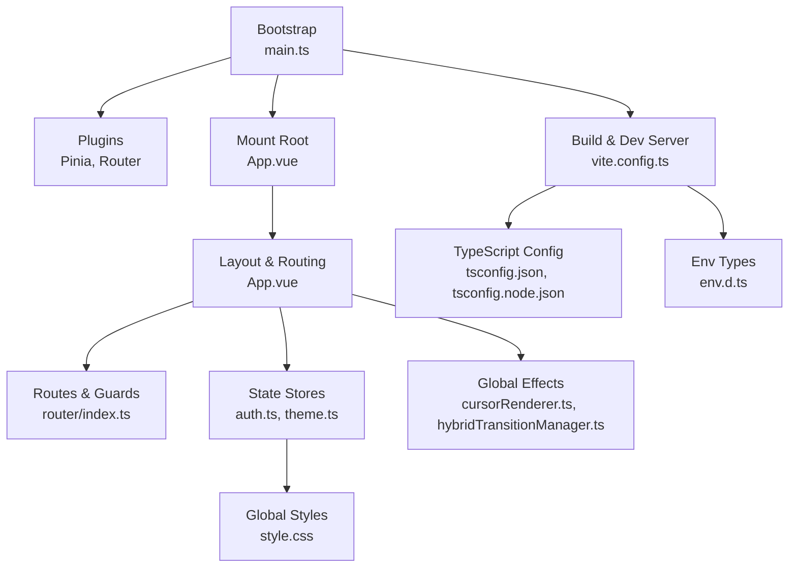
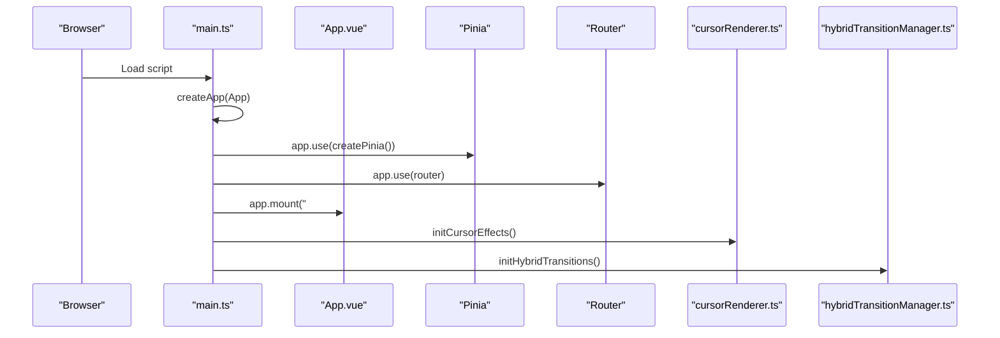
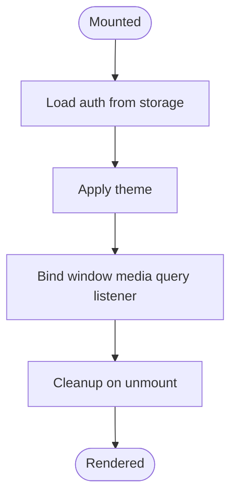
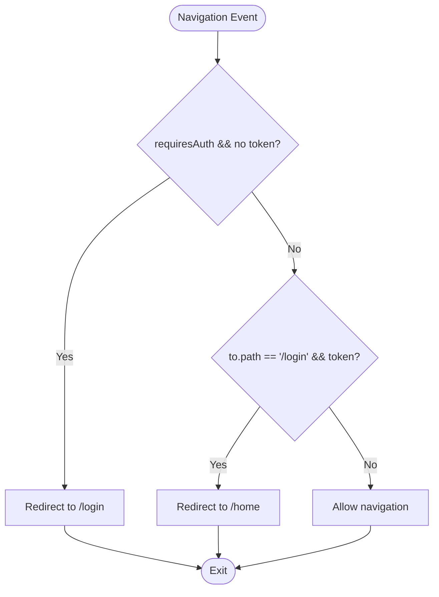
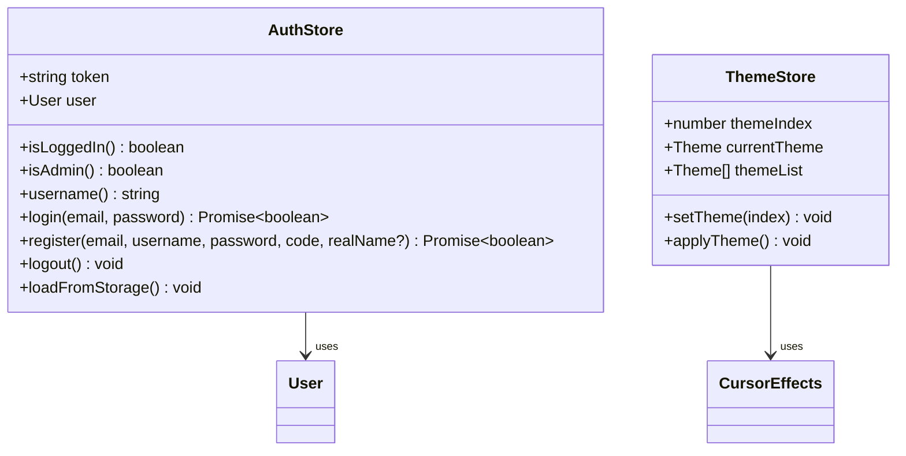
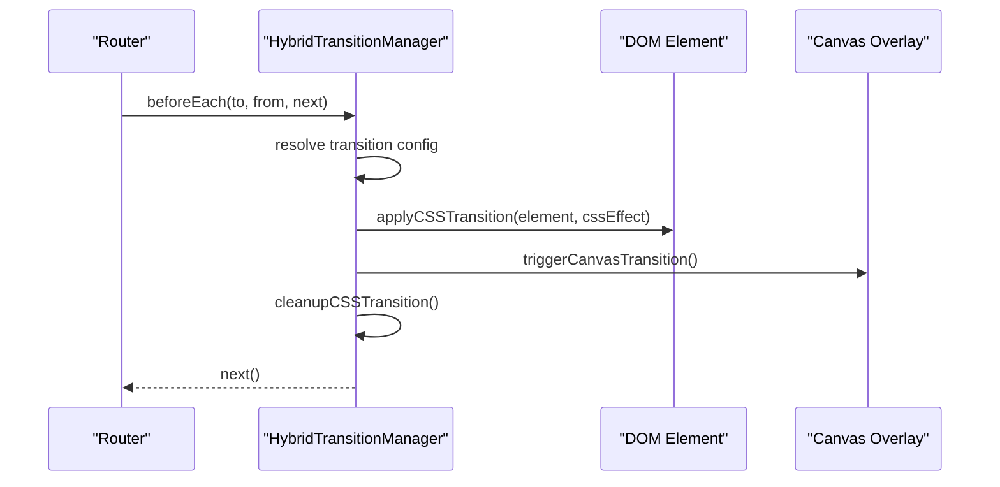
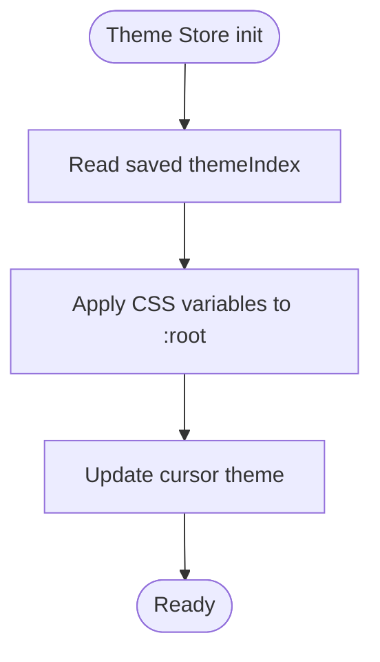
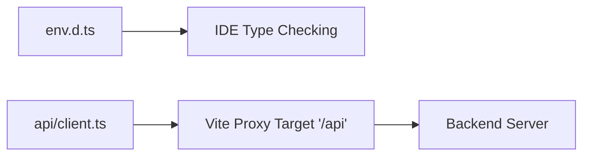
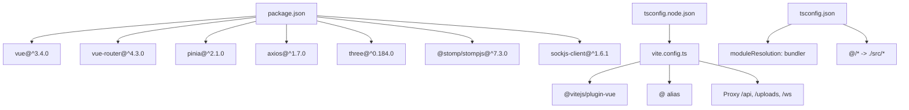

# Vue.js Application Structure

<cite>
**Referenced Files in This Document**
- [main.ts](file://camp-channel-client-pc/src/main.ts)
- [App.vue](file://camp-channel-client-pc/src/App.vue)
- [router/index.ts](file://camp-channel-client-pc/src/router/index.ts)
- [stores/auth.ts](file://camp-channel-client-pc/src/stores/auth.ts)
- [stores/theme.ts](file://camp-channel-client-pc/src/stores/theme.ts)
- [utils/cursorRenderer.ts](file://camp-channel-client-pc/src/utils/cursorRenderer.ts)
- [utils/hybridTransitionManager.ts](file://camp-channel-client-pc/src/utils/hybridTransitionManager.ts)
- [style.css](file://camp-channel-client-pc/src/style.css)
- [env.d.ts](file://camp-channel-client-pc/src/env.d.ts)
- [api/client.ts](file://camp-channel-client-pc/src/api/client.ts)
- [vite.config.ts](file://camp-channel-client-pc/vite.config.ts)
- [package.json](file://camp-channel-client-pc/package.json)
- [tsconfig.json](file://camp-channel-client-pc/tsconfig.json)
- [tsconfig.node.json](file://camp-channel-client-pc/tsconfig.node.json)
</cite>

## Table of Contents
1. [Introduction](#introduction)
2. [Project Structure](#project-structure)
3. [Core Components](#core-components)
4. [Architecture Overview](#architecture-overview)
5. [Detailed Component Analysis](#detailed-component-analysis)
6. [Dependency Analysis](#dependency-analysis)
7. [Performance Considerations](#performance-considerations)
8. [Troubleshooting Guide](#troubleshooting-guide)
9. [Conclusion](#conclusion)
10. [Appendices](#appendices)

## Introduction
This document explains the Vue 3.4.0 application structure and initialization for the PC client. It covers the modern Composition API setup, application bootstrap process, plugin registration order, Pinia store integration, router configuration, global CSS, environment typing, and build configuration via Vite. It also documents best practices for component registration, plugin ordering, and global configuration, along with common initialization pitfalls and their solutions.

## Project Structure
The Vue application is organized around a clear separation of concerns:
- Entry point initializes the app, registers plugins, and mounts the root component.
- Root component orchestrates layout, routing, and global UI elements.
- Router defines routes and guards.
- Stores encapsulate state for authentication and theming.
- Utilities implement advanced UI effects (cursor and page transitions).
- Global CSS and type declarations support consistent theming and IDE support.

**Diagram sources**
- [main.ts:1-19](file://camp-channel-client-pc/src/main.ts#L1-L19)
- [App.vue:1-85](file://camp-channel-client-pc/src/App.vue#L1-L85)
- [router/index.ts:1-46](file://camp-channel-client-pc/src/router/index.ts#L1-L46)
- [stores/auth.ts:1-61](file://camp-channel-client-pc/src/stores/auth.ts#L1-L61)
- [stores/theme.ts:1-295](file://camp-channel-client-pc/src/stores/theme.ts#L1-L295)
- [utils/cursorRenderer.ts:1-464](file://camp-channel-client-pc/src/utils/cursorRenderer.ts#L1-L464)
- [utils/hybridTransitionManager.ts:1-236](file://camp-channel-client-pc/src/utils/hybridTransitionManager.ts#L1-L236)
- [style.css:1-35](file://camp-channel-client-pc/src/style.css#L1-L35)
- [vite.config.ts:1-35](file://camp-channel-client-pc/vite.config.ts#L1-L35)
- [package.json:1-28](file://camp-channel-client-pc/package.json#L1-L28)
- [tsconfig.json:1-25](file://camp-channel-client-pc/tsconfig.json#L1-L25)
- [tsconfig.node.json:1-11](file://camp-channel-client-pc/tsconfig.node.json#L1-L11)
- [env.d.ts:1-11](file://camp-channel-client-pc/src/env.d.ts#L1-L11)

**Section sources**
- [main.ts:1-19](file://camp-channel-client-pc/src/main.ts#L1-L19)
- [vite.config.ts:1-35](file://camp-channel-client-pc/vite.config.ts#L1-L35)
- [package.json:1-28](file://camp-channel-client-pc/package.json#L1-L28)
- [tsconfig.json:1-25](file://camp-channel-client-pc/tsconfig.json#L1-L25)
- [tsconfig.node.json:1-11](file://camp-channel-client-pc/tsconfig.node.json#L1-L11)
- [env.d.ts:1-11](file://camp-channel-client-pc/src/env.d.ts#L1-L11)

## Core Components
- Entry point: Creates the Vue app, installs Pinia and Router, mounts the root component, and initializes global effects.
- Root component: Provides responsive layout, conditional rendering based on route, and integrates sidebar/mobile navigation.
- Router: Hash-based history with route guards for authentication and redirection.
- Stores: Pinia stores for authentication and theme management with persisted state.
- Utilities: Canvas-based cursor effects and hybrid CSS+Canvas page transitions.
- Global CSS: CSS variables for theming and base styles.
- Environment types: Type declarations for Vue components and third-party modules.

**Section sources**
- [main.ts:1-19](file://camp-channel-client-pc/src/main.ts#L1-L19)
- [App.vue:1-85](file://camp-channel-client-pc/src/App.vue#L1-L85)
- [router/index.ts:1-46](file://camp-channel-client-pc/src/router/index.ts#L1-L46)
- [stores/auth.ts:1-61](file://camp-channel-client-pc/src/stores/auth.ts#L1-L61)
- [stores/theme.ts:1-295](file://camp-channel-client-pc/src/stores/theme.ts#L1-L295)
- [utils/cursorRenderer.ts:1-464](file://camp-channel-client-pc/src/utils/cursorRenderer.ts#L1-L464)
- [utils/hybridTransitionManager.ts:1-236](file://camp-channel-client-pc/src/utils/hybridTransitionManager.ts#L1-L236)
- [style.css:1-35](file://camp-channel-client-pc/src/style.css#L1-L35)
- [env.d.ts:1-11](file://camp-channel-client-pc/src/env.d.ts#L1-L11)

## Architecture Overview
The application follows a layered architecture:
- Bootstrap layer: Initializes the Vue app, plugins, and global effects.
- Presentation layer: Root component renders layout and routes.
- State layer: Pinia stores manage auth and theme state.
- Effects layer: Utilities implement visual enhancements.
- Infrastructure layer: Vite build tooling, TypeScript configuration, and environment typings.

**Diagram sources**
- [main.ts:1-19](file://camp-channel-client-pc/src/main.ts#L1-L19)
- [App.vue:1-85](file://camp-channel-client-pc/src/App.vue#L1-L85)
- [router/index.ts:1-46](file://camp-channel-client-pc/src/router/index.ts#L1-L46)
- [stores/auth.ts:1-61](file://camp-channel-client-pc/src/stores/auth.ts#L1-L61)
- [stores/theme.ts:1-295](file://camp-channel-client-pc/src/stores/theme.ts#L1-L295)
- [utils/cursorRenderer.ts:1-464](file://camp-channel-client-pc/src/utils/cursorRenderer.ts#L1-L464)
- [utils/hybridTransitionManager.ts:1-236](file://camp-channel-client-pc/src/utils/hybridTransitionManager.ts#L1-L236)
- [style.css:1-35](file://camp-channel-client-pc/src/style.css#L1-L35)
- [vite.config.ts:1-35](file://camp-channel-client-pc/vite.config.ts#L1-L35)
- [tsconfig.json:1-25](file://camp-channel-client-pc/tsconfig.json#L1-L25)
- [tsconfig.node.json:1-11](file://camp-channel-client-pc/tsconfig.node.json#L1-L11)
- [env.d.ts:1-11](file://camp-channel-client-pc/src/env.d.ts#L1-L11)

## Detailed Component Analysis

### Entry Point and Application Bootstrap
The entry point creates the app, registers plugins, mounts the root component, and initializes global effects after mount. It imports the global stylesheet and utility initializers.

**Diagram sources**
- [main.ts:1-19](file://camp-channel-client-pc/src/main.ts#L1-L19)
- [utils/cursorRenderer.ts:444-449](file://camp-channel-client-pc/src/utils/cursorRenderer.ts#L444-L449)
- [utils/hybridTransitionManager.ts:227-231](file://camp-channel-client-pc/src/utils/hybridTransitionManager.ts#L227-L231)

**Section sources**
- [main.ts:1-19](file://camp-channel-client-pc/src/main.ts#L1-L19)

### Root Component: App.vue
App.vue uses the Composition API to:
- Compute layout visibility based on route path.
- Manage mobile/desktop responsiveness.
- Integrate sidebar and mobile navigation.
- Apply theme and auth state on mount.
- Render router views conditionally.

**Diagram sources**
- [App.vue:33-46](file://camp-channel-client-pc/src/App.vue#L33-L46)

**Section sources**
- [App.vue:1-85](file://camp-channel-client-pc/src/App.vue#L1-L85)

### Router: Navigation Guards and History
The router uses hash history and guards to enforce authentication. It exposes itself globally for transition coordination and redirects unauthorized users or prevents logged-in users from accessing login/register.

**Diagram sources**
- [router/index.ts:34-43](file://camp-channel-client-pc/src/router/index.ts#L34-L43)

**Section sources**
- [router/index.ts:1-46](file://camp-channel-client-pc/src/router/index.ts#L1-L46)

### Pinia Stores: Auth and Theme
- Auth store persists token and user info, exposes computed flags, and synchronizes with local storage.
- Theme store manages a curated palette, applies CSS variables, and updates cursor effects.

**Diagram sources**
- [stores/auth.ts:6-60](file://camp-channel-client-pc/src/stores/auth.ts#L6-L60)
- [stores/theme.ts:261-294](file://camp-channel-client-pc/src/stores/theme.ts#L261-L294)
- [utils/cursorRenderer.ts:451-456](file://camp-channel-client-pc/src/utils/cursorRenderer.ts#L451-L456)

**Section sources**
- [stores/auth.ts:1-61](file://camp-channel-client-pc/src/stores/auth.ts#L1-L61)
- [stores/theme.ts:1-295](file://camp-channel-client-pc/src/stores/theme.ts#L1-L295)

### Global Effects: Cursor and Page Transitions
- Cursor renderer initializes a canvas overlay, binds mouse events, and renders themed effects.
- Hybrid transition manager coordinates CSS transitions and canvas overlays during navigation.

**Diagram sources**
- [utils/hybridTransitionManager.ts:18-76](file://camp-channel-client-pc/src/utils/hybridTransitionManager.ts#L18-L76)
- [utils/cursorRenderer.ts:333-385](file://camp-channel-client-pc/src/utils/cursorRenderer.ts#L333-L385)

**Section sources**
- [utils/cursorRenderer.ts:1-464](file://camp-channel-client-pc/src/utils/cursorRenderer.ts#L1-L464)
- [utils/hybridTransitionManager.ts:1-236](file://camp-channel-client-pc/src/utils/hybridTransitionManager.ts#L1-L236)

### Global CSS and Theming
Global CSS defines CSS variables consumed by the theme store and sets base styles. The theme store writes variables to the document root for dynamic theming.

**Diagram sources**
- [stores/theme.ts:278-291](file://camp-channel-client-pc/src/stores/theme.ts#L278-L291)
- [style.css:3-13](file://camp-channel-client-pc/src/style.css#L3-L13)

**Section sources**
- [style.css:1-35](file://camp-channel-client-pc/src/style.css#L1-L35)
- [stores/theme.ts:1-295](file://camp-channel-client-pc/src/stores/theme.ts#L1-L295)

### Environment Variables and Type Definitions
Environment types declare Vue module resolution and additional module shims. The API client reads the base URL from the Vite proxy configuration.

**Diagram sources**
- [env.d.ts:1-11](file://camp-channel-client-pc/src/env.d.ts#L1-L11)
- [api/client.ts:4-8](file://camp-channel-client-pc/src/api/client.ts#L4-L8)
- [vite.config.ts:19-32](file://camp-channel-client-pc/vite.config.ts#L19-L32)

**Section sources**
- [env.d.ts:1-11](file://camp-channel-client-pc/src/env.d.ts#L1-L11)
- [api/client.ts:1-35](file://camp-channel-client-pc/src/api/client.ts#L1-L35)
- [vite.config.ts:1-35](file://camp-channel-client-pc/vite.config.ts#L1-L35)

## Dependency Analysis
The runtime dependencies are declared in package.json, while Vite and TypeScript configurations govern build behavior and module resolution.

**Diagram sources**
- [package.json:1-28](file://camp-channel-client-pc/package.json#L1-L28)
- [vite.config.ts:1-35](file://camp-channel-client-pc/vite.config.ts#L1-L35)
- [tsconfig.json:1-25](file://camp-channel-client-pc/tsconfig.json#L1-L25)
- [tsconfig.node.json:1-11](file://camp-channel-client-pc/tsconfig.node.json#L1-L11)

**Section sources**
- [package.json:1-28](file://camp-channel-client-pc/package.json#L1-L28)
- [vite.config.ts:1-35](file://camp-channel-client-pc/vite.config.ts#L1-L35)
- [tsconfig.json:1-25](file://camp-channel-client-pc/tsconfig.json#L1-L25)
- [tsconfig.node.json:1-11](file://camp-channel-client-pc/tsconfig.node.json#L1-L11)

## Performance Considerations
- Prefer lazy-loading route components to reduce initial bundle size.
- Defer heavy initialization until after mount to keep first paint fast.
- Use CSS variables for theming to avoid frequent DOM writes.
- Limit canvas particle counts and lifetimes to maintain smooth frame rates.
- Keep router guards lightweight and avoid synchronous blocking operations.

## Troubleshooting Guide
Common initialization issues and resolutions:
- Router not found for transitions: Ensure the router is registered before initializing hybrid transitions and that the global reference is set.
  - Reference: [router/index.ts:30-31](file://camp-channel-client-pc/src/router/index.ts#L30-L31), [utils/hybridTransitionManager.ts:18-23](file://camp-channel-client-pc/src/utils/hybridTransitionManager.ts#L18-L23)
- Authentication loop: Verify token presence and router guards logic; ensure redirects do not cause infinite loops.
  - Reference: [router/index.ts:34-43](file://camp-channel-client-pc/src/router/index.ts#L34-L43)
- Theme not applied: Confirm theme store writes CSS variables to :root and that global CSS variables are defined.
  - Reference: [stores/theme.ts:278-291](file://camp-channel-client-pc/src/stores/theme.ts#L278-L291), [style.css:3-13](file://camp-channel-client-pc/src/style.css#L3-L13)
- API 401 errors: Check interceptor behavior and ensure automatic logout and redirect to login.
  - Reference: [api/client.ts:18-32](file://camp-channel-client-pc/src/api/client.ts#L18-L32)
- Build-time module resolution errors: Ensure tsconfig paths and Vite alias match the project structure.
  - Reference: [tsconfig.json:18-20](file://camp-channel-client-pc/tsconfig.json#L18-L20), [vite.config.ts:10-15](file://camp-channel-client-pc/vite.config.ts#L10-L15)

**Section sources**
- [router/index.ts:30-43](file://camp-channel-client-pc/src/router/index.ts#L30-L43)
- [stores/theme.ts:278-291](file://camp-channel-client-pc/src/stores/theme.ts#L278-L291)
- [style.css:3-13](file://camp-channel-client-pc/src/style.css#L3-L13)
- [api/client.ts:18-32](file://camp-channel-client-pc/src/api/client.ts#L18-L32)
- [tsconfig.json:18-20](file://camp-channel-client-pc/tsconfig.json#L18-L20)
- [vite.config.ts:10-15](file://camp-channel-client-pc/vite.config.ts#L10-L15)

## Conclusion
The Vue 3.4.0 application is structured for scalability and maintainability. The entry point cleanly wires Pinia and Router, while the root component focuses on layout and routing. Stores encapsulate state with persistence, and utilities deliver immersive visual effects. Vite and TypeScript configurations support efficient development and production builds. Following the outlined best practices ensures robust initialization and predictable behavior.

## Appendices
- Best practices summary:
  - Register plugins in a logical order: state management before routing, then effects.
  - Initialize global effects after mount to avoid SSR-related issues.
  - Use lazy-loaded route components and keep guards synchronous.
  - Centralize theme variables in CSS and update them via reactive stores.
  - Configure Vite aliases and TypeScript paths consistently.