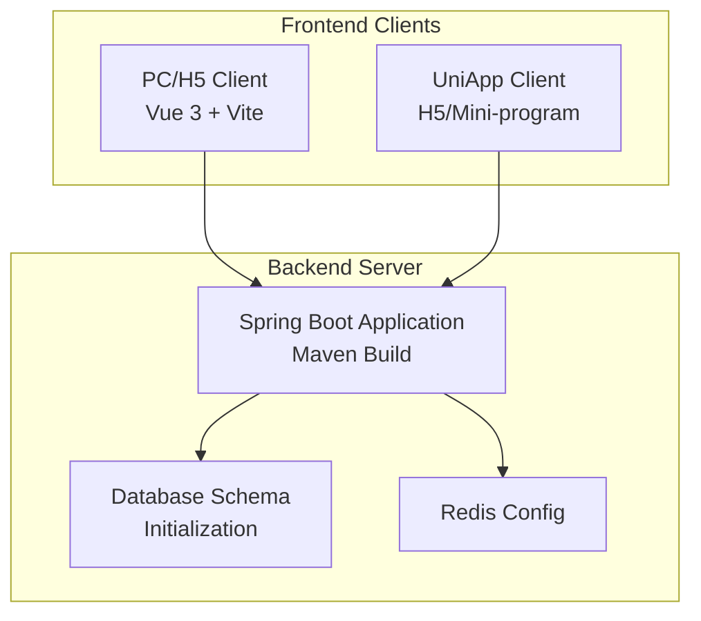
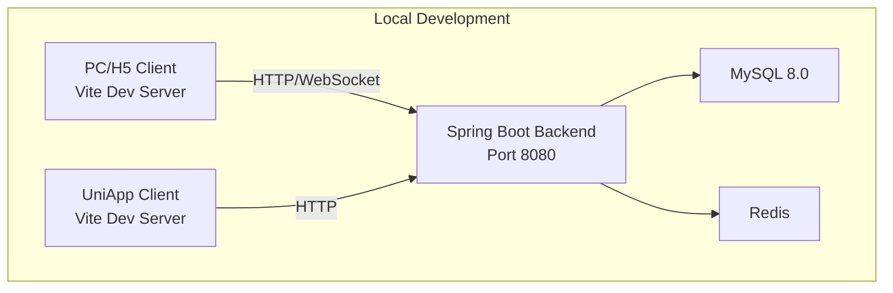
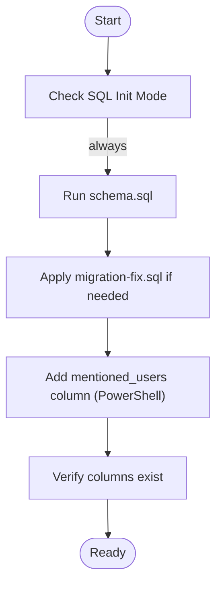
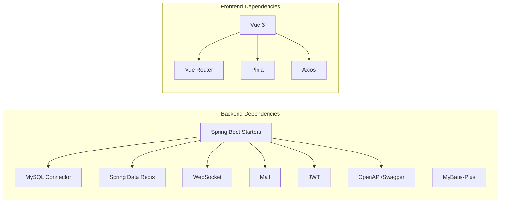

# Getting Started

<cite>
**Referenced Files in This Document**
- [pom.xml](file://camp-channel-server/pom.xml)
- [application.yml](file://camp-channel-server/src/main/resources/application.yml)
- [schema.sql](file://camp-channel-server/src/main/resources/db/schema.sql)
- [migration-fix.sql](file://camp-channel-server/src/main/resources/db/migration-fix.sql)
- [run-migration.ps1](file://camp-channel-server/run-migration.ps1)
- [migrate-database.bat](file://camp-channel-server/migrate-database.bat)
- [check-env.bat](file://camp-channel-server/check-env.bat)
- [clean-build.bat](file://camp-channel-server/clean-build.bat)
- [setup-java-env.bat](file://setup-java-env.bat)
- [mvnw.cmd](file://camp-channel-server/mvnw.cmd)
- [vite.config.ts (PC)](file://camp-channel-client-pc/vite.config.ts)
- [vite.config.ts (UniApp)](file://camp-channel-client-uniapp/vite.config.ts)
- [package.json (PC)](file://camp-channel-client-pc/package.json)
- [package.json (UniApp)](file://camp-channel-client-uniapp/package.json)
- [test_backend.py](file://test_backend.py)
</cite>

## Table of Contents
1. [Introduction](#introduction)
2. [Project Structure](#project-structure)
3. [Core Components](#core-components)
4. [Architecture Overview](#architecture-overview)
5. [Detailed Component Analysis](#detailed-component-analysis)
6. [Dependency Analysis](#dependency-analysis)
7. [Performance Considerations](#performance-considerations)
8. [Troubleshooting Guide](#troubleshooting-guide)
9. [Conclusion](#conclusion)
10. [Appendices](#appendices)

## Introduction
This guide helps you set up the Camp Channel development environment from scratch and run the platform locally. It covers prerequisites, backend server configuration, frontend client setup, database initialization, and environment verification. The instructions are tailored for beginners while providing precise technical details for experienced developers. Cross-platform considerations for Windows, macOS, and Linux are included.

## Project Structure
The repository is organized into three main parts:
- Backend server built with Spring Boot and Maven
- Frontend clients:
  - PC/H5 client using Vue 3 and Vite
  - UniApp client targeting H5 and mini-programs
- Shared database schema and migration scripts

**Section sources**
- [pom.xml:1-227](file://camp-channel-server/pom.xml#L1-L227)
- [application.yml:1-119](file://camp-channel-server/src/main/resources/application.yml#L1-L119)
- [schema.sql:1-236](file://camp-channel-server/src/main/resources/db/schema.sql#L1-L236)
- [vite.config.ts (PC):1-35](file://camp-channel-client-pc/vite.config.ts#L1-L35)
- [vite.config.ts (UniApp):1-16](file://camp-channel-client-uniapp/vite.config.ts#L1-L16)

## Core Components
- Backend server: Spring Boot application configured via Maven, with embedded database initialization, Redis connectivity, and OpenAPI/Swagger endpoints.
- Database: MySQL 8.0 schema initialized on first run; migration scripts support incremental fixes.
- Redis: Local caching and session-related features enabled by default.
- Frontends: PC/H5 client and UniApp client configured with Vite proxies to the backend API.

Prerequisites summary:
- Java: The project targets Java 26 (as defined in Maven properties). Ensure your environment matches the required version.
- Node.js: Required for building and running the frontend clients.
- MySQL 8.0: Used for persistence; schema and migrations are provided.
- Redis: Required for caching and session features.

**Section sources**
- [pom.xml:20-30](file://camp-channel-server/pom.xml#L20-L30)
- [application.yml:13-43](file://camp-channel-server/src/main/resources/application.yml#L13-L43)
- [application.yml:68-93](file://camp-channel-server/src/main/resources/application.yml#L68-L93)
- [schema.sql:1-236](file://camp-channel-server/src/main/resources/db/schema.sql#L1-L236)

## Architecture Overview
The development stack integrates a Spring Boot backend with two frontend clients. The backend exposes REST APIs and WebSocket endpoints, while the frontends consume these endpoints via local reverse proxies.

**Diagram sources**
- [vite.config.ts (PC):16-34](file://camp-channel-client-pc/vite.config.ts#L16-L34)
- [vite.config.ts (UniApp):6-14](file://camp-channel-client-uniapp/vite.config.ts#L6-L14)
- [application.yml:13-43](file://camp-channel-server/src/main/resources/application.yml#L13-L43)

## Detailed Component Analysis

### Environment Prerequisites and Verification
- Java 26
  - The backend enforces a Java 26 toolchain and compiler configuration. Use the provided environment setup script to configure JAVA_HOME and PATH, then verify with the diagnostic script.
  - Steps:
    - Run the environment setup script to configure JAVA_HOME and PATH.
    - Reopen a terminal and run the environment diagnostic script to confirm Java and Maven availability.
  - Platform-specific notes:
    - Windows: Use the provided batch scripts. On macOS/Linux, ensure JAVA_HOME points to a Java 26 JDK and that mvn is on PATH.

- Node.js
  - Required for frontend builds. Install Node.js LTS and verify with node -v and npm -v.

- MySQL 8.0
  - The backend initializes schema on first run. Ensure MySQL is installed and accessible. The application connects to localhost by default.

- Redis
  - The backend is configured to connect to localhost:6379 by default. Ensure Redis is running locally.

Verification examples:
- Backend diagnostics script demonstrates authentication and rate-limiting behavior against the backend.
- Frontend proxy configurations route /api, /uploads, and WebSocket traffic to the backend.

**Section sources**
- [pom.xml:20-30](file://camp-channel-server/pom.xml#L20-L30)
- [setup-java-env.bat:1-44](file://setup-java-env.bat#L1-L44)
- [check-env.bat:1-28](file://camp-channel-server/check-env.bat#L1-L28)
- [test_backend.py:35-98](file://test_backend.py#L35-L98)
- [vite.config.ts (PC):16-34](file://camp-channel-client-pc/vite.config.ts#L16-L34)
- [vite.config.ts (UniApp):6-14](file://camp-channel-client-uniapp/vite.config.ts#L6-L14)

### Backend Server Setup (Spring Boot + Maven)
- Build and run the backend using Maven:
  - Use the Maven Wrapper script to compile and package the backend.
  - Start the Spring Boot application. The server listens on port 8080 with a base context path of /api.
- Database initialization:
  - The application is configured to initialize schema on startup using schema.sql.
  - If schema initialization fails or is incomplete, run the provided migration scripts to add missing columns.
- Redis configuration:
  - The application connects to Redis on localhost:6379 by default. Ensure Redis is running.

Key configuration highlights:
- Server port and context path
- DataSource URL, credentials, and HikariCP pool settings
- SQL initialization mode and schema location
- Redis connection settings
- OpenAPI/Swagger UI paths

**Section sources**
- [application.yml:1-119](file://camp-channel-server/src/main/resources/application.yml#L1-L119)
- [schema.sql:1-236](file://camp-channel-server/src/main/resources/db/schema.sql#L1-L236)
- [migrate-database.bat:1-45](file://camp-channel-server/migrate-database.bat#L1-L45)
- [run-migration.ps1:1-54](file://camp-channel-server/run-migration.ps1#L1-L54)
- [mvnw.cmd:1-206](file://camp-channel-server/mvnw.cmd#L1-L206)

### Frontend Client Setup (PC/H5 and UniApp)
- PC/H5 Client
  - Uses Vue 3 and Vite. The dev server runs on port 3000 and proxies /api, /uploads, and WebSocket traffic to the backend.
  - Install dependencies using npm, then start the dev server.
  - The proxy configuration ensures seamless integration with the backend’s /api context path.

- UniApp Client
  - Uses the UniApp Vite plugin. The dev server runs on port 5173 and proxies /api to the backend.
  - Install dependencies using npm, then start the dev server for H5 or the appropriate platform target.

Common scripts and dependencies:
- Scripts include dev, build, and preview commands for the PC client.
- UniApp scripts include platform-specific dev/build targets.

**Section sources**
- [vite.config.ts (PC):1-35](file://camp-channel-client-pc/vite.config.ts#L1-L35)
- [package.json (PC):1-28](file://camp-channel-client-pc/package.json#L1-L28)
- [vite.config.ts (UniApp):1-16](file://camp-channel-client-uniapp/vite.config.ts#L1-L16)
- [package.json (UniApp):1-29](file://camp-channel-client-uniapp/package.json#L1-L29)

### Database Initialization and Migration
- Automatic initialization:
  - On first run, the backend initializes the schema using schema.sql and continues on errors to support idempotent execution.
- Manual migration:
  - If automatic initialization does not apply the latest changes, use the migration scripts:
    - Batch script for Windows to apply migration-fix.sql.
    - PowerShell script to add the mentioned_users column to the post table.
- Schema overview:
  - The schema defines core entities such as user, channel, post, comment, friendship, message, notification, operation_log, report, login_device, group_message, gallery, gallery_like, and gallery_comment.

**Diagram sources**
- [application.yml:25-29](file://camp-channel-server/src/main/resources/application.yml#L25-L29)
- [schema.sql:174-184](file://camp-channel-server/src/main/resources/db/schema.sql#L174-L184)
- [migration-fix.sql:1-16](file://camp-channel-server/src/main/resources/db/migration-fix.sql#L1-L16)
- [run-migration.ps1:1-54](file://camp-channel-server/run-migration.ps1#L1-L54)

**Section sources**
- [application.yml:25-29](file://camp-channel-server/src/main/resources/application.yml#L25-L29)
- [schema.sql:1-236](file://camp-channel-server/src/main/resources/db/schema.sql#L1-L236)
- [migration-fix.sql:1-16](file://camp-channel-server/src/main/resources/db/migration-fix.sql#L1-L16)
- [migrate-database.bat:1-45](file://camp-channel-server/migrate-database.bat#L1-L45)
- [run-migration.ps1:1-54](file://camp-channel-server/run-migration.ps1#L1-L54)

### Environment Verification Examples
- Backend health checks:
  - Use the provided Python diagnostics script to test authentication, authenticated endpoints, unauthenticated rejection, rate limiting, and sensitive word filtering.
- Frontend connectivity:
  - Confirm that the frontend dev servers can reach the backend via the configured proxies (/api, /uploads, WebSocket).

**Section sources**
- [test_backend.py:35-98](file://test_backend.py#L35-L98)
- [vite.config.ts (PC):16-34](file://camp-channel-client-pc/vite.config.ts#L16-L34)
- [vite.config.ts (UniApp):6-14](file://camp-channel-client-uniapp/vite.config.ts#L6-L14)

### IDE Setup Recommendations
- Backend:
  - Import the Maven project and ensure the IDE uses the same Java 26 JDK as configured in the project properties.
  - Enable annotation processing for Lombok if supported by your IDE.
- Frontend:
  - Install Node.js support in your IDE and configure npm scripts for dev/build.
  - Configure Vite dev servers and proxy settings per client.

[No sources needed since this section provides general guidance]

## Dependency Analysis
The backend depends on Spring Boot starters, MyBatis-Plus, MySQL connector, JWT, Redis, validation, WebSocket, mail, and OpenAPI/Swagger. The frontend clients depend on Vue 3, Vue Router, Pinia, Axios, and related ecosystem packages.

**Diagram sources**
- [pom.xml:32-135](file://camp-channel-server/pom.xml#L32-L135)
- [package.json (PC):10-26](file://camp-channel-client-pc/package.json#L10-L26)
- [package.json (UniApp):11-27](file://camp-channel-client-uniapp/package.json#L11-L27)

**Section sources**
- [pom.xml:32-135](file://camp-channel-server/pom.xml#L32-L135)
- [package.json (PC):1-28](file://camp-channel-client-pc/package.json#L1-L28)
- [package.json (UniApp):1-29](file://camp-channel-client-uniapp/package.json#L1-L29)

## Performance Considerations
- Use the provided scripts to clean caches and rebuild when switching JDK/toolchains to avoid stale artifacts.
- Keep Redis and MySQL running locally for optimal performance during development.
- Adjust HikariCP pool sizes and timeouts in application.yml according to your machine capacity.

[No sources needed since this section provides general guidance]

## Troubleshooting Guide
Common issues and resolutions:
- Java version mismatch
  - Symptom: Build failures or runtime errors indicating incompatible JDK.
  - Resolution: Use Java 26 as configured in the project. Reconfigure JAVA_HOME and PATH, then re-run diagnostics.
- Maven not found
  - Symptom: mvn command not recognized.
  - Resolution: Ensure Maven is installed and added to PATH, or use the Maven Wrapper script.
- MySQL connection refused
  - Symptom: Application fails to connect to the database.
  - Resolution: Start MySQL 8.0 and verify credentials and URL in application.yml. Run schema initialization and migration scripts if needed.
- Redis connection refused
  - Symptom: Redis-related errors at startup.
  - Resolution: Start Redis locally and verify host/port/password in application.yml.
- Frontend proxy issues
  - Symptom: API calls fail from the frontend dev server.
  - Resolution: Confirm proxy settings in Vite configs and that the backend is running on port 8080.

Cleanup and reset:
- Use the cleanup script to remove IDE caches and build outputs, then invalidate caches in your IDE and rebuild.

**Section sources**
- [check-env.bat:1-28](file://camp-channel-server/check-env.bat#L1-L28)
- [setup-java-env.bat:1-44](file://setup-java-env.bat#L1-L44)
- [mvnw.cmd:1-206](file://camp-channel-server/mvnw.cmd#L1-L206)
- [application.yml:13-43](file://camp-channel-server/src/main/resources/application.yml#L13-L43)
- [clean-build.bat:1-28](file://camp-channel-server/clean-build.bat#L1-L28)

## Conclusion
You now have a complete, cross-platform setup guide to run the Camp Channel platform locally. By aligning your environment with the prerequisites, initializing the database, and configuring the frontend proxies, you can develop and test features efficiently across Windows, macOS, and Linux.

[No sources needed since this section summarizes without analyzing specific files]

## Appendices

### A. Step-by-Step Installation Checklist
- Backend
  - Install Java 26 and verify with the environment diagnostic script.
  - Install MySQL 8.0 and Redis locally.
  - Initialize the database schema and run migration scripts if needed.
  - Start the Spring Boot backend on port 8080.
- Frontend
  - Install Node.js and npm.
  - Install dependencies for the PC/H5 and/or UniApp client.
  - Start the frontend dev server(s) and confirm proxy connectivity to the backend.

**Section sources**
- [setup-java-env.bat:1-44](file://setup-java-env.bat#L1-L44)
- [check-env.bat:1-28](file://camp-channel-server/check-env.bat#L1-L28)
- [application.yml:13-43](file://camp-channel-server/src/main/resources/application.yml#L13-L43)
- [schema.sql:1-236](file://camp-channel-server/src/main/resources/db/schema.sql#L1-L236)
- [migrate-database.bat:1-45](file://camp-channel-server/migrate-database.bat#L1-L45)
- [run-migration.ps1:1-54](file://camp-channel-server/run-migration.ps1#L1-L54)
- [vite.config.ts (PC):1-35](file://camp-channel-client-pc/vite.config.ts#L1-L35)
- [vite.config.ts (UniApp):1-16](file://camp-channel-client-uniapp/vite.config.ts#L1-L16)