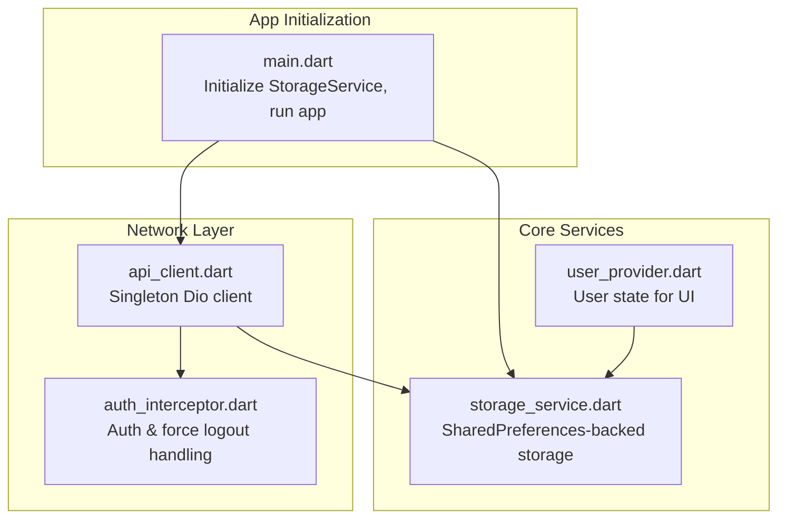
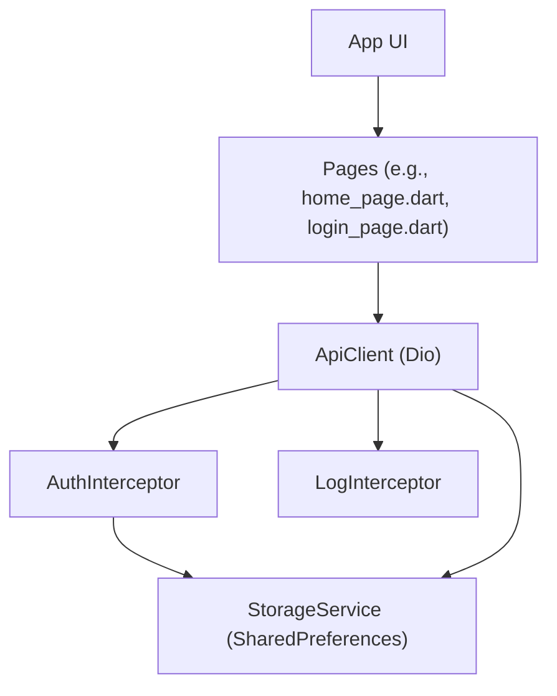
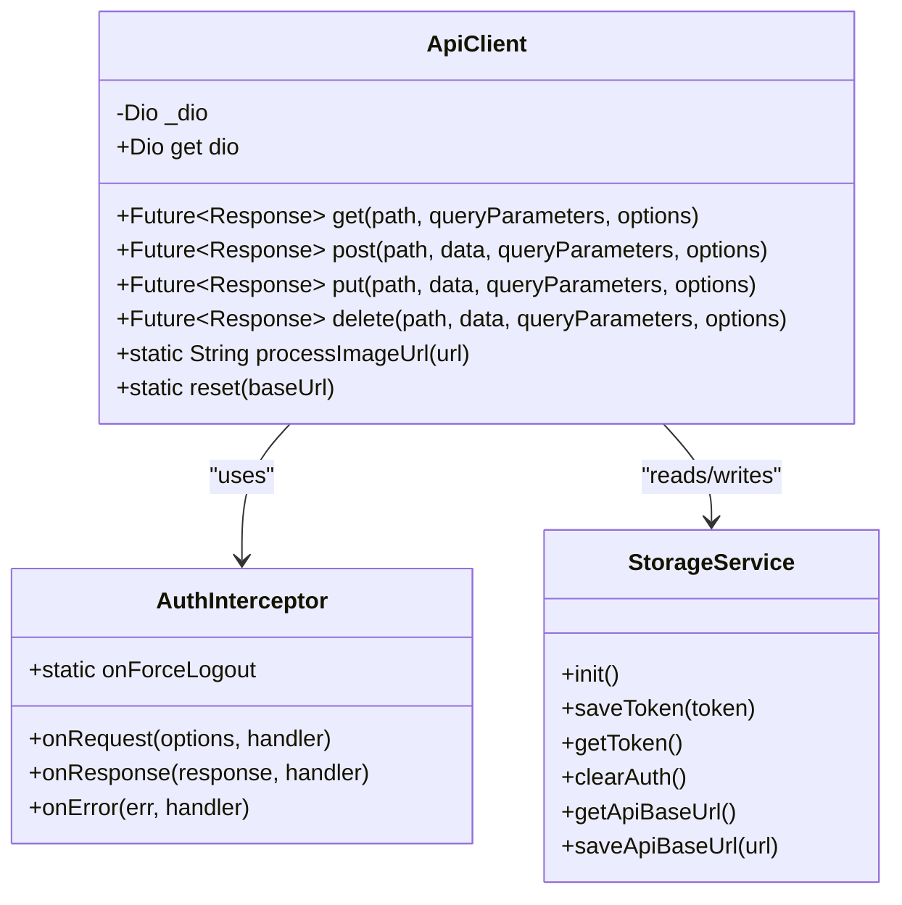
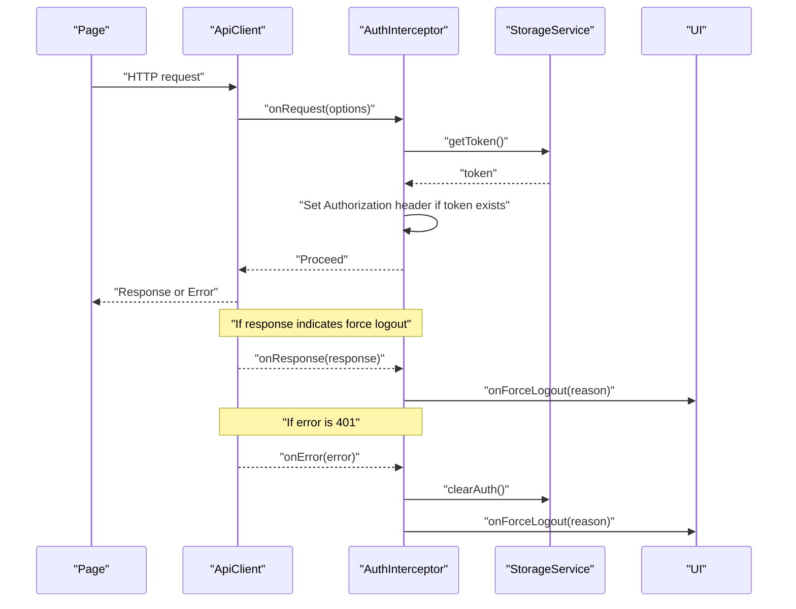
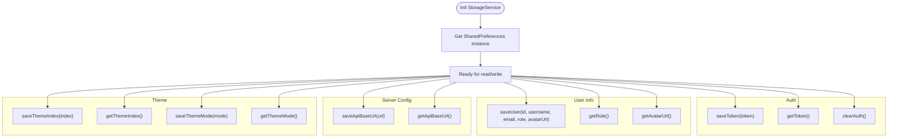
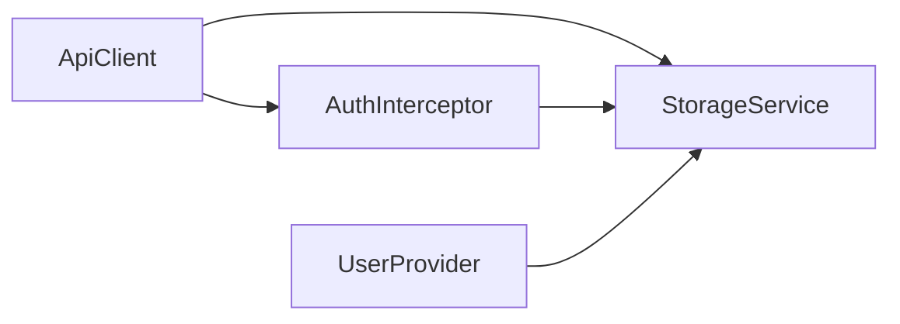

# API and Network Integration

<cite>
**Referenced Files in This Document**
- [main.dart](file://camp-channel-client-flutter/lib/main.dart)
- [api_client.dart](file://camp-channel-client-flutter/lib/core/network/api_client.dart)
- [auth_interceptor.dart](file://camp-channel-client-flutter/lib/core/network/auth_interceptor.dart)
- [storage_service.dart](file://camp-channel-client-flutter/lib/core/services/storage_service.dart)
- [user_provider.dart](file://camp-channel-client-flutter/lib/core/services/user_provider.dart)
</cite>

## Table of Contents
1. [Introduction](#introduction)
2. [Project Structure](#project-structure)
3. [Core Components](#core-components)
4. [Architecture Overview](#architecture-overview)
5. [Detailed Component Analysis](#detailed-component-analysis)
6. [Dependency Analysis](#dependency-analysis)
7. [Performance Considerations](#performance-considerations)
8. [Troubleshooting Guide](#troubleshooting-guide)
9. [Conclusion](#conclusion)

## Introduction
This document explains the API and network integration layer of the Flutter mobile application. It covers HTTP client configuration via Dio, authentication and token management, interceptor-based request/response handling, storage of credentials and preferences, and error handling strategies. It also outlines best practices for secure API communication and graceful degradation when the backend is unavailable.

## Project Structure
The Flutter app initializes core services early in the app lifecycle and exposes a shared HTTP client used across pages. The network stack centers around a singleton HTTP client configured with interceptors for authentication and logging.

**Diagram sources**
- [main.dart:21-25](file://camp-channel-client-flutter/lib/main.dart#L21-L25)
- [api_client.dart:6-29](file://camp-channel-client-flutter/lib/core/network/api_client.dart#L6-L29)
- [auth_interceptor.dart:4-66](file://camp-channel-client-flutter/lib/core/network/auth_interceptor.dart#L4-L66)
- [storage_service.dart:15-18](file://camp-channel-client-flutter/lib/core/services/storage_service.dart#L15-L18)
- [user_provider.dart:4-35](file://camp-channel-client-flutter/lib/core/services/user_provider.dart#L4-L35)

**Section sources**
- [main.dart:21-25](file://camp-channel-client-flutter/lib/main.dart#L21-L25)
- [api_client.dart:6-29](file://camp-channel-client-flutter/lib/core/network/api_client.dart#L6-L29)

## Core Components
- ApiClient: Singleton Dio client with base URL resolution, timeouts, JSON content type, and interceptors.
- AuthInterceptor: Adds Authorization headers and handles 401 errors and device-force-logout scenarios.
- StorageService: SharedPreferences-backed persistence for tokens, user info, roles, avatars, and theme preferences.
- UserProvider: UI state provider that reads persisted user attributes for reactive UI updates.

**Section sources**
- [api_client.dart:6-99](file://camp-channel-client-flutter/lib/core/network/api_client.dart#L6-L99)
- [auth_interceptor.dart:4-66](file://camp-channel-client-flutter/lib/core/network/auth_interceptor.dart#L4-L66)
- [storage_service.dart:3-124](file://camp-channel-client-flutter/lib/core/services/storage_service.dart#L3-L124)
- [user_provider.dart:4-35](file://camp-channel-client-flutter/lib/core/services/user_provider.dart#L4-L35)

## Architecture Overview
The app composes a single HTTP client with two primary interceptors:
- AuthInterceptor: injects Authorization headers and reacts to 401 and device-force-logout responses.
- LogInterceptor: logs request/response bodies for diagnostics.

**Diagram sources**
- [api_client.dart:19-23](file://camp-channel-client-flutter/lib/core/network/api_client.dart#L19-L23)
- [auth_interceptor.dart:9-29](file://camp-channel-client-flutter/lib/core/network/auth_interceptor.dart#L9-L29)
- [storage_service.dart:15-18](file://camp-channel-client-flutter/lib/core/services/storage_service.dart#L15-L18)

## Detailed Component Analysis

### ApiClient: HTTP Client Configuration and Image URL Processing
- Singleton pattern ensures a single Dio instance with shared interceptors.
- Base URL resolution:
  - Prefers a stored API base URL from StorageService.
  - Falls back to platform-specific defaults.
- Timeouts: connectTimeout and receiveTimeout are set to 10 seconds each.
- Content type: application/json.
- Interceptors:
  - AuthInterceptor adds Authorization header when a token exists.
  - LogInterceptor logs request and response bodies.
- Image URL processing:
  - Converts relative image/avatar URLs to absolute URLs by combining the server root with the stored base URL.

**Diagram sources**
- [api_client.dart:6-99](file://camp-channel-client-flutter/lib/core/network/api_client.dart#L6-L99)
- [auth_interceptor.dart:4-66](file://camp-channel-client-flutter/lib/core/network/auth_interceptor.dart#L4-L66)
- [storage_service.dart:15-18](file://camp-channel-client-flutter/lib/core/services/storage_service.dart#L15-L18)

**Section sources**
- [api_client.dart:11-24](file://camp-channel-client-flutter/lib/core/network/api_client.dart#L11-L24)
- [api_client.dart:36-50](file://camp-channel-client-flutter/lib/core/network/api_client.dart#L36-L50)
- [api_client.dart:54-63](file://camp-channel-client-flutter/lib/core/network/api_client.dart#L54-L63)

### AuthInterceptor: Authentication Header Management and Force Logout Handling
- onRequest:
  - Reads token from StorageService and sets Authorization header if present.
- onResponse:
  - Inspects response data for a specific error code indicating device-force-logout and triggers forced logout.
- onError:
  - Handles DioException with 401 status by clearing local auth and invoking a global callback to show a dialog and navigate to login.
- Global callback:
  - Exposed as a static function to allow UI to react to forced logout.

**Diagram sources**
- [auth_interceptor.dart:9-29](file://camp-channel-client-flutter/lib/core/network/auth_interceptor.dart#L9-L29)
- [auth_interceptor.dart:31-53](file://camp-channel-client-flutter/lib/core/network/auth_interceptor.dart#L31-L53)
- [storage_service.dart:94-102](file://camp-channel-client-flutter/lib/core/services/storage_service.dart#L94-L102)
- [main.dart:40-43](file://camp-channel-client-flutter/lib/main.dart#L40-L43)

**Section sources**
- [auth_interceptor.dart:9-16](file://camp-channel-client-flutter/lib/core/network/auth_interceptor.dart#L9-L16)
- [auth_interceptor.dart:18-29](file://camp-channel-client-flutter/lib/core/network/auth_interceptor.dart#L18-L29)
- [auth_interceptor.dart:31-53](file://camp-channel-client-flutter/lib/core/network/auth_interceptor.dart#L31-L53)
- [auth_interceptor.dart:55-64](file://camp-channel-client-flutter/lib/core/network/auth_interceptor.dart#L55-L64)

### StorageService: Local Persistence for Tokens and Preferences
- Keys:
  - Authentication token, user identity, role, avatar URL, API base URL, theme index, and theme mode.
- Operations:
  - Save and retrieve token and user info.
  - Save and retrieve API base URL for runtime override.
  - Clear all authentication-related keys.
  - Persist theme preferences.

**Diagram sources**
- [storage_service.dart:15-18](file://camp-channel-client-flutter/lib/core/services/storage_service.dart#L15-L18)
- [storage_service.dart:20-28](file://camp-channel-client-flutter/lib/core/services/storage_service.dart#L20-L28)
- [storage_service.dart:30-43](file://camp-channel-client-flutter/lib/core/services/storage_service.dart#L30-L43)
- [storage_service.dart:85-92](file://camp-channel-client-flutter/lib/core/services/storage_service.dart#L85-L92)
- [storage_service.dart:104-122](file://camp-channel-client-flutter/lib/core/services/storage_service.dart#L104-L122)

**Section sources**
- [storage_service.dart:3-124](file://camp-channel-client-flutter/lib/core/services/storage_service.dart#L3-L124)

### UserProvider: Reactive UI State Based on Stored User Data
- Holds derived UI state such as unread notifications count, role, and avatar URL.
- Refreshes state from StorageService on app startup to keep UI synchronized with persisted data.

**Section sources**
- [user_provider.dart:4-35](file://camp-channel-client-flutter/lib/core/services/user_provider.dart#L4-L35)

## Dependency Analysis
- ApiClient depends on:
  - AuthInterceptor for authentication and error handling.
  - StorageService for token retrieval and base URL resolution.
- AuthInterceptor depends on:
  - StorageService for token and auth clearing.
  - UI callback for forced logout.
- UserProvider depends on:
  - StorageService for role and avatar URL.

**Diagram sources**
- [api_client.dart:19-23](file://camp-channel-client-flutter/lib/core/network/api_client.dart#L19-L23)
- [auth_interceptor.dart:11-14](file://camp-channel-client-flutter/lib/core/network/auth_interceptor.dart#L11-L14)
- [storage_service.dart:26-28](file://camp-channel-client-flutter/lib/core/services/storage_service.dart#L26-L28)
- [user_provider.dart:29-32](file://camp-channel-client-flutter/lib/core/services/user_provider.dart#L29-L32)

**Section sources**
- [api_client.dart:19-23](file://camp-channel-client-flutter/lib/core/network/api_client.dart#L19-L23)
- [auth_interceptor.dart:11-14](file://camp-channel-client-flutter/lib/core/network/auth_interceptor.dart#L11-L14)
- [storage_service.dart:26-28](file://camp-channel-client-flutter/lib/core/services/storage_service.dart#L26-L28)
- [user_provider.dart:29-32](file://camp-channel-client-flutter/lib/core/services/user_provider.dart#L29-L32)

## Performance Considerations
- Timeout tuning:
  - Current connectTimeout and receiveTimeout are 10 seconds. Adjust based on network conditions and backend latency.
- Logging overhead:
  - LogInterceptor logs request/response bodies; disable or restrict in production builds to reduce overhead.
- Image URL processing:
  - Avoid repeated base URL computation; cache resolved base URL if the stored base URL does not change frequently.
- Retry strategy:
  - No built-in retry logic in the current implementation. Consider adding exponential backoff for transient failures (e.g., 5xx, network timeouts) while avoiding duplicate writes.

[No sources needed since this section provides general guidance]

## Troubleshooting Guide
- 401 Unauthorized responses:
  - AuthInterceptor clears local auth and triggers a forced logout callback. Verify token validity and expiration.
- Device-force-logout (error code):
  - On receiving the specific error code, the interceptor triggers a force logout dialog and navigates to the login route.
- Base URL misconfiguration:
  - If API calls fail, confirm the stored base URL and platform fallback. Use the setter to update the base URL at runtime.
- Image loading issues:
  - Ensure relative image paths are corrected to absolute URLs using the provided processor method.

**Section sources**
- [auth_interceptor.dart:31-53](file://camp-channel-client-flutter/lib/core/network/auth_interceptor.dart#L31-L53)
- [auth_interceptor.dart:23-27](file://camp-channel-client-flutter/lib/core/network/auth_interceptor.dart#L23-L27)
- [api_client.dart:54-63](file://camp-channel-client-flutter/lib/core/network/api_client.dart#L54-L63)
- [storage_service.dart:85-92](file://camp-channel-client-flutter/lib/core/services/storage_service.dart#L85-L92)

## Conclusion
The Flutter app’s network layer is centered on a singleton Dio client with a dedicated authentication interceptor and SharedPreferences-backed storage. It enforces Authorization headers, handles 401 and device-force-logout scenarios, and supports runtime base URL overrides. While the current implementation focuses on simplicity and clarity, enhancements such as configurable retries, HTTPS enforcement, and offline strategies would further improve robustness and user experience.