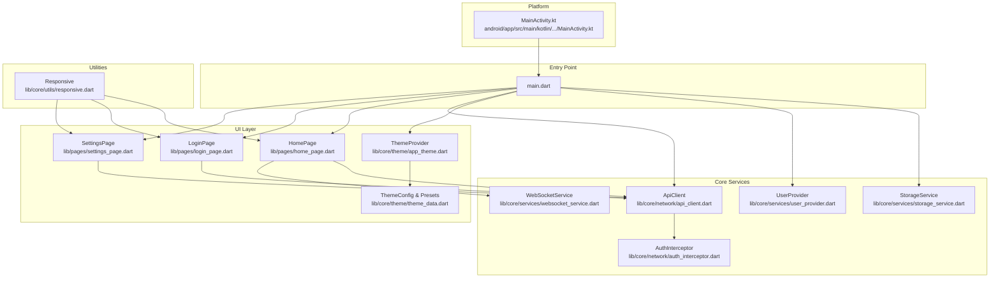
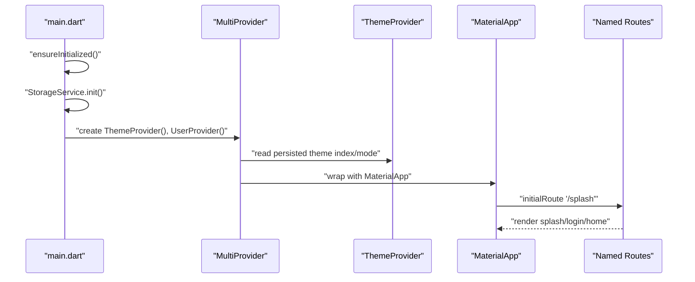
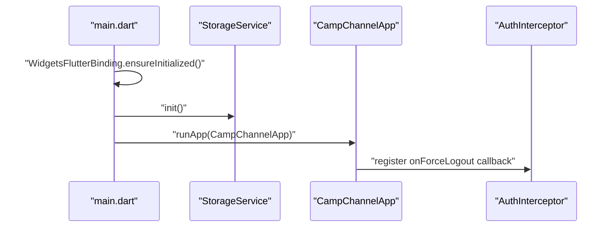
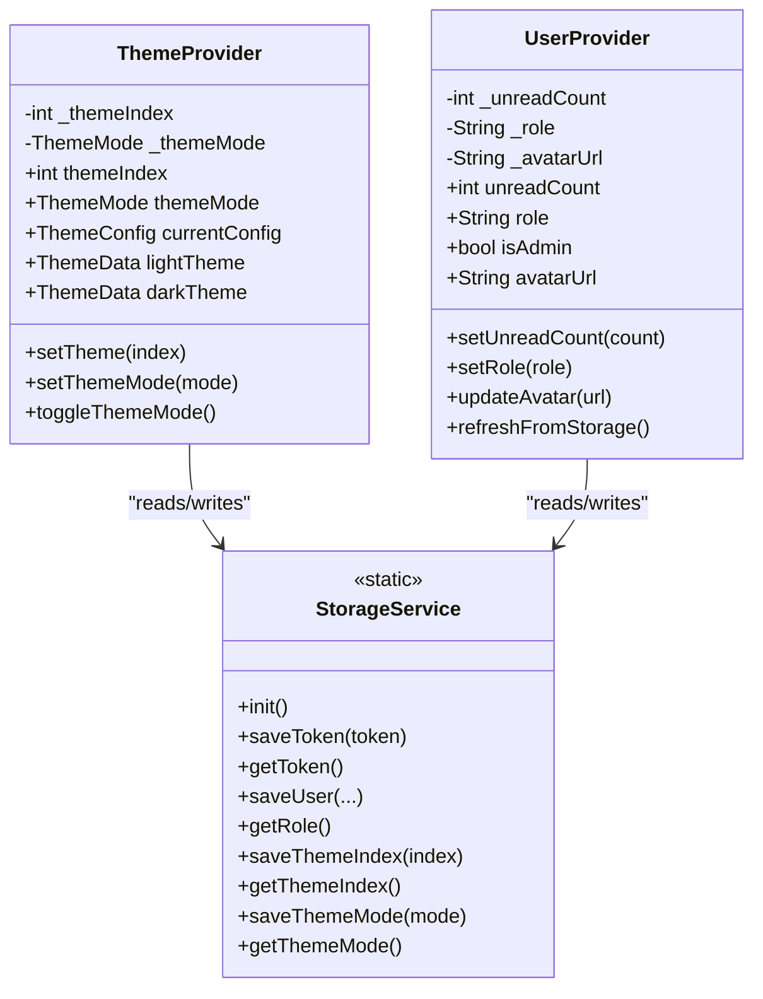
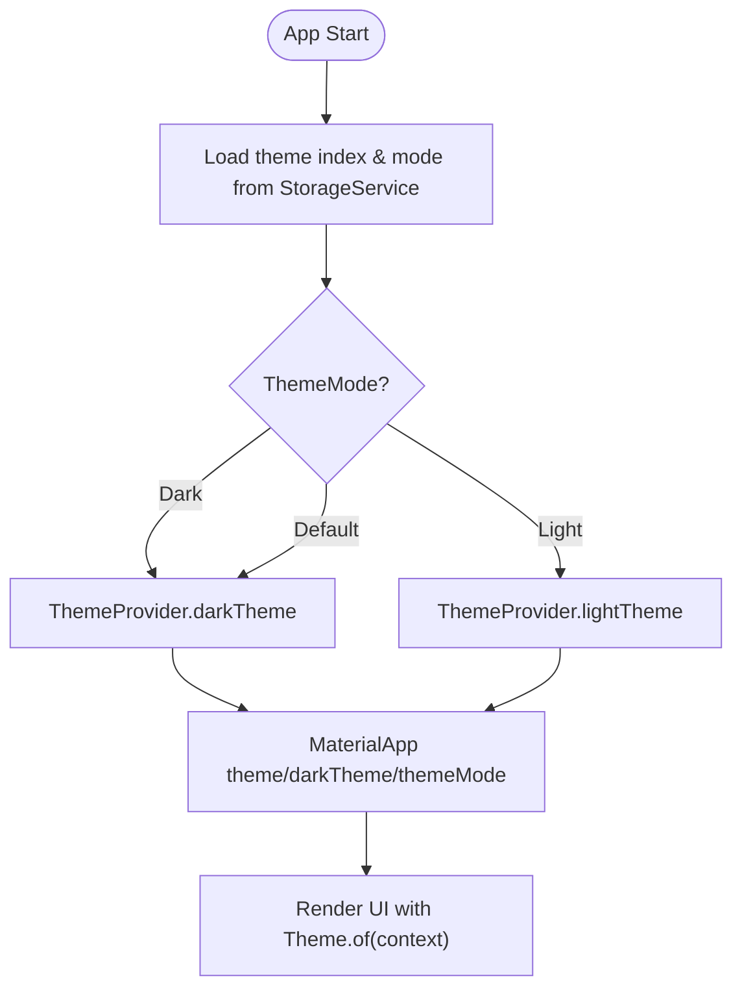
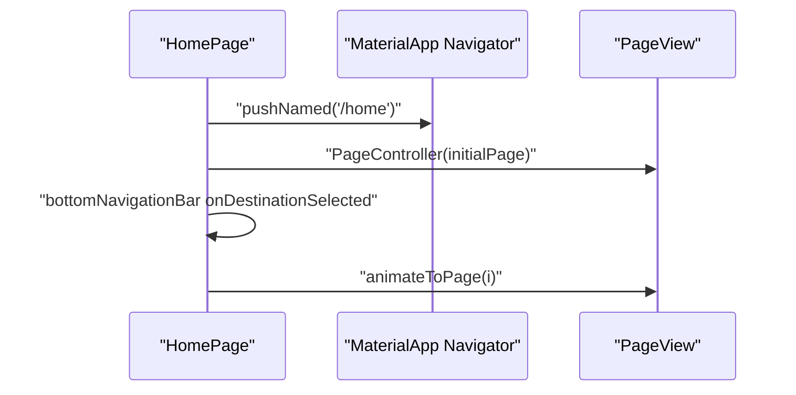
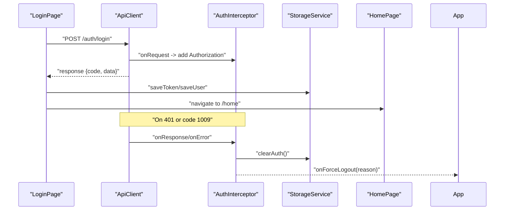
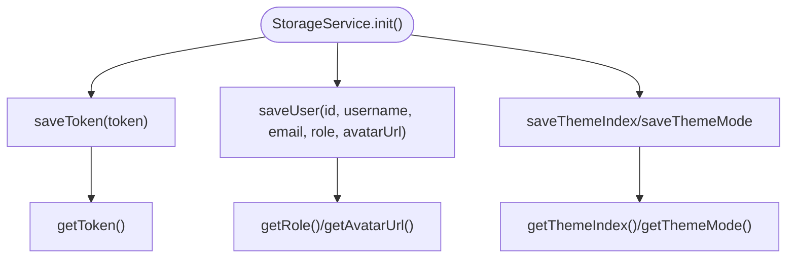
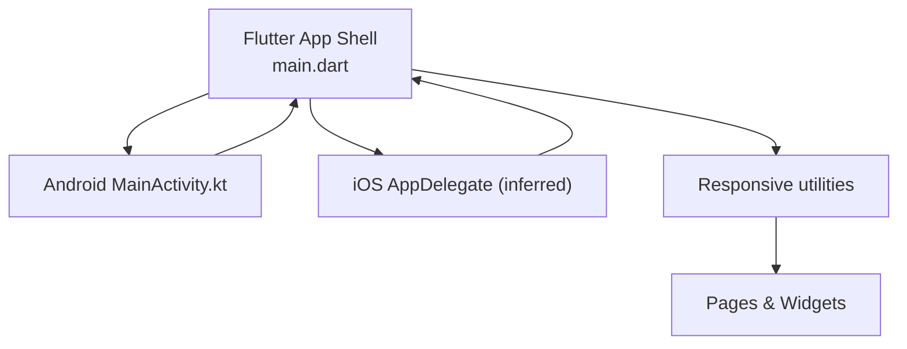
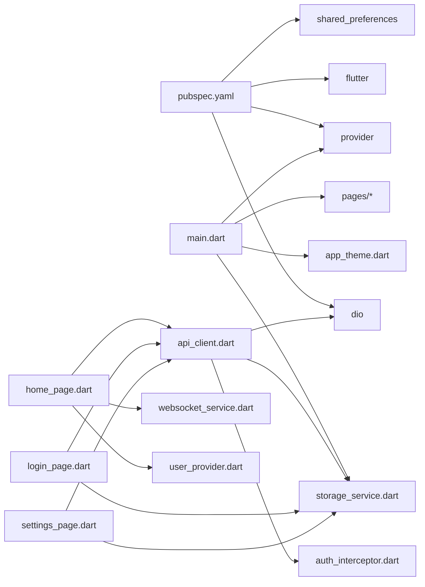

# Flutter Architecture Overview

<cite>
**Referenced Files in This Document**
- [main.dart](file://camp-channel-client-flutter/lib/main.dart)
- [pubspec.yaml](file://camp-channel-client-flutter/pubspec.yaml)
- [storage_service.dart](file://camp-channel-client-flutter/lib/core/services/storage_service.dart)
- [user_provider.dart](file://camp-channel-client-flutter/lib/core/services/user_provider.dart)
- [app_theme.dart](file://camp-channel-client-flutter/lib/core/theme/app_theme.dart)
- [theme_data.dart](file://camp-channel-client-flutter/lib/core/theme/theme_data.dart)
- [auth_interceptor.dart](file://camp-channel-client-flutter/lib/core/network/auth_interceptor.dart)
- [api_client.dart](file://camp-channel-client-flutter/lib/core/network/api_client.dart)
- [websocket_service.dart](file://camp-channel-client-flutter/lib/core/services/websocket_service.dart)
- [home_page.dart](file://camp-channel-client-flutter/lib/pages/home_page.dart)
- [login_page.dart](file://camp-channel-client-flutter/lib/pages/login_page.dart)
- [settings_page.dart](file://camp-channel-client-flutter/lib/pages/settings_page.dart)
- [responsive.dart](file://camp-channel-client-flutter/lib/core/utils/responsive.dart)
- [MainActivity.kt](file://camp-channel-client-flutter/android/app/src/main/kotlin/com/example/camp_channel_client_flutter/MainActivity.kt)
</cite>

## Table of Contents
1. [Introduction](#introduction)
2. [Project Structure](#project-structure)
3. [Core Components](#core-components)
4. [Architecture Overview](#architecture-overview)
5. [Detailed Component Analysis](#detailed-component-analysis)
6. [Dependency Analysis](#dependency-analysis)
7. [Performance Considerations](#performance-considerations)
8. [Troubleshooting Guide](#troubleshooting-guide)
9. [Conclusion](#conclusion)
10. [Appendices](#appendices)

## Introduction
This document presents a comprehensive Flutter architecture overview for the mobile client. It explains the application’s initialization flow, global state providers, theme system, routing and navigation, and the integration with shared backend services. It also highlights how the Flutter client maintains cross-platform consistency across Android and iOS while leveraging platform-specific capabilities.

## Project Structure
The Flutter client follows a layered structure:
- Entry point and app shell: main.dart
- Core services: storage, user state, network, and WebSocket
- Theme system: theme provider and theme configurations
- Pages: feature-driven screens organized under pages/
- Utilities: responsive helpers
- Platform integration: Android activity entry point

**Diagram sources**
- [main.dart:1-122](file://camp-channel-client-flutter/lib/main.dart#L1-L122)
- [storage_service.dart:1-124](file://camp-channel-client-flutter/lib/core/services/storage_service.dart#L1-L124)
- [user_provider.dart:1-35](file://camp-channel-client-flutter/lib/core/services/user_provider.dart#L1-L35)
- [app_theme.dart:1-48](file://camp-channel-client-flutter/lib/core/theme/app_theme.dart#L1-L48)
- [theme_data.dart:1-252](file://camp-channel-client-flutter/lib/core/theme/theme_data.dart#L1-L252)
- [auth_interceptor.dart:1-66](file://camp-channel-client-flutter/lib/core/network/auth_interceptor.dart#L1-L66)
- [api_client.dart:1-100](file://camp-channel-client-flutter/lib/core/network/api_client.dart#L1-L100)
- [websocket_service.dart:1-151](file://camp-channel-client-flutter/lib/core/services/websocket_service.dart#L1-L151)
- [home_page.dart:1-152](file://camp-channel-client-flutter/lib/pages/home_page.dart#L1-L152)
- [login_page.dart:1-315](file://camp-channel-client-flutter/lib/pages/login_page.dart#L1-L315)
- [settings_page.dart:1-200](file://camp-channel-client-flutter/lib/pages/settings_page.dart#L1-L200)
- [responsive.dart:1-18](file://camp-channel-client-flutter/lib/core/utils/responsive.dart#L1-L18)
- [MainActivity.kt:1-6](file://camp-channel-client-flutter/android/app/src/main/kotlin/com/example/camp_channel_client_flutter/MainActivity.kt#L1-L6)

**Section sources**
- [main.dart:1-122](file://camp-channel-client-flutter/lib/main.dart#L1-L122)
- [pubspec.yaml:1-38](file://camp-channel-client-flutter/pubspec.yaml#L1-L38)

## Core Components
- Application entry point and lifecycle
  - Initialization ensures Flutter binding is ready, initializes persistent storage, and runs the app shell.
  - See [main.dart:21-25](file://camp-channel-client-flutter/lib/main.dart#L21-L25).

- Global state providers
  - ThemeProvider: manages theme index and mode, persists preferences, and exposes light/dark themes.
  - UserProvider: holds user-related state (unread count, role, avatar), synchronized from storage.
  - Both are provided via MultiProvider and consumed by widgets.
  - See [main.dart:86-90](file://camp-channel-client-flutter/lib/main.dart#L86-L90), [app_theme.dart:5-47](file://camp-channel-client-flutter/lib/core/theme/app_theme.dart#L5-L47), [user_provider.dart:4-34](file://camp-channel-client-flutter/lib/core/services/user_provider.dart#L4-L34).

- Theme system
  - ThemeProvider reads persisted theme mode and index, applies Material 3 themes, and exposes multiple theme presets.
  - ThemeConfig defines light/dark ThemeData factories and reusable UI tokens.
  - See [app_theme.dart:1-48](file://camp-channel-client-flutter/lib/core/theme/app_theme.dart#L1-L48), [theme_data.dart:3-252](file://camp-channel-client-flutter/lib/core/theme/theme_data.dart#L3-L252).

- Routing and navigation
  - MaterialApp configured with named routes and initial route.
  - Navigation keys and dialogs handle forced logout scenarios.
  - See [main.dart:93-116](file://camp-channel-client-flutter/lib/main.dart#L93-L116), [main.dart:45-82](file://camp-channel-client-flutter/lib/main.dart#L45-L82).

- Authentication and storage
  - StorageService persists tokens, user info, roles, avatars, and theme preferences.
  - AuthInterceptor injects Authorization headers and handles 401 and device-force-logout responses.
  - See [storage_service.dart:1-124](file://camp-channel-client-flutter/lib/core/services/storage_service.dart#L1-L124), [auth_interceptor.dart:1-66](file://camp-channel-client-flutter/lib/core/network/auth_interceptor.dart#L1-L66).

- Network client
  - ApiClient singleton wraps Dio with base URL resolution, logging, and AuthInterceptor.
  - Provides CRUD helpers and image URL normalization.
  - See [api_client.dart:1-100](file://camp-channel-client-flutter/lib/core/network/api_client.dart#L1-L100).

- Real-time communication
  - WebSocketService connects to backend raw WebSocket endpoint, dispatches events, and reconnects with exponential backoff.
  - See [websocket_service.dart:1-151](file://camp-channel-client-flutter/lib/core/services/websocket_service.dart#L1-L151).

- Example pages
  - LoginPage demonstrates login flow, API calls, and navigation.
  - HomePage integrates notifications, profile sync, bottom navigation, and WebSocket.
  - SettingsPage shows server address configuration and toggles.
  - See [login_page.dart:1-315](file://camp-channel-client-flutter/lib/pages/login_page.dart#L1-L315), [home_page.dart:1-152](file://camp-channel-client-flutter/lib/pages/home_page.dart#L1-L152), [settings_page.dart:1-200](file://camp-channel-client-flutter/lib/pages/settings_page.dart#L1-L200).

**Section sources**
- [main.dart:21-122](file://camp-channel-client-flutter/lib/main.dart#L21-L122)
- [storage_service.dart:1-124](file://camp-channel-client-flutter/lib/core/services/storage_service.dart#L1-L124)
- [user_provider.dart:1-35](file://camp-channel-client-flutter/lib/core/services/user_provider.dart#L1-L35)
- [app_theme.dart:1-48](file://camp-channel-client-flutter/lib/core/theme/app_theme.dart#L1-L48)
- [theme_data.dart:1-252](file://camp-channel-client-flutter/lib/core/theme/theme_data.dart#L1-L252)
- [auth_interceptor.dart:1-66](file://camp-channel-client-flutter/lib/core/network/auth_interceptor.dart#L1-L66)
- [api_client.dart:1-100](file://camp-channel-client-flutter/lib/core/network/api_client.dart#L1-L100)
- [websocket_service.dart:1-151](file://camp-channel-client-flutter/lib/core/services/websocket_service.dart#L1-L151)
- [login_page.dart:1-315](file://camp-channel-client-flutter/lib/pages/login_page.dart#L1-L315)
- [home_page.dart:1-152](file://camp-channel-client-flutter/lib/pages/home_page.dart#L1-L152)
- [settings_page.dart:1-200](file://camp-channel-client-flutter/lib/pages/settings_page.dart#L1-L200)

## Architecture Overview
The app follows a Provider-based reactive architecture with a clear separation of concerns:
- Entry point initializes storage and mounts the app shell.
- Global providers supply theme and user state.
- Network layer centralizes HTTP and WebSocket communication.
- Pages consume providers and services to render UI and orchestrate flows.

**Diagram sources**
- [main.dart:21-25](file://camp-channel-client-flutter/lib/main.dart#L21-L25)
- [main.dart:86-116](file://camp-channel-client-flutter/lib/main.dart#L86-L116)
- [app_theme.dart:9-19](file://camp-channel-client-flutter/lib/core/theme/app_theme.dart#L9-L19)

**Section sources**
- [main.dart:21-116](file://camp-channel-client-flutter/lib/main.dart#L21-L116)
- [app_theme.dart:1-48](file://camp-channel-client-flutter/lib/core/theme/app_theme.dart#L1-L48)

## Detailed Component Analysis

### Entry Point and Lifecycle
- Initialization order:
  - Ensures Flutter binding readiness.
  - Initializes SharedPreferences via StorageService.
  - Mounts CampChannelApp as the root widget.
- Forced logout handling:
  - Registers AuthInterceptor.onForceLogout callback.
  - Displays a modal dialog and navigates to login.

**Diagram sources**
- [main.dart:21-43](file://camp-channel-client-flutter/lib/main.dart#L21-L43)
- [storage_service.dart:16-18](file://camp-channel-client-flutter/lib/core/services/storage_service.dart#L16-L18)
- [auth_interceptor.dart:7](file://camp-channel-client-flutter/lib/core/network/auth_interceptor.dart#L7)

**Section sources**
- [main.dart:21-43](file://camp-channel-client-flutter/lib/main.dart#L21-L43)
- [storage_service.dart:16-18](file://camp-channel-client-flutter/lib/core/services/storage_service.dart#L16-L18)

### Global State Providers Setup
- ThemeProvider
  - Loads persisted theme index and mode from StorageService.
  - Exposes currentConfig, lightTheme, and darkTheme.
  - Persists changes on user interaction.
- UserProvider
  - Holds unreadCount, role, and avatarUrl.
  - Refreshes state from storage on app start.

**Diagram sources**
- [app_theme.dart:5-47](file://camp-channel-client-flutter/lib/core/theme/app_theme.dart#L5-L47)
- [user_provider.dart:4-34](file://camp-channel-client-flutter/lib/core/services/user_provider.dart#L4-L34)
- [storage_service.dart:1-124](file://camp-channel-client-flutter/lib/core/services/storage_service.dart#L1-L124)

**Section sources**
- [app_theme.dart:1-48](file://camp-channel-client-flutter/lib/core/theme/app_theme.dart#L1-L48)
- [user_provider.dart:1-35](file://camp-channel-client-flutter/lib/core/services/user_provider.dart#L1-L35)
- [storage_service.dart:104-122](file://camp-channel-client-flutter/lib/core/services/storage_service.dart#L104-L122)

### Theme System Implementation
- ThemeProvider constructs ThemeData from ThemeConfig presets.
- ThemeMode supports dark/light/auto; changes persist immediately.
- HomePage and LoginPage consume Theme.of(context) for consistent theming.

**Diagram sources**
- [app_theme.dart:9-19](file://camp-channel-client-flutter/lib/core/theme/app_theme.dart#L9-L19)
- [theme_data.dart:30-208](file://camp-channel-client-flutter/lib/core/theme/theme_data.dart#L30-L208)
- [main.dart:93-99](file://camp-channel-client-flutter/lib/main.dart#L93-L99)

**Section sources**
- [app_theme.dart:1-48](file://camp-channel-client-flutter/lib/core/theme/app_theme.dart#L1-L48)
- [theme_data.dart:1-252](file://camp-channel-client-flutter/lib/core/theme/theme_data.dart#L1-L252)
- [main.dart:93-99](file://camp-channel-client-flutter/lib/main.dart#L93-L99)

### Routing Configuration and Navigation Patterns
- Named routes define navigable screens.
- Initial route is splash; navigation occurs via pushNamed and pushReplacementNamed.
- Bottom navigation in HomePage orchestrates PageView and updates selected index.

**Diagram sources**
- [main.dart:100-116](file://camp-channel-client-flutter/lib/main.dart#L100-L116)
- [home_page.dart:86-149](file://camp-channel-client-flutter/lib/pages/home_page.dart#L86-L149)

**Section sources**
- [main.dart:100-116](file://camp-channel-client-flutter/lib/main.dart#L100-L116)
- [home_page.dart:19-38](file://camp-channel-client-flutter/lib/pages/home_page.dart#L19-L38)

### Authentication State and Interceptors
- AuthInterceptor
  - Adds Authorization header from StorageService.
  - Handles 401 and device-force-logout (code 1009) by clearing local auth and invoking onForceLogout.
- LoginPage
  - Calls ApiClient.post('/auth/login'), saves token and user info, then navigates to home.
- HomePage
  - Syncs profile avatar and unread notifications on startup.

**Diagram sources**
- [login_page.dart:48-98](file://camp-channel-client-flutter/lib/pages/login_page.dart#L48-L98)
- [api_client.dart:19-24](file://camp-channel-client-flutter/lib/core/network/api_client.dart#L19-L24)
- [auth_interceptor.dart:10-53](file://camp-channel-client-flutter/lib/core/network/auth_interceptor.dart#L10-L53)
- [storage_service.dart:95-102](file://camp-channel-client-flutter/lib/core/services/storage_service.dart#L95-L102)
- [home_page.dart:53-83](file://camp-channel-client-flutter/lib/pages/home_page.dart#L53-L83)

**Section sources**
- [auth_interceptor.dart:1-66](file://camp-channel-client-flutter/lib/core/network/auth_interceptor.dart#L1-L66)
- [login_page.dart:48-98](file://camp-channel-client-flutter/lib/pages/login_page.dart#L48-L98)
- [home_page.dart:53-83](file://camp-channel-client-flutter/lib/pages/home_page.dart#L53-L83)

### Storage Services Initialization
- StorageService.init() initializes SharedPreferences.
- Used across providers and pages to persist tokens, user info, roles, avatars, and theme preferences.
- HomePage and SettingsPage demonstrate reading and writing preferences.

**Diagram sources**
- [storage_service.dart:16-18](file://camp-channel-client-flutter/lib/core/services/storage_service.dart#L16-L18)
- [storage_service.dart:20-102](file://camp-channel-client-flutter/lib/core/services/storage_service.dart#L20-L102)
- [home_page.dart:53-68](file://camp-channel-client-flutter/lib/pages/home_page.dart#L53-L68)
- [settings_page.dart:27-45](file://camp-channel-client-flutter/lib/pages/settings_page.dart#L27-L45)

**Section sources**
- [storage_service.dart:1-124](file://camp-channel-client-flutter/lib/core/services/storage_service.dart#L1-L124)
- [home_page.dart:53-68](file://camp-channel-client-flutter/lib/pages/home_page.dart#L53-L68)
- [settings_page.dart:27-45](file://camp-channel-client-flutter/lib/pages/settings_page.dart#L27-L45)

### Cross-Platform Consistency and Platform Integration
- Flutter app shell and routing are platform-agnostic.
- Android activity entry point delegates to FlutterActivity.
- Responsive utilities adapt UI for mobile/tablet form factors.
- The app targets Android and iOS via the same Flutter codebase.

**Diagram sources**
- [main.dart:1-122](file://camp-channel-client-flutter/lib/main.dart#L1-L122)
- [MainActivity.kt:1-6](file://camp-channel-client-flutter/android/app/src/main/kotlin/com/example/camp_channel_client_flutter/MainActivity.kt#L1-L6)
- [responsive.dart:1-18](file://camp-channel-client-flutter/lib/core/utils/responsive.dart#L1-L18)

**Section sources**
- [pubspec.yaml:35-38](file://camp-channel-client-flutter/pubspec.yaml#L35-L38)
- [MainActivity.kt:1-6](file://camp-channel-client-flutter/android/app/src/main/kotlin/com/example/camp_channel_client_flutter/MainActivity.kt#L1-L6)
- [responsive.dart:1-18](file://camp-channel-client-flutter/lib/core/utils/responsive.dart#L1-L18)

## Dependency Analysis
- External dependencies declared in pubspec.yaml include Flutter SDK, Material icons, Dio, Provider, shared_preferences, and cached_network_image.
- Internal dependencies:
  - main.dart depends on providers, theme, and pages.
  - ApiClient depends on AuthInterceptor and StorageService.
  - HomePage depends on ApiClient, WebSocketService, and UserProvider.
  - LoginPage depends on ApiClient and StorageService.
  - SettingsPage depends on ApiClient and StorageService.

**Diagram sources**
- [pubspec.yaml:8-30](file://camp-channel-client-flutter/pubspec.yaml#L8-L30)
- [main.dart:1-20](file://camp-channel-client-flutter/lib/main.dart#L1-L20)
- [api_client.dart:1-100](file://camp-channel-client-flutter/lib/core/network/api_client.dart#L1-L100)
- [auth_interceptor.dart:1-66](file://camp-channel-client-flutter/lib/core/network/auth_interceptor.dart#L1-L66)
- [storage_service.dart:1-124](file://camp-channel-client-flutter/lib/core/services/storage_service.dart#L1-L124)
- [home_page.dart:1-152](file://camp-channel-client-flutter/lib/pages/home_page.dart#L1-L152)
- [login_page.dart:1-315](file://camp-channel-client-flutter/lib/pages/login_page.dart#L1-L315)
- [settings_page.dart:1-200](file://camp-channel-client-flutter/lib/pages/settings_page.dart#L1-L200)

**Section sources**
- [pubspec.yaml:1-38](file://camp-channel-client-flutter/pubspec.yaml#L1-L38)
- [main.dart:1-20](file://camp-channel-client-flutter/lib/main.dart#L1-L20)

## Performance Considerations
- Use Provider sparingly; keep rebuild scope narrow with Consumer.
- Debounce or throttle frequent network calls (e.g., unread counts).
- Persist only essential data in SharedPreferences to avoid bloated storage.
- Leverage Material 3 theming to minimize custom paint and layout work.
- Reuse ApiClient singleton and avoid creating multiple instances.

## Troubleshooting Guide
- Authentication failures
  - Verify token presence in StorageService and Authorization header injection in AuthInterceptor.
  - On 401 or force-logout code, confirm clearAuth() is invoked and onForceLogout navigates to login.
  - See [auth_interceptor.dart:32-53](file://camp-channel-client-flutter/lib/core/network/auth_interceptor.dart#L32-L53), [storage_service.dart:95-102](file://camp-channel-client-flutter/lib/core/services/storage_service.dart#L95-L102).

- Base URL and image URLs
  - ApiClient resolves base URL from StorageService or defaults per platform; ensure correct server address is saved.
  - Image URL normalization removes “/api” suffix to construct absolute URLs.
  - See [api_client.dart:36-63](file://camp-channel-client-flutter/lib/core/network/api_client.dart#L36-L63).

- WebSocket connectivity
  - Confirm token availability and correct host derivation from API base URL.
  - Observe heartbeat and exponential backoff behavior; inspect reconnect attempts.
  - See [websocket_service.dart:40-90](file://camp-channel-client-flutter/lib/core/services/websocket_service.dart#L40-L90), [websocket_service.dart:119-136](file://camp-channel-client-flutter/lib/core/services/websocket_service.dart#L119-L136).

**Section sources**
- [auth_interceptor.dart:32-53](file://camp-channel-client-flutter/lib/core/network/auth_interceptor.dart#L32-L53)
- [storage_service.dart:95-102](file://camp-channel-client-flutter/lib/core/services/storage_service.dart#L95-L102)
- [api_client.dart:36-63](file://camp-channel-client-flutter/lib/core/network/api_client.dart#L36-L63)
- [websocket_service.dart:40-90](file://camp-channel-client-flutter/lib/core/services/websocket_service.dart#L40-L90)
- [websocket_service.dart:119-136](file://camp-channel-client-flutter/lib/core/services/websocket_service.dart#L119-L136)

## Conclusion
The Flutter client employs a clean, layered architecture centered around Provider-managed global state, a robust theme system, and a centralized network layer with authentication interception. The app initializes storage early, mounts a themed MaterialApp with named routes, and integrates real-time communication via WebSocket. Cross-platform consistency is achieved through Flutter’s unified UI framework, with platform-specific entry points and responsive utilities ensuring optimal UX across Android and iOS.

## Appendices
- Example code snippet paths
  - Entry point initialization: [main.dart:21-25](file://camp-channel-client-flutter/lib/main.dart#L21-L25)
  - ThemeProvider constructor and setters: [app_theme.dart:9-46](file://camp-channel-client-flutter/lib/core/theme/app_theme.dart#L9-L46)
  - AuthInterceptor request/response/error hooks: [auth_interceptor.dart:10-53](file://camp-channel-client-flutter/lib/core/network/auth_interceptor.dart#L10-L53)
  - ApiClient base URL resolution and helpers: [api_client.dart:36-98](file://camp-channel-client-flutter/lib/core/network/api_client.dart#L36-L98)
  - WebSocket connection and streams: [websocket_service.dart:35-111](file://camp-channel-client-flutter/lib/core/services/websocket_service.dart#L35-L111)
  - LoginPage login flow: [login_page.dart:48-98](file://camp-channel-client-flutter/lib/pages/login_page.dart#L48-L98)
  - HomePage bottom navigation and unread sync: [home_page.dart:86-149](file://camp-channel-client-flutter/lib/pages/home_page.dart#L86-L149)
  - SettingsPage server address dialog and save: [settings_page.dart:54-94](file://camp-channel-client-flutter/lib/pages/settings_page.dart#L54-L94)
  - Responsive helpers: [responsive.dart:4-16](file://camp-channel-client-flutter/lib/core/utils/responsive.dart#L4-L16)