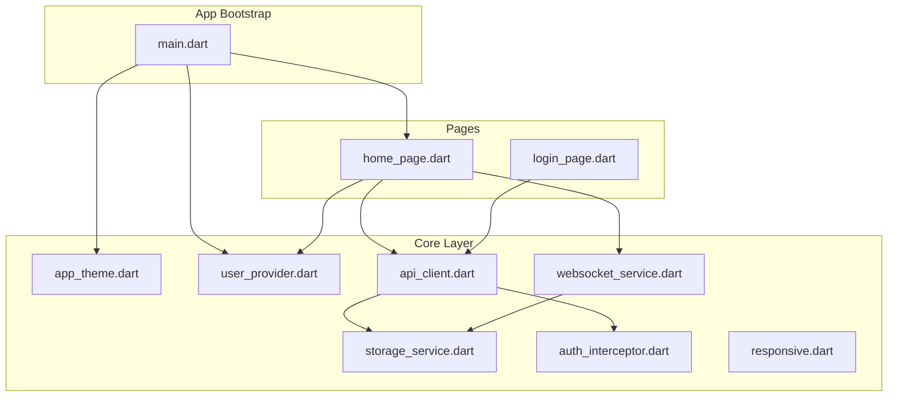
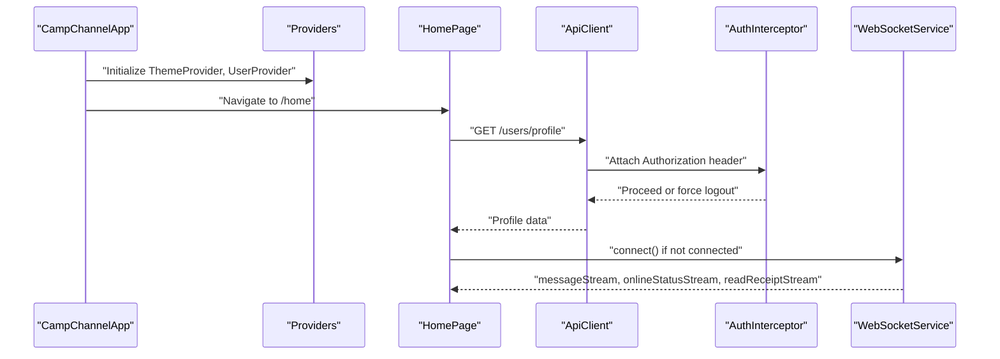
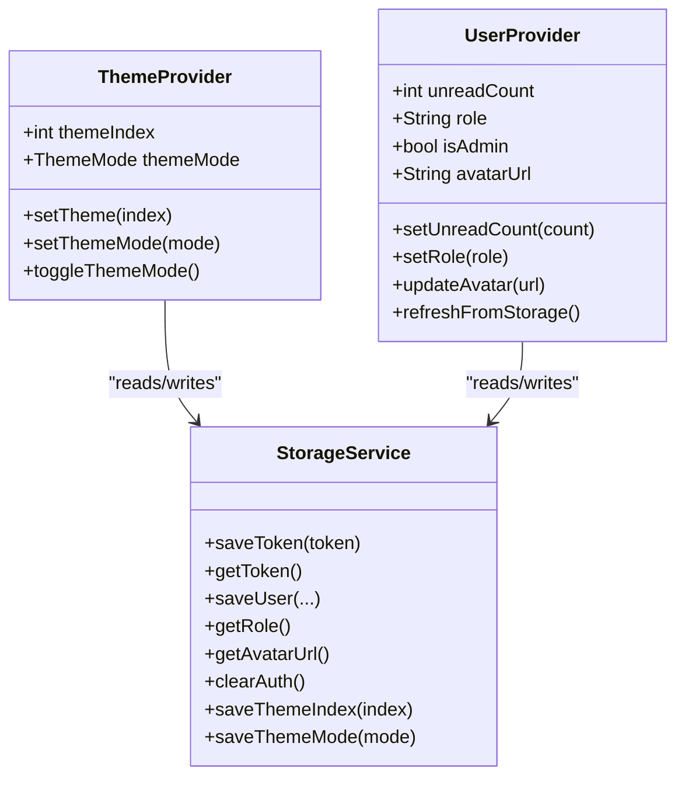
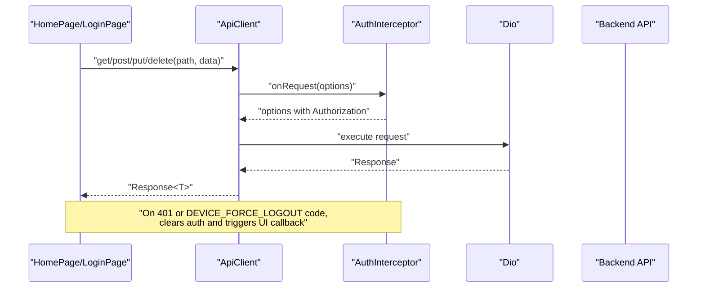
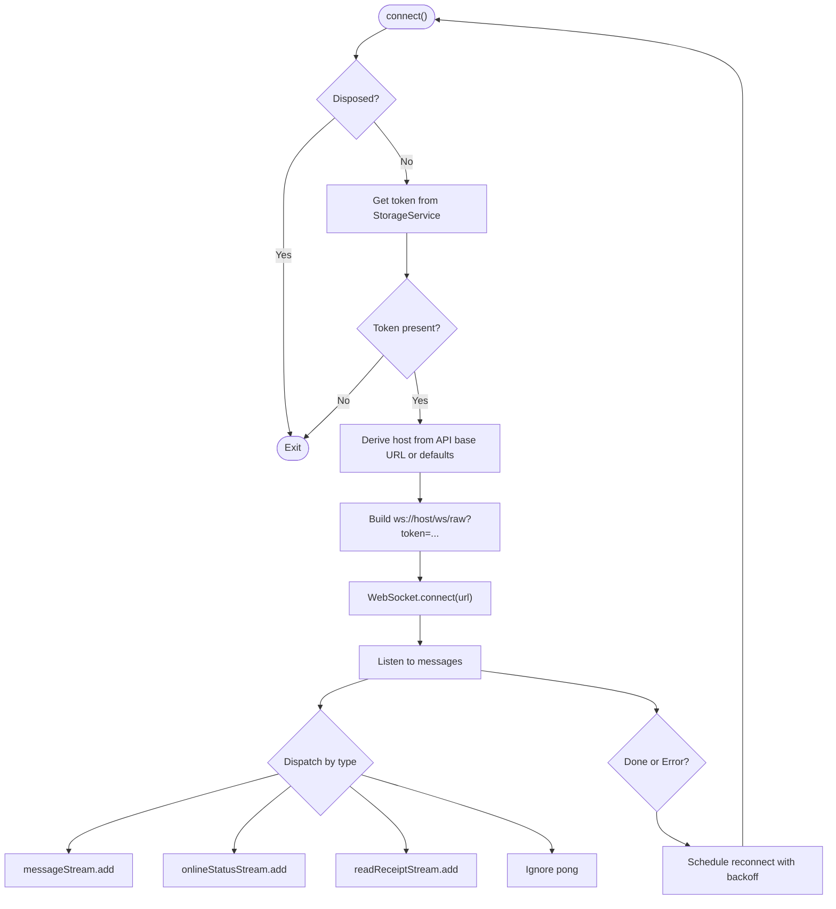
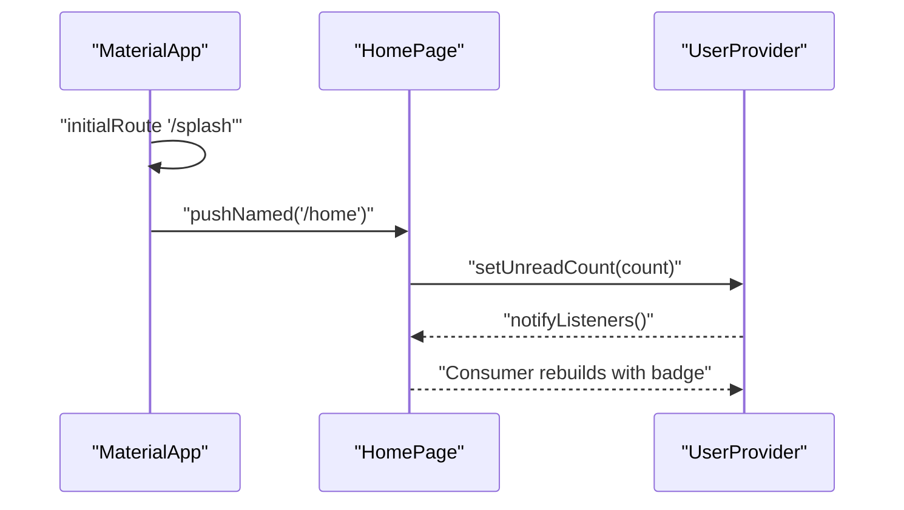
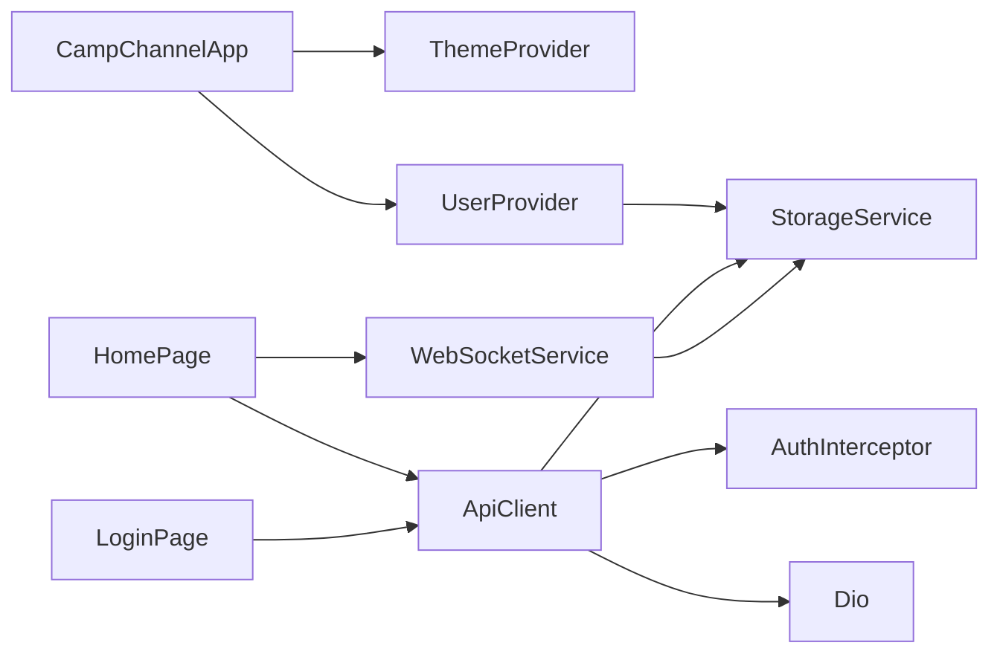

# Mobile Application - Flutter Client

<cite>
**Referenced Files in This Document**
- [pubspec.yaml](file://camp-channel-client-flutter/pubspec.yaml)
- [main.dart](file://camp-channel-client-flutter/lib/main.dart)
- [AndroidManifest.xml](file://camp-channel-client-flutter/android/app/src/main/AndroidManifest.xml)
- [analysis_options.yaml](file://camp-channel-client-flutter/analysis_options.yaml)
- [storage_service.dart](file://camp-channel-client-flutter/lib/core/services/storage_service.dart)
- [user_provider.dart](file://camp-channel-client-flutter/lib/core/services/user_provider.dart)
- [auth_interceptor.dart](file://camp-channel-client-flutter/lib/core/network/auth_interceptor.dart)
- [api_client.dart](file://camp-channel-client-flutter/lib/core/network/api_client.dart)
- [websocket_service.dart](file://camp-channel-client-flutter/lib/core/services/websocket_service.dart)
- [app_theme.dart](file://camp-channel-client-flutter/lib/core/theme/app_theme.dart)
- [responsive.dart](file://camp-channel-client-flutter/lib/core/utils/responsive.dart)
- [home_page.dart](file://camp-channel-client-flutter/lib/pages/home_page.dart)
- [login_page.dart](file://camp-channel-client-flutter/lib/pages/login_page.dart)
</cite>

## Table of Contents
1. [Introduction](#introduction)
2. [Project Structure](#project-structure)
3. [Core Components](#core-components)
4. [Architecture Overview](#architecture-overview)
5. [Detailed Component Analysis](#detailed-component-analysis)
6. [Dependency Analysis](#dependency-analysis)
7. [Performance Considerations](#performance-considerations)
8. [Troubleshooting Guide](#troubleshooting-guide)
9. [Conclusion](#conclusion)
10. [Appendices](#appendices)

## Introduction
This document explains the Flutter mobile application architecture for the campus channel ecosystem. It covers the cross-platform development approach using Dart, Provider-based state management, reactive UI components optimized for mobile interfaces, and integration with backend APIs via an HTTP client and WebSocket services for real-time messaging. It also documents mobile navigation patterns, platform-specific configurations for Android and iOS, performance optimization strategies, offline-aware behaviors, and push notification considerations. Finally, it outlines best practices for code organization, testing, and deployment pipelines for Android and iOS.

## Project Structure
The Flutter project follows a layered structure:
- Core: Services, network, themes, and utilities
- Pages: Feature-driven screens and navigation
- Widgets: Reusable UI components
- Root: Application bootstrap and global providers

**Diagram sources**
- [main.dart:21-121](file://camp-channel-client-flutter/lib/main.dart#L21-L121)
- [app_theme.dart:1-48](file://camp-channel-client-flutter/lib/core/theme/app_theme.dart#L1-L48)
- [storage_service.dart:1-124](file://camp-channel-client-flutter/lib/core/services/storage_service.dart#L1-L124)
- [user_provider.dart:1-35](file://camp-channel-client-flutter/lib/core/services/user_provider.dart#L1-L35)
- [auth_interceptor.dart:1-66](file://camp-channel-client-flutter/lib/core/network/auth_interceptor.dart#L1-L66)
- [api_client.dart:1-100](file://camp-channel-client-flutter/lib/core/network/api_client.dart#L1-L100)
- [websocket_service.dart:1-151](file://camp-channel-client-flutter/lib/core/services/websocket_service.dart#L1-L151)
- [responsive.dart:1-18](file://camp-channel-client-flutter/lib/core/utils/responsive.dart#L1-L18)
- [home_page.dart:1-152](file://camp-channel-client-flutter/lib/pages/home_page.dart#L1-L152)
- [login_page.dart:1-315](file://camp-channel-client-flutter/lib/pages/login_page.dart#L1-L315)

**Section sources**
- [main.dart:21-121](file://camp-channel-client-flutter/lib/main.dart#L21-L121)
- [pubspec.yaml:1-38](file://camp-channel-client-flutter/pubspec.yaml#L1-L38)

## Core Components
- State Management: Provider with ChangeNotifier for theme and user state
- Authentication: Shared preferences-backed storage and Dio interceptors
- Networking: Singleton API client with timeouts and logging
- Real-time Messaging: WebSocket service with heartbeat and exponential backoff
- Theming: ThemeProvider backed by persistent theme preferences
- Responsive UI: Utility to detect device class and content widths

**Section sources**
- [user_provider.dart:1-35](file://camp-channel-client-flutter/lib/core/services/user_provider.dart#L1-L35)
- [app_theme.dart:1-48](file://camp-channel-client-flutter/lib/core/theme/app_theme.dart#L1-L48)
- [storage_service.dart:1-124](file://camp-channel-client-flutter/lib/core/services/storage_service.dart#L1-L124)
- [auth_interceptor.dart:1-66](file://camp-channel-client-flutter/lib/core/network/auth_interceptor.dart#L1-L66)
- [api_client.dart:1-100](file://camp-channel-client-flutter/lib/core/network/api_client.dart#L1-L100)
- [websocket_service.dart:1-151](file://camp-channel-client-flutter/lib/core/services/websocket_service.dart#L1-L151)
- [responsive.dart:1-18](file://camp-channel-client-flutter/lib/core/utils/responsive.dart#L1-L18)

## Architecture Overview
The app initializes storage, sets up global providers, and mounts a Material-based app with named routes. Authentication is enforced via an interceptor that attaches tokens and handles force logout. The API client encapsulates HTTP requests and image URL normalization. The WebSocket service manages real-time events with heartbeat and reconnect logic.

**Diagram sources**
- [main.dart:84-121](file://camp-channel-client-flutter/lib/main.dart#L84-L121)
- [home_page.dart:31-51](file://camp-channel-client-flutter/lib/pages/home_page.dart#L31-L51)
- [api_client.dart:65-100](file://camp-channel-client-flutter/lib/core/network/api_client.dart#L65-L100)
- [auth_interceptor.dart:9-53](file://camp-channel-client-flutter/lib/core/network/auth_interceptor.dart#L9-L53)
- [websocket_service.dart:34-90](file://camp-channel-client-flutter/lib/core/services/websocket_service.dart#L34-L90)

## Detailed Component Analysis

### State Management with Provider
- ThemeProvider persists and toggles theme mode and index.
- UserProvider exposes unread count, role, admin flag, avatar URL, and refresh from storage.
- App bootstraps providers and exposes them globally.

**Diagram sources**
- [app_theme.dart:5-47](file://camp-channel-client-flutter/lib/core/theme/app_theme.dart#L5-L47)
- [user_provider.dart:4-34](file://camp-channel-client-flutter/lib/core/services/user_provider.dart#L4-L34)
- [storage_service.dart:3-124](file://camp-channel-client-flutter/lib/core/services/storage_service.dart#L3-L124)

**Section sources**
- [app_theme.dart:1-48](file://camp-channel-client-flutter/lib/core/theme/app_theme.dart#L1-L48)
- [user_provider.dart:1-35](file://camp-channel-client-flutter/lib/core/services/user_provider.dart#L1-L35)
- [storage_service.dart:1-124](file://camp-channel-client-flutter/lib/core/services/storage_service.dart#L1-L124)
- [main.dart:86-90](file://camp-channel-client-flutter/lib/main.dart#L86-L90)

### API Service Integration
- Singleton Dio client with configurable base URL, timeouts, JSON content type, and interceptors.
- Automatic Authorization header injection and force logout handling.
- Image URL normalization by stripping "/api" suffix from base URL.

**Diagram sources**
- [api_client.dart:11-52](file://camp-channel-client-flutter/lib/core/network/api_client.dart#L11-L52)
- [auth_interceptor.dart:9-53](file://camp-channel-client-flutter/lib/core/network/auth_interceptor.dart#L9-L53)
- [login_page.dart:48-98](file://camp-channel-client-flutter/lib/pages/login_page.dart#L48-L98)
- [home_page.dart:53-83](file://camp-channel-client-flutter/lib/pages/home_page.dart#L53-L83)

**Section sources**
- [api_client.dart:1-100](file://camp-channel-client-flutter/lib/core/network/api_client.dart#L1-L100)
- [auth_interceptor.dart:1-66](file://camp-channel-client-flutter/lib/core/network/auth_interceptor.dart#L1-L66)
- [login_page.dart:1-315](file://camp-channel-client-flutter/lib/pages/login_page.dart#L1-L315)
- [home_page.dart:1-152](file://camp-channel-client-flutter/lib/pages/home_page.dart#L1-L152)

### WebSocket Connection Handling
- Establishes connection using stored token and derived host from API base URL.
- Broadcast streams for messages, online status, and read receipts.
- Heartbeat ping every 30 seconds; exponential backoff reconnect with capped delay.
- Disposal and reconnection reset helpers.

**Diagram sources**
- [websocket_service.dart:34-151](file://camp-channel-client-flutter/lib/core/services/websocket_service.dart#L34-L151)

**Section sources**
- [websocket_service.dart:1-151](file://camp-channel-client-flutter/lib/core/services/websocket_service.dart#L1-L151)

### Mobile Navigation Patterns
- Named routes configured at the app level.
- Bottom navigation bar with page view for tabbed experiences.
- Unread badge updates reactively from UserProvider.

**Diagram sources**
- [main.dart:100-116](file://camp-channel-client-flutter/lib/main.dart#L100-L116)
- [home_page.dart:93-148](file://camp-channel-client-flutter/lib/pages/home_page.dart#L93-L148)

**Section sources**
- [main.dart:100-116](file://camp-channel-client-flutter/lib/main.dart#L100-L116)
- [home_page.dart:19-151](file://camp-channel-client-flutter/lib/pages/home_page.dart#L19-L151)

### Platform-Specific Features and Permissions
- Android manifest declares internet and network state permissions and cleartext traffic allowance.
- Base URL defaults vary per platform; Android uses a LAN address while others default to localhost.

**Section sources**
- [AndroidManifest.xml:1-49](file://camp-channel-client-flutter/android/app/src/main/AndroidManifest.xml#L1-L49)
- [api_client.dart:43-50](file://camp-channel-client-flutter/lib/core/network/api_client.dart#L43-L50)

### Offline Scenarios and Push Notifications
- Offline behavior: Network failures are handled by Dio exceptions; UI surfaces user-friendly messages. The app does not implement explicit offline caching layers in the analyzed code.
- Push notifications: No explicit FCM/Push SDK integration is present in the analyzed code; therefore, push handling is out-of-scope here.

**Section sources**
- [login_page.dart:83-97](file://camp-channel-client-flutter/lib/pages/login_page.dart#L83-L97)
- [auth_interceptor.dart:31-53](file://camp-channel-client-flutter/lib/core/network/auth_interceptor.dart#L31-L53)

## Dependency Analysis
External dependencies include Dio for HTTP, Provider for state, shared_preferences for persistence, and cached_network_image for image loading. Linting is configured via flutter_lints.

**Diagram sources**
- [pubspec.yaml:8-30](file://camp-channel-client-flutter/pubspec.yaml#L8-L30)
- [main.dart:84-121](file://camp-channel-client-flutter/lib/main.dart#L84-L121)
- [home_page.dart:21-51](file://camp-channel-client-flutter/lib/pages/home_page.dart#L21-L51)
- [login_page.dart:24](file://camp-channel-client-flutter/lib/pages/login_page.dart#L24)
- [api_client.dart:11-24](file://camp-channel-client-flutter/lib/core/network/api_client.dart#L11-L24)
- [auth_interceptor.dart:1-66](file://camp-channel-client-flutter/lib/core/network/auth_interceptor.dart#L1-L66)

**Section sources**
- [pubspec.yaml:1-38](file://camp-channel-client-flutter/pubspec.yaml#L1-L38)
- [analysis_options.yaml:1-29](file://camp-channel-client-flutter/analysis_options.yaml#L1-L29)

## Performance Considerations
- HTTP client configuration: Short connect/receive timeouts reduce hanging requests on mobile networks.
- Logging: LogInterceptor enabled in Dio aids debugging but should be disabled in production builds.
- Image loading: cached_network_image improves perceived performance for remote images.
- Reconnection: WebSocket exponential backoff prevents thundering herd on server restarts.
- UI responsiveness: Provider-based reactive updates minimize unnecessary rebuilds; keep listeners scoped to affected widgets.

[No sources needed since this section provides general guidance]

## Troubleshooting Guide
- Authentication failures: AuthInterceptor clears credentials and triggers a force logout dialog; ensure token validity and backend error codes align with expected values.
- Network errors: LoginPage catches DioException and surfaces user-friendly messages; verify base URL and connectivity.
- WebSocket disconnects: Automatic reconnect with exponential backoff; inspect heartbeat and server-side handlers.

**Section sources**
- [auth_interceptor.dart:55-64](file://camp-channel-client-flutter/lib/core/network/auth_interceptor.dart#L55-L64)
- [login_page.dart:83-97](file://camp-channel-client-flutter/lib/pages/login_page.dart#L83-L97)
- [websocket_service.dart:121-136](file://camp-channel-client-flutter/lib/core/services/websocket_service.dart#L121-L136)

## Conclusion
The Flutter client employs a clean separation of concerns with Provider-managed state, a robust HTTP client with authentication interception, and a resilient WebSocket service for real-time messaging. The architecture supports responsive UI, persistent preferences, and platform-specific defaults. Extending offline capabilities and integrating push notifications would further improve user experience across diverse network conditions.

[No sources needed since this section summarizes without analyzing specific files]

## Appendices

### Configuration Options for Android/iOS Deployment
- Android: Internet permission, network state permission, cleartext traffic allowed for development, hardware acceleration enabled, and singleTop launch mode.
- iOS: No explicit configuration observed in the analyzed code; typical Flutter iOS defaults apply.

**Section sources**
- [AndroidManifest.xml:1-49](file://camp-channel-client-flutter/android/app/src/main/AndroidManifest.xml#L1-L49)

### Testing Strategies
- Unit tests: Use flutter_test and mock Dio/Storage/WebSocket for isolated logic.
- Widget tests: Verify UI flows like login form validation and navigation.
- Linting: Enforce flutter_lints for consistent code quality.

**Section sources**
- [analysis_options.yaml:10-29](file://camp-channel-client-flutter/analysis_options.yaml#L10-L29)

### Deployment Pipelines
- Android: Build via Gradle; ensure signing configs and minSdkVersion meet target devices.
- iOS: Build via Xcode or command line; configure provisioning profiles and entitlements as needed.
- CI/CD: Cache dependencies, run lints and tests, and produce signed artifacts for distribution.

[No sources needed since this section provides general guidance]