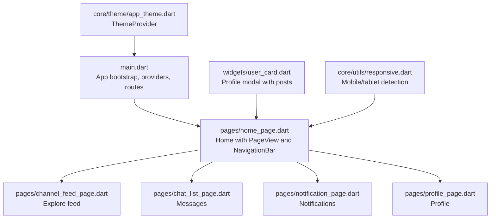
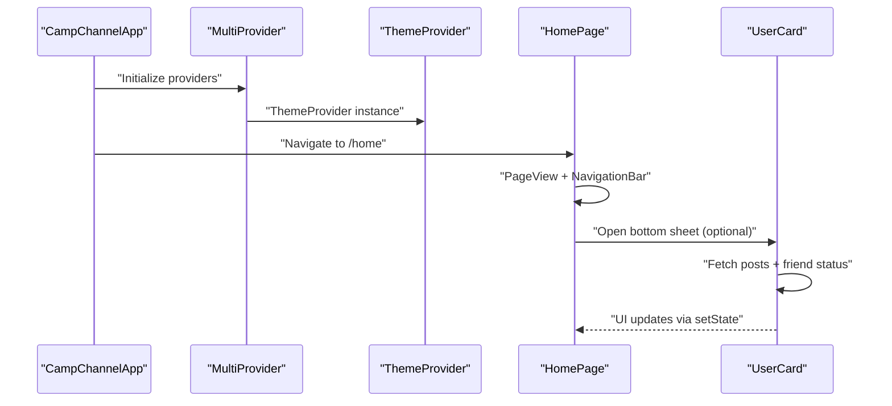
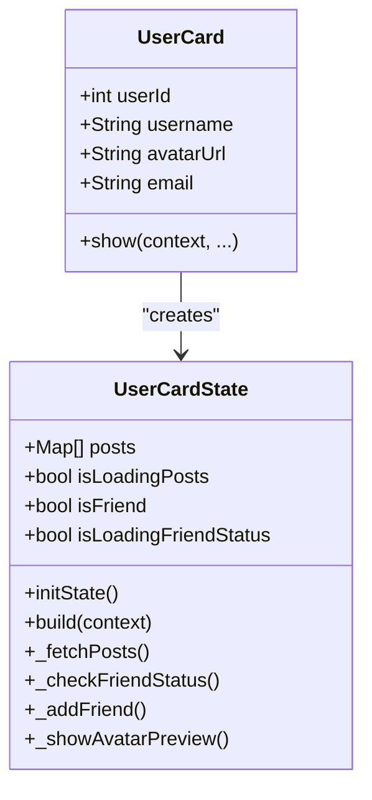
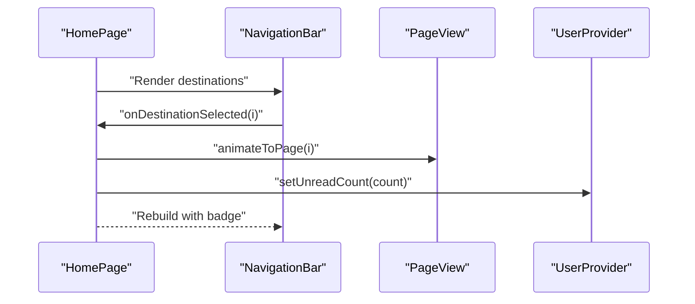
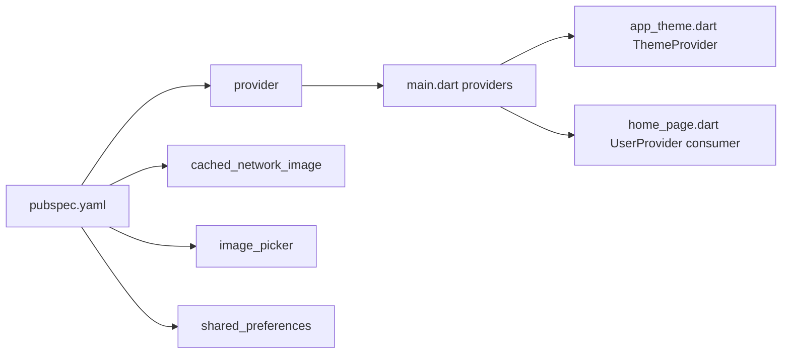

# Mobile-optimized UI Components

<cite>
**Referenced Files in This Document**
- [main.dart](file://camp-channel-client-flutter/lib/main.dart)
- [user_card.dart](file://camp-channel-client-flutter/lib/widgets/user_card.dart)
- [home_page.dart](file://camp-channel-client-flutter/lib/pages/home_page.dart)
- [responsive.dart](file://camp-channel-client-flutter/lib/core/utils/responsive.dart)
- [app_theme.dart](file://camp-channel-client-flutter/lib/core/theme/app_theme.dart)
- [pubspec.yaml](file://camp-channel-client-flutter/pubspec.yaml)
</cite>

## Table of Contents
1. [Introduction](#introduction)
2. [Project Structure](#project-structure)
3. [Core Components](#core-components)
4. [Architecture Overview](#architecture-overview)
5. [Detailed Component Analysis](#detailed-component-analysis)
6. [Dependency Analysis](#dependency-analysis)
7. [Performance Considerations](#performance-considerations)
8. [Troubleshooting Guide](#troubleshooting-guide)
9. [Conclusion](#conclusion)

## Introduction
This document focuses on the mobile-optimized UI components and design patterns implemented in the Flutter application. It explains how custom widgets are tailored for mobile interfaces, how responsive design principles and Material 3 navigation are applied, and how state management integrates with UI updates. It also covers performance optimizations, accessibility considerations, internationalization support, and platform-specific UI adaptations for Android and iOS.

## Project Structure
The Flutter application organizes UI logic under lib/, with the main entry point initializing providers and routing. The pages directory contains the primary screens, while the widgets directory holds reusable components such as the UserCard. Utility modules provide responsive breakpoints and theme management.



**Diagram sources**
- [main.dart:84-121](file://camp-channel-client-flutter/lib/main.dart#L84-L121)
- [home_page.dart:86-151](file://camp-channel-client-flutter/lib/pages/home_page.dart#L86-L151)
- [responsive.dart:3-17](file://camp-channel-client-flutter/lib/core/utils/responsive.dart#L3-L17)
- [app_theme.dart:5-47](file://camp-channel-client-flutter/lib/core/theme/app_theme.dart#L5-L47)

**Section sources**
- [main.dart:21-121](file://camp-channel-client-flutter/lib/main.dart#L21-L121)
- [pubspec.yaml:8-33](file://camp-channel-client-flutter/pubspec.yaml#L8-L33)

## Core Components
- UserCard: A bottom-sheet-style profile card that displays user identity, avatar, contact actions, friend status, and a scrollable list of recent posts. It encapsulates network calls, loading states, and user interactions.
- HomePage: The main tabbed interface using a PageView and a NavigationBar. It manages unread counts via a WebSocket-backed service and integrates with the theme provider.

Key mobile-specific patterns:
- Bottom sheet presentation for profile details with a draggable handle area.
- Adaptive sizing using MediaQuery and fixed heights for navigation.
- Provider-based state management for theme and user data.
- Material 3 NavigationBar with badges for unread notifications.

**Section sources**
- [user_card.dart:6-41](file://camp-channel-client-flutter/lib/widgets/user_card.dart#L6-L41)
- [home_page.dart:12-17](file://camp-channel-client-flutter/lib/pages/home_page.dart#L12-L17)

## Architecture Overview
The app initializes providers for theme and user state, sets up global routes, and renders the home screen. The HomePage orchestrates page transitions and bottom navigation, while the UserCard composes UI elements and handles asynchronous data fetching.



**Diagram sources**
- [main.dart:86-119](file://camp-channel-client-flutter/lib/main.dart#L86-L119)
- [home_page.dart:86-151](file://camp-channel-client-flutter/lib/pages/home_page.dart#L86-L151)
- [user_card.dart:50-96](file://camp-channel-client-flutter/lib/widgets/user_card.dart#L50-L96)

## Detailed Component Analysis

### UserCard: Mobile-optimized Profile Card
UserCard is a stateful widget designed for mobile use with a bottom-sheet presentation pattern. It:
- Accepts user identity props and conditionally renders avatar or placeholder initials.
- Fetches user posts and friend status on initialization.
- Provides actions such as private chat and friend request.
- Displays a scrollable list of posts with truncated content and subtle cards.



**Diagram sources**
- [user_card.dart:6-41](file://camp-channel-client-flutter/lib/widgets/user_card.dart#L6-L41)
- [user_card.dart:43-96](file://camp-channel-client-flutter/lib/widgets/user_card.dart#L43-L96)

Implementation highlights:
- Bottom sheet presentation with scroll control and transparent backdrop.
- Conditional rendering of action buttons based on ownership and friend status.
- Loading indicators and empty-state visuals for lists.
- Network calls using a dedicated API client and error handling via snack bars.

**Section sources**
- [user_card.dart:20-37](file://camp-channel-client-flutter/lib/widgets/user_card.dart#L20-L37)
- [user_card.dart:57-76](file://camp-channel-client-flutter/lib/widgets/user_card.dart#L57-L76)
- [user_card.dart:78-96](file://camp-channel-client-flutter/lib/widgets/user_card.dart#L78-L96)
- [user_card.dart:125-160](file://camp-channel-client-flutter/lib/widgets/user_card.dart#L125-L160)
- [user_card.dart:234-261](file://camp-channel-client-flutter/lib/widgets/user_card.dart#L234-L261)
- [user_card.dart:278-331](file://camp-channel-client-flutter/lib/widgets/user_card.dart#L278-L331)

### HomePage: Mobile Navigation and Layout
HomePage implements a bottom-tabbed interface optimized for mobile:
- Uses a PageView to switch between content pages.
- NavigationBar with icons, selected icons, and badge indicators for unread messages.
- Integrates with UserProvider to update unread counts and with WebSocketService for real-time updates.



**Diagram sources**
- [home_page.dart:86-151](file://camp-channel-client-flutter/lib/pages/home_page.dart#L86-L151)

**Section sources**
- [home_page.dart:19-38](file://camp-channel-client-flutter/lib/pages/home_page.dart#L19-L38)
- [home_page.dart:86-151](file://camp-channel-client-flutter/lib/pages/home_page.dart#L86-L151)

### Responsive Design Principles
The app uses a simple breakpoint to distinguish mobile from tablet experiences:
- Mobile: width < 600
- Tablet: width in [600, 1200)
- Content width adapts accordingly for layouts that require constrained widths.

These utilities enable consistent spacing and content sizing across form factors.

**Section sources**
- [responsive.dart:3-17](file://camp-channel-client-flutter/lib/core/utils/responsive.dart#L3-L17)

### Theme and Platform Adaptations
- ThemeProvider persists theme mode and index, notifying listeners to rebuild themed widgets.
- The app uses Material 3 design tokens and adapts to light/dark modes.
- Platform-specific icons and behaviors are handled by Flutter’s Material and Cupertino defaults.

**Section sources**
- [app_theme.dart:5-47](file://camp-channel-client-flutter/lib/core/theme/app_theme.dart#L5-L47)
- [main.dart:93-99](file://camp-channel-client-flutter/lib/main.dart#L93-L99)

### State Management Integration
- MultiProvider registers ThemeProvider and UserProvider at the app level.
- HomePage consumes UserProvider to reflect unread counts in the navigation bar.
- UserCard triggers UI updates via setState after asynchronous operations.

```mermaid
flowchart TD
Start(["User interaction"]) --> Action{"Action type"}
Action --> |Tap "Add Friend"| CallAPI["Call API client"]
Action --> |Open Profile Sheet| LoadData["Load posts & friend status"]
Action --> |Change Tab| SwitchPage["PageView animateToPage"]
CallAPI --> UpdateUI["setState -> rebuild"]
LoadData --> UpdateUI
SwitchPage --> UpdateUI
UpdateUI --> End(["UI updated"])
```

**Diagram sources**
- [user_card.dart:98-123](file://camp-channel-client-flutter/lib/widgets/user_card.dart#L98-L123)
- [home_page.dart:98-104](file://camp-channel-client-flutter/lib/pages/home_page.dart#L98-L104)

## Dependency Analysis
External dependencies relevant to UI and state:
- provider: State management via ChangeNotifierProvider and Consumer.
- cached_network_image: Efficient image loading for avatars and posts.
- image_picker: Avatar upload capability.
- shared_preferences: Persisting theme and user preferences.



**Diagram sources**
- [pubspec.yaml:8-33](file://camp-channel-client-flutter/pubspec.yaml#L8-L33)
- [main.dart:86-90](file://camp-channel-client-flutter/lib/main.dart#L86-L90)

**Section sources**
- [pubspec.yaml:8-33](file://camp-channel-client-flutter/pubspec.yaml#L8-L33)
- [main.dart:86-90](file://camp-channel-client-flutter/lib/main.dart#L86-L90)

## Performance Considerations
- Prefer lightweight widgets and avoid unnecessary rebuilds by scoping Consumer to minimal subtrees.
- Use ListView.builder for long lists to reduce memory footprint.
- Defer heavy computations off the UI thread and leverage caching for images.
- Keep bottom sheets closed when not in use to minimize layout work.
- Use PageStorage or PageController to preserve scroll positions across tabs.

## Troubleshooting Guide
Common issues and remedies:
- Bottom sheet not dismissing: Ensure showModalBottomSheet is called with a proper context and that the widget is mounted before setState.
- Empty or stale data: Verify API responses and handle error branches; confirm mounted checks before updating state.
- Navigation badge not updating: Confirm UserProvider updates are triggered and Consumer is wrapping the NavigationBar.
- Theme not persisting: Check storage keys and ThemeProvider setters for correctness.

**Section sources**
- [user_card.dart:64-76](file://camp-channel-client-flutter/lib/widgets/user_card.dart#L64-L76)
- [home_page.dart:93-148](file://camp-channel-client-flutter/lib/pages/home_page.dart#L93-L148)
- [app_theme.dart:29-46](file://camp-channel-client-flutter/lib/core/theme/app_theme.dart#L29-L46)

## Conclusion
The Flutter application demonstrates mobile-first UI design with Material 3 navigation, responsive breakpoints, and provider-driven state management. The UserCard and HomePage showcase practical patterns for bottom-sheet modals, tabbed navigation, and real-time updates. By following the outlined practices—scoped state updates, efficient list rendering, and robust error handling—the UI remains responsive and accessible across Android and iOS devices.