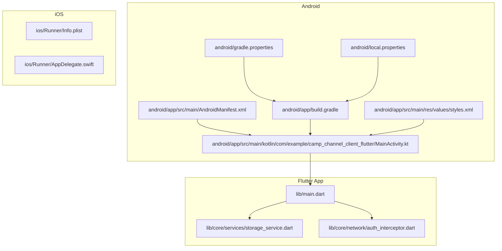
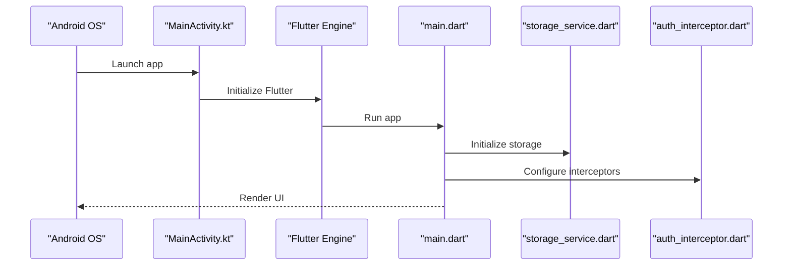
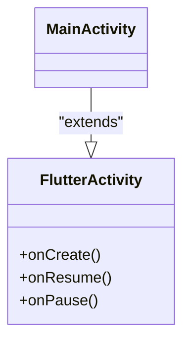
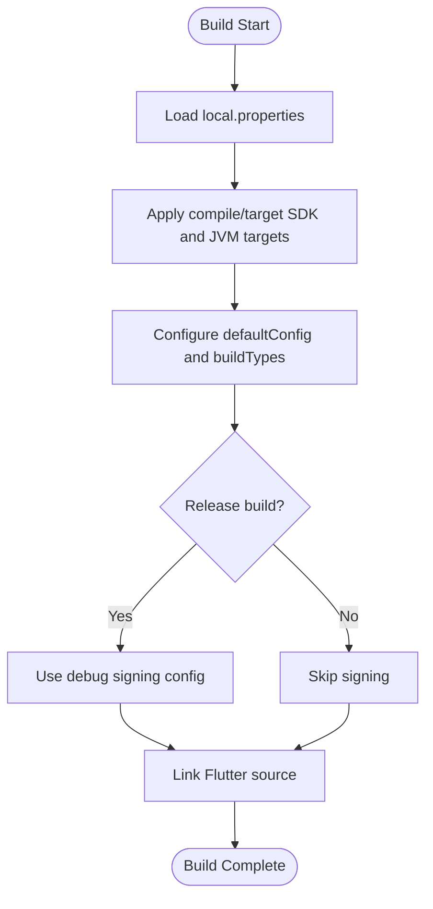
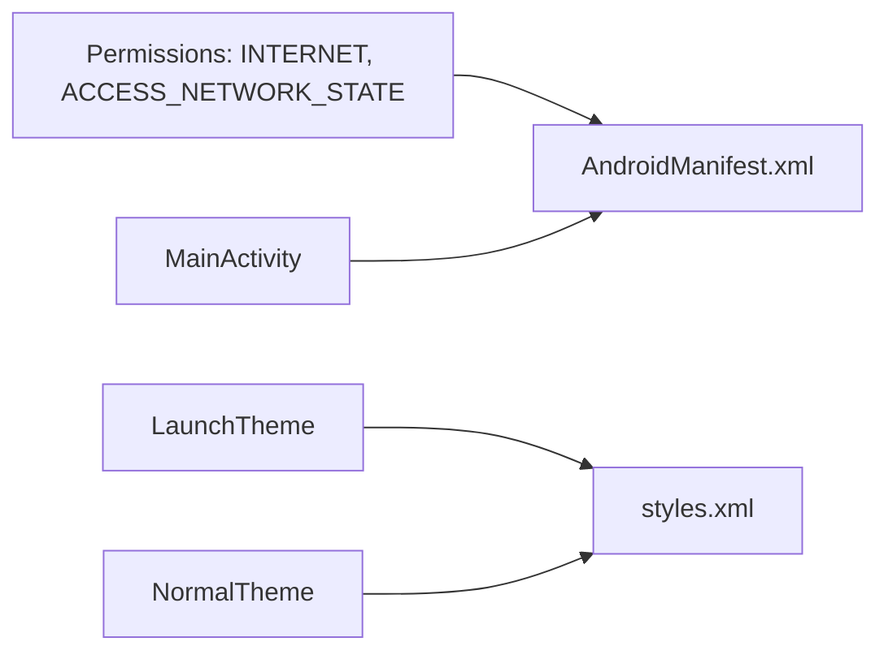
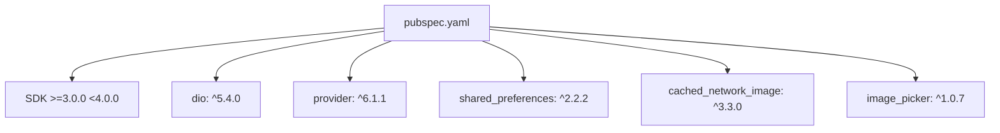
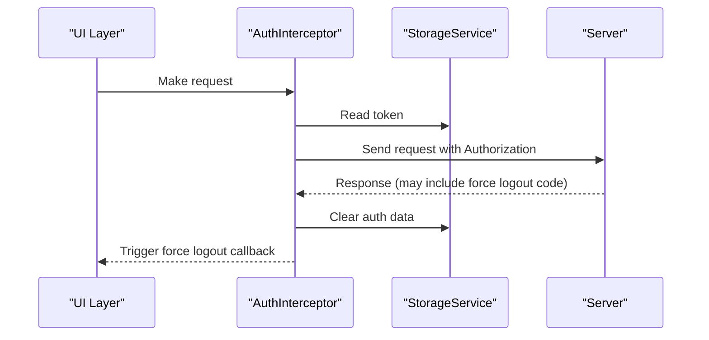
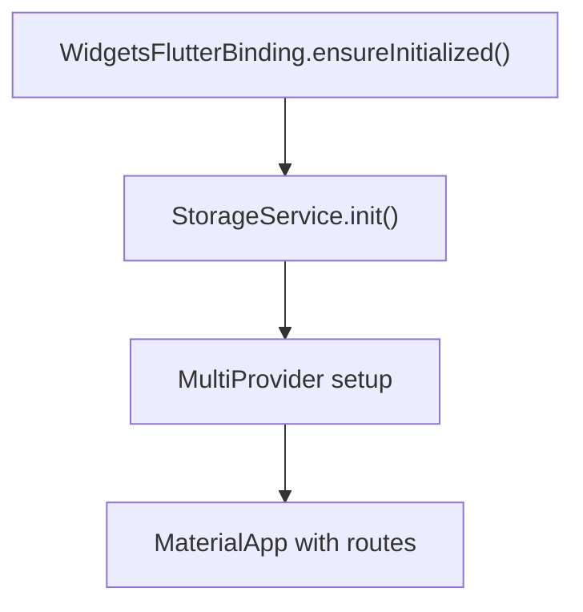
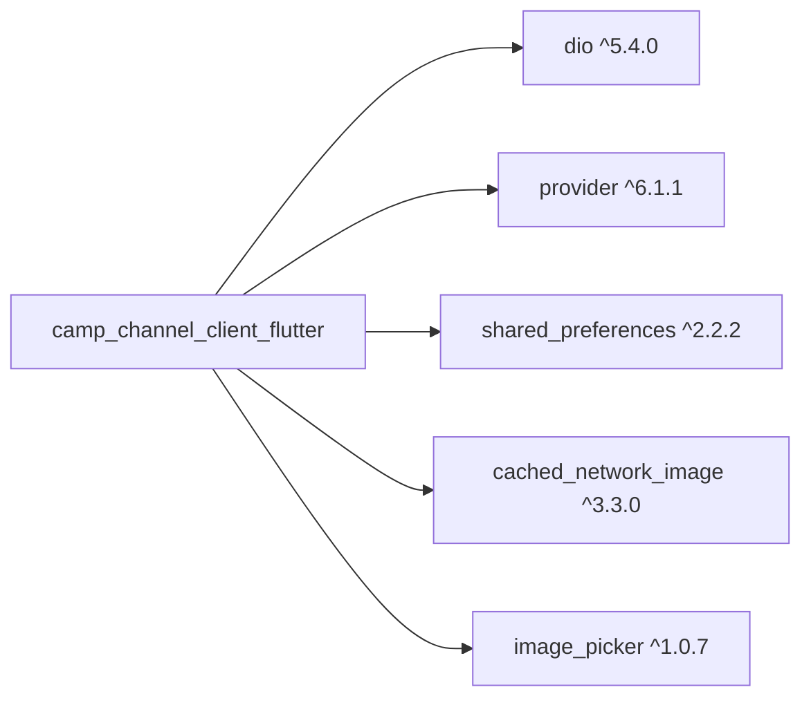

# Platform Integration and Deployment

<cite>
**Referenced Files in This Document**
- [pubspec.yaml](file://camp-channel-client-flutter/pubspec.yaml)
- [MainActivity.kt](file://camp-channel-client-flutter/android/app/src/main/kotlin/com/example/camp_channel_client_flutter/MainActivity.kt)
- [AndroidManifest.xml](file://camp-channel-client-flutter/android/app/src/main/AndroidManifest.xml)
- [build.gradle](file://camp-channel-client-flutter/android/app/build.gradle)
- [gradle.properties](file://camp-channel-client-flutter/android/gradle.properties)
- [local.properties](file://camp-channel-client-flutter/android/local.properties)
- [styles.xml](file://camp-channel-client-flutter/android/app/src/main/res/values/styles.xml)
- [main.dart](file://camp-channel-client-flutter/lib/main.dart)
- [storage_service.dart](file://camp-channel-client-flutter/lib/core/services/storage_service.dart)
- [auth_interceptor.dart](file://camp-channel-client-flutter/lib/core/network/auth_interceptor.dart)
- [analysis_options.yaml](file://camp-channel-client-flutter/analysis_options.yaml)
- [README.md](file://camp-channel-client-flutter/README.md)
</cite>

## Table of Contents
1. [Introduction](#introduction)
2. [Project Structure](#project-structure)
3. [Core Components](#core-components)
4. [Architecture Overview](#architecture-overview)
5. [Detailed Component Analysis](#detailed-component-analysis)
6. [Dependency Analysis](#dependency-analysis)
7. [Performance Considerations](#performance-considerations)
8. [Troubleshooting Guide](#troubleshooting-guide)
9. [Conclusion](#conclusion)
10. [Appendices](#appendices)

## Introduction
This document provides comprehensive platform integration and deployment strategies for the Flutter mobile application targeting Android and iOS. It explains Android-specific implementation details including the MainActivity configuration and Kotlin integration, pubspec.yaml configuration and dependency management, Android build process and signing configuration, and release preparation steps. It also covers iOS deployment considerations, cross-platform compatibility, performance optimization, testing strategies across Android and iOS versions, and CI/CD and release management processes.

## Project Structure
The Flutter application is organized into platform-specific and shared directories:
- Android platform configuration under android/
- iOS platform configuration under ios/ (managed by Flutter)
- Shared Dart code under lib/
- Build and packaging metadata under pubspec.yaml and related Gradle files

**Diagram sources**
- [main.dart:1-122](file://camp-channel-client-flutter/lib/main.dart#L1-L122)
- [storage_service.dart:1-124](file://camp-channel-client-flutter/lib/core/services/storage_service.dart#L1-L124)
- [auth_interceptor.dart:1-66](file://camp-channel-client-flutter/lib/core/network/auth_interceptor.dart#L1-L66)
- [MainActivity.kt:1-6](file://camp-channel-client-flutter/android/app/src/main/kotlin/com/example/camp_channel_client_flutter/MainActivity.kt#L1-L6)
- [AndroidManifest.xml:1-49](file://camp-channel-client-flutter/android/app/src/main/AndroidManifest.xml#L1-L49)
- [build.gradle:1-63](file://camp-channel-client-flutter/android/app/build.gradle#L1-L63)
- [gradle.properties:1-24](file://camp-channel-client-flutter/android/gradle.properties#L1-L24)
- [local.properties:1-5](file://camp-channel-client-flutter/android/local.properties#L1-L5)
- [styles.xml:1-19](file://camp-channel-client-flutter/android/app/src/main/res/values/styles.xml#L1-L19)

**Section sources**
- [README.md:1-17](file://camp-channel-client-flutter/README.md#L1-L17)

## Core Components
- Android MainActivity written in Kotlin integrates the Flutter engine and exposes the main Activity lifecycle to Flutter.
- AndroidManifest.xml declares permissions, the main Activity, hardware acceleration, and intent queries for text processing.
- Gradle build scripts define SDK versions, Java/Kotlin compatibility, signing configuration, and Flutter source linkage.
- Gradle properties enable performance optimizations such as parallel builds, configuration caching, and build cache.
- Local properties provide versioning and SDK locations used during builds.
- Styles define launch and normal themes for Android windows.

**Section sources**
- [MainActivity.kt:1-6](file://camp-channel-client-flutter/android/app/src/main/kotlin/com/example/camp_channel_client_flutter/MainActivity.kt#L1-L6)
- [AndroidManifest.xml:1-49](file://camp-channel-client-flutter/android/app/src/main/AndroidManifest.xml#L1-L49)
- [build.gradle:26-58](file://camp-channel-client-flutter/android/app/build.gradle#L26-L58)
- [gradle.properties:1-24](file://camp-channel-client-flutter/android/gradle.properties#L1-L24)
- [local.properties:1-5](file://camp-channel-client-flutter/android/local.properties#L1-L5)
- [styles.xml:1-19](file://camp-channel-client-flutter/android/app/src/main/res/values/styles.xml#L1-L19)

## Architecture Overview
The app initializes the Flutter binding, sets up storage, and runs the main application widget. Network requests are intercepted to manage authentication tokens and handle force logout scenarios. On Android, the MainActivity hosts the Flutter engine and the app’s Android configuration is defined via Gradle and Manifest.

**Diagram sources**
- [MainActivity.kt:1-6](file://camp-channel-client-flutter/android/app/src/main/kotlin/com/example/camp_channel_client_flutter/MainActivity.kt#L1-L6)
- [main.dart:21-25](file://camp-channel-client-flutter/lib/main.dart#L21-L25)
- [storage_service.dart:16-18](file://camp-channel-client-flutter/lib/core/services/storage_service.dart#L16-L18)
- [auth_interceptor.dart:1-66](file://camp-channel-client-flutter/lib/core/network/auth_interceptor.dart#L1-L66)

## Detailed Component Analysis

### Android MainActivity and Kotlin Integration
- MainActivity extends FlutterActivity, enabling Flutter’s Android embedding.
- The Activity is declared in AndroidManifest.xml and exported for launcher intents.
- Hardware acceleration is enabled, and configuration changes are handled for robustness.

**Diagram sources**
- [MainActivity.kt:1-6](file://camp-channel-client-flutter/android/app/src/main/kotlin/com/example/camp_channel_client_flutter/MainActivity.kt#L1-L6)

**Section sources**
- [MainActivity.kt:1-6](file://camp-channel-client-flutter/android/app/src/main/kotlin/com/example/camp_channel_client_flutter/MainActivity.kt#L1-L6)
- [AndroidManifest.xml:9-30](file://camp-channel-client-flutter/android/app/src/main/AndroidManifest.xml#L9-L30)

### Android Build Configuration and Signing
- The Gradle script defines compile/target SDK versions, Java/Kotlin compatibility, and Flutter-managed SDK properties.
- Versioning is sourced from local.properties (versionName/versionCode).
- Release signing is currently configured to use debug signing; production releases require adding a proper signingConfig.

**Diagram sources**
- [build.gradle:8-24](file://camp-channel-client-flutter/android/app/build.gradle#L8-L24)
- [build.gradle:40-57](file://camp-channel-client-flutter/android/app/build.gradle#L40-L57)
- [local.properties:4-5](file://camp-channel-client-flutter/android/local.properties#L4-L5)

**Section sources**
- [build.gradle:1-63](file://camp-channel-client-flutter/android/app/build.gradle#L1-L63)
- [local.properties:1-5](file://camp-channel-client-flutter/android/local.properties#L1-L5)

### Android Permissions, Launch Behavior, and Themes
- Internet and network state permissions are declared.
- MainActivity is exported and configured with singleTop launch mode, hardware acceleration, and comprehensive configChanges handling.
- LaunchTheme and NormalTheme are defined for smooth startup and runtime UI appearance.

**Diagram sources**
- [AndroidManifest.xml:2-6](file://camp-channel-client-flutter/android/app/src/main/AndroidManifest.xml#L2-L6)
- [AndroidManifest.xml:9-30](file://camp-channel-client-flutter/android/app/src/main/AndroidManifest.xml#L9-L30)
- [styles.xml:3-17](file://camp-channel-client-flutter/android/app/src/main/res/values/styles.xml#L3-L17)

**Section sources**
- [AndroidManifest.xml:1-49](file://camp-channel-client-flutter/android/app/src/main/AndroidManifest.xml#L1-L49)
- [styles.xml:1-19](file://camp-channel-client-flutter/android/app/src/main/res/values/styles.xml#L1-L19)

### Dependency Management and Pubspec Configuration
- The pubspec defines SDK constraints, dependencies (dio, provider, shared_preferences, cached_network_image, image_picker), and dev dependencies.
- Flutter engine settings and platform sections indicate Android/iOS support.

**Diagram sources**
- [pubspec.yaml:5-33](file://camp-channel-client-flutter/pubspec.yaml#L5-L33)

**Section sources**
- [pubspec.yaml:1-41](file://camp-channel-client-flutter/pubspec.yaml#L1-L41)

### Authentication and Force Logout Handling
- AuthInterceptor injects Authorization headers and handles 401 responses and a specific force logout code.
- On force logout, credentials are cleared and a UI callback is triggered to navigate to the login route.

**Diagram sources**
- [auth_interceptor.dart:9-64](file://camp-channel-client-flutter/lib/core/network/auth_interceptor.dart#L9-L64)
- [storage_service.dart:95-102](file://camp-channel-client-flutter/lib/core/services/storage_service.dart#L95-L102)

**Section sources**
- [auth_interceptor.dart:1-66](file://camp-channel-client-flutter/lib/core/network/auth_interceptor.dart#L1-L66)
- [storage_service.dart:1-124](file://camp-channel-client-flutter/lib/core/services/storage_service.dart#L1-L124)

### Cross-Platform Initialization and Routing
- main.dart initializes the Flutter binding, sets up storage, and configures providers and routing.
- The app uses Material theme and supports a wide range of named routes.

**Diagram sources**
- [main.dart:21-120](file://camp-channel-client-flutter/lib/main.dart#L21-L120)

**Section sources**
- [main.dart:1-122](file://camp-channel-client-flutter/lib/main.dart#L1-L122)

### iOS Deployment Considerations
- iOS deployment is managed by Flutter’s toolchain. Ensure Info.plist includes required permissions and usage descriptions as needed by the app’s features.
- Use Xcode to configure signing, provisioning profiles, and entitlements for distribution.
- Prepare screenshots, app icons, and metadata for App Store Connect submission.

[No sources needed since this section provides general guidance]

### Continuous Integration and Deployment Pipelines
- Configure CI jobs to run Flutter tests, analyze code, and build APK/AAB artifacts.
- Use Gradle properties and local.properties to standardize build settings across environments.
- Automate release tagging and artifact publishing.

[No sources needed since this section provides general guidance]

## Dependency Analysis
The app relies on a small set of focused dependencies for networking, state management, persistence, and media handling. These choices simplify maintenance and reduce binary size.

**Diagram sources**
- [pubspec.yaml:8-33](file://camp-channel-client-flutter/pubspec.yaml#L8-L33)

**Section sources**
- [pubspec.yaml:1-41](file://camp-channel-client-flutter/pubspec.yaml#L1-L41)

## Performance Considerations
- Android Gradle optimizations: Enable parallel builds, configuration caching, and build cache to speed up incremental builds.
- Keep minSdk/targetSdk aligned with Flutter’s recommended versions for optimal compatibility and performance.
- Use hardware acceleration and appropriate configChanges handling to minimize UI jank.
- Prefer lightweight HTTP clients and efficient image loading libraries to reduce memory footprint.

**Section sources**
- [gradle.properties:7-18](file://camp-channel-client-flutter/android/gradle.properties#L7-L18)
- [build.gradle:26-58](file://camp-channel-client-flutter/android/app/build.gradle#L26-L58)
- [AndroidManifest.xml:15-17](file://camp-channel-client-flutter/android/app/src/main/AndroidManifest.xml#L15-L17)

## Troubleshooting Guide
- Build failures due to missing local.properties: Ensure flutter.versionName and flutter.versionCode are set.
- Release signing issues: Replace debug signing with a proper release signingConfig in the Gradle script.
- Network errors: Verify AuthInterceptor is registered and StorageService credentials are present.
- Theme inconsistencies: Confirm LaunchTheme and NormalTheme resources are correctly defined.

**Section sources**
- [local.properties:4-5](file://camp-channel-client-flutter/android/local.properties#L4-L5)
- [build.gradle:51-57](file://camp-channel-client-flutter/android/app/build.gradle#L51-L57)
- [auth_interceptor.dart:9-16](file://camp-channel-client-flutter/lib/core/network/auth_interceptor.dart#L9-L16)
- [styles.xml:3-17](file://camp-channel-client-flutter/android/app/src/main/res/values/styles.xml#L3-L17)

## Conclusion
The Flutter application is structured for straightforward Android and iOS deployment. Android-specific configurations are minimal and leverage Flutter’s Gradle integration. Production readiness requires updating signing configuration, validating permissions, and establishing CI/CD pipelines. The chosen dependencies and interceptor pattern support maintainable and secure operation across devices.

## Appendices
- Linting and analysis options are configured via analysis_options.yaml to enforce code quality.

**Section sources**
- [analysis_options.yaml:1-29](file://camp-channel-client-flutter/analysis_options.yaml#L1-L29)