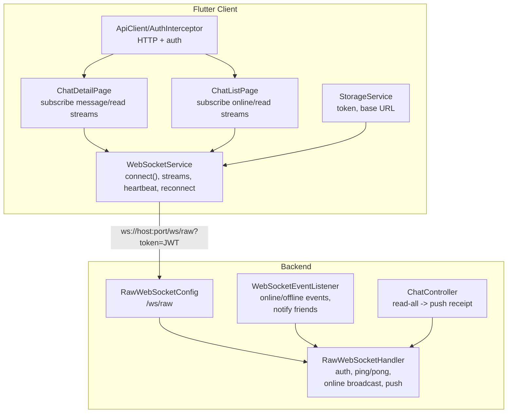
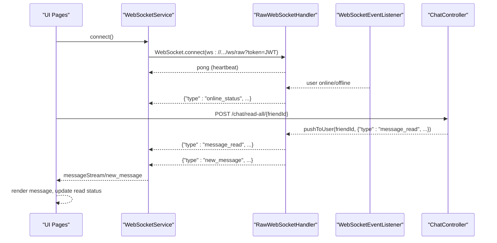
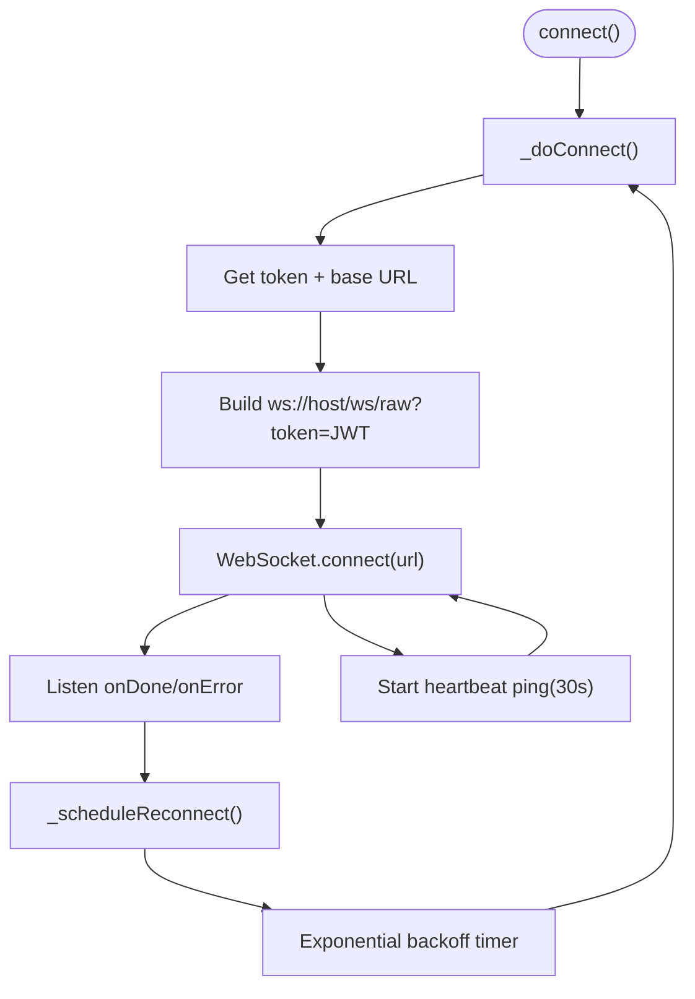
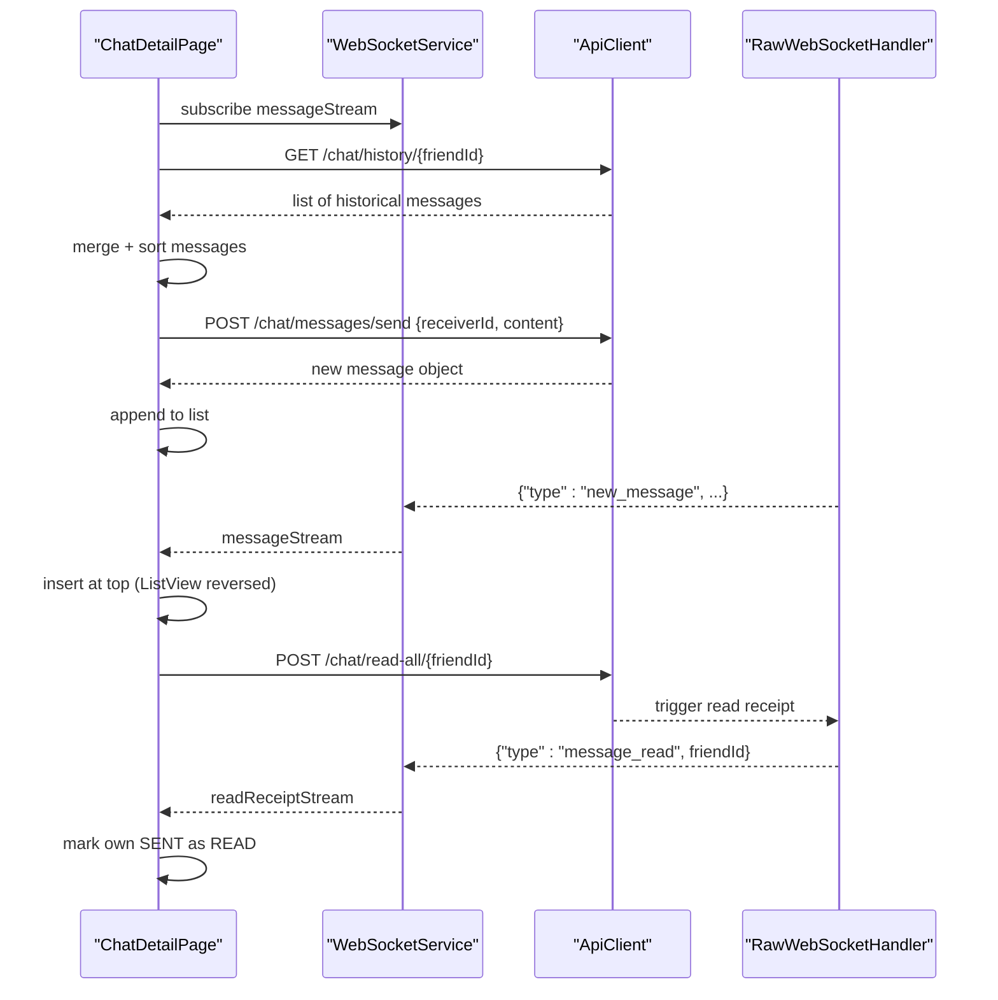
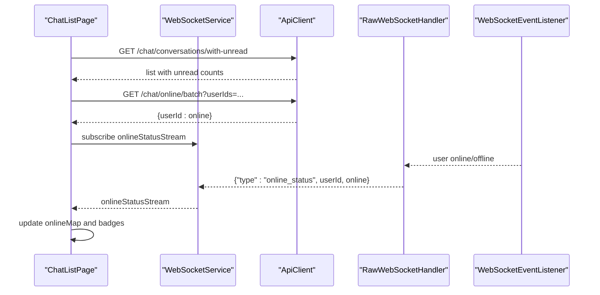
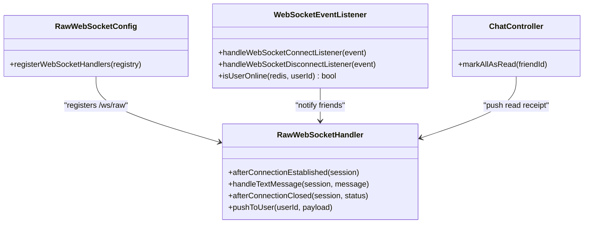
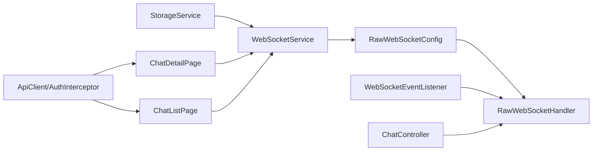

# Real-time WebSocket Messaging

<cite>
**Referenced Files in This Document**
- [websocket_service.dart](file://camp-channel-client-flutter/lib/core/services/websocket_service.dart)
- [chat_detail_page.dart](file://camp-channel-client-flutter/lib/pages/chat_detail_page.dart)
- [chat_list_page.dart](file://camp-channel-client-flutter/lib/pages/chat_list_page.dart)
- [storage_service.dart](file://camp-channel-client-flutter/lib/core/services/storage_service.dart)
- [api_client.dart](file://camp-channel-client-flutter/lib/core/network/api_client.dart)
- [auth_interceptor.dart](file://camp-channel-client-flutter/lib/core/network/auth_interceptor.dart)
- [main.dart](file://camp-channel-client-flutter/lib/main.dart)
- [RawWebSocketConfig.java](file://camp-channel-server/src/main/java/com/gdmec/campchannel/config/RawWebSocketConfig.java)
- [RawWebSocketHandler.java](file://camp-channel-server/src/main/java/com/gdmec/campchannel/config/RawWebSocketHandler.java)
- [WebSocketEventListener.java](file://camp-channel-server/src/main/java/com/gdmec/campchannel/config/WebSocketEventListener.java)
- [ChatController.java](file://camp-channel-server/src/main/java/com/gdmec/campchannel/controller/ChatController.java)
</cite>

## Table of Contents
1. [Introduction](#introduction)
2. [Project Structure](#project-structure)
3. [Core Components](#core-components)
4. [Architecture Overview](#architecture-overview)
5. [Detailed Component Analysis](#detailed-component-analysis)
6. [Dependency Analysis](#dependency-analysis)
7. [Performance Considerations](#performance-considerations)
8. [Troubleshooting Guide](#troubleshooting-guide)
9. [Conclusion](#conclusion)
10. [Appendices](#appendices)

## Introduction
This document explains the real-time WebSocket messaging system in the Flutter mobile application. It covers how the WebSocketService maintains persistent connections to the backend, how messages are serialized and deserialized, and how the UI integrates with real-time events such as new messages, read receipts, and online status updates. It also documents reconnection strategies, error recovery, and mobile-specific considerations for reliability and responsiveness.

## Project Structure
The real-time messaging spans three layers:
- Flutter client: WebSocketService manages the connection and streams; UI pages subscribe to streams for live updates.
- Backend Spring WebSocket: RawWebSocketHandler authenticates clients via JWT and broadcasts online status and read receipts.
- Shared protocol: Messages are JSON payloads with a type field and additional fields depending on the event.

**Diagram sources**
- [websocket_service.dart:35-90](file://camp-channel-client-flutter/lib/core/services/websocket_service.dart#L35-L90)
- [chat_detail_page.dart:69-105](file://camp-channel-client-flutter/lib/pages/chat_detail_page.dart#L69-L105)
- [chat_list_page.dart:31-53](file://camp-channel-client-flutter/lib/pages/chat_list_page.dart#L31-L53)
- [storage_service.dart:25-92](file://camp-channel-client-flutter/lib/core/services/storage_service.dart#L25-L92)
- [api_client.dart:36-50](file://camp-channel-client-flutter/lib/core/network/api_client.dart#L36-L50)
- [RawWebSocketConfig.java:18-22](file://camp-channel-server/src/main/java/com/gdmec/campchannel/config/RawWebSocketConfig.java#L18-L22)
- [RawWebSocketHandler.java:42-102](file://camp-channel-server/src/main/java/com/gdmec/campchannel/config/RawWebSocketHandler.java#L42-L102)
- [WebSocketEventListener.java:32-62](file://camp-channel-server/src/main/java/com/gdmec/campchannel/config/WebSocketEventListener.java#L32-L62)
- [ChatController.java:135-156](file://camp-channel-server/src/main/java/com/gdmec/campchannel/controller/ChatController.java#L135-L156)

**Section sources**
- [websocket_service.dart:1-151](file://camp-channel-client-flutter/lib/core/services/websocket_service.dart#L1-L151)
- [chat_detail_page.dart:1-464](file://camp-channel-client-flutter/lib/pages/chat_detail_page.dart#L1-L464)
- [chat_list_page.dart:1-291](file://camp-channel-client-flutter/lib/pages/chat_list_page.dart#L1-L291)
- [storage_service.dart:1-124](file://camp-channel-client-flutter/lib/core/services/storage_service.dart#L1-L124)
- [api_client.dart:1-100](file://camp-channel-client-flutter/lib/core/network/api_client.dart#L1-L100)
- [auth_interceptor.dart:1-66](file://camp-channel-client-flutter/lib/core/network/auth_interceptor.dart#L1-L66)
- [main.dart:21-25](file://camp-channel-client-flutter/lib/main.dart#L21-L25)
- [RawWebSocketConfig.java:1-24](file://camp-channel-server/src/main/java/com/gdmec/campchannel/config/RawWebSocketConfig.java#L1-L24)
- [RawWebSocketHandler.java:1-171](file://camp-channel-server/src/main/java/com/gdmec/campchannel/config/RawWebSocketHandler.java#L1-L171)
- [WebSocketEventListener.java:1-91](file://camp-channel-server/src/main/java/com/gdmec/campchannel/config/WebSocketEventListener.java#L1-L91)
- [ChatController.java:1-166](file://camp-channel-server/src/main/java/com/gdmec/campchannel/controller/ChatController.java#L1-L166)

## Core Components
- WebSocketService: Singleton managing connection lifecycle, heartbeat, message dispatch, and exponential backoff reconnection.
- ChatDetailPage: Subscribes to message and read receipt streams; merges history and live messages; supports message recall.
- ChatListPage: Subscribes to online status and read receipt streams; polls periodically; displays online badges and unread counts.
- StorageService: Provides token and base URL used to construct the WebSocket URL.
- ApiClient/AuthInterceptor: Handles HTTP requests, JWT injection, and force-logout handling.
- Backend RawWebSocketHandler: Authenticates via JWT from query param, maintains user sessions, and pushes online/read events.
- WebSocketEventListener: Detects session connect/disconnect and notifies friends via raw WebSocket.
- ChatController: Implements read-all endpoint that triggers read receipt push to the sender.

**Section sources**
- [websocket_service.dart:8-32](file://camp-channel-client-flutter/lib/core/services/websocket_service.dart#L8-L32)
- [chat_detail_page.dart:69-105](file://camp-channel-client-flutter/lib/pages/chat_detail_page.dart#L69-L105)
- [chat_list_page.dart:31-53](file://camp-channel-client-flutter/lib/pages/chat_list_page.dart#L31-L53)
- [storage_service.dart:25-92](file://camp-channel-client-flutter/lib/core/services/storage_service.dart#L25-L92)
- [api_client.dart:10-24](file://camp-channel-client-flutter/lib/core/network/api_client.dart#L10-L24)
- [auth_interceptor.dart:9-29](file://camp-channel-client-flutter/lib/core/network/auth_interceptor.dart#L9-L29)
- [RawWebSocketHandler.java:42-102](file://camp-channel-server/src/main/java/com/gdmec/campchannel/config/RawWebSocketHandler.java#L42-L102)
- [WebSocketEventListener.java:32-62](file://camp-channel-server/src/main/java/com/gdmec/campchannel/config/WebSocketEventListener.java#L32-L62)
- [ChatController.java:135-156](file://camp-channel-server/src/main/java/com/gdmec/campchannel/controller/ChatController.java#L135-L156)

## Architecture Overview
The system uses a dedicated raw WebSocket endpoint (/ws/raw) with JWT passed as a query parameter. The backend authenticates the token, tracks sessions, and pushes targeted events to connected clients. The Flutter client listens to typed JSON messages and updates UI accordingly.

**Diagram sources**
- [websocket_service.dart:35-90](file://camp-channel-client-flutter/lib/core/services/websocket_service.dart#L35-L90)
- [RawWebSocketHandler.java:42-102](file://camp-channel-server/src/main/java/com/gdmec/campchannel/config/RawWebSocketHandler.java#L42-L102)
- [WebSocketEventListener.java:32-62](file://camp-channel-server/src/main/java/com/gdmec/campchannel/config/WebSocketEventListener.java#L32-L62)
- [ChatController.java:135-156](file://camp-channel-server/src/main/java/com/gdmec/campchannel/controller/ChatController.java#L135-L156)

## Detailed Component Analysis

### WebSocketService: Connection, Streams, and Reconnection
- Connection establishment:
  - Reads token and base URL from StorageService.
  - Constructs ws://host/ws/raw?token=JWT using the stored API base URL or platform-specific fallback.
  - Opens WebSocket and registers listeners for data, done, and error.
- Message dispatch:
  - Decodes JSON and routes by type: new_message, online_status, message_read, pong.
  - Unknown types are forwarded to the message stream as fallback.
- Heartbeat:
  - Sends ping every 30 seconds; ignores pong.
- Reconnection:
  - Cancels timers, clears socket, and schedules exponential backoff (1s, 2s, 4s, 8s, 16s, capped at 30s).
  - Resets attempts on explicit reset.
- Disposal:
  - Cancels timers, closes socket, and clears state on logout or app shutdown.

**Diagram sources**
- [websocket_service.dart:35-136](file://camp-channel-client-flutter/lib/core/services/websocket_service.dart#L35-L136)

**Section sources**
- [websocket_service.dart:35-151](file://camp-channel-client-flutter/lib/core/services/websocket_service.dart#L35-L151)
- [storage_service.dart:25-92](file://camp-channel-client-flutter/lib/core/services/storage_service.dart#L25-L92)

### ChatDetailPage: Real-time Chat UI Integration
- Subscriptions:
  - messageStream: filters messages for the current chat partner and inserts at the top of the reversed list.
  - readReceiptStream: marks locally sent messages as READ when the friend acknowledges.
- History merge:
  - Fetches recent messages via REST and merges with live messages, deduplicating by ID and sorting by time.
- Send flow:
  - Calls REST endpoint to send; on success adds to UI immediately; on failure, injects a FAILED message with local timestamp.
- Recall:
  - Supports recalling own messages within a short window by invoking REST recall endpoint.

**Diagram sources**
- [chat_detail_page.dart:69-105](file://camp-channel-client-flutter/lib/pages/chat_detail_page.dart#L69-L105)
- [chat_detail_page.dart:107-150](file://camp-channel-client-flutter/lib/pages/chat_detail_page.dart#L107-L150)
- [chat_detail_page.dart:152-182](file://camp-channel-client-flutter/lib/pages/chat_detail_page.dart#L152-L182)
- [ChatController.java:135-156](file://camp-channel-server/src/main/java/com/gdmec/campchannel/controller/ChatController.java#L135-L156)

**Section sources**
- [chat_detail_page.dart:69-182](file://camp-channel-client-flutter/lib/pages/chat_detail_page.dart#L69-L182)
- [ChatController.java:135-156](file://camp-channel-server/src/main/java/com/gdmec/campchannel/controller/ChatController.java#L135-L156)

### ChatListPage: Online Status and Unread Counts
- Subscriptions:
  - onlineStatusStream: updates online map for displayed users.
  - readReceiptStream: refreshes conversation list to reflect read acknowledgments.
- Polling:
  - Periodic polling to refresh conversations and unread counts.
- Online indicators:
  - Shows green dot for online users fetched from backend.

**Diagram sources**
- [chat_list_page.dart:31-53](file://camp-channel-client-flutter/lib/pages/chat_list_page.dart#L31-L53)
- [chat_list_page.dart:63-104](file://camp-channel-client-flutter/lib/pages/chat_list_page.dart#L63-L104)
- [WebSocketEventListener.java:32-62](file://camp-channel-server/src/main/java/com/gdmec/campchannel/config/WebSocketEventListener.java#L32-L62)

**Section sources**
- [chat_list_page.dart:31-104](file://camp-channel-client-flutter/lib/pages/chat_list_page.dart#L31-L104)

### Backend WebSocket Authentication and Broadcasting
- Endpoint registration:
  - RawWebSocketConfig exposes /ws/raw with allowed origins.
- Authentication:
  - RawWebSocketHandler extracts token from query, validates via JWT, binds userId to session, and stores user session map.
- Heartbeat:
  - Responds to ping with pong.
- Online status:
  - WebSocketEventListener publishes online/offline events to friends via RawWebSocketHandler.
- Read receipts:
  - ChatController pushes message_read to the friend upon read-all.

**Diagram sources**
- [RawWebSocketConfig.java:18-22](file://camp-channel-server/src/main/java/com/gdmec/campchannel/config/RawWebSocketConfig.java#L18-L22)
- [RawWebSocketHandler.java:42-102](file://camp-channel-server/src/main/java/com/gdmec/campchannel/config/RawWebSocketHandler.java#L42-L102)
- [WebSocketEventListener.java:32-62](file://camp-channel-server/src/main/java/com/gdmec/campchannel/config/WebSocketEventListener.java#L32-L62)
- [ChatController.java:135-156](file://camp-channel-server/src/main/java/com/gdmec/campchannel/controller/ChatController.java#L135-L156)

**Section sources**
- [RawWebSocketConfig.java:18-22](file://camp-channel-server/src/main/java/com/gdmec/campchannel/config/RawWebSocketConfig.java#L18-L22)
- [RawWebSocketHandler.java:42-102](file://camp-channel-server/src/main/java/com/gdmec/campchannel/config/RawWebSocketHandler.java#L42-L102)
- [WebSocketEventListener.java:32-62](file://camp-channel-server/src/main/java/com/gdmec/campchannel/config/WebSocketEventListener.java#L32-L62)
- [ChatController.java:135-156](file://camp-channel-server/src/main/java/com/gdmec/campchannel/controller/ChatController.java#L135-L156)

## Dependency Analysis
- Client-to-backend:
  - WebSocketService depends on StorageService for token/base URL and uses Dart’s WebSocket API.
  - UI pages depend on WebSocketService streams and ApiClient for REST calls.
- Backend-to-client:
  - RawWebSocketHandler depends on JWT utilities and Redis to manage sessions and online status.
  - WebSocketEventListener bridges Spring session events to raw WebSocket notifications.
  - ChatController coordinates read receipts and read-all operations.

**Diagram sources**
- [storage_service.dart:25-92](file://camp-channel-client-flutter/lib/core/services/storage_service.dart#L25-L92)
- [websocket_service.dart:35-90](file://camp-channel-client-flutter/lib/core/services/websocket_service.dart#L35-L90)
- [RawWebSocketConfig.java:18-22](file://camp-channel-server/src/main/java/com/gdmec/campchannel/config/RawWebSocketConfig.java#L18-L22)
- [RawWebSocketHandler.java:42-102](file://camp-channel-server/src/main/java/com/gdmec/campchannel/config/RawWebSocketHandler.java#L42-L102)
- [WebSocketEventListener.java:32-62](file://camp-channel-server/src/main/java/com/gdmec/campchannel/config/WebSocketEventListener.java#L32-L62)
- [ChatController.java:135-156](file://camp-channel-server/src/main/java/com/gdmec/campchannel/controller/ChatController.java#L135-L156)
- [chat_detail_page.dart:69-105](file://camp-channel-client-flutter/lib/pages/chat_detail_page.dart#L69-L105)
- [chat_list_page.dart:31-53](file://camp-channel-client-flutter/lib/pages/chat_list_page.dart#L31-L53)
- [api_client.dart:10-24](file://camp-channel-client-flutter/lib/core/network/api_client.dart#L10-L24)
- [auth_interceptor.dart:9-29](file://camp-channel-client-flutter/lib/core/network/auth_interceptor.dart#L9-L29)

**Section sources**
- [websocket_service.dart:35-151](file://camp-channel-client-flutter/lib/core/services/websocket_service.dart#L35-L151)
- [chat_detail_page.dart:69-182](file://camp-channel-client-flutter/lib/pages/chat_detail_page.dart#L69-L182)
- [chat_list_page.dart:31-104](file://camp-channel-client-flutter/lib/pages/chat_list_page.dart#L31-L104)
- [api_client.dart:10-24](file://camp-channel-client-flutter/lib/core/network/api_client.dart#L10-L24)
- [auth_interceptor.dart:9-29](file://camp-channel-client-flutter/lib/core/network/auth_interceptor.dart#L9-L29)
- [RawWebSocketHandler.java:42-102](file://camp-channel-server/src/main/java/com/gdmec/campchannel/config/RawWebSocketHandler.java#L42-L102)
- [WebSocketEventListener.java:32-62](file://camp-channel-server/src/main/java/com/gdmec/campchannel/config/WebSocketEventListener.java#L32-L62)
- [ChatController.java:135-156](file://camp-channel-server/src/main/java/com/gdmec/campchannel/controller/ChatController.java#L135-L156)

## Performance Considerations
- Heartbeat: A periodic ping keeps NAT and proxies alive and detects stale connections quickly.
- Exponential backoff: Reduces server load during outages and prevents thundering herd on recovery.
- UI rendering: ChatDetailPage uses a reversed ListView and inserts at the head for natural chat flow; merging history avoids duplicates and sorts by time.
- Polling: ChatListPage uses periodic polling to refresh unread counts and conversation metadata; this complements real-time streams for robustness.
- Network timeouts: ApiClient sets reasonable connect/receive timeouts to fail fast on poor connectivity.

[No sources needed since this section provides general guidance]

## Troubleshooting Guide
- No messages received:
  - Verify token exists and is not expired; ensure base URL is reachable.
  - Confirm WebSocketService.isConnected and that messageStream subscriptions are active.
- Frequent reconnections:
  - Check network stability; review exponential backoff behavior and logs.
- Read receipts not updating:
  - Ensure read-all endpoint is invoked and backend pushes message_read to the sender.
- Online status not reflecting:
  - Confirm WebSocketEventListener receives session connect/disconnect events and RawWebSocketHandler broadcasts online_status.

**Section sources**
- [websocket_service.dart:32-38](file://camp-channel-client-flutter/lib/core/services/websocket_service.dart#L32-L38)
- [websocket_service.dart:119-136](file://camp-channel-client-flutter/lib/core/services/websocket_service.dart#L119-L136)
- [chat_detail_page.dart:145-150](file://camp-channel-client-flutter/lib/pages/chat_detail_page.dart#L145-L150)
- [ChatController.java:135-156](file://camp-channel-server/src/main/java/com/gdmec/campchannel/controller/ChatController.java#L135-L156)
- [WebSocketEventListener.java:32-62](file://camp-channel-server/src/main/java/com/gdmec/campchannel/config/WebSocketEventListener.java#L32-L62)

## Conclusion
The Flutter app’s WebSocket messaging system provides reliable real-time chat through a dedicated raw WebSocket endpoint, robust reconnection with exponential backoff, and clear separation of concerns between UI and transport. The backend ensures secure authentication, timely online status propagation, and precise read receipt delivery. Together, these components deliver responsive, resilient chat functionality across mobile environments.

[No sources needed since this section summarizes without analyzing specific files]

## Appendices

### Message Types and Payloads
- new_message: carries sender and receiver identifiers along with content and timestamps; UI filters by current chat partner.
- online_status: indicates a friend’s online/offline state; UI updates badges and presence indicators.
- message_read: signals that the peer has read all messages; UI marks locally sent messages as READ.
- pong: heartbeat acknowledgment; UI ignores.

**Section sources**
- [websocket_service.dart:92-111](file://camp-channel-client-flutter/lib/core/services/websocket_service.dart#L92-L111)
- [RawWebSocketHandler.java:143-149](file://camp-channel-server/src/main/java/com/gdmec/campchannel/config/RawWebSocketHandler.java#L143-L149)
- [ChatController.java:144-150](file://camp-channel-server/src/main/java/com/gdmec/campchannel/controller/ChatController.java#L144-L150)

### Mobile-Specific Considerations
- Battery optimization: Keep heartbeat periodic and avoid unnecessary polling; leverage platform power-saving features.
- Background processing: On Android/iOS, long-lived WebSocket connections may be constrained; rely on reconnection and minimal polling for degraded states.
- Network state changes: React to connectivity loss by canceling timers and scheduling reconnection; ensure UI reflects connection state.

[No sources needed since this section provides general guidance]