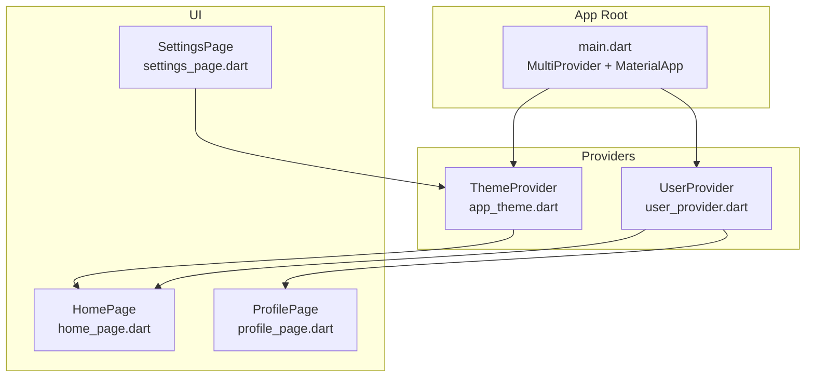
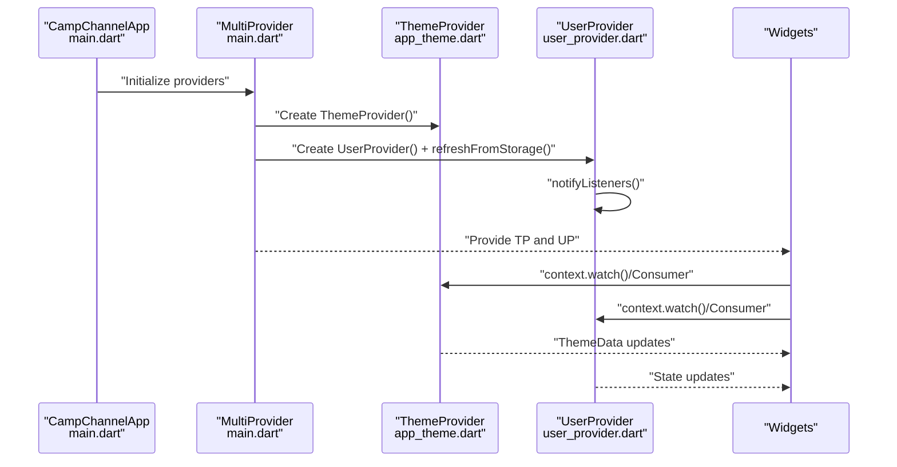
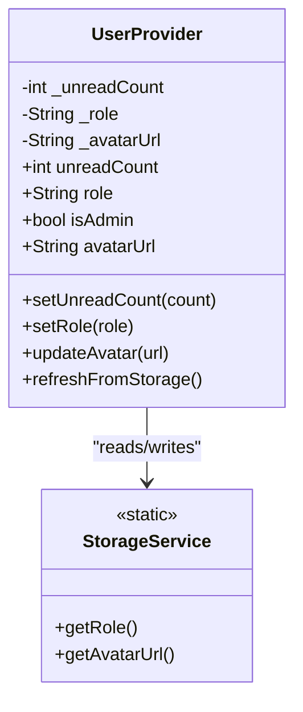
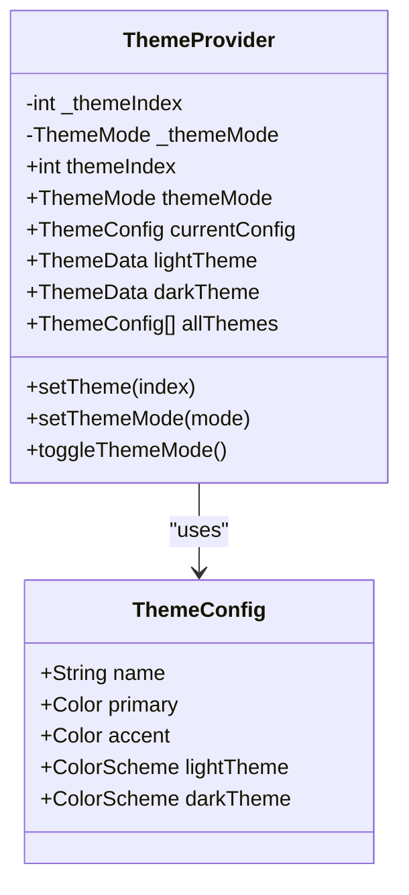
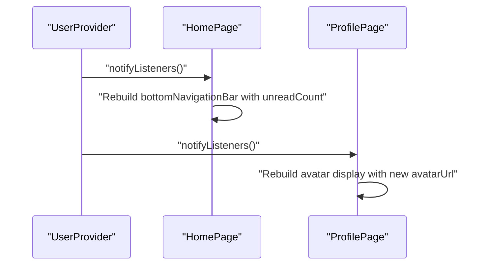
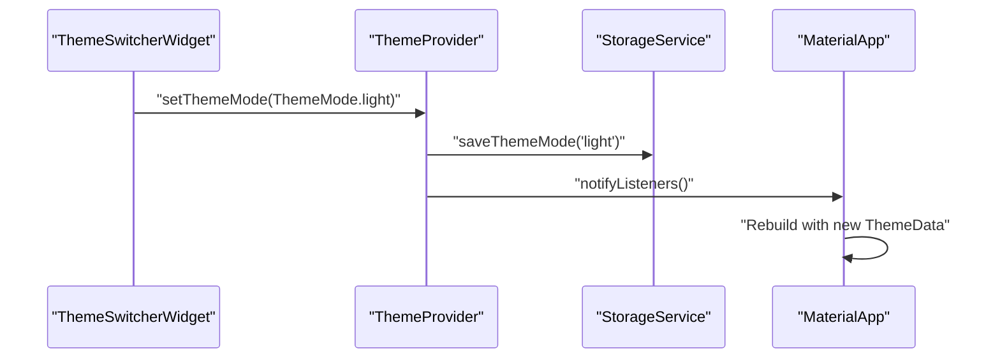
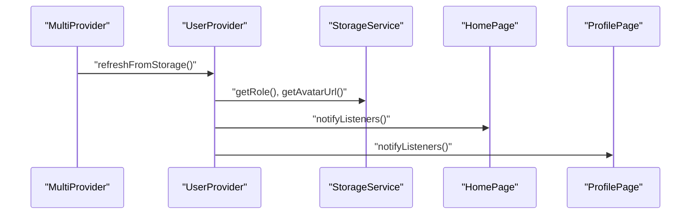
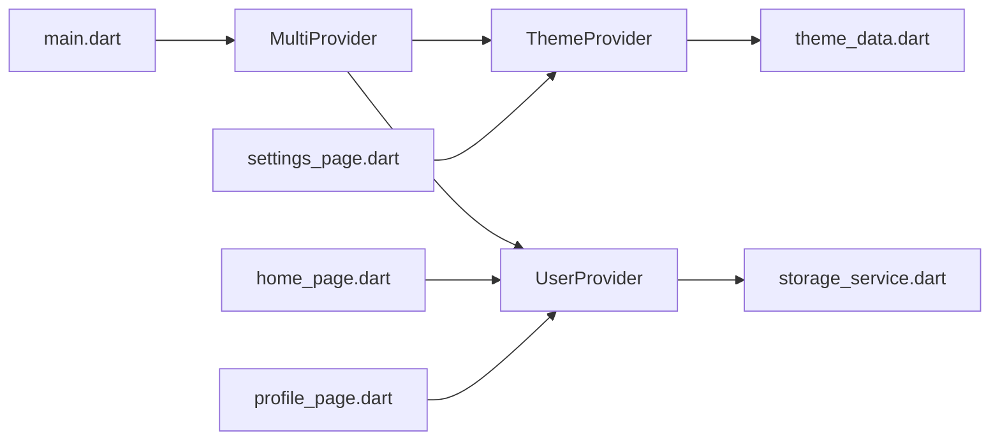

# State Management with Provider

<cite>
**Referenced Files in This Document**
- [main.dart](file://camp-channel-client-flutter/lib/main.dart)
- [user_provider.dart](file://camp-channel-client-flutter/lib/core/services/user_provider.dart)
- [storage_service.dart](file://camp-channel-client-flutter/lib/core/services/storage_service.dart)
- [app_theme.dart](file://camp-channel-client-flutter/lib/core/theme/app_theme.dart)
- [theme_data.dart](file://camp-channel-client-flutter/lib/core/theme/theme_data.dart)
- [home_page.dart](file://camp-channel-client-flutter/lib/pages/home_page.dart)
- [profile_page.dart](file://camp-channel-client-flutter/lib/pages/profile_page.dart)
- [settings_page.dart](file://camp-channel-client-flutter/lib/pages/settings_page.dart)
</cite>

## Table of Contents
1. [Introduction](#introduction)
2. [Project Structure](#project-structure)
3. [Core Components](#core-components)
4. [Architecture Overview](#architecture-overview)
5. [Detailed Component Analysis](#detailed-component-analysis)
6. [Dependency Analysis](#dependency-analysis)
7. [Performance Considerations](#performance-considerations)
8. [Troubleshooting Guide](#troubleshooting-guide)
9. [Conclusion](#conclusion)

## Introduction
This document explains the Provider-based state management system used in the Flutter application. It focuses on how ChangeNotifierProvider and MultiProvider orchestrate global state across the app, including user authentication, theme preferences, and application-wide settings. It documents the UserProvider implementation for authentication state, the ThemeProvider for theme switching and persistence, and demonstrates reactive UI updates and cross-component synchronization. Best practices for organizing providers, avoiding memory leaks, and optimizing performance are included, along with solutions to common state management challenges in mobile apps.

## Project Structure
The Flutter application initializes providers at the root and exposes them to the widget tree via MultiProvider. Providers encapsulate state and notify listeners when values change, enabling fine-grained reactivity in widgets.

**Diagram sources**
- [main.dart:86-119](file://camp-channel-client-flutter/lib/main.dart#L86-L119)
- [app_theme.dart:5-47](file://camp-channel-client-flutter/lib/core/theme/app_theme.dart#L5-L47)
- [user_provider.dart:4-34](file://camp-channel-client-flutter/lib/core/services/user_provider.dart#L4-L34)
- [home_page.dart:92-148](file://camp-channel-client-flutter/lib/pages/home_page.dart#L92-L148)
- [profile_page.dart:148-151](file://camp-channel-client-flutter/lib/pages/profile_page.dart#L148-L151)
- [settings_page.dart:1-200](file://camp-channel-client-flutter/lib/pages/settings_page.dart#L1-L200)

**Section sources**
- [main.dart:21-121](file://camp-channel-client-flutter/lib/main.dart#L21-L121)

## Core Components
- UserProvider: Manages user-related state such as unread notifications count, role, and avatar URL. It synchronizes with persistent storage and notifies listeners to trigger UI updates.
- ThemeProvider: Manages theme index and theme mode (light/dark), persists selections, and exposes ThemeData instances for Material 3 theming.
- StorageService: Provides centralized persistence for tokens, user info, roles, avatar URLs, and theme preferences using shared preferences.

Key responsibilities:
- Reactive UI updates through notifyListeners.
- Persistence via StorageService for cross-session continuity.
- Cross-component synchronization via context.watch and context.read.

**Section sources**
- [user_provider.dart:4-34](file://camp-channel-client-flutter/lib/core/services/user_provider.dart#L4-L34)
- [app_theme.dart:5-47](file://camp-channel-client-flutter/lib/core/theme/app_theme.dart#L5-L47)
- [storage_service.dart:4-123](file://camp-channel-client-flutter/lib/core/services/storage_service.dart#L4-L123)

## Architecture Overview
The app bootstraps by initializing StorageService, then wraps the MaterialApp with MultiProvider to expose ThemeProvider and UserProvider. Widgets consume providers using Consumer or context.watch to rebuild only affected subtrees.

**Diagram sources**
- [main.dart:86-119](file://camp-channel-client-flutter/lib/main.dart#L86-L119)
- [app_theme.dart:9-19](file://camp-channel-client-flutter/lib/core/theme/app_theme.dart#L9-L19)
- [user_provider.dart:29-33](file://camp-channel-client-flutter/lib/core/services/user_provider.dart#L29-L33)

## Detailed Component Analysis

### UserProvider: Authentication and Profile State
UserProvider holds user-specific state and exposes getters and setters. It integrates with StorageService to restore role and avatar on startup and notifies listeners to update dependent UI.

Implementation highlights:
- Getters for unreadCount, role, isAdmin, avatarUrl.
- Setters that update internal state and call notifyListeners.
- refreshFromStorage synchronizes role and avatar from persistent storage.

Usage patterns:
- HomePage listens to unreadCount to show badges on navigation items.
- ProfilePage watches avatarUrl to reflect avatar changes after sync.

**Diagram sources**
- [user_provider.dart:4-34](file://camp-channel-client-flutter/lib/core/services/user_provider.dart#L4-L34)
- [storage_service.dart:61-78](file://camp-channel-client-flutter/lib/core/services/storage_service.dart#L61-L78)

**Section sources**
- [user_provider.dart:4-34](file://camp-channel-client-flutter/lib/core/services/user_provider.dart#L4-L34)
- [home_page.dart:92-148](file://camp-channel-client-flutter/lib/pages/home_page.dart#L92-L148)
- [profile_page.dart:148-151](file://camp-channel-client-flutter/lib/pages/profile_page.dart#L148-L151)

### ThemeProvider: Light/Dark Mode and Theme Persistence
ThemeProvider manages theme index and theme mode, loads persisted preferences, and exposes ThemeData instances for Material 3. It persists changes to storage and notifies listeners to rebuild themed widgets.

Key behaviors:
- Constructor restores theme index and mode from storage.
- Methods to set theme index, set theme mode, and toggle theme mode.
- Exposes currentConfig, lightTheme, and darkTheme.

**Diagram sources**
- [app_theme.dart:5-47](file://camp-channel-client-flutter/lib/core/theme/app_theme.dart#L5-L47)
- [theme_data.dart:3-209](file://camp-channel-client-flutter/lib/core/theme/theme_data.dart#L3-L209)

**Section sources**
- [app_theme.dart:5-47](file://camp-channel-client-flutter/lib/core/theme/app_theme.dart#L5-L47)
- [theme_data.dart:211-251](file://camp-channel-client-flutter/lib/core/theme/theme_data.dart#L211-L251)

### StorageService: Persistence Layer
StorageService centralizes all persistent keys for tokens, user info, roles, avatar URLs, and theme preferences. It ensures initialization via init and provides safe getters/setters with defaults.

Highlights:
- Keys for auth_token, user_id, username, email, role, avatar_url, api_base_url, theme_index, theme_mode.
- Methods to save/load theme index and mode.
- Utility methods like isAdmin and getRole with defaults.

**Section sources**
- [storage_service.dart:4-123](file://camp-channel-client-flutter/lib/core/services/storage_service.dart#L4-L123)

### Reactive UI Updates and Cross-Component Synchronization
- HomePage uses Consumer<UserProvider> to render unread notifications badge reactively.
- ProfilePage watches UserProvider.avatarUrl to reflect avatar updates after syncing from storage.
- SettingsPage reads/writes theme preferences indirectly via ThemeProvider through UI interactions.

**Diagram sources**
- [home_page.dart:92-148](file://camp-channel-client-flutter/lib/pages/home_page.dart#L92-L148)
- [profile_page.dart:148-151](file://camp-channel-client-flutter/lib/pages/profile_page.dart#L148-L151)
- [user_provider.dart:14-27](file://camp-channel-client-flutter/lib/core/services/user_provider.dart#L14-L27)

**Section sources**
- [home_page.dart:92-148](file://camp-channel-client-flutter/lib/pages/home_page.dart#L92-L148)
- [profile_page.dart:148-151](file://camp-channel-client-flutter/lib/pages/profile_page.dart#L148-L151)

### Example Workflows

#### Theme Switching Flow

**Diagram sources**
- [app_theme.dart:36-46](file://camp-channel-client-flutter/lib/core/theme/app_theme.dart#L36-L46)
- [storage_service.dart:116-122](file://camp-channel-client-flutter/lib/core/services/storage_service.dart#L116-L122)
- [main.dart:91-99](file://camp-channel-client-flutter/lib/main.dart#L91-L99)

#### User State Refresh Flow

**Diagram sources**
- [main.dart:89](file://camp-channel-client-flutter/lib/main.dart#L89)
- [user_provider.dart:29-33](file://camp-channel-client-flutter/lib/core/services/user_provider.dart#L29-L33)
- [storage_service.dart:61-78](file://camp-channel-client-flutter/lib/core/services/storage_service.dart#L61-L78)

## Dependency Analysis
Provider-based architecture minimizes coupling by keeping state in dedicated ChangeNotifier subclasses and exposing them via MultiProvider. Consumers depend only on interfaces exposed by providers (getters and methods), not on internal implementation details.

**Diagram sources**
- [main.dart:86-119](file://camp-channel-client-flutter/lib/main.dart#L86-L119)
- [app_theme.dart:5-47](file://camp-channel-client-flutter/lib/core/theme/app_theme.dart#L5-L47)
- [theme_data.dart:211-251](file://camp-channel-client-flutter/lib/core/theme/theme_data.dart#L211-L251)
- [user_provider.dart:4-34](file://camp-channel-client-flutter/lib/core/services/user_provider.dart#L4-L34)
- [storage_service.dart:4-123](file://camp-channel-client-flutter/lib/core/services/storage_service.dart#L4-L123)
- [home_page.dart:92-148](file://camp-channel-client-flutter/lib/pages/home_page.dart#L92-L148)
- [profile_page.dart:148-151](file://camp-channel-client-flutter/lib/pages/profile_page.dart#L148-L151)
- [settings_page.dart:1-200](file://camp-channel-client-flutter/lib/pages/settings_page.dart#L1-L200)

**Section sources**
- [main.dart:86-119](file://camp-channel-client-flutter/lib/main.dart#L86-L119)

## Performance Considerations
- Use Consumer selectively around widgets that need specific provider updates to minimize rebuild scope.
- Prefer context.watch inside build methods for lightweight, fine-grained subscriptions.
- Avoid frequent notifyListeners; batch updates when possible.
- Persist only essential data to reduce IO overhead.
- Keep provider state shallow; extract nested state into separate providers if needed.

## Troubleshooting Guide
Common issues and remedies:
- Providers not updating UI:
  - Ensure notifyListeners is called after state changes.
  - Verify widgets use context.watch or Consumer for the correct provider type.
- State not restored on app restart:
  - Confirm StorageService.init is called during app bootstrap.
  - Ensure refreshFromStorage is invoked when creating UserProvider.
- Theme not persisting:
  - Check that setTheme and setThemeMode write to StorageService.
  - Verify themeMode and themeIndex are read in ThemeProvider constructor.
- Memory leaks:
  - Avoid holding long-lived references to BuildContext in providers.
  - Do not subscribe/unsubscribe manually; rely on Provider’s lifecycle.

**Section sources**
- [main.dart:21-25](file://camp-channel-client-flutter/lib/main.dart#L21-L25)
- [main.dart:89](file://camp-channel-client-flutter/lib/main.dart#L89)
- [app_theme.dart:9-19](file://camp-channel-client-flutter/lib/core/theme/app_theme.dart#L9-L19)
- [storage_service.dart:16-18](file://camp-channel-client-flutter/lib/core/services/storage_service.dart#L16-L18)

## Conclusion
The application’s Provider-based state management cleanly separates concerns: UserProvider handles authentication and profile state, ThemeProvider controls theme selection and persistence, and StorageService provides reliable persistence. MultiProvider exposes these providers globally, while Consumer and context.watch enable efficient, reactive UI updates. Following the best practices outlined here helps maintain scalability, performance, and reliability across the app.