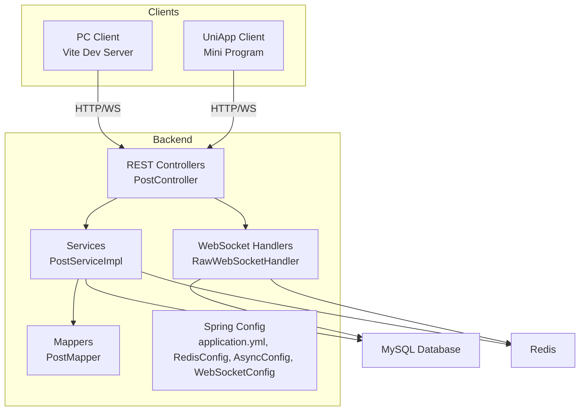
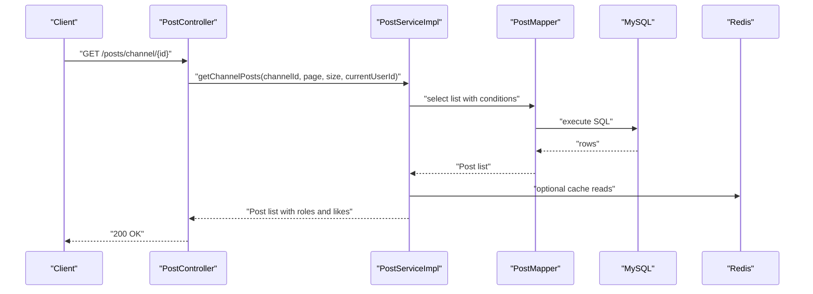
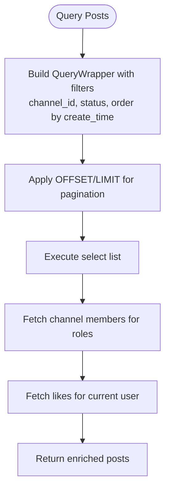
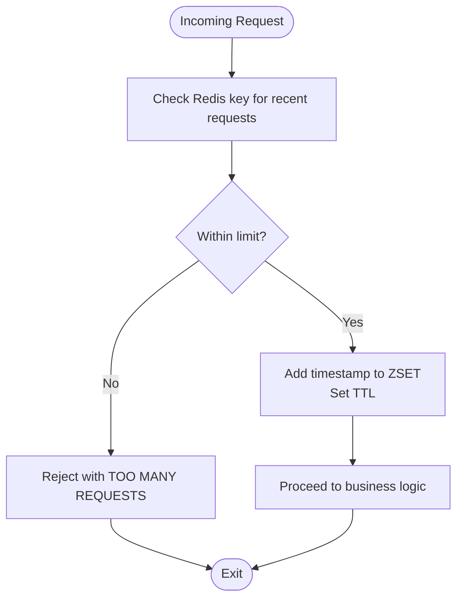
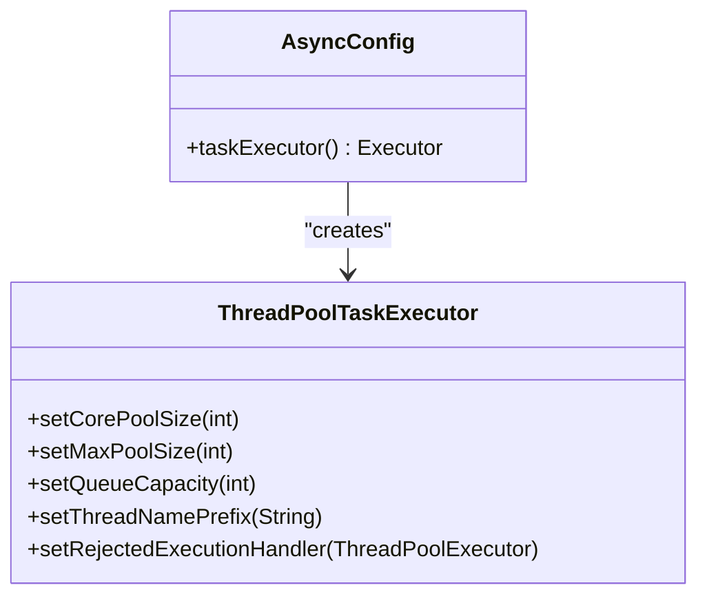
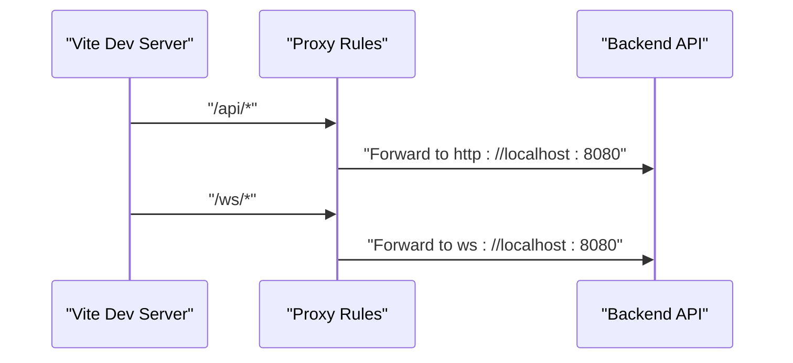
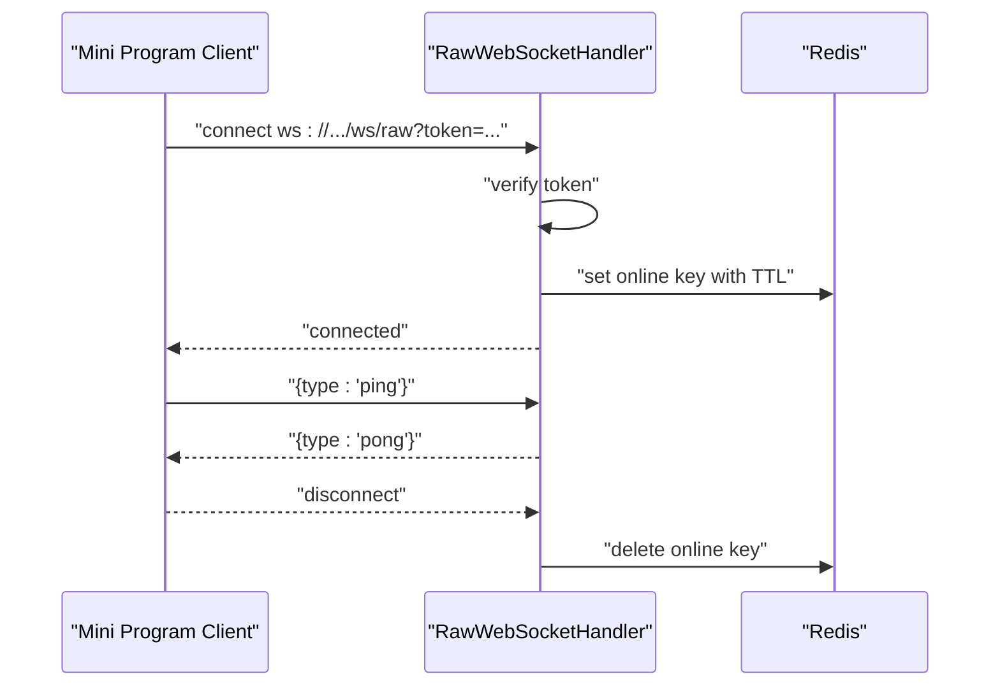
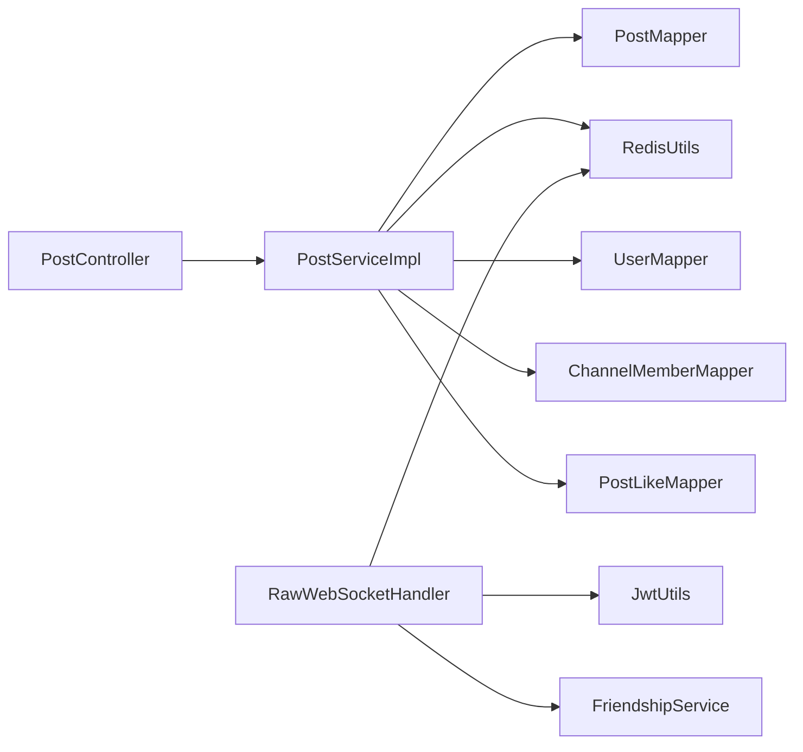

# Performance Optimization

<cite>
**Referenced Files in This Document**
- [application.yml](file://camp-channel-server/src/main/resources/application.yml)
- [RedisConfig.java](file://camp-channel-server/src/main/java/com/gdmec/campchannel/config/RedisConfig.java)
- [RedisUtils.java](file://camp-channel-server/src/main/java/com/gdmec/campchannel/common/utils/RedisUtils.java)
- [AsyncConfig.java](file://camp-channel-server/src/main/java/com/gdmec/campchannel/config/AsyncConfig.java)
- [WebSocketConfig.java](file://camp-channel-server/src/main/java/com/gdmec/campchannel/config/WebSocketConfig.java)
- [RawWebSocketConfig.java](file://camp-channel-server/src/main/java/com/gdmec/campchannel/config/RawWebSocketConfig.java)
- [RawWebSocketHandler.java](file://camp-channel-server/src/main/java/com/gdmec/campchannel/config/RawWebSocketHandler.java)
- [WebMvcConfig.java](file://camp-channel-server/src/main/java/com/gdmec/campchannel/config/WebMvcConfig.java)
- [PostMapper.java](file://camp-channel-server/src/main/java/com/gdmec/campchannel/mapper/PostMapper.java)
- [PostServiceImpl.java](file://camp-channel-server/src/main/java/com/gdmec/campchannel/service/impl/PostServiceImpl.java)
- [PostController.java](file://camp-channel-server/src/main/java/com/gdmec/campchannel/controller/PostController.java)
- [vite.config.ts](file://camp-channel-client-pc/vite.config.ts)
- [websocket.ts](file://camp-channel-client-uniapp/src/utils/websocket.ts)
</cite>

## Table of Contents
1. [Introduction](#introduction)
2. [Project Structure](#project-structure)
3. [Core Components](#core-components)
4. [Architecture Overview](#architecture-overview)
5. [Detailed Component Analysis](#detailed-component-analysis)
6. [Dependency Analysis](#dependency-analysis)
7. [Performance Considerations](#performance-considerations)
8. [Troubleshooting Guide](#troubleshooting-guide)
9. [Conclusion](#conclusion)
10. [Appendices](#appendices)

## Introduction
This document presents a comprehensive performance optimization strategy for the Camp Channel platform. It covers database query optimization, Redis-based caching, asynchronous processing, frontend build and asset optimization, WebSocket performance tuning, scalability planning, and monitoring approaches. The guidance is grounded in concrete configurations and implementations present in the codebase, and it explains how these techniques interrelate to improve user experience under varying loads.

## Project Structure
The platform consists of:
- A Spring Boot backend exposing REST APIs and WebSocket endpoints, configured via application.yml and Spring Java configuration classes.
- A Vue-based PC client using Vite for development and proxying to the backend.
- A UniApp-based client for mini-programs with a dedicated WebSocket manager.
- A MySQL-backed persistence layer with MyBatis-Plus and HikariCP connection pooling.

**Diagram sources**
- [application.yml:1-119](file://camp-channel-server/src/main/resources/application.yml#L1-L119)
- [PostController.java:1-202](file://camp-channel-server/src/main/java/com/gdmec/campchannel/controller/PostController.java#L1-L202)
- [PostServiceImpl.java:1-387](file://camp-channel-server/src/main/java/com/gdmec/campchannel/service/impl/PostServiceImpl.java#L1-L387)
- [PostMapper.java:1-9](file://camp-channel-server/src/main/java/com/gdmec/campchannel/mapper/PostMapper.java#L1-L9)
- [RedisConfig.java:1-47](file://camp-channel-server/src/main/java/com/gdmec/campchannel/config/RedisConfig.java#L1-L47)
- [AsyncConfig.java:1-31](file://camp-channel-server/src/main/java/com/gdmec/campchannel/config/AsyncConfig.java#L1-L31)
- [WebSocketConfig.java:1-36](file://camp-channel-server/src/main/java/com/gdmec/campchannel/config/WebSocketConfig.java#L1-L36)
- [RawWebSocketConfig.java:1-24](file://camp-channel-server/src/main/java/com/gdmec/campchannel/config/RawWebSocketConfig.java#L1-L24)
- [RawWebSocketHandler.java:1-171](file://camp-channel-server/src/main/java/com/gdmec/campchannel/config/RawWebSocketHandler.java#L1-L171)

**Section sources**
- [application.yml:1-119](file://camp-channel-server/src/main/resources/application.yml#L1-L119)
- [vite.config.ts:1-35](file://camp-channel-client-pc/vite.config.ts#L1-L35)

## Core Components
- Database and connection pooling: HikariCP configured in application.yml with conservative pool sizes suitable for development.
- Redis: Connection and serialization configuration via RedisConfig, plus a RedisUtils utility implementing sliding-window rate limiting.
- Asynchronous processing: An executor bean configured for offloading tasks like email notifications.
- WebSocket: STOMP broker for modern clients and a raw WebSocket endpoint for mini-program constraints.
- Frontend build: Vite configuration proxies API and WebSocket traffic to the backend during development.

**Section sources**
- [application.yml:13-47](file://camp-channel-server/src/main/resources/application.yml#L13-L47)
- [RedisConfig.java:1-47](file://camp-channel-server/src/main/java/com/gdmec/campchannel/config/RedisConfig.java#L1-L47)
- [RedisUtils.java:1-170](file://camp-channel-server/src/main/java/com/gdmec/campchannel/common/utils/RedisUtils.java#L1-L170)
- [AsyncConfig.java:1-31](file://camp-channel-server/src/main/java/com/gdmec/campchannel/config/AsyncConfig.java#L1-L31)
- [WebSocketConfig.java:1-36](file://camp-channel-server/src/main/java/com/gdmec/campchannel/config/WebSocketConfig.java#L1-L36)
- [RawWebSocketConfig.java:1-24](file://camp-channel-server/src/main/java/com/gdmec/campchannel/config/RawWebSocketConfig.java#L1-L24)
- [RawWebSocketHandler.java:1-171](file://camp-channel-server/src/main/java/com/gdmec/campchannel/config/RawWebSocketHandler.java#L1-L171)
- [vite.config.ts:1-35](file://camp-channel-client-pc/vite.config.ts#L1-L35)

## Architecture Overview
The backend integrates REST and WebSocket endpoints, with Redis used for rate limiting and online presence, and MySQL for persistent storage. The frontend clients communicate over HTTP and WebSocket, with Vite proxying requests during development.

**Diagram sources**
- [PostController.java:110-121](file://camp-channel-server/src/main/java/com/gdmec/campchannel/controller/PostController.java#L110-L121)
- [PostServiceImpl.java:155-202](file://camp-channel-server/src/main/java/com/gdmec/campchannel/service/impl/PostServiceImpl.java#L155-L202)
- [PostMapper.java:1-9](file://camp-channel-server/src/main/java/com/gdmec/campchannel/mapper/PostMapper.java#L1-L9)
- [application.yml:13-29](file://camp-channel-server/src/main/resources/application.yml#L13-L29)

## Detailed Component Analysis

### Database Query Optimization
- Pagination via LIMIT: Both PostController and PostServiceImpl apply LIMIT clauses to avoid fetching entire datasets. This reduces memory pressure and network bandwidth.
- Selective joins and denormalization hints: PostController enriches posts with usernames and channel names by querying related entities; PostServiceImpl enriches posts with user roles and like status using targeted queries and batch retrieval.
- Indexing considerations: The code does not show explicit indexes; ensure database indexes exist on frequently filtered/sorted columns such as channel_id, status, create_time, user_id, and post_id for efficient pagination and filtering.

**Diagram sources**
- [PostController.java:58-77](file://camp-channel-server/src/main/java/com/gdmec/campchannel/controller/PostController.java#L58-L77)
- [PostServiceImpl.java:155-202](file://camp-channel-server/src/main/java/com/gdmec/campchannel/service/impl/PostServiceImpl.java#L155-L202)

**Section sources**
- [PostController.java:58-77](file://camp-channel-server/src/main/java/com/gdmec/campchannel/controller/PostController.java#L58-L77)
- [PostServiceImpl.java:155-202](file://camp-channel-server/src/main/java/com/gdmec/campchannel/service/impl/PostServiceImpl.java#L155-L202)

### Redis Caching Strategy and Rate Limiting
- Serialization: RedisConfig configures JSON serialization for values and String keys, enabling structured caching of domain objects.
- Rate limiting: RedisUtils implements a sliding-window rate limiter using ZSETs to track request timestamps per user, removing expired entries and enforcing limits with TTL.
- Online presence: RawWebSocketHandler marks users online in Redis with short TTLs and notifies friends upon status changes.

**Diagram sources**
- [RedisUtils.java:142-168](file://camp-channel-server/src/main/java/com/gdmec/campchannel/common/utils/RedisUtils.java#L142-L168)
- [RawWebSocketHandler.java:64-69](file://camp-channel-server/src/main/java/com/gdmec/campchannel/config/RawWebSocketHandler.java#L64-L69)

**Section sources**
- [RedisConfig.java:1-47](file://camp-channel-server/src/main/java/com/gdmec/campchannel/config/RedisConfig.java#L1-L47)
- [RedisUtils.java:132-168](file://camp-channel-server/src/main/java/com/gdmec/campchannel/common/utils/RedisUtils.java#L132-L168)
- [RawWebSocketHandler.java:39-69](file://camp-channel-server/src/main/java/com/gdmec/campchannel/config/RawWebSocketHandler.java#L39-L69)

### Asynchronous Processing Configuration
- Email executor: AsyncConfig defines a ThreadPoolTaskExecutor for offloading asynchronous tasks (e.g., email notifications) with bounded queue capacity and caller-runs policy on rejection.
- Impact: Reduces request latency by delegating non-blocking work to a separate thread pool.

**Diagram sources**
- [AsyncConfig.java:17-29](file://camp-channel-server/src/main/java/com/gdmec/campchannel/config/AsyncConfig.java#L17-L29)

**Section sources**
- [AsyncConfig.java:1-31](file://camp-channel-server/src/main/java/com/gdmec/campchannel/config/AsyncConfig.java#L1-L31)

### Frontend Build Optimization and Asset Delivery
- Proxy configuration: Vite proxy routes API and WebSocket traffic to the backend during development, simplifying CORS and reducing cross-origin overhead.
- Static assets: WebMvcConfig exposes uploaded media via /uploads/**, ensuring efficient delivery of images and videos.

**Diagram sources**
- [vite.config.ts:19-33](file://camp-channel-client-pc/vite.config.ts#L19-L33)
- [WebMvcConfig.java:14-18](file://camp-channel-server/src/main/java/com/gdmec/campchannel/config/WebMvcConfig.java#L14-L18)

**Section sources**
- [vite.config.ts:1-35](file://camp-channel-client-pc/vite.config.ts#L1-L35)
- [WebMvcConfig.java:1-19](file://camp-channel-server/src/main/java/com/gdmec/campchannel/config/WebMvcConfig.java#L1-L19)

### WebSocket Performance Tuning
- Endpoint diversity: STOMP endpoints for modern browsers and a raw WebSocket endpoint for mini-programs, accommodating different transport constraints.
- Authentication and lifecycle: RawWebSocketHandler validates JWT tokens from query parameters, tracks sessions in-memory, and updates Redis presence with TTL.
- Heartbeat: RawWebSocketHandler responds to ping messages with pong, enabling keepalive behavior.

**Diagram sources**
- [RawWebSocketConfig.java:18-22](file://camp-channel-server/src/main/java/com/gdmec/campchannel/config/RawWebSocketConfig.java#L18-L22)
- [RawWebSocketHandler.java:42-88](file://camp-channel-server/src/main/java/com/gdmec/campchannel/config/RawWebSocketHandler.java#L42-L88)
- [websocket.ts:23-129](file://camp-channel-client-uniapp/src/utils/websocket.ts#L23-L129)

**Section sources**
- [WebSocketConfig.java:1-36](file://camp-channel-server/src/main/java/com/gdmec/campchannel/config/WebSocketConfig.java#L1-L36)
- [RawWebSocketConfig.java:1-24](file://camp-channel-server/src/main/java/com/gdmec/campchannel/config/RawWebSocketConfig.java#L1-L24)
- [RawWebSocketHandler.java:1-171](file://camp-channel-server/src/main/java/com/gdmec/campchannel/config/RawWebSocketHandler.java#L1-L171)
- [websocket.ts:1-268](file://camp-channel-client-uniapp/src/utils/websocket.ts#L1-L268)

## Dependency Analysis
The backend components exhibit clear separation of concerns:
- Controllers depend on Services.
- Services depend on Mappers and external systems (Redis, DB).
- WebSocket handlers depend on JWT utilities, Redis, and friendship services.
- Frontend clients depend on backend endpoints and Vite proxy rules.

**Diagram sources**
- [PostController.java:82-92](file://camp-channel-server/src/main/java/com/gdmec/campchannel/controller/PostController.java#L82-L92)
- [PostServiceImpl.java:37-53](file://camp-channel-server/src/main/java/com/gdmec/campchannel/service/impl/PostServiceImpl.java#L37-L53)
- [RawWebSocketHandler.java:30-37](file://camp-channel-server/src/main/java/com/gdmec/campchannel/config/RawWebSocketHandler.java#L30-L37)

**Section sources**
- [PostController.java:1-202](file://camp-channel-server/src/main/java/com/gdmec/campchannel/controller/PostController.java#L1-L202)
- [PostServiceImpl.java:1-387](file://camp-channel-server/src/main/java/com/gdmec/campchannel/service/impl/PostServiceImpl.java#L1-L387)
- [RawWebSocketHandler.java:1-171](file://camp-channel-server/src/main/java/com/gdmec/campchannel/config/RawWebSocketHandler.java#L1-L171)

## Performance Considerations
- Database
  - Use database indexes on frequently queried columns (e.g., channel_id, status, user_id, post_id).
  - Prefer pagination with OFFSET/LIMIT and consider keyset pagination for large datasets.
  - Batch operations where possible (e.g., fetching likes for a list of post IDs).
- Redis
  - Tune pool sizes and timeouts according to expected concurrency.
  - Use appropriate TTLs to prevent memory accumulation.
  - Monitor hit ratios and evictions; adjust cache policies for hot keys.
- Asynchronous Tasks
  - Size the thread pool to match I/O-bound workloads; avoid excessive threads causing context switching overhead.
  - Use bounded queues to prevent unbounded memory growth.
- Frontend
  - Enable gzip/brotli compression on the backend and leverage CDN for static assets.
  - Lazy-load heavy components and split bundles.
  - Minimize re-renders and use virtualization for long lists.
- WebSocket
  - Keep-alive heartbeats reduce stale connections.
  - Use per-user routing and broadcast sparingly; consider sharding for high concurrency.
- Scalability
  - Horizontal scaling: stateless backend pods behind a load balancer; persist state in Redis and MySQL.
  - Auto-scaling: scale based on CPU/memory and queue length metrics.
- Monitoring
  - Metrics: response latency, throughput, error rates, DB query time, Redis hit ratio, JVM GC, and WebSocket connection counts.
  - Tracing: distributed tracing across API and WebSocket layers.
  - Alerts: threshold-based alerts for latency, error spikes, and resource exhaustion.

[No sources needed since this section provides general guidance]

## Troubleshooting Guide
- Database bottlenecks
  - Symptoms: high DB query times, timeouts, slow paginated lists.
  - Actions: add missing indexes, review query plans, switch to keyset pagination, reduce N+1 queries by batching.
- Memory leaks
  - Symptoms: increasing heap usage, GC pressure.
  - Actions: inspect thread pools, ensure proper closure of WebSocket sessions, avoid retaining large collections in memory.
- Network latency
  - Symptoms: slow API responses, delayed WebSocket messages.
  - Actions: enable compression, optimize DNS/TLS, place CDN closer to users, tune TCP buffers.
- Redis issues
  - Symptoms: timeouts, eviction storms, rate limiter failures.
  - Actions: increase pool size, adjust timeouts, monitor memory usage, validate TTLs and key patterns.
- WebSocket reliability
  - Symptoms: frequent disconnections, missed notifications.
  - Actions: implement exponential backoff, heartbeat handling, and robust reconnection logic in clients.

**Section sources**
- [RawWebSocketHandler.java:104-114](file://camp-channel-server/src/main/java/com/gdmec/campchannel/config/RawWebSocketHandler.java#L104-L114)
- [websocket.ts:232-253](file://camp-channel-client-uniapp/src/utils/websocket.ts#L232-L253)

## Conclusion
The Camp Channel platform’s performance hinges on efficient database queries, judicious use of Redis for rate limiting and presence, asynchronous task offloading, and optimized frontend delivery. By aligning these techniques with scalable infrastructure and comprehensive monitoring, the platform can maintain responsiveness and reliability under load.

[No sources needed since this section summarizes without analyzing specific files]

## Appendices

### Configuration Options for Performance Tuning
- Database and connection pooling
  - HikariCP pool sizes and timeouts are defined in application.yml.
- Redis
  - Host, port, password, database, and Lettuce pool settings are configured in application.yml; JSON serialization is set up in RedisConfig.
- Asynchronous executor
  - Core/max pool size, queue capacity, and rejection policy are defined in AsyncConfig.
- WebSocket
  - STOMP endpoints and raw WebSocket endpoint are registered in WebSocketConfig and RawWebSocketConfig.
- Frontend proxy
  - Vite proxy targets and WebSocket proxy flag are configured in vite.config.ts.

**Section sources**
- [application.yml:13-47](file://camp-channel-server/src/main/resources/application.yml#L13-L47)
- [RedisConfig.java:1-47](file://camp-channel-server/src/main/java/com/gdmec/campchannel/config/RedisConfig.java#L1-L47)
- [AsyncConfig.java:1-31](file://camp-channel-server/src/main/java/com/gdmec/campchannel/config/AsyncConfig.java#L1-L31)
- [WebSocketConfig.java:1-36](file://camp-channel-server/src/main/java/com/gdmec/campchannel/config/WebSocketConfig.java#L1-L36)
- [RawWebSocketConfig.java:1-24](file://camp-channel-server/src/main/java/com/gdmec/campchannel/config/RawWebSocketConfig.java#L1-L24)
- [vite.config.ts:1-35](file://camp-channel-client-pc/vite.config.ts#L1-L35)