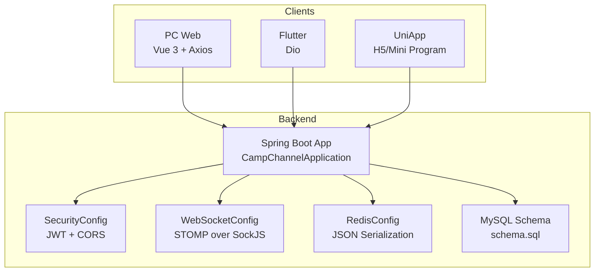
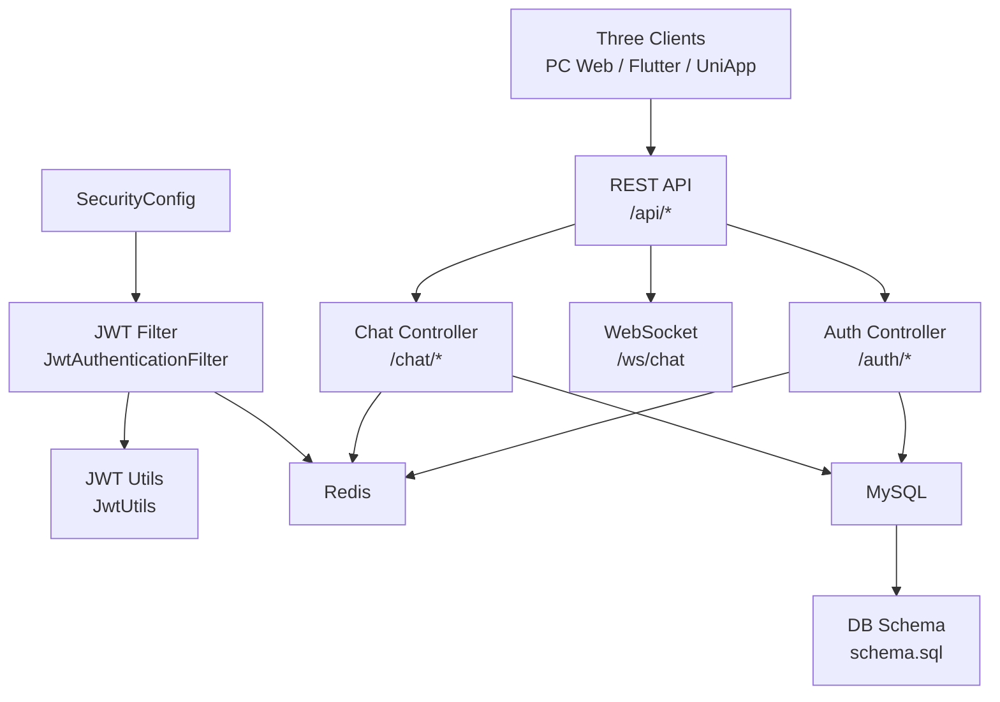
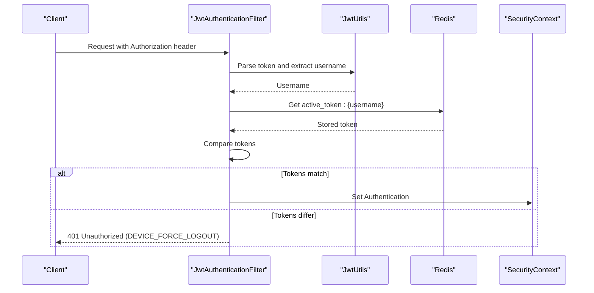
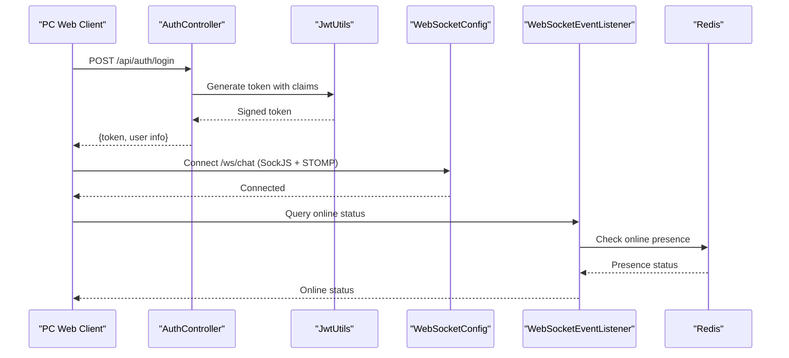
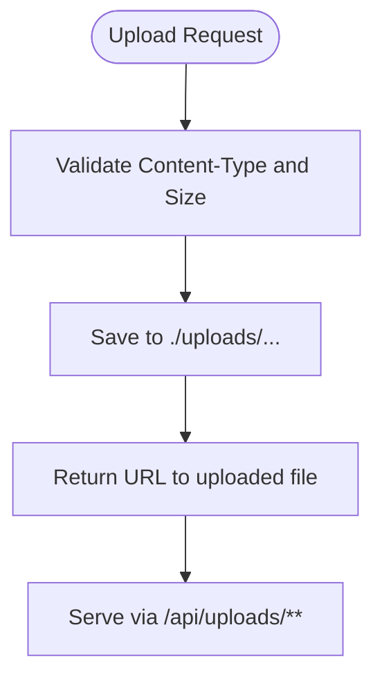
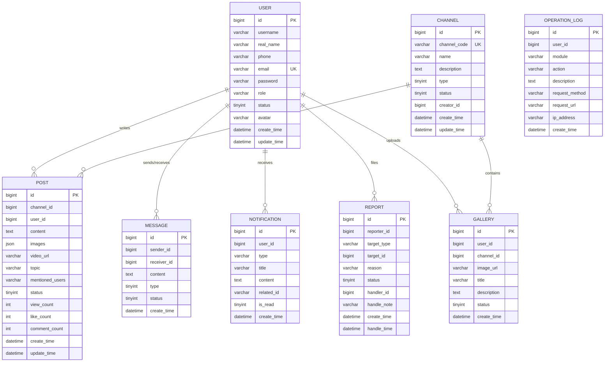
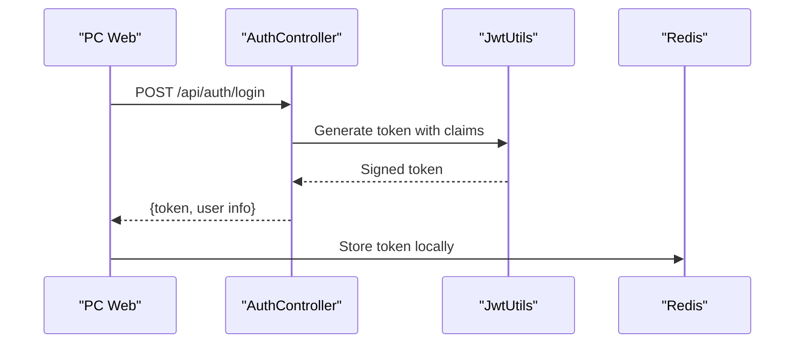
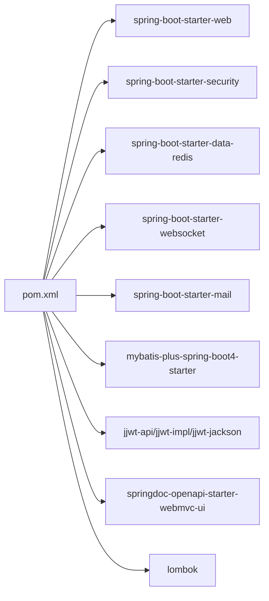

# Architecture Overview

<cite>
**Referenced Files in This Document**
- [CampChannelApplication.java](file://camp-channel-server/src/main/java/com/gdmec/campchannel/CampChannelApplication.java)
- [application.yml](file://camp-channel-server/src/main/resources/application.yml)
- [pom.xml](file://camp-channel-server/pom.xml)
- [WebSocketConfig.java](file://camp-channel-server/src/main/java/com/gdmec/campchannel/config/WebSocketConfig.java)
- [SecurityConfig.java](file://camp-channel-server/src/main/java/com/gdmec/campchannel/config/SecurityConfig.java)
- [RedisConfig.java](file://camp-channel-server/src/main/java/com/gdmec/campchannel/config/RedisConfig.java)
- [JwtAuthenticationFilter.java](file://camp-channel-server/src/main/java/com/gdmec/campchannel/security/JwtAuthenticationFilter.java)
- [JwtUtils.java](file://camp-channel-server/src/main/java/com/gdmec/campchannel/common/utils/JwtUtils.java)
- [AuthController.java](file://camp-channel-server/src/main/java/com/gdmec/campchannel/controller/AuthController.java)
- [ChatController.java](file://camp-channel-server/src/main/java/com/gdmec/campchannel/controller/ChatController.java)
- [schema.sql](file://camp-channel-server/src/main/resources/db/schema.sql)
- [client.ts](file://camp-channel-client-pc/src/api/client.ts)
- [request.ts](file://camp-channel-client-uniapp/src/utils/request.ts)
- [pubspec.yaml](file://camp-channel-client-flutter/pubspec.yaml)
- [package.json (UniApp)](file://camp-channel-client-uniapp/package.json)
- [package.json (PC Web)](file://camp-channel-client-pc/package.json)
</cite>

## Table of Contents
1. [Introduction](#introduction)
2. [Project Structure](#project-structure)
3. [Core Components](#core-components)
4. [Architecture Overview](#architecture-overview)
5. [Detailed Component Analysis](#detailed-component-analysis)
6. [Dependency Analysis](#dependency-analysis)
7. [Performance Considerations](#performance-considerations)
8. [Troubleshooting Guide](#troubleshooting-guide)
9. [Conclusion](#conclusion)
10. [Appendices](#appendices)

## Introduction
This document presents the architecture of the Camp Channel system, a campus social platform connecting three client platforms (PC Web, Flutter Mobile, UniApp) to a centralized Spring Boot backend. The backend exposes REST APIs, supports real-time messaging via WebSocket, manages file uploads, and persists data in MySQL with Redis caching. Cross-cutting concerns include JWT-based authentication, CORS configuration, rate limiting, and operational observability.

## Project Structure
The repository is organized into:
- Backend: Spring Boot application with layered architecture (controllers, services, mappers, entities, configurations).
- Clients:
  - PC Web (Vue 3 + TypeScript)
  - Flutter (Dio HTTP client)
  - UniApp (H5/Mini Program)

**Diagram sources**
- [CampChannelApplication.java:12-29](file://camp-channel-server/src/main/java/com/gdmec/campchannel/CampChannelApplication.java#L12-L29)
- [SecurityConfig.java:53-105](file://camp-channel-server/src/main/java/com/gdmec/campchannel/config/SecurityConfig.java#L53-L105)
- [WebSocketConfig.java:13-36](file://camp-channel-server/src/main/java/com/gdmec/campchannel/config/WebSocketConfig.java#L13-L36)
- [RedisConfig.java:18-46](file://camp-channel-server/src/main/java/com/gdmec/campchannel/config/RedisConfig.java#L18-L46)
- [schema.sql:1-236](file://camp-channel-server/src/main/resources/db/schema.sql#L1-L236)

**Section sources**
- [CampChannelApplication.java:12-29](file://camp-channel-server/src/main/java/com/gdmec/campchannel/CampChannelApplication.java#L12-L29)
- [application.yml:1-119](file://camp-channel-server/src/main/resources/application.yml#L1-L119)
- [pom.xml:1-227](file://camp-channel-server/pom.xml#L1-L227)

## Core Components
- Spring Boot Application: Central entrypoint enabling async processing and configuring MyBatis-Plus pagination.
- Security Layer: Stateless JWT authentication with CORS, pre-authenticated endpoints for login, Swagger, and WebSocket.
- Real-Time Messaging: STOMP over SockJS endpoint for chat, with custom auth interceptor and event listener for online presence.
- Data Access: MyBatis-Plus with MySQL schema covering users, channels, posts, messages, notifications, reports, galleries, and audit logs.
- Caching: Redis configured with JSON serialization for tokens and online presence checks.
- Clients: Three frontends using REST APIs and WebSocket for chat; UniApp also handles local file previews via uploads.

**Section sources**
- [CampChannelApplication.java:12-29](file://camp-channel-server/src/main/java/com/gdmec/campchannel/CampChannelApplication.java#L12-L29)
- [SecurityConfig.java:53-105](file://camp-channel-server/src/main/java/com/gdmec/campchannel/config/SecurityConfig.java#L53-L105)
- [WebSocketConfig.java:13-36](file://camp-channel-server/src/main/java/com/gdmec/campchannel/config/WebSocketConfig.java#L13-L36)
- [RedisConfig.java:18-46](file://camp-channel-server/src/main/java/com/gdmec/campchannel/config/RedisConfig.java#L18-L46)
- [schema.sql:1-236](file://camp-channel-server/src/main/resources/db/schema.sql#L1-L236)

## Architecture Overview
The system follows a centralized Spring Boot backend with:
- RESTful API surface under /api with JWT-protected routes and explicit permitAll for login, Swagger, and WebSocket.
- WebSocket chat endpoint (/ws/chat) using STOMP over SockJS for real-time messaging.
- Redis-backed caching for JWT active-token enforcement and online presence.
- MySQL persistence with MyBatis-Plus mappers and entities.

**Diagram sources**
- [SecurityConfig.java:53-105](file://camp-channel-server/src/main/java/com/gdmec/campchannel/config/SecurityConfig.java#L53-L105)
- [JwtAuthenticationFilter.java:31-100](file://camp-channel-server/src/main/java/com/gdmec/campchannel/security/JwtAuthenticationFilter.java#L31-L100)
- [JwtUtils.java:18-84](file://camp-channel-server/src/main/java/com/gdmec/campchannel/common/utils/JwtUtils.java#L18-L84)
- [AuthController.java:41-207](file://camp-channel-server/src/main/java/com/gdmec/campchannel/controller/AuthController.java#L41-L207)
- [ChatController.java:24-166](file://camp-channel-server/src/main/java/com/gdmec/campchannel/controller/ChatController.java#L24-L166)
- [WebSocketConfig.java:13-36](file://camp-channel-server/src/main/java/com/gdmec/campchannel/config/WebSocketConfig.java#L13-L36)
- [schema.sql:1-236](file://camp-channel-server/src/main/resources/db/schema.sql#L1-L236)

## Detailed Component Analysis

### Authentication and Security
- JWT-based stateless authentication with BCrypt password hashing.
- Global JWT filter validates tokens, enforces single-device login by comparing active token in Redis, and injects authentication into Spring Security context.
- SecurityConfig permits unauthenticated access to login, registration, verification, Swagger UI, and WebSocket endpoints; all other endpoints require authentication.

**Diagram sources**
- [JwtAuthenticationFilter.java:42-100](file://camp-channel-server/src/main/java/com/gdmec/campchannel/security/JwtAuthenticationFilter.java#L42-L100)
- [JwtUtils.java:40-83](file://camp-channel-server/src/main/java/com/gdmec/campchannel/common/utils/JwtUtils.java#L40-L83)
- [SecurityConfig.java:53-105](file://camp-channel-server/src/main/java/com/gdmec/campchannel/config/SecurityConfig.java#L53-L105)

**Section sources**
- [JwtAuthenticationFilter.java:31-113](file://camp-channel-server/src/main/java/com/gdmec/campchannel/security/JwtAuthenticationFilter.java#L31-L113)
- [JwtUtils.java:18-84](file://camp-channel-server/src/main/java/com/gdmec/campchannel/common/utils/JwtUtils.java#L18-L84)
- [SecurityConfig.java:53-137](file://camp-channel-server/src/main/java/com/gdmec/campchannel/config/SecurityConfig.java#L53-L137)
- [AuthController.java:124-207](file://camp-channel-server/src/main/java/com/gdmec/campchannel/controller/AuthController.java#L124-L207)

### Real-Time Messaging (WebSocket)
- STOMP endpoint /ws/chat with SockJS fallback.
- Custom auth interceptor registered to secure inbound messages.
- Online presence and read receipts integrated with Redis; REST endpoints expose online status and chat history.

**Diagram sources**
- [AuthController.java:124-207](file://camp-channel-server/src/main/java/com/gdmec/campchannel/controller/AuthController.java#L124-L207)
- [JwtUtils.java:66-74](file://camp-channel-server/src/main/java/com/gdmec/campchannel/common/utils/JwtUtils.java#L66-L74)
- [WebSocketConfig.java:18-35](file://camp-channel-server/src/main/java/com/gdmec/campchannel/config/WebSocketConfig.java#L18-L35)
- [ChatController.java:32-52](file://camp-channel-server/src/main/java/com/gdmec/campchannel/controller/ChatController.java#L32-L52)

**Section sources**
- [WebSocketConfig.java:13-36](file://camp-channel-server/src/main/java/com/gdmec/campchannel/config/WebSocketConfig.java#L13-L36)
- [ChatController.java:24-166](file://camp-channel-server/src/main/java/com/gdmec/campchannel/controller/ChatController.java#L24-L166)

### File Upload Processing
- REST endpoints for uploads and static file serving under /api/uploads and /uploads.
- Multipart limits configured in application.yml; uploads directory used as local storage (simulating object storage behavior).
- Clients construct absolute URLs for images using base URL plus context path.

**Diagram sources**
- [application.yml:44-47](file://camp-channel-server/src/main/resources/application.yml#L44-L47)
- [request.ts:16-25](file://camp-channel-client-uniapp/src/utils/request.ts#L16-L25)

**Section sources**
- [application.yml:44-47](file://camp-channel-server/src/main/resources/application.yml#L44-L47)
- [request.ts:16-25](file://camp-channel-client-uniapp/src/utils/request.ts#L16-L25)

### Database Operations
- MySQL schema defines entities for users, channels, posts, comments, friendships, messages, notifications, reports, galleries, and operation logs.
- MyBatis-Plus pagination interceptor configured; mappers and services follow standard Spring Boot patterns.

**Diagram sources**
- [schema.sql:1-236](file://camp-channel-server/src/main/resources/db/schema.sql#L1-L236)

**Section sources**
- [schema.sql:1-236](file://camp-channel-server/src/main/resources/db/schema.sql#L1-L236)

### Cross-Platform Client Integration
- PC Web (Vue 3): Uses Axios with base URL /api and Authorization header injection.
- Flutter: Uses Dio for HTTP requests and Provider for state management.
- UniApp: Provides a unified request wrapper with token handling, base URL resolution, and force logout on unauthorized responses.

**Diagram sources**
- [client.ts:1-35](file://camp-channel-client-pc/src/api/client.ts#L1-L35)
- [request.ts:30-84](file://camp-channel-client-uniapp/src/utils/request.ts#L30-L84)
- [AuthController.java:171-190](file://camp-channel-server/src/main/java/com/gdmec/campchannel/controller/AuthController.java#L171-L190)

**Section sources**
- [client.ts:1-35](file://camp-channel-client-pc/src/api/client.ts#L1-L35)
- [request.ts:1-112](file://camp-channel-client-uniapp/src/utils/request.ts#L1-L112)
- [pubspec.yaml:1-38](file://camp-channel-client-flutter/pubspec.yaml#L1-L38)
- [package.json (UniApp):1-29](file://camp-channel-client-uniapp/package.json#L1-L29)
- [package.json (PC Web):1-28](file://camp-channel-client-pc/package.json#L1-L28)

## Dependency Analysis
- Backend dependencies include Spring Web, Security, Data Redis, Validation, WebSocket, Mail, MyBatis-Plus, JWT, OpenAPI/Swagger, and Lombok.
- Java 26 is enforced; Maven compiler plugin exports/opens required internal APIs for annotation processors.

**Diagram sources**
- [pom.xml:32-135](file://camp-channel-server/pom.xml#L32-L135)

**Section sources**
- [pom.xml:20-30](file://camp-channel-server/pom.xml#L20-L30)
- [pom.xml:137-227](file://camp-channel-server/pom.xml#L137-L227)

## Performance Considerations
- Database pooling: HikariCP configured with min idle, max pool size, and timeouts.
- Redis connection pool sizing aligned with expected concurrency.
- Pagination via MyBatis-Plus interceptor reduces payload sizes for lists.
- Rate limiting for verification codes and login attempts mitigates brute-force risks.
- WebSocket message broker uses in-memory topics/queues; consider clustering for horizontal scaling.

[No sources needed since this section provides general guidance]

## Troubleshooting Guide
- 401 Unauthorized after login:
  - Verify Authorization header format and token validity.
  - Check Redis active token mismatch indicating single-device enforcement.
- Force logout behavior:
  - Clients remove local tokens and navigate to login on receiving 401 or business code 1009.
- CORS issues:
  - Confirm allowed origins and credentials settings in SecurityConfig.
- WebSocket connection failures:
  - Ensure /ws/chat endpoint is reachable and SockJS fallback is supported.

**Section sources**
- [JwtAuthenticationFilter.java:84-96](file://camp-channel-server/src/main/java/com/gdmec/campchannel/security/JwtAuthenticationFilter.java#L84-L96)
- [request.ts:58-109](file://camp-channel-client-uniapp/src/utils/request.ts#L58-L109)
- [SecurityConfig.java:110-124](file://camp-channel-server/src/main/java/com/gdmec/campchannel/config/SecurityConfig.java#L110-L124)

## Conclusion
The Camp Channel system employs a centralized Spring Boot backend with layered architecture, JWT authentication, Redis caching, and MySQL persistence. It integrates three cross-platform clients via REST and WebSocket, delivering a scalable foundation for campus social interactions. Security, performance, and operational simplicity are addressed through well-defined configuration and modular components.

[No sources needed since this section summarizes without analyzing specific files]

## Appendices

### Infrastructure Requirements
- Database: MySQL 8+ with UTF-8mb4; initial schema and migrations applied.
- Redis: Standalone or clustered for caching and online presence.
- WebSocket: STOMP over SockJS endpoint exposed at /ws/chat.
- File Storage: Local ./uploads directory; production should integrate object storage with CDN.
- Monitoring: Enable logging and consider adding metrics and tracing.

**Section sources**
- [application.yml:13-119](file://camp-channel-server/src/main/resources/application.yml#L13-L119)
- [schema.sql:1-236](file://camp-channel-server/src/main/resources/db/schema.sql#L1-L236)

### Technology Stack Integration Points
- Backend:
  - Spring Boot 4.0.6, Java 26, MyBatis-Plus 3.5.16, JWT 0.12.7, SpringDoc 3.0.3, Lombok 1.18.46.
- Frontends:
  - Vue 3 + TypeScript (Axios), Flutter (Dio), UniApp (Pinia, Vue 3).

**Section sources**
- [pom.xml:20-30](file://camp-channel-server/pom.xml#L20-L30)
- [package.json (PC Web):10-26](file://camp-channel-client-pc/package.json#L10-L26)
- [pubspec.yaml:8-30](file://camp-channel-client-flutter/pubspec.yaml#L8-L30)
- [package.json (UniApp):11-27](file://camp-channel-client-uniapp/package.json#L11-L27)