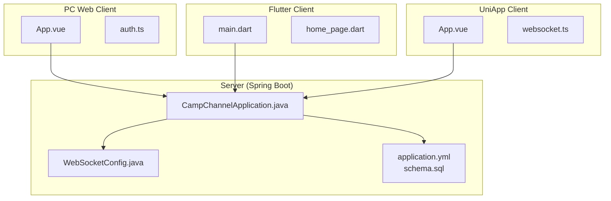
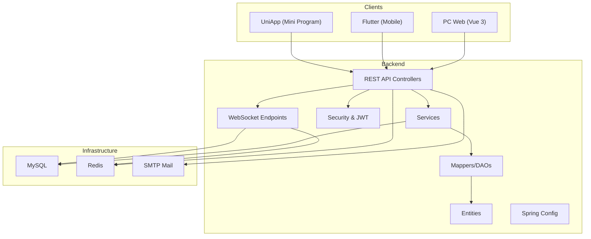
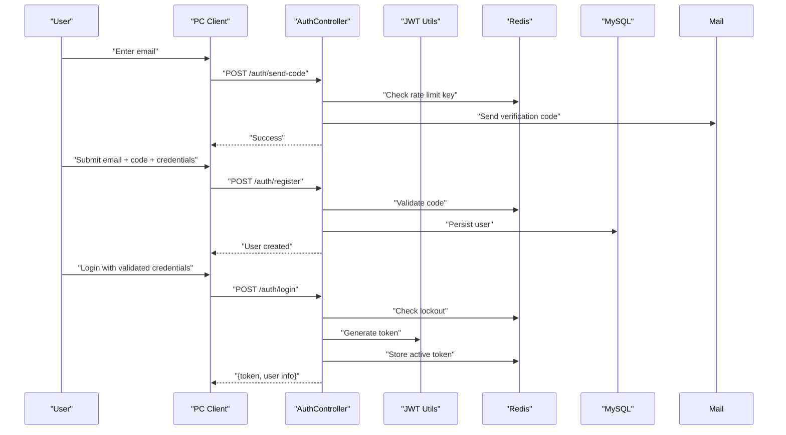
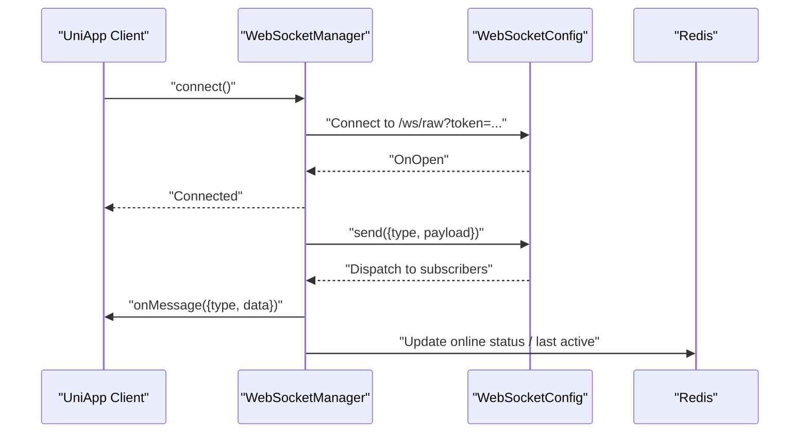
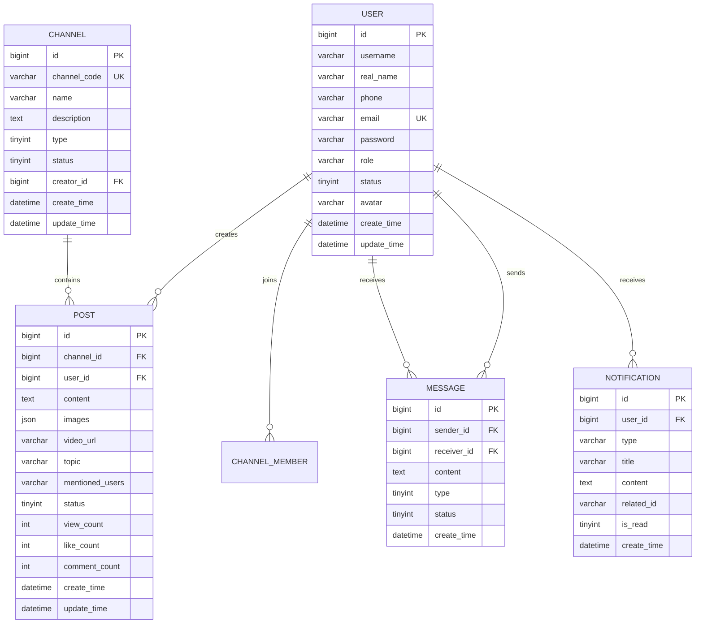
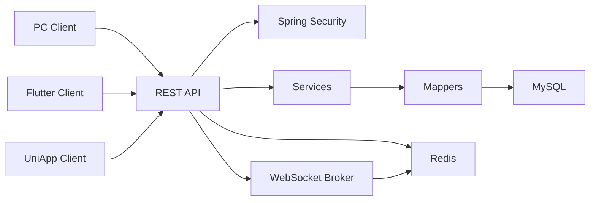

# Project Overview

<cite>
**Referenced Files in This Document**
- [CampChannelApplication.java](file://camp-channel-server/src/main/java/com/gdmec/campchannel/CampChannelApplication.java)
- [application.yml](file://camp-channel-server/src/main/resources/application.yml)
- [WebSocketConfig.java](file://camp-channel-server/src/main/java/com/gdmec/campchannel/config/WebSocketConfig.java)
- [AuthController.java](file://camp-channel-server/src/main/java/com/gdmec/campchannel/controller/AuthController.java)
- [User.java](file://camp-channel-server/src/main/java/com/gdmec/campchannel/entity/User.java)
- [Post.java](file://camp-channel-server/src/main/java/com/gdmec/campchannel/entity/Post.java)
- [Channel.java](file://camp-channel-server/src/main/java/com/gdmec/campchannel/entity/Channel.java)
- [schema.sql](file://camp-channel-server/src/main/resources/db/schema.sql)
- [App.vue (PC)](file://camp-channel-client-pc/src/App.vue)
- [auth.ts (PC Pinia store)](file://camp-channel-client-pc/src/stores/auth.ts)
- [main.dart (Flutter)](file://camp-channel-client-flutter/lib/main.dart)
- [home_page.dart (Flutter)](file://camp-channel-client-flutter/lib/pages/home_page.dart)
- [App.vue (UniApp)](file://camp-channel-client-uniapp/src/App.vue)
- [websocket.ts (UniApp)](file://camp-channel-client-uniapp/src/utils/websocket.ts)
- [需求文档 V2.0](file://Camp Channel 校园频道系统 V2.0 需求文档.md)
</cite>

## Table of Contents
1. [Introduction](#introduction)
2. [Project Structure](#project-structure)
3. [Core Components](#core-components)
4. [Architecture Overview](#architecture-overview)
5. [Detailed Component Analysis](#detailed-component-analysis)
6. [Dependency Analysis](#dependency-analysis)
7. [Performance Considerations](#performance-considerations)
8. [Troubleshooting Guide](#troubleshooting-guide)
9. [Conclusion](#conclusion)
10. [Appendices](#appendices)

## Introduction
Camp Channel is a comprehensive campus social networking platform designed for Guangdong Polytechnic Institute students. It serves as a centralized communication hub enabling students to discover channels, publish posts, engage in real-time chat, manage friends, and receive notifications. The platform enforces institutional email validation via the domain @stu.gdmec.edu.cn and integrates content moderation capabilities to maintain a safe and appropriate environment. The system comprises three client platforms:
- PC Web (Vue.js SPA)
- Flutter Mobile (Android/iOS)
- UniApp (WeChat Mini Program)

These clients communicate with a Spring Boot backend that provides REST APIs, WebSocket real-time messaging, JWT-based authentication, Redis-backed caching and rate limiting, and a MySQL relational data model. The platform positions itself as a campus-wide social network that connects academic and social interaction scenarios within the broader educational ecosystem.

## Project Structure
The repository is organized into three client applications and a Spring Boot server module:
- Server: Spring Boot application with controllers, services, mappers, entities, configurations, and database initialization scripts.
- PC Web Client: Vue 3 + TypeScript single-page application with Pinia stores, routing, and rich UI components.
- Flutter Client: Cross-platform mobile application using provider-based state management and native-like navigation.
- UniApp Client: WeChat Mini Program client with a WebSocket manager for real-time messaging and tab bar integration.

**Diagram sources**
- [CampChannelApplication.java:12-30](file://camp-channel-server/src/main/java/com/gdmec/campchannel/CampChannelApplication.java#L12-L30)
- [WebSocketConfig.java:11-36](file://camp-channel-server/src/main/java/com/gdmec/campchannel/config/WebSocketConfig.java#L11-L36)
- [application.yml:1-119](file://camp-channel-server/src/main/resources/application.yml#L1-L119)
- [schema.sql:1-200](file://camp-channel-server/src/main/resources/db/schema.sql#L1-L200)
- [App.vue (PC):1-85](file://camp-channel-client-pc/src/App.vue#L1-L85)
- [auth.ts (PC Pinia store):1-61](file://camp-channel-client-pc/src/stores/auth.ts#L1-L61)
- [main.dart (Flutter):1-122](file://camp-channel-client-flutter/lib/main.dart#L1-L122)
- [home_page.dart (Flutter):1-152](file://camp-channel-client-flutter/lib/pages/home_page.dart#L1-L152)
- [App.vue (UniApp):1-93](file://camp-channel-client-uniapp/src/App.vue#L1-L93)
- [websocket.ts (UniApp):1-268](file://camp-channel-client-uniapp/src/utils/websocket.ts#L1-L268)

**Section sources**
- [CampChannelApplication.java:12-30](file://camp-channel-server/src/main/java/com/gdmec/campchannel/CampChannelApplication.java#L12-L30)
- [application.yml:1-119](file://camp-channel-server/src/main/resources/application.yml#L1-L119)
- [schema.sql:1-200](file://camp-channel-server/src/main/resources/db/schema.sql#L1-L200)
- [App.vue (PC):1-85](file://camp-channel-client-pc/src/App.vue#L1-L85)
- [auth.ts (PC Pinia store):1-61](file://camp-channel-client-pc/src/stores/auth.ts#L1-L61)
- [main.dart (Flutter):1-122](file://camp-channel-client-flutter/lib/main.dart#L1-L122)
- [home_page.dart (Flutter):1-152](file://camp-channel-client-flutter/lib/pages/home_page.dart#L1-L152)
- [App.vue (UniApp):1-93](file://camp-channel-client-uniapp/src/App.vue#L1-L93)
- [websocket.ts (UniApp):1-268](file://camp-channel-client-uniapp/src/utils/websocket.ts#L1-L268)

## Core Components
- Spring Boot Backend
  - Entry point initializes the application, MyBatis-Plus pagination, and asynchronous processing.
  - Configuration includes datasource, Redis, multipart upload limits, SMTP mail, JWT, Swagger/OpenAPI, and logging.
  - WebSocket support enables real-time chat via STOMP over SockJS and a raw endpoint for UniApp.
  - Controllers implement authentication (institutional email validation), channels, posts, comments, likes, messages, friendships, notifications, reports, and administration.
  - Entities represent users, channels, posts, messages, comments, friendships, notifications, reports, and operation logs.
  - Database schema defines normalized tables with indexes and migration additions for V2.0 features.

- PC Web Client (Vue 3)
  - Central layout with sidebar navigation and mobile adaptation.
  - Pinia store manages authentication state and persists tokens and user info.
  - Pages cover login, registration, home feed, channel browsing, post creation/detail, chat, friends, notifications, settings, and admin.

- Flutter Client
  - App bootstraps providers for theme and user state, routes to core pages, and handles forced logout UX.
  - Home page integrates channel feed, chat list, notifications, and profile tabs, fetches unread counts, initializes WebSocket, and synchronizes profile.

- UniApp Client
  - App initializes tab bar styling and unread badge logic.
  - WebSocket manager encapsulates connection lifecycle, message dispatching, and exponential backoff reconnection for WeChat Mini Program constraints.

- Institutional Validation and Moderation
  - Authentication enforces @stu.gdmec.edu.cn domain and rate-limiting for verification codes.
  - Content moderation includes a sensitive words filter and report handling.
  - Notifications and audit logs support content oversight and compliance.

**Section sources**
- [CampChannelApplication.java:12-30](file://camp-channel-server/src/main/java/com/gdmec/campchannel/CampChannelApplication.java#L12-L30)
- [application.yml:1-119](file://camp-channel-server/src/main/resources/application.yml#L1-L119)
- [WebSocketConfig.java:11-36](file://camp-channel-server/src/main/java/com/gdmec/campchannel/config/WebSocketConfig.java#L11-L36)
- [AuthController.java:61-207](file://camp-channel-server/src/main/java/com/gdmec/campchannel/controller/AuthController.java#L61-L207)
- [User.java:10-42](file://camp-channel-server/src/main/java/com/gdmec/campchannel/entity/User.java#L10-L42)
- [Post.java:11-58](file://camp-channel-server/src/main/java/com/gdmec/campchannel/entity/Post.java#L11-L58)
- [Channel.java:10-32](file://camp-channel-server/src/main/java/com/gdmec/campchannel/entity/Channel.java#L10-L32)
- [schema.sql:1-200](file://camp-channel-server/src/main/resources/db/schema.sql#L1-L200)
- [App.vue (PC):1-85](file://camp-channel-client-pc/src/App.vue#L1-L85)
- [auth.ts (PC Pinia store):1-61](file://camp-channel-client-pc/src/stores/auth.ts#L1-L61)
- [main.dart (Flutter):1-122](file://camp-channel-client-flutter/lib/main.dart#L1-L122)
- [home_page.dart (Flutter):1-152](file://camp-channel-client-flutter/lib/pages/home_page.dart#L1-L152)
- [App.vue (UniApp):1-93](file://camp-channel-client-uniapp/src/App.vue#L1-L93)
- [websocket.ts (UniApp):1-268](file://camp-channel-client-uniapp/src/utils/websocket.ts#L1-L268)

## Architecture Overview
Camp Channel follows a layered architecture:
- Presentation Layer: Three clients (PC Web, Flutter, UniApp) render UI and orchestrate user interactions.
- Application Layer: Spring Boot controllers expose REST endpoints and manage business workflows.
- Messaging Layer: WebSocket endpoints deliver real-time chat and notifications.
- Persistence Layer: MySQL stores entities; Redis caches tokens, rate limits, online status, and session data.
- Security Layer: JWT-based authentication, CSRF protection, and role-based access control.

**Diagram sources**
- [application.yml:1-119](file://camp-channel-server/src/main/resources/application.yml#L1-L119)
- [WebSocketConfig.java:11-36](file://camp-channel-server/src/main/java/com/gdmec/campchannel/config/WebSocketConfig.java#L11-L36)
- [AuthController.java:61-207](file://camp-channel-server/src/main/java/com/gdmec/campchannel/controller/AuthController.java#L61-L207)
- [schema.sql:1-200](file://camp-channel-server/src/main/resources/db/schema.sql#L1-L200)

## Detailed Component Analysis

### Authentication and Institutional Email Validation
- The authentication flow validates institutional email suffix, enforces rate limits for verification codes, and uses Redis to track failed attempts and active tokens. JWT is issued upon successful login and stored client-side for subsequent requests. Single-device login enforcement ensures mutual exclusivity across sessions.

**Diagram sources**
- [AuthController.java:61-207](file://camp-channel-server/src/main/java/com/gdmec/campchannel/controller/AuthController.java#L61-L207)
- [application.yml:31-42](file://camp-channel-server/src/main/resources/application.yml#L31-L42)
- [User.java:10-42](file://camp-channel-server/src/main/java/com/gdmec/campchannel/entity/User.java#L10-L42)

**Section sources**
- [AuthController.java:61-207](file://camp-channel-server/src/main/java/com/gdmec/campchannel/controller/AuthController.java#L61-L207)
- [User.java:10-42](file://camp-channel-server/src/main/java/com/gdmec/campchannel/entity/User.java#L10-L42)
- [application.yml:31-42](file://camp-channel-server/src/main/resources/application.yml#L31-L42)

### Real-Time Messaging (WebSocket)
- The backend exposes STOMP endpoints for modern browsers and a raw WebSocket endpoint for UniApp. Clients subscribe to topics and user-specific queues. The UniApp client implements a robust WebSocket manager with connection lifecycle, message routing, wildcard handlers, and exponential backoff reconnection.

**Diagram sources**
- [WebSocketConfig.java:11-36](file://camp-channel-server/src/main/java/com/gdmec/campchannel/config/WebSocketConfig.java#L11-L36)
- [websocket.ts (UniApp):23-129](file://camp-channel-client-uniapp/src/utils/websocket.ts#L23-L129)
- [application.yml:31-42](file://camp-channel-server/src/main/resources/application.yml#L31-L42)

**Section sources**
- [WebSocketConfig.java:11-36](file://camp-channel-server/src/main/java/com/gdmec/campchannel/config/WebSocketConfig.java#L11-L36)
- [websocket.ts (UniApp):1-268](file://camp-channel-client-uniapp/src/utils/websocket.ts#L1-L268)
- [application.yml:31-42](file://camp-channel-server/src/main/resources/application.yml#L31-L42)

### Channels, Posts, and Social Interaction
- Channels organize content and memberships. Posts carry content, media, topics, mentions, and engagement metrics. The database schema defines normalized relations among users, channels, posts, comments, likes, messages, and notifications. V2.0 introduces group messages, pinned posts, favorites, hot/recommended feeds, and richer media in chats.

**Diagram sources**
- [schema.sql:1-200](file://camp-channel-server/src/main/resources/db/schema.sql#L1-L200)
- [User.java:10-42](file://camp-channel-server/src/main/java/com/gdmec/campchannel/entity/User.java#L10-L42)
- [Channel.java:10-32](file://camp-channel-server/src/main/java/com/gdmec/campchannel/entity/Channel.java#L10-L32)
- [Post.java:11-58](file://camp-channel-server/src/main/java/com/gdmec/campchannel/entity/Post.java#L11-L58)

**Section sources**
- [schema.sql:1-200](file://camp-channel-server/src/main/resources/db/schema.sql#L1-L200)
- [Post.java:11-58](file://camp-channel-server/src/main/java/com/gdmec/campchannel/entity/Post.java#L11-L58)
- [Channel.java:10-32](file://camp-channel-server/src/main/java/com/gdmec/campchannel/entity/Channel.java#L10-L32)
- [需求文档 V2.0:45-172](file://Camp Channel 校园频道系统 V2.0 需求文档.md#L45-L172)

### Practical Examples: Academic and Social Interaction
- Academic Discovery: Students browse channels by department or course, view posts with topics and media, and engage via comments and likes.
- Social Communication: Students create posts in public channels, share photos/videos, and participate in discussions. Private chats facilitate one-on-one conversations.
- Community Management: Administrators moderate content, review reports, and manage channel membership. Notifications keep users informed of mentions, approvals, and updates.
- Institutional Integration: Email-based registration and login tie accounts to student identities, ensuring a trusted community environment.

[No sources needed since this section provides conceptual examples]

## Dependency Analysis
The backend depends on Spring Boot, MyBatis-Plus, Spring Security, Redis, and MySQL. Clients depend on REST and WebSocket endpoints, with the UniApp client adding a dedicated WebSocket manager abstraction.

**Diagram sources**
- [application.yml:1-119](file://camp-channel-server/src/main/resources/application.yml#L1-L119)
- [WebSocketConfig.java:11-36](file://camp-channel-server/src/main/java/com/gdmec/campchannel/config/WebSocketConfig.java#L11-L36)
- [schema.sql:1-200](file://camp-channel-server/src/main/resources/db/schema.sql#L1-L200)

**Section sources**
- [application.yml:1-119](file://camp-channel-server/src/main/resources/application.yml#L1-L119)
- [WebSocketConfig.java:11-36](file://camp-channel-server/src/main/java/com/gdmec/campchannel/config/WebSocketConfig.java#L11-L36)
- [schema.sql:1-200](file://camp-channel-server/src/main/resources/db/schema.sql#L1-L200)

## Performance Considerations
- Caching and Rate Limiting: Redis is used for JWT-based single-device sessions, verification code rate limits, and online status tracking. Consider precomputing hot feed scores and caching frequent queries.
- Database Indexes: Ensure proper indexing on foreign keys and frequently queried columns (e.g., channel_id, user_id, timestamps).
- Asynchronous Operations: Leverage @EnableAsync for non-blocking tasks such as sending emails and background moderation checks.
- WebSocket Scalability: Use a message broker (already configured) and consider horizontal scaling with sticky sessions or shared state.

[No sources needed since this section provides general guidance]

## Troubleshooting Guide
- Authentication Failures
  - Verify institutional email suffix and rate limits for verification codes.
  - Check Redis connectivity for token storage and lockout counters.
  - Confirm JWT expiration and header configuration.

- WebSocket Issues
  - Ensure the correct endpoint is used per client (STOMP for PC, raw WS for UniApp).
  - Validate token inclusion in the raw WebSocket URL query parameter.
  - Monitor reconnection attempts and exponential backoff behavior.

- Database Initialization
  - Confirm datasource configuration and schema initialization script execution.
  - Review migration additions for V2.0 features.

**Section sources**
- [AuthController.java:61-207](file://camp-channel-server/src/main/java/com/gdmec/campchannel/controller/AuthController.java#L61-L207)
- [application.yml:13-42](file://camp-channel-server/src/main/resources/application.yml#L13-L42)
- [websocket.ts (UniApp):23-129](file://camp-channel-client-uniapp/src/utils/websocket.ts#L23-L129)
- [schema.sql:174-200](file://camp-channel-server/src/main/resources/db/schema.sql#L174-L200)

## Conclusion
Camp Channel delivers a unified campus social networking experience across PC, mobile, and mini-program clients. Its Spring Boot backend provides robust authentication with institutional validation, real-time messaging via WebSocket, and a scalable data model. The platform’s positioning as a comprehensive campus network is reinforced by content moderation, notifications, and institutional integration. The documented architecture and client integrations offer a clear foundation for stakeholders and developers to understand and extend the system.

[No sources needed since this section summarizes without analyzing specific files]

## Appendices
- Example Workflows
  - New Student Registration: Send verification code → Register user → Login and receive JWT → Persist session in Redis.
  - Real-Time Chat: Establish WebSocket connection → Subscribe to user/topic queues → Send/receive messages with status updates.
  - Content Moderation: Users submit reports → Administrators review and act → Notifications dispatched to involved parties.

[No sources needed since this section provides conceptual examples]