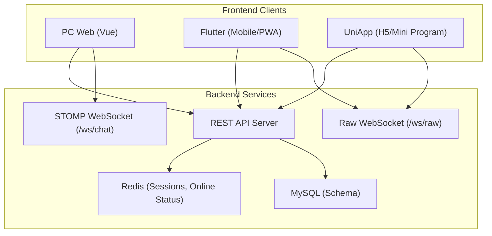
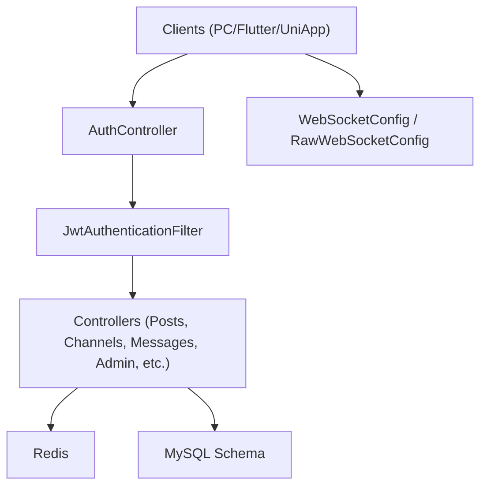
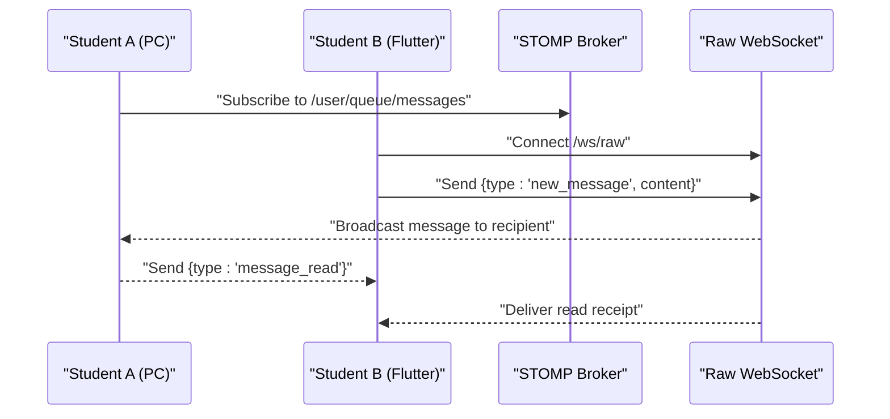
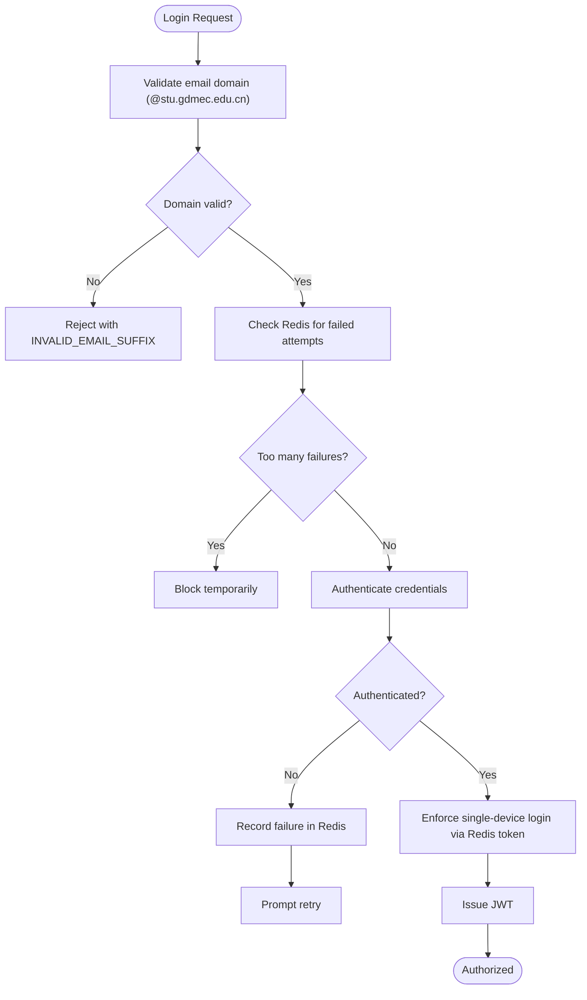
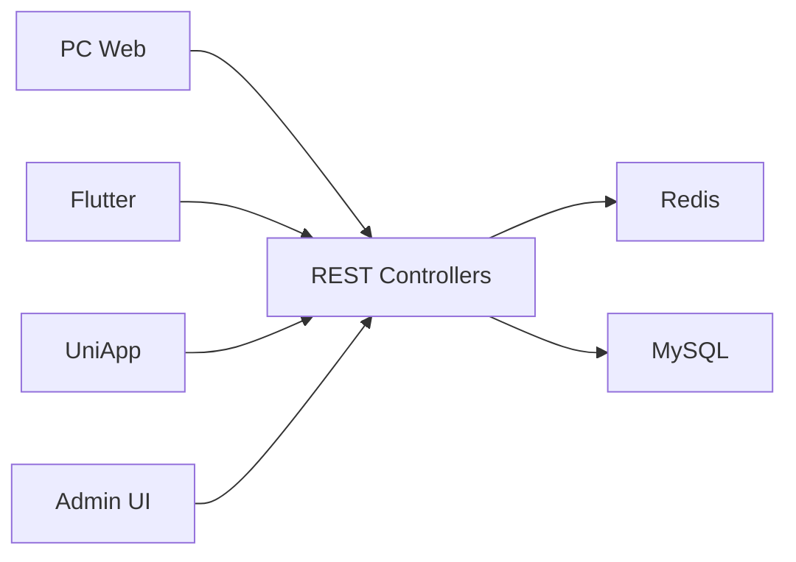

# Stakeholder Benefits

<cite>
**Referenced Files in This Document**
- [Camp Channel 校园频道系统 V2.0 需求文档.md](file://Camp Channel 校园频道系统 V2.0 需求文档.md)
- [Camp Channel 校园频道系统 V1.0 需求文档.md](file://Camp Channel 校园频道系统 V1.0 需求文档.md)
- [application.yml](file://camp-channel-server/src/main/resources/application.yml)
- [schema.sql](file://camp-channel-server/src/main/resources/db/schema.sql)
- [AuthController.java](file://camp-channel-server/src/main/java/com/gdmec/campchannel/controller/AuthController.java)
- [JwtAuthenticationFilter.java](file://camp-channel-server/src/main/java/com/gdmec/campchannel/security/JwtAuthenticationFilter.java)
- [SensitiveWordFilter.java](file://camp-channel-server/src/main/java/com/gdmec/campchannel/common/filter/SensitiveWordFilter.java)
- [WebSocketConfig.java](file://camp-channel-server/src/main/java/com/gdmec/campchannel/config/WebSocketConfig.java)
- [RawWebSocketConfig.java](file://camp-channel-server/src/main/java/com/gdmec/campchannel/config/RawWebSocketConfig.java)
- [AdminPage.vue](file://camp-channel-client-pc/src/pages/AdminPage.vue)
- [admin_page.dart](file://camp-channel-client-flutter/lib/pages/admin_page.dart)
- [AdminController.java](file://camp-channel-server/src/main/java/com/gdmec/campchannel/controller/AdminController.java)
- [ChatPage.vue](file://camp-channel-client-pc/src/pages/ChatPage.vue)
- [websocket_service.dart](file://camp-channel-client-flutter/lib/core/services/websocket_service.dart)
- [websocket.ts](file://camp-channel-client-uniapp/src/utils/websocket.ts)
- [CreatePostPage.vue](file://camp-channel-client-pc/src/pages/CreatePostPage.vue)
- [create_post_page.dart](file://camp-channel-client-flutter/lib/pages/create_post_page.dart)
- [GalleryController.java](file://camp-channel-server/src/main/java/com/gdmec/campchannel/controller/GalleryController.java)
- [GalleryService.java](file://camp-channel-server/src/main/java/com/gdmec/campchannel/service/GalleryService.java)
- [manifest.json (Flutter)](file://camp-channel-client-flutter/web/manifest.json)
- [manifest.json (UniApp)](file://camp-channel-client-uniapp/src/manifest.json)
- [vite.config.ts (UniApp)](file://camp-channel-client-uniapp/vite.config.ts)
</cite>

## Table of Contents
1. [Introduction](#introduction)
2. [Project Structure](#project-structure)
3. [Core Components](#core-components)
4. [Architecture Overview](#architecture-overview)
5. [Detailed Component Analysis](#detailed-component-analysis)
6. [Dependency Analysis](#dependency-analysis)
7. [Performance Considerations](#performance-considerations)
8. [Troubleshooting Guide](#troubleshooting-guide)
9. [Conclusion](#conclusion)
10. [Appendices](#appendices)

## Introduction
This document presents the stakeholder benefits of the Camp Channel platform across three primary groups: students, institutions, and developers. It explains how the platform’s features deliver measurable value to each group, supported by concrete examples and mapped to the documented requirements and implementation artifacts in the repository.

- Students gain enhanced academic collaboration, improved social interaction, and streamlined content sharing with multimedia support.
- Institutions benefit from content moderation, user management, and administrative oversight via the management dashboard.
- Developers enjoy cross-platform development efficiency, real-time communication capabilities, and a scalable architecture.

## Project Structure
The platform consists of:
- A Spring Boot backend exposing REST APIs and real-time WebSocket endpoints.
- Three frontends: Vue/PC, Flutter (mobile and Progressive Web App), and UniApp (H5/mini-program).
- A relational database with normalized tables and schema migrations.
- Configuration for security (JWT, single-device login), Redis-backed caching and online status, and sensitive word filtering.

**Diagram sources**
- [WebSocketConfig.java:18-35](file://camp-channel-server/src/main/java/com/gdmec/campchannel/config/WebSocketConfig.java#L18-L35)
- [RawWebSocketConfig.java:18-22](file://camp-channel-server/src/main/java/com/gdmec/campchannel/config/RawWebSocketConfig.java#L18-L22)
- [application.yml:31-42](file://camp-channel-server/src/main/resources/application.yml#L31-L42)
- [schema.sql:1-236](file://camp-channel-server/src/main/resources/db/schema.sql#L1-L236)

**Section sources**
- [application.yml:1-119](file://camp-channel-server/src/main/resources/application.yml#L1-L119)
- [schema.sql:1-236](file://camp-channel-server/src/main/resources/db/schema.sql#L1-L236)

## Core Components
- Authentication and security: JWT-based session management, single-device login enforcement, and email domain validation.
- Real-time communication: STOMP WebSocket for PC and raw WebSocket for Flutter/UniApp clients.
- Content and collaboration: Channels, posts, likes/comments, galleries, and group messaging.
- Moderation and administration: Admin dashboard, content review queues, reports, and audit logs.
- Cross-platform delivery: Vue/PC, Flutter (mobile and PWA), and UniApp (H5/mini program).

**Section sources**
- [AuthController.java:61-152](file://camp-channel-server/src/main/java/com/gdmec/campchannel/controller/AuthController.java#L61-L152)
- [JwtAuthenticationFilter.java:42-100](file://camp-channel-server/src/main/java/com/gdmec/campchannel/security/JwtAuthenticationFilter.java#L42-L100)
- [WebSocketConfig.java:18-35](file://camp-channel-server/src/main/java/com/gdmec/campchannel/config/WebSocketConfig.java#L18-L35)
- [RawWebSocketConfig.java:18-22](file://camp-channel-server/src/main/java/com/gdmec/campchannel/config/RawWebSocketConfig.java#L18-L22)
- [AdminPage.vue:1-426](file://camp-channel-client-pc/src/pages/AdminPage.vue#L1-L426)
- [admin_page.dart:1-318](file://camp-channel-client-flutter/lib/pages/admin_page.dart#L1-L318)

## Architecture Overview
The platform integrates a unified backend with multiple frontends and shared infrastructure:
- REST endpoints serve CRUD operations for posts, channels, friends, notifications, and admin tasks.
- Real-time messaging uses STOMP over SockJS for PC and raw WebSocket for Flutter/UniApp.
- Redis maintains active tokens, online presence, and caching.
- MySQL stores all entities and relationships, with schema migrations supporting incremental feature rollout.

**Diagram sources**
- [AuthController.java:41-152](file://camp-channel-server/src/main/java/com/gdmec/campchannel/controller/AuthController.java#L41-L152)
- [JwtAuthenticationFilter.java:42-100](file://camp-channel-server/src/main/java/com/gdmec/campchannel/security/JwtAuthenticationFilter.java#L42-L100)
- [WebSocketConfig.java:18-35](file://camp-channel-server/src/main/java/com/gdmec/campchannel/config/WebSocketConfig.java#L18-L35)
- [RawWebSocketConfig.java:18-22](file://camp-channel-server/src/main/java/com/gdmec/campchannel/config/RawWebSocketConfig.java#L18-L22)
- [application.yml:31-42](file://camp-channel-server/src/main/resources/application.yml#L31-L42)
- [schema.sql:1-236](file://camp-channel-server/src/main/resources/db/schema.sql#L1-L236)

## Detailed Component Analysis

### Student Benefits

#### Enhanced Academic Collaboration Through Channel-Based Discussions
- Students can join channels aligned with courses or interests, browse posts, and participate in threaded conversations.
- Practical example: A student publishes a study tip in a course channel; peers can like, comment, and share related resources, forming a collaborative learning hub.

**Section sources**
- [schema.sql:16-64](file://camp-channel-server/src/main/resources/db/schema.sql#L16-L64)
- [CreatePostPage.vue:93-143](file://camp-channel-client-pc/src/pages/CreatePostPage.vue#L93-L143)
- [create_post_page.dart:1-43](file://camp-channel-client-flutter/lib/pages/create_post_page.dart#L1-L43)

#### Improved Social Interaction With Real-Time Messaging and Friend Systems
- One-on-one chat with real-time read receipts and online status visibility.
- Practical example: Two roommates coordinate plans; the sender sees “read” indicators and can instantly confirm receipt.

**Diagram sources**
- [ChatPage.vue:89-127](file://camp-channel-client-pc/src/pages/ChatPage.vue#L89-L127)
- [websocket_service.dart:1-125](file://camp-channel-client-flutter/lib/core/services/websocket_service.dart#L1-L125)
- [websocket.ts:120-267](file://camp-channel-client-uniapp/src/utils/websocket.ts#L120-L267)
- [WebSocketConfig.java:18-35](file://camp-channel-server/src/main/java/com/gdmec/campchannel/config/WebSocketConfig.java#L18-L35)
- [RawWebSocketConfig.java:18-22](file://camp-channel-server/src/main/java/com/gdmec/campchannel/config/RawWebSocketConfig.java#L18-L22)

**Section sources**
- [schema.sql:103-129](file://camp-channel-server/src/main/resources/db/schema.sql#L103-L129)
- [ChatPage.vue:89-127](file://camp-channel-client-pc/src/pages/ChatPage.vue#L89-L127)
- [websocket_service.dart:1-125](file://camp-channel-client-flutter/lib/core/services/websocket_service.dart#L1-L125)
- [websocket.ts:120-267](file://camp-channel-client-uniapp/src/utils/websocket.ts#L120-L267)

#### Streamlined Content Sharing With Multimedia Support
- Rich posts with images and videos; optional topics and mentions; galleries for curated content.
- Practical example: A student shares a project screenshot and a short demo video in a channel post; classmates can like, comment, and share.

**Section sources**
- [schema.sql:45-90](file://camp-channel-server/src/main/resources/db/schema.sql#L45-L90)
- [CreatePostPage.vue:93-143](file://camp-channel-client-pc/src/pages/CreatePostPage.vue#L93-L143)
- [create_post_page.dart:1-43](file://camp-channel-client-flutter/lib/pages/create_post_page.dart#L1-L43)
- [GalleryController.java:136-159](file://camp-channel-server/src/main/java/com/gdmec/campchannel/controller/GalleryController.java#L136-L159)
- [GalleryService.java:1-36](file://camp-channel-server/src/main/java/com/gdmec/campchannel/service/GalleryService.java#L1-L36)

### Institutional Benefits

#### Content Moderation Capabilities
- Sensitive word filtering and content review queues; administrators can approve or reject posts and galleries.
- Practical example: A flagged post is automatically detected by the filter and moved to the admin review queue for action.

**Section sources**
- [SensitiveWordFilter.java:1-166](file://camp-channel-server/src/main/java/com/gdmec/campchannel/common/filter/SensitiveWordFilter.java#L1-L166)
- [schema.sql:146-161](file://camp-channel-server/src/main/resources/db/schema.sql#L146-L161)
- [AdminController.java:327-342](file://camp-channel-server/src/main/java/com/gdmec/campchannel/controller/AdminController.java#L327-L342)

#### User Management Tools
- Role-based access control (user/sys_admin), single-device login enforcement, and device management.
- Practical example: An administrator disables a user account or forces logout from suspicious devices.

**Section sources**
- [AuthController.java:61-152](file://camp-channel-server/src/main/java/com/gdmec/campchannel/controller/AuthController.java#L61-L152)
- [JwtAuthenticationFilter.java:76-96](file://camp-channel-server/src/main/java/com/gdmec/campchannel/security/JwtAuthenticationFilter.java#L76-L96)
- [schema.sql:1-14](file://camp-channel-server/src/main/resources/db/schema.sql#L1-L14)

#### Administrative Oversight Through the Management Dashboard
- Unified dashboard for statistics, user/channel management, content review, reports, logs, and announcements.
- Practical example: An admin reviews pending channel applications, handles user reports, and publishes institution-wide notices.

**Section sources**
- [AdminPage.vue:1-426](file://camp-channel-client-pc/src/pages/AdminPage.vue#L1-L426)
- [admin_page.dart:1-318](file://camp-channel-client-flutter/lib/pages/admin_page.dart#L1-L318)
- [AdminController.java:327-356](file://camp-channel-server/src/main/java/com/gdmec/campchannel/controller/AdminController.java#L327-L356)

### Operational Benefits for Developers

#### Cross-Platform Development Efficiency
- Shared backend APIs consumed by Vue/PC, Flutter (mobile and PWA), and UniApp (H5/mini program).
- Practical example: A new post creation feature is implemented once in the backend and reused across all clients.

**Section sources**
- [manifest.json (Flutter):1-35](file://camp-channel-client-flutter/web/manifest.json#L1-L35)
- [manifest.json (UniApp):1-20](file://camp-channel-client-uniapp/src/manifest.json#L1-L20)
- [vite.config.ts (UniApp):1-15](file://camp-channel-client-uniapp/vite.config.ts#L1-L15)

#### Real-Time Communication Capabilities
- STOMP WebSocket for PC and raw WebSocket for Flutter/UniApp ensure low-latency messaging with heartbeat and reconnection logic.
- Practical example: Clients subscribe to personal queues and receive live updates for messages and read receipts.

**Section sources**
- [WebSocketConfig.java:18-35](file://camp-channel-server/src/main/java/com/gdmec/campchannel/config/WebSocketConfig.java#L18-L35)
- [RawWebSocketConfig.java:18-22](file://camp-channel-server/src/main/java/com/gdmec/campchannel/config/RawWebSocketConfig.java#L18-L22)
- [websocket_service.dart:1-125](file://camp-channel-client-flutter/lib/core/services/websocket_service.dart#L1-L125)
- [websocket.ts:120-267](file://camp-channel-client-uniapp/src/utils/websocket.ts#L120-L267)

#### Scalable Architecture
- Redis-backed sessions and online status, MySQL with indexed tables, and modular controllers/services.
- Practical example: Online status is maintained via Redis with TTL-based heartbeat; chat history is stored in MySQL with optimized indexes.

**Section sources**
- [application.yml:31-42](file://camp-channel-server/src/main/resources/application.yml#L31-L42)
- [schema.sql:1-236](file://camp-channel-server/src/main/resources/db/schema.sql#L1-L236)

### Platform Role in Fostering Campus Community Engagement, Academic Support Networks, and Institutional Communication Channels
- Academic support: Students collaborate around course channels, share resources, and receive timely notifications.
- Community: Channels enable interest-based groups, events, and peer-to-peer help.
- Institutional communication: Admins publish announcements and manage compliance via the dashboard.

**Section sources**
- [Camp Channel 校园频道系统 V2.0 需求文档.md:16-20](file://Camp Channel 校园频道系统 V2.0 需求文档.md#L16-L20)
- [AdminPage.vue:1-426](file://camp-channel-client-pc/src/pages/AdminPage.vue#L1-L426)
- [AdminController.java:344-356](file://camp-channel-server/src/main/java/com/gdmec/campchannel/controller/AdminController.java#L344-L356)

### Security Benefits
- Institutional email validation: Registration and login require the @stu.gdmec.edu.cn domain.
- Content moderation: Sensitive word filtering and admin review queues.
- User authentication: JWT with single-device enforcement and device management.

**Diagram sources**
- [AuthController.java:61-152](file://camp-channel-server/src/main/java/com/gdmec/campchannel/controller/AuthController.java#L61-L152)
- [JwtAuthenticationFilter.java:76-96](file://camp-channel-server/src/main/java/com/gdmec/campchannel/security/JwtAuthenticationFilter.java#L76-L96)
- [application.yml:31-42](file://camp-channel-server/src/main/resources/application.yml#L31-L42)

**Section sources**
- [AuthController.java:61-152](file://camp-channel-server/src/main/java/com/gdmec/campchannel/controller/AuthController.java#L61-L152)
- [JwtAuthenticationFilter.java:76-96](file://camp-channel-server/src/main/java/com/gdmec/campchannel/security/JwtAuthenticationFilter.java#L76-L96)
- [SensitiveWordFilter.java:1-166](file://camp-channel-server/src/main/java/com/gdmec/campchannel/common/filter/SensitiveWordFilter.java#L1-L166)

### Concrete Use Cases

#### Students
- Publishing a study resource: A student creates a post with images and a topic tag; peers discover and engage.
- Real-time coordination: Roommates exchange messages with read receipts and online status.
- Content sharing: A student shares a gallery image to a friend via direct share.

**Section sources**
- [CreatePostPage.vue:93-143](file://camp-channel-client-pc/src/pages/CreatePostPage.vue#L93-L143)
- [create_post_page.dart:1-43](file://camp-channel-client-flutter/lib/pages/create_post_page.dart#L1-L43)
- [ChatPage.vue:89-127](file://camp-channel-client-pc/src/pages/ChatPage.vue#L89-L127)
- [websocket_service.dart:1-125](file://camp-channel-client-flutter/lib/core/services/websocket_service.dart#L1-L125)
- [websocket.ts:120-267](file://camp-channel-client-uniapp/src/utils/websocket.ts#L120-L267)
- [GalleryController.java:136-159](file://camp-channel-server/src/main/java/com/gdmec/campchannel/controller/GalleryController.java#L136-L159)

#### Institutions
- Managing spam: Sensitive words trigger automatic moderation and admin review.
- Enforcing policies: Single-device login prevents concurrent access; admins can force logout.
- Overseeing activity: Admin dashboard displays stats, pending items, and logs.

**Section sources**
- [SensitiveWordFilter.java:1-166](file://camp-channel-server/src/main/java/com/gdmec/campchannel/common/filter/SensitiveWordFilter.java#L1-L166)
- [AuthController.java:61-152](file://camp-channel-server/src/main/java/com/gdmec/campchannel/controller/AuthController.java#L61-L152)
- [JwtAuthenticationFilter.java:76-96](file://camp-channel-server/src/main/java/com/gdmec/campchannel/security/JwtAuthenticationFilter.java#L76-L96)
- [AdminPage.vue:1-426](file://camp-channel-client-pc/src/pages/AdminPage.vue#L1-L426)
- [AdminController.java:327-356](file://camp-channel-server/src/main/java/com/gdmec/campchannel/controller/AdminController.java#L327-L356)

#### Developers
- Consistent APIs: A single backend serves Vue/PC, Flutter, and UniApp clients.
- Real-time features: WebSocket endpoints provide reliable messaging across platforms.
- Scalability: Redis and indexed MySQL tables support growth.

**Section sources**
- [WebSocketConfig.java:18-35](file://camp-channel-server/src/main/java/com/gdmec/campchannel/config/WebSocketConfig.java#L18-L35)
- [RawWebSocketConfig.java:18-22](file://camp-channel-server/src/main/java/com/gdmec/campchannel/config/RawWebSocketConfig.java#L18-L22)
- [application.yml:31-42](file://camp-channel-server/src/main/resources/application.yml#L31-L42)
- [schema.sql:1-236](file://camp-channel-server/src/main/resources/db/schema.sql#L1-L236)

## Dependency Analysis
The platform exhibits clear separation of concerns:
- Frontends depend on REST and WebSocket endpoints.
- Backend depends on Redis for session and presence, and MySQL for persistence.
- Admin features rely on dedicated controllers and UI pages.

**Diagram sources**
- [application.yml:31-42](file://camp-channel-server/src/main/resources/application.yml#L31-L42)
- [schema.sql:1-236](file://camp-channel-server/src/main/resources/db/schema.sql#L1-L236)
- [AdminPage.vue:1-426](file://camp-channel-client-pc/src/pages/AdminPage.vue#L1-L426)
- [admin_page.dart:1-318](file://camp-channel-client-flutter/lib/pages/admin_page.dart#L1-L318)

**Section sources**
- [application.yml:31-42](file://camp-channel-server/src/main/resources/application.yml#L31-L42)
- [schema.sql:1-236](file://camp-channel-server/src/main/resources/db/schema.sql#L1-L236)

## Performance Considerations
- Redis-backed online status and caching reduce database load.
- Indexed tables accelerate queries for posts, messages, and logs.
- WebSocket heartbeats and reconnection logic improve reliability.

**Section sources**
- [application.yml:31-42](file://camp-channel-server/src/main/resources/application.yml#L31-L42)
- [schema.sql:1-236](file://camp-channel-server/src/main/resources/db/schema.sql#L1-L236)
- [websocket_service.dart:1-125](file://camp-channel-client-flutter/lib/core/services/websocket_service.dart#L1-L125)
- [websocket.ts:120-267](file://camp-channel-client-uniapp/src/utils/websocket.ts#L120-L267)

## Troubleshooting Guide
- Authentication failures: Verify email domain validation and failed attempt limits; check Redis for enforced single-device login.
- WebSocket connectivity: Confirm endpoint configuration and client-side reconnection logic; inspect heartbeat behavior.
- Moderation issues: Review sensitive word filter initialization and admin review queues.

**Section sources**
- [AuthController.java:61-152](file://camp-channel-server/src/main/java/com/gdmec/campchannel/controller/AuthController.java#L61-L152)
- [JwtAuthenticationFilter.java:76-96](file://camp-channel-server/src/main/java/com/gdmec/campchannel/security/JwtAuthenticationFilter.java#L76-L96)
- [SensitiveWordFilter.java:1-166](file://camp-channel-server/src/main/java/com/gdmec/campchannel/common/filter/SensitiveWordFilter.java#L1-L166)
- [websocket_service.dart:1-125](file://camp-channel-client-flutter/lib/core/services/websocket_service.dart#L1-L125)
- [websocket.ts:120-267](file://camp-channel-client-uniapp/src/utils/websocket.ts#L120-L267)

## Conclusion
Camp Channel delivers a cohesive, secure, and scalable platform tailored to the needs of students, institutions, and developers. Students benefit from seamless collaboration and social features; institutions gain robust moderation and oversight; developers enjoy efficient cross-platform delivery and real-time capabilities. The documented features and implementation artifacts provide a clear roadmap for continued enhancements.

## Appendices
- Additional requirements and feature scope are documented in the V2.0 requirements document.

**Section sources**
- [Camp Channel 校园频道系统 V2.0 需求文档.md:1-291](file://Camp Channel 校园频道系统 V2.0 需求文档.md#L1-L291)