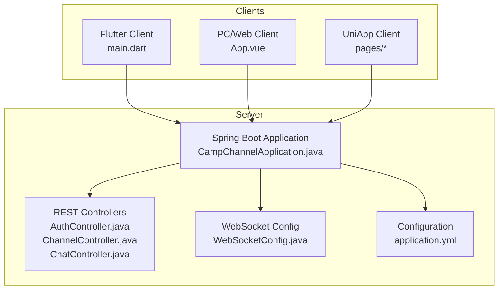
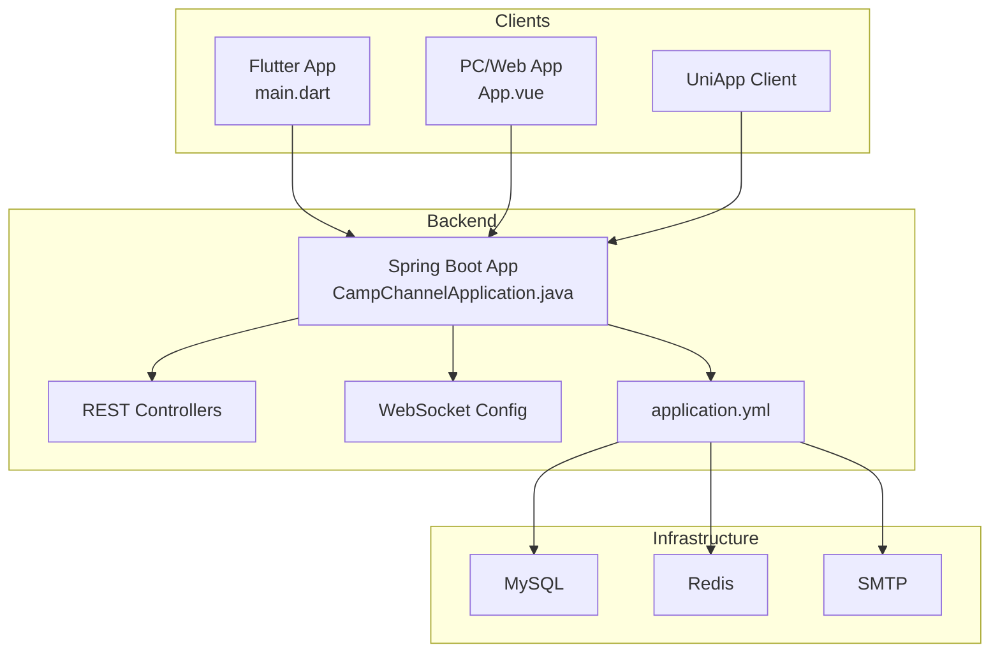
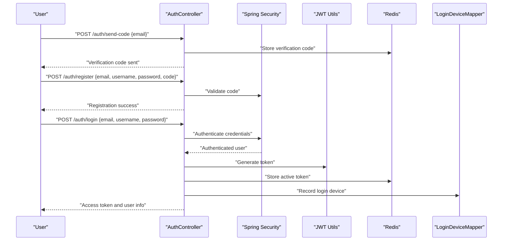
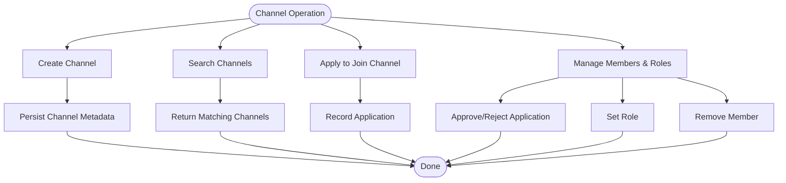
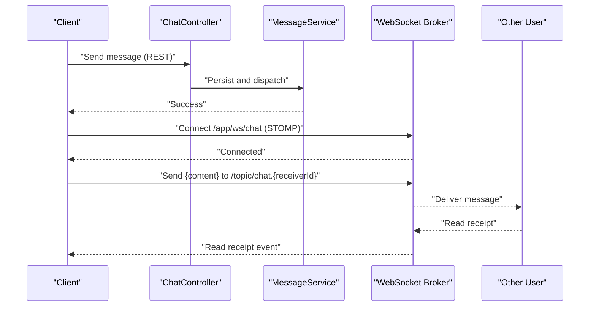
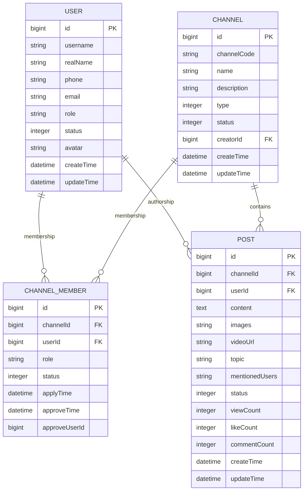
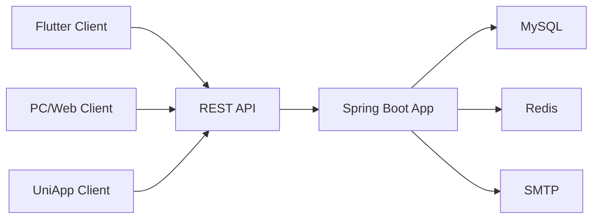

# System Introduction

<cite>
**Referenced Files in This Document**
- [Camp Channel 校园频道系统 V2.0 需求文档.md](file://Camp Channel 校园频道系统 V2.0 需求文档.md)
- [Camp Channel 校园频道系统 V1.0 需求文档.md](file://Camp Channel 校园频道系统 V1.0 需求文档.md)
- [CampChannelApplication.java](file://camp-channel-server/src/main/java/com/gdmec/campchannel/CampChannelApplication.java)
- [application.yml](file://camp-channel-server/src/main/resources/application.yml)
- [AuthController.java](file://camp-channel-server/src/main/java/com/gdmec/campchannel/controller/AuthController.java)
- [ChatController.java](file://camp-channel-server/src/main/java/com/gdmec/campchannel/controller/ChatController.java)
- [ChannelController.java](file://camp-channel-server/src/main/java/com/gdmec/campchannel/controller/ChannelController.java)
- [WebSocketConfig.java](file://camp-channel-server/src/main/java/com/gdmec/campchannel/config/WebSocketConfig.java)
- [User.java](file://camp-channel-server/src/main/java/com/gdmec/campchannel/entity/User.java)
- [Post.java](file://camp-channel-server/src/main/java/com/gdmec/campchannel/entity/Post.java)
- [Channel.java](file://camp-channel-server/src/main/java/com/gdmec/campchannel/entity/Channel.java)
- [ChannelMember.java](file://camp-channel-server/src/main/java/com/gdmec/campchannel/entity/ChannelMember.java)
- [Message.java](file://camp-channel-server/src/main/java/com/gdmec/campchannel/entity/Message.java)
- [main.dart](file://camp-channel-client-flutter/lib/main.dart)
- [App.vue](file://camp-channel-client-pc/src/App.vue)
</cite>

## Table of Contents
1. [Introduction](#introduction)
2. [Project Structure](#project-structure)
3. [Core Components](#core-components)
4. [Architecture Overview](#architecture-overview)
5. [Detailed Component Analysis](#detailed-component-analysis)
6. [Dependency Analysis](#dependency-analysis)
7. [Performance Considerations](#performance-considerations)
8. [Troubleshooting Guide](#troubleshooting-guide)
9. [Conclusion](#conclusion)

## Introduction
Camp Channel is a comprehensive campus communication platform designed specifically for students of Guangdong Polytechnic Institute. Its primary purpose is to serve as an institutional-grade social network that connects students through channels, posts, real-time messaging, and curated content. The platform emphasizes academic and social interaction within the campus community while maintaining strict institutional controls, including email validation for student accounts and robust content moderation capabilities.

The platform’s core value proposition centers on four pillars:
- Institutional identity and trust: Student-only access via validated institutional email addresses
- Channel-based content sharing: Structured communities organized around academic and social interests
- Real-time messaging: Instant chat with online presence indicators and read receipts
- Social networking: Posts, likes, comments, and friend connections tailored to campus life

For stakeholders, Camp Channel offers a secure, centralized hub for campus-wide collaboration, announcements, study groups, and social engagement. For developers, it provides a modern, scalable backend with Spring Boot and a multi-client frontend ecosystem supporting web, desktop, and mobile experiences.

Practical examples of how the platform serves students:
- Academic collaboration: Students form channel-based study groups, share notes, and discuss assignments within subject-specific channels.
- Social interaction: Campus events, clubs, and casual discussions thrive through posts and comments, with optional group messaging for deeper coordination.
- Content sharing: Rich media posts (images, videos) enable visual storytelling and peer feedback, fostering a vibrant campus culture.

Positioning as a secure, institutional-grade social network, Camp Channel enforces email validation, integrates content moderation, and provides administrative controls for channel ownership and user management.

## Project Structure
The project follows a multi-module architecture:
- Backend server built with Spring Boot and MyBatis-Plus, exposing REST APIs and WebSocket endpoints for real-time chat.
- Frontend clients:
  - Flutter client for mobile and desktop experiences
  - Vue.js client for PC/web with advanced UI effects and routing
  - UniApp client for cross-platform mobile deployment

**Diagram sources**
- [CampChannelApplication.java:12-30](file://camp-channel-server/src/main/java/com/gdmec/campchannel/CampChannelApplication.java#L12-L30)
- [application.yml:1-119](file://camp-channel-server/src/main/resources/application.yml#L1-L119)
- [AuthController.java:37-41](file://camp-channel-server/src/main/java/com/gdmec/campchannel/controller/AuthController.java#L37-L41)
- [ChannelController.java:18-22](file://camp-channel-server/src/main/java/com/gdmec/campchannel/controller/ChannelController.java#L18-L22)
- [ChatController.java:20-24](file://camp-channel-server/src/main/java/com/gdmec/campchannel/controller/ChatController.java#L20-L24)
- [WebSocketConfig.java:11-36](file://camp-channel-server/src/main/java/com/gdmec/campchannel/config/WebSocketConfig.java#L11-L36)
- [main.dart:21-122](file://camp-channel-client-flutter/lib/main.dart#L21-L122)
- [App.vue:1-85](file://camp-channel-client-pc/src/App.vue#L1-L85)

**Section sources**
- [CampChannelApplication.java:12-30](file://camp-channel-server/src/main/java/com/gdmec/campchannel/CampChannelApplication.java#L12-L30)
- [application.yml:1-119](file://camp-channel-server/src/main/resources/application.yml#L1-L119)
- [main.dart:21-122](file://camp-channel-client-flutter/lib/main.dart#L21-L122)
- [App.vue:1-85](file://camp-channel-client-pc/src/App.vue#L1-L85)

## Core Components
This section outlines the foundational building blocks of the platform, focusing on channels, posts, real-time messaging, and user identity.

- Channels and memberships
  - Channels represent structured communities with metadata such as name, description, type, and status.
  - Membership roles and statuses enable administrative controls and application workflows for joining channels.
  - Operations include creation, search, member management, and role assignment.

- Posts and content
  - Posts capture content shared within channels, including text, images, and optional video URLs.
  - Metadata tracks counts for views, likes, and comments, enabling engagement analytics and feed sorting.

- Real-time messaging
  - REST endpoints support sending, recalling, and retrieving chat history.
  - Online presence and read receipts enhance conversational transparency.
  - WebSocket endpoints power live chat sessions with STOMP/SockJS transport.

- User identity and authentication
  - Authentication requires institutional email validation and enforces password policies and rate limiting.
  - Single-device login enforcement ensures account security by invalidating concurrent sessions.

- Platform configuration
  - Centralized configuration manages database connectivity, Redis caching, file upload limits, SMTP email settings, and JWT token behavior.

**Section sources**
- [ChannelController.java:24-168](file://camp-channel-server/src/main/java/com/gdmec/campchannel/controller/ChannelController.java#L24-L168)
- [Channel.java:10-32](file://camp-channel-server/src/main/java/com/gdmec/campchannel/entity/Channel.java#L10-L32)
- [ChannelMember.java:11-34](file://camp-channel-server/src/main/java/com/gdmec/campchannel/entity/ChannelMember.java#L11-L34)
- [Post.java:11-58](file://camp-channel-server/src/main/java/com/gdmec/campchannel/entity/Post.java#L11-L58)
- [ChatController.java:24-166](file://camp-channel-server/src/main/java/com/gdmec/campchannel/controller/ChatController.java#L24-L166)
- [Message.java:11-40](file://camp-channel-server/src/main/java/com/gdmec/campchannel/entity/Message.java#L11-L40)
- [AuthController.java:61-207](file://camp-channel-server/src/main/java/com/gdmec/campchannel/controller/AuthController.java#L61-L207)
- [User.java:10-42](file://camp-channel-server/src/main/java/com/gdmec/campchannel/entity/User.java#L10-L42)
- [application.yml:13-83](file://camp-channel-server/src/main/resources/application.yml#L13-L83)

## Architecture Overview
Camp Channel employs a layered architecture:
- Presentation layer: Flutter, Vue, and UniApp clients handle UI, navigation, and user interactions.
- API gateway and controllers: Spring Boot REST controllers expose endpoints for authentication, channels, posts, chat, and administration.
- Messaging layer: WebSocket endpoints enable real-time chat with STOMP/SockJS.
- Persistence and caching: MySQL stores entities and relationships; Redis supports session tokens, rate limiting, and online presence.
- Security: JWT-based authentication, Spring Security integration, and email domain validation.

**Diagram sources**
- [main.dart:21-122](file://camp-channel-client-flutter/lib/main.dart#L21-L122)
- [App.vue:1-85](file://camp-channel-client-pc/src/App.vue#L1-L85)
- [CampChannelApplication.java:12-30](file://camp-channel-server/src/main/java/com/gdmec/campchannel/CampChannelApplication.java#L12-L30)
- [application.yml:13-83](file://camp-channel-server/src/main/resources/application.yml#L13-L83)
- [WebSocketConfig.java:11-36](file://camp-channel-server/src/main/java/com/gdmec/campchannel/config/WebSocketConfig.java#L11-L36)

## Detailed Component Analysis

### Authentication and Identity
Camp Channel enforces institutional email validation and secure login:
- Email suffix validation ensures only registered students can sign up.
- Rate-limiting and lockout mechanisms protect against brute-force attacks.
- Single-device login enforcement invalidates previous sessions upon new login.
- JWT tokens carry user identity and are prefixed consistently across the platform.

**Diagram sources**
- [AuthController.java:61-207](file://camp-channel-server/src/main/java/com/gdmec/campchannel/controller/AuthController.java#L61-L207)
- [application.yml:49-67](file://camp-channel-server/src/main/resources/application.yml#L49-L67)

**Section sources**
- [AuthController.java:61-207](file://camp-channel-server/src/main/java/com/gdmec/campchannel/controller/AuthController.java#L61-L207)
- [User.java:10-42](file://camp-channel-server/src/main/java/com/gdmec/campchannel/entity/User.java#L10-L42)
- [application.yml:49-67](file://camp-channel-server/src/main/resources/application.yml#L49-L67)

### Channel Management
Channels organize content and membership:
- Creation, editing, and deletion of channels
- Search and discovery of channels
- Membership applications, approvals, and role management
- Member removal and administrative oversight

**Diagram sources**
- [ChannelController.java:24-168](file://camp-channel-server/src/main/java/com/gdmec/campchannel/controller/ChannelController.java#L24-L168)
- [Channel.java:10-32](file://camp-channel-server/src/main/java/com/gdmec/campchannel/entity/Channel.java#L10-L32)
- [ChannelMember.java:11-34](file://camp-channel-server/src/main/java/com/gdmec/campchannel/entity/ChannelMember.java#L11-L34)

**Section sources**
- [ChannelController.java:24-168](file://camp-channel-server/src/main/java/com/gdmec/campchannel/controller/ChannelController.java#L24-L168)
- [Channel.java:10-32](file://camp-channel-server/src/main/java/com/gdmec/campchannel/entity/Channel.java#L10-L32)
- [ChannelMember.java:11-34](file://camp-channel-server/src/main/java/com/gdmec/campchannel/entity/ChannelMember.java#L11-L34)

### Real-Time Messaging
Real-time chat combines REST endpoints for management and WebSocket endpoints for live communication:
- REST endpoints support sending, recalling, and fetching chat history
- Online presence and read receipts improve transparency
- WebSocket endpoints enable persistent chat sessions with STOMP/SockJS

**Diagram sources**
- [ChatController.java:54-166](file://camp-channel-server/src/main/java/com/gdmec/campchannel/controller/ChatController.java#L54-L166)
- [WebSocketConfig.java:18-36](file://camp-channel-server/src/main/java/com/gdmec/campchannel/config/WebSocketConfig.java#L18-L36)

**Section sources**
- [ChatController.java:24-166](file://camp-channel-server/src/main/java/com/gdmec/campchannel/controller/ChatController.java#L24-L166)
- [Message.java:11-40](file://camp-channel-server/src/main/java/com/gdmec/campchannel/entity/Message.java#L11-L40)
- [WebSocketConfig.java:11-36](file://camp-channel-server/src/main/java/com/gdmec/campchannel/config/WebSocketConfig.java#L11-L36)

### Content Model: Users, Channels, Posts
The data model underpins the platform’s social and academic features.

**Diagram sources**
- [User.java:10-42](file://camp-channel-server/src/main/java/com/gdmec/campchannel/entity/User.java#L10-L42)
- [Channel.java:10-32](file://camp-channel-server/src/main/java/com/gdmec/campchannel/entity/Channel.java#L10-L32)
- [ChannelMember.java:11-34](file://camp-channel-server/src/main/java/com/gdmec/campchannel/entity/ChannelMember.java#L11-L34)
- [Post.java:11-58](file://camp-channel-server/src/main/java/com/gdmec/campchannel/entity/Post.java#L11-L58)

**Section sources**
- [User.java:10-42](file://camp-channel-server/src/main/java/com/gdmec/campchannel/entity/User.java#L10-L42)
- [Channel.java:10-32](file://camp-channel-server/src/main/java/com/gdmec/campchannel/entity/Channel.java#L10-L32)
- [ChannelMember.java:11-34](file://camp-channel-server/src/main/java/com/gdmec/campchannel/entity/ChannelMember.java#L11-L34)
- [Post.java:11-58](file://camp-channel-server/src/main/java/com/gdmec/campchannel/entity/Post.java#L11-L58)

### Conceptual Overview for Stakeholders
- Purpose: Provide a trusted, institutional social network for Guangdong Polytechnic Institute students.
- Value: Academic collaboration, social engagement, and content sharing within controlled channels.
- Security: Verified student identities, single-device login, and administrative moderation tools.
- Scalability: Multi-client architecture with centralized backend and real-time capabilities.

[No sources needed since this section provides a conceptual overview]

## Dependency Analysis
The backend depends on Spring Boot, MyBatis-Plus, and external services for persistence, caching, and email delivery. Clients communicate via REST and WebSocket protocols.

**Diagram sources**
- [main.dart:21-122](file://camp-channel-client-flutter/lib/main.dart#L21-L122)
- [App.vue:1-85](file://camp-channel-client-pc/src/App.vue#L1-L85)
- [application.yml:13-83](file://camp-channel-server/src/main/resources/application.yml#L13-L83)

**Section sources**
- [application.yml:13-83](file://camp-channel-server/src/main/resources/application.yml#L13-L83)

## Performance Considerations
- Caching and rate limiting: Redis is used for verification codes, active tokens, and online presence to reduce database load.
- Asynchronous processing: Spring Boot is configured to support asynchronous tasks.
- File upload limits: Controlled via multipart settings to prevent oversized requests.
- Database pagination: MyBatis-Plus pagination interceptor improves query performance for lists.

[No sources needed since this section provides general guidance]

## Troubleshooting Guide
Common operational issues and their likely causes:
- Authentication failures
  - Invalid or expired verification codes during registration
  - Password errors exceeding threshold leading to temporary lockouts
  - Non-student email domains rejected during login

- Real-time messaging issues
  - WebSocket connection failures or missing read receipts
  - Offline users not receiving read confirmations

- Configuration problems
  - Incorrect SMTP settings preventing email notifications
  - Database connectivity issues affecting login and CRUD operations

Recommended checks:
- Verify Redis connectivity for token storage and online status
- Confirm database initialization and schema migration status
- Review application logs for detailed error traces

**Section sources**
- [AuthController.java:61-207](file://camp-channel-server/src/main/java/com/gdmec/campchannel/controller/AuthController.java#L61-L207)
- [ChatController.java:32-166](file://camp-channel-server/src/main/java/com/gdmec/campchannel/controller/ChatController.java#L32-L166)
- [application.yml:13-83](file://camp-channel-server/src/main/resources/application.yml#L13-L83)

## Conclusion
Camp Channel delivers a secure, institutional-grade campus social networking platform tailored to Guangdong Polytechnic Institute students. By combining validated identity, channel-based organization, real-time messaging, and robust administrative controls, it enables meaningful academic collaboration and social interaction. The multi-client architecture and centralized backend provide scalability and a consistent user experience across devices, while ongoing enhancements in V2.0 expand depth and richness of the social experience.

[No sources needed since this section summarizes without analyzing specific files]