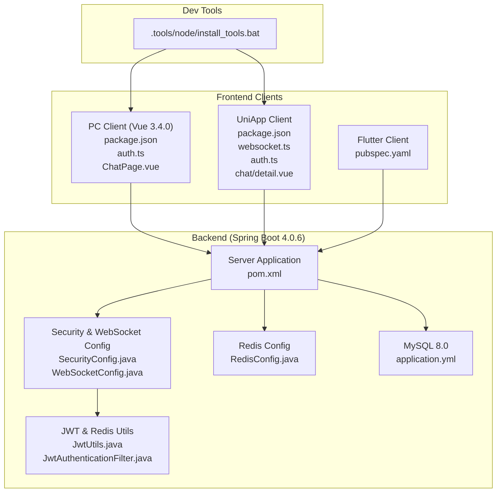
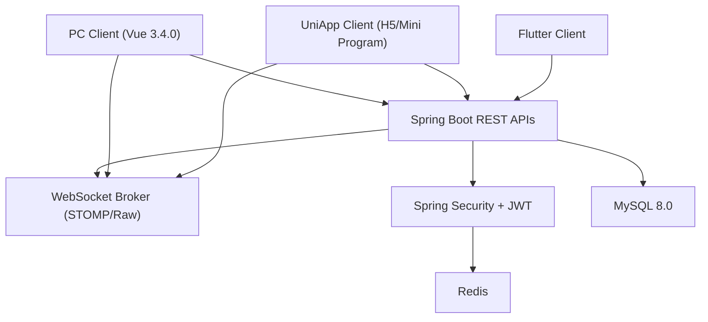
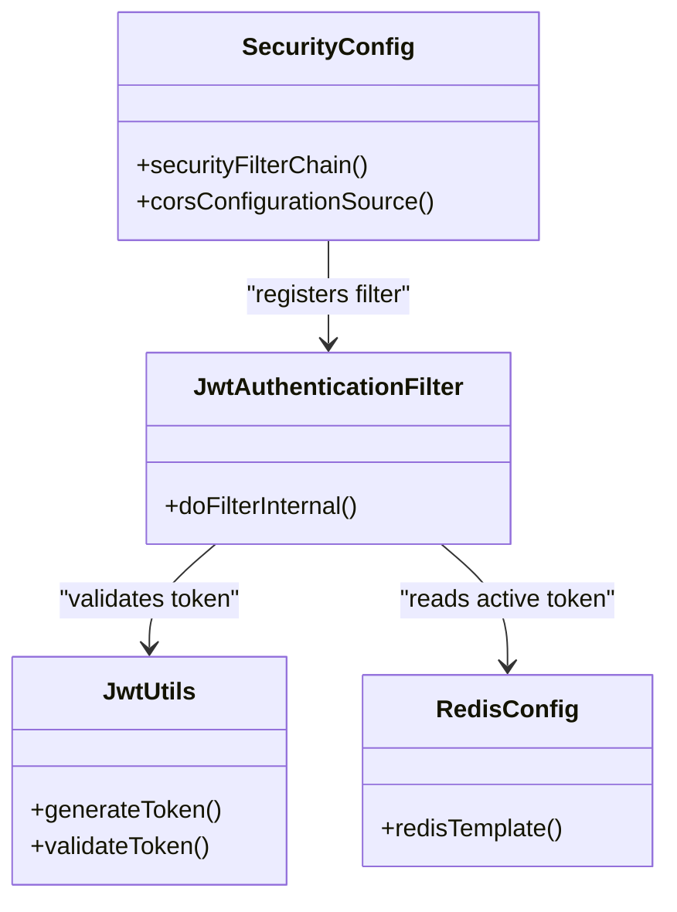
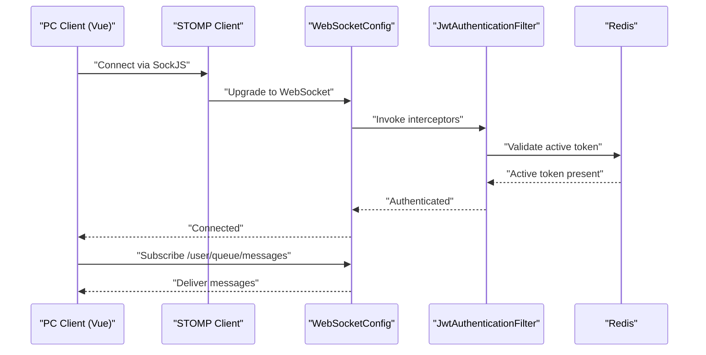
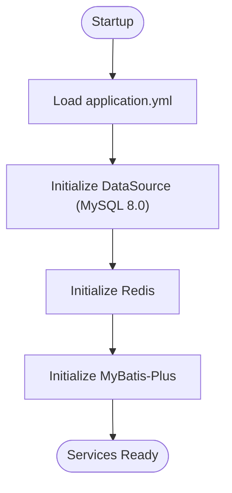
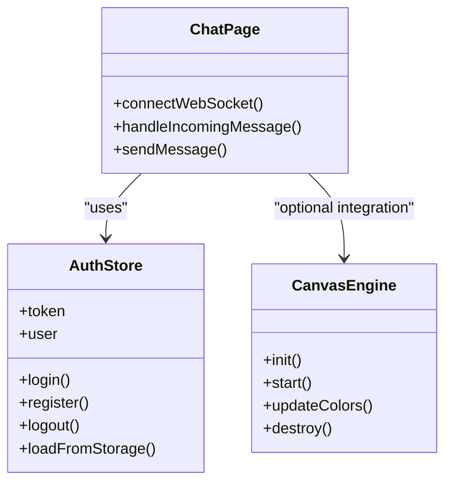
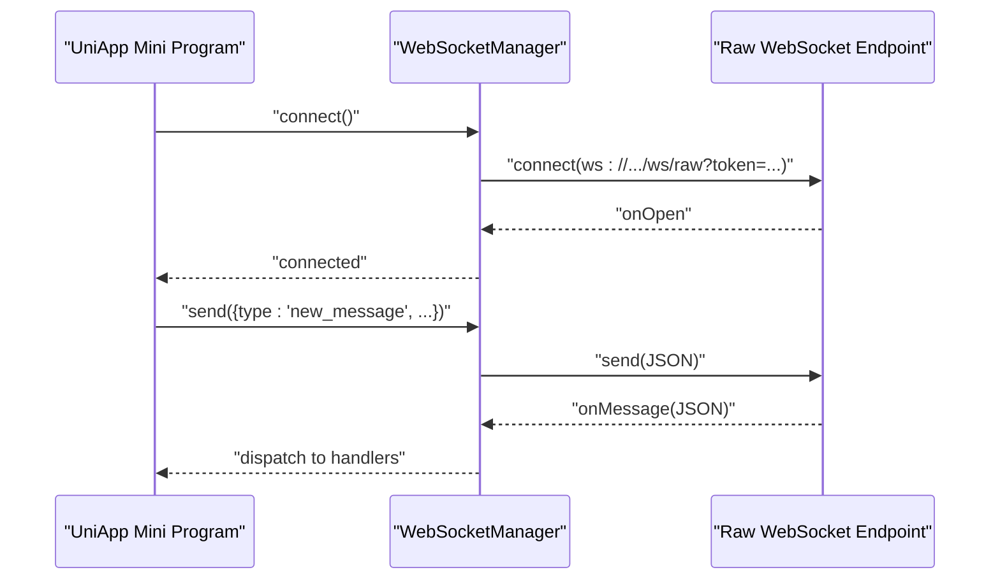
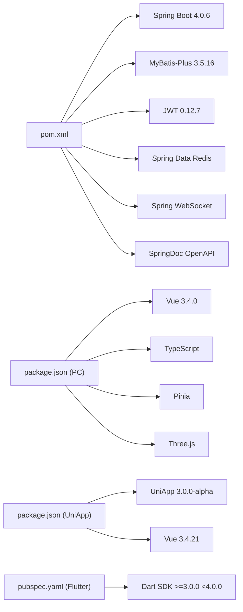

# Technology Stack

<cite>
**Referenced Files in This Document**
- [pom.xml](file://camp-channel-server/pom.xml)
- [application.yml](file://camp-channel-server/src/main/resources/application.yml)
- [SecurityConfig.java](file://camp-channel-server/src/main/java/com/gdmec/campchannel/config/SecurityConfig.java)
- [WebSocketConfig.java](file://camp-channel-server/src/main/java/com/gdmec/campchannel/config/WebSocketConfig.java)
- [JwtAuthenticationFilter.java](file://camp-channel-server/src/main/java/com/gdmec/campchannel/security/JwtAuthenticationFilter.java)
- [JwtUtils.java](file://camp-channel-server/src/main/java/com/gdmec/campchannel/common/utils/JwtUtils.java)
- [RedisConfig.java](file://camp-channel-server/src/main/java/com/gdmec/campchannel/config/RedisConfig.java)
- [package.json (PC)](file://camp-channel-client-pc/package.json)
- [auth.ts (PC)](file://camp-channel-client-pc/src/stores/auth.ts)
- [ChatPage.vue](file://camp-channel-client-pc/src/pages/ChatPage.vue)
- [CanvasEngine.ts](file://camp-channel-client-pc/src/canvas/CanvasEngine.ts)
- [package.json (UniApp)](file://camp-channel-client-uniapp/package.json)
- [websocket.ts (UniApp)](file://camp-channel-client-uniapp/src/utils/websocket.ts)
- [auth.ts (UniApp)](file://camp-channel-client-uniapp/src/stores/auth.ts)
- [chat/detail.vue (UniApp)](file://camp-channel-client-uniapp/src/pages/chat/detail.vue)
- [pubspec.yaml (Flutter)](file://camp-channel-client-flutter/pubspec.yaml)
- [install_tools.bat](file://.tools/node/install_tools.bat)
</cite>

## Table of Contents
1. [Introduction](#introduction)
2. [Project Structure](#project-structure)
3. [Core Components](#core-components)
4. [Architecture Overview](#architecture-overview)
5. [Detailed Component Analysis](#detailed-component-analysis)
6. [Dependency Analysis](#dependency-analysis)
7. [Performance Considerations](#performance-considerations)
8. [Troubleshooting Guide](#troubleshooting-guide)
9. [Conclusion](#conclusion)
10. [Appendices](#appendices)

## Introduction
This document presents the complete technology stack powering the Camp Channel platform. It covers the backend built on Spring Boot 4.0.6 with MyBatis-Plus, JWT authentication, Redis caching, WebSocket real-time communication, and Spring Security. On the frontend, it documents Vue.js 3.4.0 with TypeScript, Pinia state management, Three.js for 3D/visual effects, Flutter SDK for cross-platform mobile development, and UniApp for unified cross-platform delivery. It also outlines database technologies (MySQL 8.0, Redis), real-time communication protocols (WebSocket), development tools (.tools utilities), and provides practical examples of how each technology contributes to platform functionality, along with environment prerequisites and setup requirements.

## Project Structure
The repository is organized into three major parts:
- Backend server (Spring Boot 4.0.6) under camp-channel-server
- Frontend clients:
  - PC client (Vue 3.4.0 + TypeScript + Pinia + Three.js canvas effects)
  - UniApp client (cross-platform H5/Mini Program)
  - Flutter client (mobile/desktop)
- Development utilities under .tools/node

**Diagram sources**
- [pom.xml:1-227](file://camp-channel-server/pom.xml#L1-L227)
- [application.yml:1-119](file://camp-channel-server/src/main/resources/application.yml#L1-L119)
- [SecurityConfig.java:1-137](file://camp-channel-server/src/main/java/com/gdmec/campchannel/config/SecurityConfig.java#L1-L137)
- [WebSocketConfig.java:1-36](file://camp-channel-server/src/main/java/com/gdmec/campchannel/config/WebSocketConfig.java#L1-L36)
- [JwtUtils.java:1-85](file://camp-channel-server/src/main/java/com/gdmec/campchannel/common/utils/JwtUtils.java#L1-L85)
- [JwtAuthenticationFilter.java:1-113](file://camp-channel-server/src/main/java/com/gdmec/campchannel/security/JwtAuthenticationFilter.java#L1-L113)
- [RedisConfig.java:1-47](file://camp-channel-server/src/main/java/com/gdmec/campchannel/config/RedisConfig.java#L1-L47)
- [package.json (PC):1-28](file://camp-channel-client-pc/package.json#L1-L28)
- [auth.ts (PC):1-61](file://camp-channel-client-pc/src/stores/auth.ts#L1-L61)
- [ChatPage.vue:1-395](file://camp-channel-client-pc/src/pages/ChatPage.vue#L1-L395)
- [package.json (UniApp):1-29](file://camp-channel-client-uniapp/package.json#L1-L29)
- [websocket.ts (UniApp):1-268](file://camp-channel-client-uniapp/src/utils/websocket.ts#L1-L268)
- [auth.ts (UniApp):1-34](file://camp-channel-client-uniapp/src/stores/auth.ts#L1-L34)
- [chat/detail.vue (UniApp):1-507](file://camp-channel-client-uniapp/src/pages/chat/detail.vue#L1-L507)
- [pubspec.yaml (Flutter):1-38](file://camp-channel-client-flutter/pubspec.yaml#L1-L38)
- [install_tools.bat:1-56](file://.tools/node/install_tools.bat#L1-L56)

**Section sources**
- [pom.xml:1-227](file://camp-channel-server/pom.xml#L1-L227)
- [application.yml:1-119](file://camp-channel-server/src/main/resources/application.yml#L1-L119)

## Core Components
- Backend framework and libraries
  - Spring Boot 4.0.6 parent with Java 26 toolchain
  - Spring Web, Security, Data Redis, Validation, WebSocket
  - MyBatis-Plus 3.5.16 for database access
  - JWT 0.12.7 for stateless authentication
  - SpringDoc OpenAPI 3.0.3 for API docs
  - Lombok 1.18.46 for concise POJOs
- Database and caching
  - MySQL 8.0 via HikariCP connection pooling
  - Redis for session-like caching and token validation
- Real-time communication
  - STOMP over WebSocket for browser chat
  - Raw WebSocket for Mini Program environments
- Frontend stacks
  - Vue 3.4.0 with TypeScript, Pinia, Axios, Three.js
  - UniApp 3.0.0-alpha with Vue 3.4.21 for H5/Mini Program
  - Flutter SDK with Dart >=3.0.0 <4.0.0
- Development utilities
  - .tools/node scripts for Node.js native module toolchain on Windows

**Section sources**
- [pom.xml:20-135](file://camp-channel-server/pom.xml#L20-L135)
- [application.yml:13-119](file://camp-channel-server/src/main/resources/application.yml#L13-L119)
- [package.json (PC):10-26](file://camp-channel-client-pc/package.json#L10-L26)
- [package.json (UniApp):11-27](file://camp-channel-client-uniapp/package.json#L11-L27)
- [pubspec.yaml (Flutter):5-7](file://camp-channel-client-flutter/pubspec.yaml#L5-L7)
- [install_tools.bat:12-27](file://.tools/node/install_tools.bat#L12-L27)

## Architecture Overview
The platform follows a layered architecture:
- Presentation layer: Vue PC client, UniApp cross-platform client, Flutter client
- Application layer: Spring Boot REST APIs and WebSocket endpoints
- Persistence layer: MySQL 8.0 and Redis
- Cross-cutting concerns: JWT-based authentication, Spring Security, Redis-backed token validation, WebSocket message broker

**Diagram sources**
- [SecurityConfig.java:53-104](file://camp-channel-server/src/main/java/com/gdmec/campchannel/config/SecurityConfig.java#L53-L104)
- [WebSocketConfig.java:18-35](file://camp-channel-server/src/main/java/com/gdmec/campchannel/config/WebSocketConfig.java#L18-L35)
- [JwtAuthenticationFilter.java:42-100](file://camp-channel-server/src/main/java/com/gdmec/campchannel/security/JwtAuthenticationFilter.java#L42-L100)
- [application.yml:13-42](file://camp-channel-server/src/main/resources/application.yml#L13-L42)

## Detailed Component Analysis

### Backend: Spring Boot 4.0.6 and Spring Security
- SecurityConfig establishes stateless JWT-based authentication, disables CSRF for SPA, enables CORS, and registers a JWT filter before the default form filter.
- JwtAuthenticationFilter extracts tokens from Authorization headers, validates them, enforces single-device login via Redis, and injects Authentication into the SecurityContext.
- JwtUtils encapsulates token generation, parsing, and validation using HS512 keys from application.yml.
- RedisConfig configures JSON serialization for RedisTemplate to support complex objects.

**Diagram sources**
- [SecurityConfig.java:52-104](file://camp-channel-server/src/main/java/com/gdmec/campchannel/config/SecurityConfig.java#L52-L104)
- [JwtAuthenticationFilter.java:42-100](file://camp-channel-server/src/main/java/com/gdmec/campchannel/security/JwtAuthenticationFilter.java#L42-L100)
- [JwtUtils.java:66-83](file://camp-channel-server/src/main/java/com/gdmec/campchannel/common/utils/JwtUtils.java#L66-L83)
- [RedisConfig.java:20-45](file://camp-channel-server/src/main/java/com/gdmec/campchannel/config/RedisConfig.java#L20-L45)

**Section sources**
- [SecurityConfig.java:52-137](file://camp-channel-server/src/main/java/com/gdmec/campchannel/config/SecurityConfig.java#L52-L137)
- [JwtAuthenticationFilter.java:42-113](file://camp-channel-server/src/main/java/com/gdmec/campchannel/security/JwtAuthenticationFilter.java#L42-L113)
- [JwtUtils.java:35-83](file://camp-channel-server/src/main/java/com/gdmec/campchannel/common/utils/JwtUtils.java#L35-L83)
- [RedisConfig.java:17-47](file://camp-channel-server/src/main/java/com/gdmec/campchannel/config/RedisConfig.java#L17-L47)

### Backend: WebSocket Real-Time Communication
- WebSocketConfig enables STOMP over SockJS for browsers and registers an auth interceptor for inbound channels.
- The PC client connects via SockJS + STOMP, subscribes to user-specific queues for messages and online status.
- The UniApp client uses a raw WebSocket manager tailored for Mini Program environments, passing JWT via query parameter and managing reconnection.

**Diagram sources**
- [WebSocketConfig.java:18-35](file://camp-channel-server/src/main/java/com/gdmec/campchannel/config/WebSocketConfig.java#L18-L35)
- [JwtAuthenticationFilter.java:76-96](file://camp-channel-server/src/main/java/com/gdmec/campchannel/security/JwtAuthenticationFilter.java#L76-L96)
- [ChatPage.vue:89-127](file://camp-channel-client-pc/src/pages/ChatPage.vue#L89-L127)

**Section sources**
- [WebSocketConfig.java:18-36](file://camp-channel-server/src/main/java/com/gdmec/campchannel/config/WebSocketConfig.java#L18-L36)
- [ChatPage.vue:89-127](file://camp-channel-client-pc/src/pages/ChatPage.vue#L89-L127)
- [websocket.ts (UniApp):23-50](file://camp-channel-client-uniapp/src/utils/websocket.ts#L23-L50)

### Backend: MyBatis-Plus and Database Technologies
- MyBatis-Plus is configured with underline-to-camel mapping, auto ID strategy, and mapper locations from application.yml.
- MySQL 8.0 is configured with HikariCP connection pool and schema initialization.
- Redis is configured for connection, timeouts, and JSON serialization.

**Diagram sources**
- [application.yml:13-77](file://camp-channel-server/src/main/resources/application.yml#L13-L77)
- [pom.xml:62-77](file://camp-channel-server/pom.xml#L62-L77)

**Section sources**
- [application.yml:13-77](file://camp-channel-server/src/main/resources/application.yml#L13-L77)
- [pom.xml:62-77](file://camp-channel-server/pom.xml#L62-L77)

### Frontend: Vue 3.4.0 + TypeScript + Pinia + Three.js (PC Client)
- Package dependencies include Vue 3.4.0, TypeScript, Pinia, Axios, Three.js, and SockJS/STOMP for WebSocket.
- Pinia store manages authentication state, persists tokens and user info in localStorage, and exposes computed helpers.
- ChatPage.vue demonstrates real-time messaging via STOMP, subscription to user queues, and message history retrieval.
- CanvasEngine.ts integrates Three.js-like particle systems and canvas rendering for immersive backgrounds.

**Diagram sources**
- [auth.ts (PC):6-60](file://camp-channel-client-pc/src/stores/auth.ts#L6-L60)
- [ChatPage.vue:89-127](file://camp-channel-client-pc/src/pages/ChatPage.vue#L89-L127)
- [CanvasEngine.ts:19-102](file://camp-channel-client-pc/src/canvas/CanvasEngine.ts#L19-L102)

**Section sources**
- [package.json (PC):10-26](file://camp-channel-client-pc/package.json#L10-L26)
- [auth.ts (PC):6-60](file://camp-channel-client-pc/src/stores/auth.ts#L6-L60)
- [ChatPage.vue:89-127](file://camp-channel-client-pc/src/pages/ChatPage.vue#L89-L127)
- [CanvasEngine.ts:19-102](file://camp-channel-client-pc/src/canvas/CanvasEngine.ts#L19-L102)

### Frontend: UniApp (Cross-Platform) + Raw WebSocket
- UniApp dependencies include @dcloudio/uni-app 3.0.0-alpha and Vue 3.4.21.
- websocket.ts implements a singleton WebSocket manager for Mini Program environments with exponential backoff, message routing, and token injection via query parameter.
- chat/detail.vue integrates the WebSocket manager, handles message recall, read receipts, and polling fallback.

**Diagram sources**
- [websocket.ts (UniApp):23-129](file://camp-channel-client-uniapp/src/utils/websocket.ts#L23-L129)
- [chat/detail.vue (UniApp):259-297](file://camp-channel-client-uniapp/src/pages/chat/detail.vue#L259-L297)

**Section sources**
- [package.json (UniApp):11-27](file://camp-channel-client-uniapp/package.json#L11-L27)
- [websocket.ts (UniApp):1-268](file://camp-channel-client-uniapp/src/utils/websocket.ts#L1-L268)
- [chat/detail.vue (UniApp):259-297](file://camp-channel-client-uniapp/src/pages/chat/detail.vue#L259-L297)

### Frontend: Flutter SDK (Mobile/Desktop)
- Flutter pubspec.yaml defines SDK constraint >=3.0.0 <4.0.0 and key dependencies like dio (HTTP), provider (state), shared_preferences (storage), cached_network_image.
- Flutter enables cross-platform delivery for PC, Web, and Android apps using a single codebase.

**Section sources**
- [pubspec.yaml (Flutter):5-31](file://camp-channel-client-flutter/pubspec.yaml#L5-L31)

### Development Tools (.tools utilities)
- install_tools.bat automates installation of Python and Visual Studio Build Tools on Windows to compile Node.js native modules, ensuring smooth frontend builds.

**Section sources**
- [install_tools.bat:12-56](file://.tools/node/install_tools.bat#L12-L56)

## Dependency Analysis
- Backend dependencies are declared in pom.xml with explicit versions for Spring Boot 4.0.6, MyBatis-Plus, JWT, OpenAPI, and Lombok.
- Frontend dependencies are declared in package.json for each client, pinning Vue, TypeScript, Pinia, Three.js, and UniApp.
- Runtime configuration is centralized in application.yml for server port, context path, datasource, Redis, mail, OpenAPI, and JWT settings.

**Diagram sources**
- [pom.xml:32-135](file://camp-channel-server/pom.xml#L32-L135)
- [package.json (PC):10-26](file://camp-channel-client-pc/package.json#L10-L26)
- [package.json (UniApp):11-27](file://camp-channel-client-uniapp/package.json#L11-L27)
- [pubspec.yaml (Flutter):5-7](file://camp-channel-client-flutter/pubspec.yaml#L5-L7)

**Section sources**
- [pom.xml:32-135](file://camp-channel-server/pom.xml#L32-L135)
- [package.json (PC):10-26](file://camp-channel-client-pc/package.json#L10-L26)
- [package.json (UniApp):11-27](file://camp-channel-client-uniapp/package.json#L11-L27)
- [pubspec.yaml (Flutter):5-7](file://camp-channel-client-flutter/pubspec.yaml#L5-L7)

## Performance Considerations
- Database
  - HikariCP connection pool tuning (minimum-idle, maximum-pool-size) reduces connection overhead and improves throughput.
  - MyBatis-Plus camelCase mapping and mapper locations optimize query mapping and reduce boilerplate.
- Caching
  - Redis JSON serialization and short TTLs for tokens improve memory efficiency and reduce deserialization costs.
  - Single-device login enforcement via Redis avoids stale sessions and reduces server-side validation overhead.
- Real-time Messaging
  - STOMP over SockJS minimizes overhead for browsers; raw WebSocket for Mini Programs ensures minimal protocol complexity.
  - Exponential backoff in UniApp WebSocket manager prevents thundering herd on reconnect.
- Frontend Rendering
  - CanvasEngine integrates lightweight particle systems and glass effects; Three.js is used selectively for advanced scenarios.
  - Pinia state management reduces unnecessary reactivity churn compared to Vuex.

[No sources needed since this section provides general guidance]

## Troubleshooting Guide
- Spring Security Unauthorized/Forbidden
  - Ensure Authorization header starts with the configured token prefix and that the token is not expired.
  - Verify Redis contains the active token for the current user; otherwise, the filter returns device-force-logout.
- WebSocket Connection Failures
  - For PC: confirm STOMP endpoint and that the Authorization header is passed during SockJS handshake.
  - For UniApp: verify token is appended as a query parameter and that the raw WebSocket URL matches backend configuration.
- Database Initialization
  - Confirm MySQL credentials and schema initialization settings in application.yml; ensure the database exists or allow creation.
- Node.js Native Modules on Windows
  - Run install_tools.bat to install Python and Visual Studio Build Tools; ensure Windows is fully updated before retrying.

**Section sources**
- [SecurityConfig.java:91-100](file://camp-channel-server/src/main/java/com/gdmec/campchannel/config/SecurityConfig.java#L91-L100)
- [JwtAuthenticationFilter.java:76-96](file://camp-channel-server/src/main/java/com/gdmec/campchannel/security/JwtAuthenticationFilter.java#L76-L96)
- [application.yml:13-42](file://camp-channel-server/src/main/resources/application.yml#L13-L42)
- [install_tools.bat:12-56](file://.tools/node/install_tools.bat#L12-L56)

## Conclusion
Camp Channel leverages a modern, cohesive tech stack:
- Backend: Spring Boot 4.0.6 with Spring Security and JWT for robust, stateless authentication; MyBatis-Plus for efficient persistence; Redis for token validation and caching; WebSocket for real-time messaging.
- Frontend: Vue 3.4.0 with TypeScript and Pinia for maintainable UIs; Three.js for immersive visuals; UniApp for cross-platform reach; Flutter for mobile/desktop.
- Operations: Centralized configuration, strong typing, and modular components enable scalability and developer productivity.

[No sources needed since this section summarizes without analyzing specific files]

## Appendices

### Version Compatibility and Setup Prerequisites
- Backend
  - Java 26 toolchain enforced by Maven compiler plugin and Spring Boot 4.0.6 parent.
  - MySQL 8.0 configured via JDBC URL and HikariCP settings.
  - Redis configured for connection, timeouts, and JSON serialization.
- Frontend
  - PC: Node.js LTS recommended; install dependencies per package.json.
  - UniApp: Node.js LTS; use uni commands for H5/Mini Program builds.
  - Flutter: Dart SDK >=3.0.0 <4.0.0; ensure platform toolchains (Android/iOS/Web) are installed.
- Development Utilities
  - Windows users should run install_tools.bat to prepare native build tools.

**Section sources**
- [pom.xml:20-26](file://camp-channel-server/pom.xml#L20-L26)
- [application.yml:13-42](file://camp-channel-server/src/main/resources/application.yml#L13-L42)
- [package.json (PC):1-28](file://camp-channel-client-pc/package.json#L1-L28)
- [package.json (UniApp):1-29](file://camp-channel-client-uniapp/package.json#L1-L29)
- [pubspec.yaml (Flutter):5-7](file://camp-channel-client-flutter/pubspec.yaml#L5-L7)
- [install_tools.bat:12-56](file://.tools/node/install_tools.bat#L12-L56)