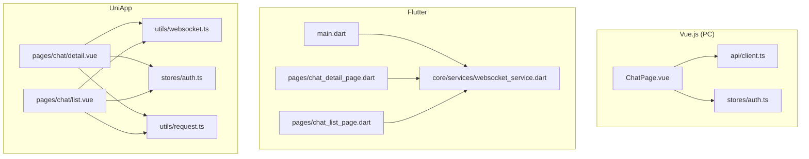
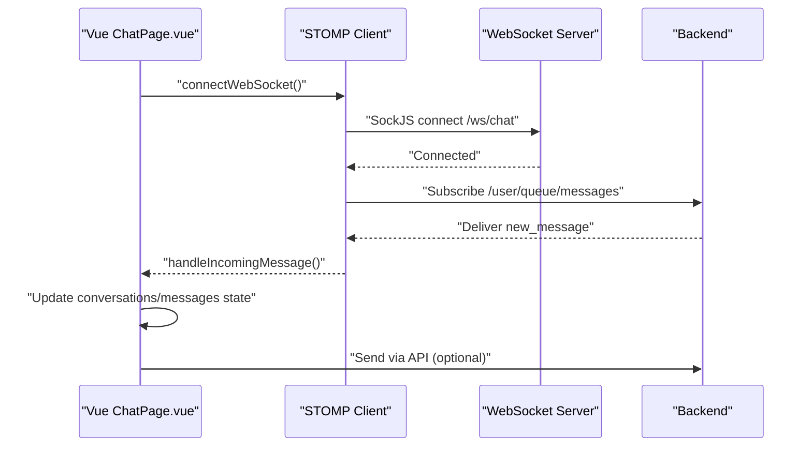
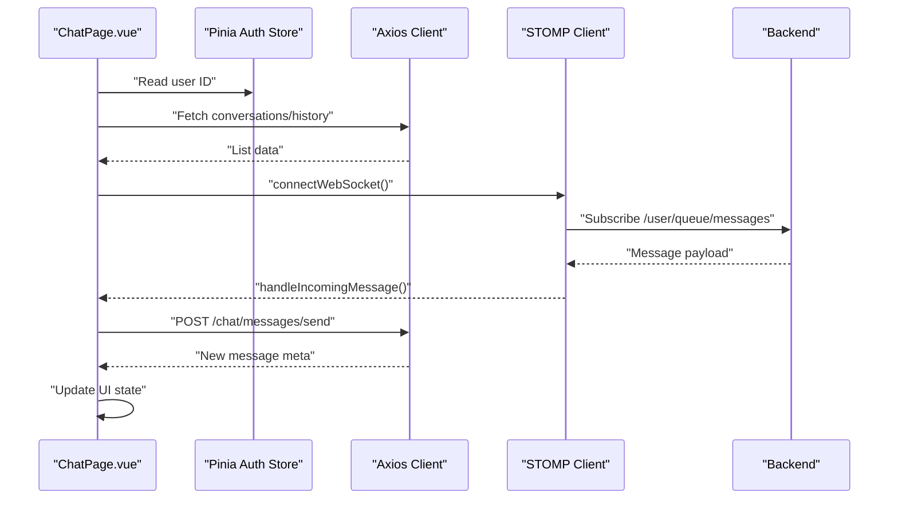
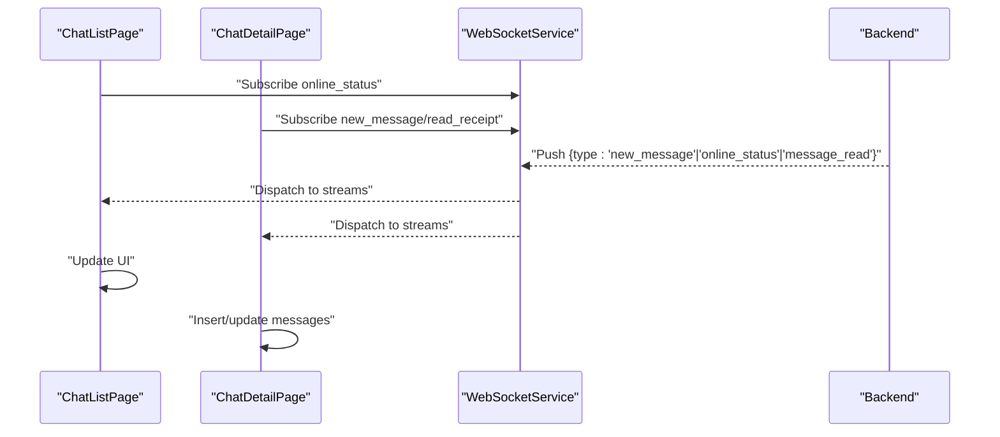
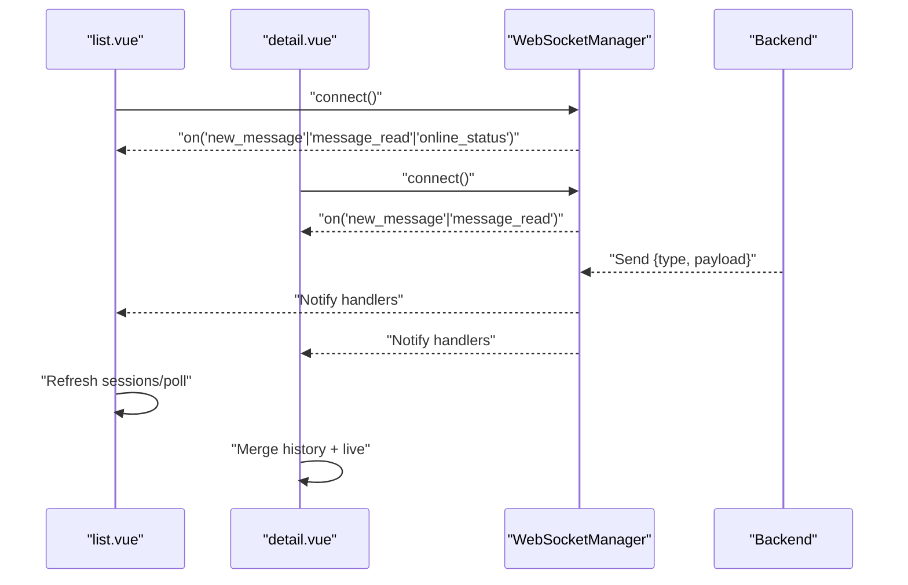
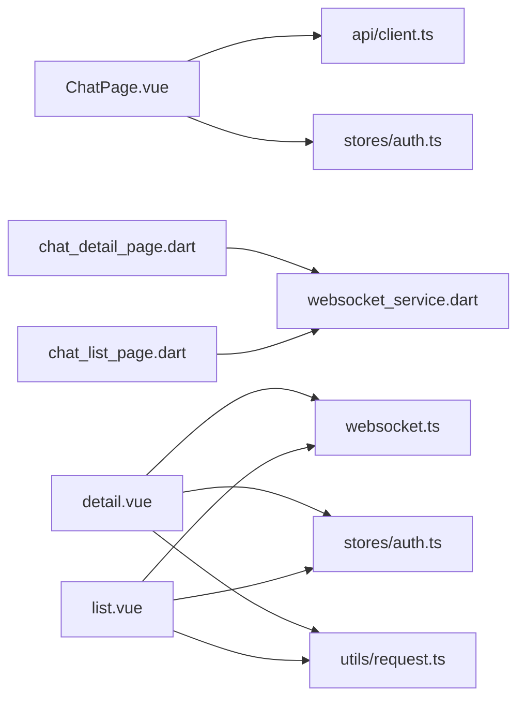

# Client-side Integration and Real-time Updates

<cite>
**Referenced Files in This Document**
- [ChatPage.vue](file://camp-channel-client-pc/src/pages/ChatPage.vue)
- [client.ts](file://camp-channel-client-pc/src/api/client.ts)
- [auth.ts (PC)](file://camp-channel-client-pc/src/stores/auth.ts)
- [main.dart](file://camp-channel-client-flutter/lib/main.dart)
- [websocket_service.dart](file://camp-channel-client-flutter/lib/core/services/websocket_service.dart)
- [chat_detail_page.dart](file://camp-channel-client-flutter/lib/pages/chat_detail_page.dart)
- [chat_list_page.dart](file://camp-channel-client-flutter/lib/pages/chat_list_page.dart)
- [websocket.ts](file://camp-channel-client-uniapp/src/utils/websocket.ts)
- [detail.vue (UniApp Chat)](file://camp-channel-client-uniapp/src/pages/chat/detail.vue)
- [list.vue (UniApp Chat)](file://camp-channel-client-uniapp/src/pages/chat/list.vue)
- [auth.ts (UniApp)](file://camp-channel-client-uniapp/src/stores/auth.ts)
- [request.ts (UniApp)](file://camp-channel-client-uniapp/src/utils/request.ts)
</cite>

## Table of Contents
1. [Introduction](#introduction)
2. [Project Structure](#project-structure)
3. [Core Components](#core-components)
4. [Architecture Overview](#architecture-overview)
5. [Detailed Component Analysis](#detailed-component-analysis)
6. [Dependency Analysis](#dependency-analysis)
7. [Performance Considerations](#performance-considerations)
8. [Troubleshooting Guide](#troubleshooting-guide)
9. [Conclusion](#conclusion)

## Introduction
This document explains how the client-side applications integrate with the real-time communication system across three platforms: Vue.js (PC), Flutter, and UniApp. It covers WebSocket connection establishment, message handling, real-time UI updates, client-side state management, error handling, reconnection strategies, and platform-specific optimizations. Concrete examples are linked to actual source files to guide implementation.

## Project Structure
The client-side real-time features are implemented per-platform with shared patterns:
- Vue.js (PC): Uses STOMP over SockJS for WebSocket transport, with Pinia stores for auth state and UI-driven message handling.
- Flutter: Uses a raw WebSocket to a dedicated /ws/raw endpoint, with Provider and streams for state and UI updates.
- UniApp: Uses a raw WebSocket via uni.connectSocket with a centralized manager, Pinia for auth state, and polling as a fallback.

**Diagram sources**
- [ChatPage.vue:65-127](file://camp-channel-client-pc/src/pages/ChatPage.vue#L65-L127)
- [client.ts:1-35](file://camp-channel-client-pc/src/api/client.ts#L1-L35)
- [auth.ts (PC):1-61](file://camp-channel-client-pc/src/stores/auth.ts#L1-L61)
- [main.dart:1-122](file://camp-channel-client-flutter/lib/main.dart#L1-L122)
- [websocket_service.dart:1-151](file://camp-channel-client-flutter/lib/core/services/websocket_service.dart#L1-L151)
- [chat_detail_page.dart:1-464](file://camp-channel-client-flutter/lib/pages/chat_detail_page.dart#L1-L464)
- [chat_list_page.dart:1-291](file://camp-channel-client-flutter/lib/pages/chat_list_page.dart#L1-L291)
- [websocket.ts:1-268](file://camp-channel-client-uniapp/src/utils/websocket.ts#L1-L268)
- [detail.vue (UniApp Chat):1-507](file://camp-channel-client-uniapp/src/pages/chat/detail.vue#L1-L507)
- [list.vue (UniApp Chat):1-348](file://camp-channel-client-uniapp/src/pages/chat/list.vue#L1-L348)
- [auth.ts (UniApp):1-34](file://camp-channel-client-uniapp/src/stores/auth.ts#L1-L34)
- [request.ts (UniApp):1-112](file://camp-channel-client-uniapp/src/utils/request.ts#L1-L112)

**Section sources**
- [ChatPage.vue:65-127](file://camp-channel-client-pc/src/pages/ChatPage.vue#L65-L127)
- [client.ts:1-35](file://camp-channel-client-pc/src/api/client.ts#L1-L35)
- [auth.ts (PC):1-61](file://camp-channel-client-pc/src/stores/auth.ts#L1-L61)
- [main.dart:1-122](file://camp-channel-client-flutter/lib/main.dart#L1-L122)
- [websocket_service.dart:1-151](file://camp-channel-client-flutter/lib/core/services/websocket_service.dart#L1-L151)
- [chat_detail_page.dart:1-464](file://camp-channel-client-flutter/lib/pages/chat_detail_page.dart#L1-L464)
- [chat_list_page.dart:1-291](file://camp-channel-client-flutter/lib/pages/chat_list_page.dart#L1-L291)
- [websocket.ts:1-268](file://camp-channel-client-uniapp/src/utils/websocket.ts#L1-L268)
- [detail.vue (UniApp Chat):1-507](file://camp-channel-client-uniapp/src/pages/chat/detail.vue#L1-L507)
- [list.vue (UniApp Chat):1-348](file://camp-channel-client-uniapp/src/pages/chat/list.vue#L1-L348)
- [auth.ts (UniApp):1-34](file://camp-channel-client-uniapp/src/stores/auth.ts#L1-L34)
- [request.ts (UniApp):1-112](file://camp-channel-client-uniapp/src/utils/request.ts#L1-L112)

## Core Components
- Vue.js (PC) WebSocket client
  - Initializes STOMP over SockJS, subscribes to user-specific queues for messages and online status, and updates conversation/message lists reactively.
  - Example path: [connectWebSocket:89-127](file://camp-channel-client-pc/src/pages/ChatPage.vue#L89-L127), [handleIncomingMessage:129-174](file://camp-channel-client-pc/src/pages/ChatPage.vue#L129-L174), [handleOnlineStatus:176-181](file://camp-channel-client-pc/src/pages/ChatPage.vue#L176-L181).
- Flutter WebSocket client
  - Singleton service connects to /ws/raw, dispatches messages to typed streams (new_message, online_status, message_read), and manages heartbeat and exponential backoff reconnection.
  - Example path: [WebSocketService.connect:35-90](file://camp-channel-client-flutter/lib/core/services/websocket_service.dart#L35-L90), [_dispatch:92-111](file://camp-channel-client-flutter/lib/core/services/websocket_service.dart#L92-L111), [_scheduleReconnect:121-136](file://camp-channel-client-flutter/lib/core/services/websocket_service.dart#L121-L136).
- UniApp WebSocket client
  - Centralized WebSocketManager with singleton pattern, manual reconnection, and handler registration by message type; uses uni.connectSocket with token in query param.
  - Example path: [WebSocketManager.connect:23-129](file://camp-channel-client-uniapp/src/utils/websocket.ts#L23-L129), [WebSocketManager.on:188-200](file://camp-channel-client-uniapp/src/utils/websocket.ts#L188-L200), [WebSocketManager.send:160-180](file://camp-channel-client-uniapp/src/utils/websocket.ts#L160-L180).

**Section sources**
- [ChatPage.vue:89-181](file://camp-channel-client-pc/src/pages/ChatPage.vue#L89-L181)
- [websocket_service.dart:35-136](file://camp-channel-client-flutter/lib/core/services/websocket_service.dart#L35-L136)
- [websocket.ts:23-180](file://camp-channel-client-uniapp/src/utils/websocket.ts#L23-L180)

## Architecture Overview
The real-time architecture follows a publish-subscribe pattern:
- Backend publishes messages to user-specific destinations (queues or topics).
- Clients subscribe upon successful connection and render updates immediately.
- UI components maintain minimal reactive state and rely on stores/services for data synchronization.

**Diagram sources**
- [ChatPage.vue:89-127](file://camp-channel-client-pc/src/pages/ChatPage.vue#L89-L127)
- [ChatPage.vue:129-174](file://camp-channel-client-pc/src/pages/ChatPage.vue#L129-L174)

**Section sources**
- [ChatPage.vue:89-174](file://camp-channel-client-pc/src/pages/ChatPage.vue#L89-L174)

## Detailed Component Analysis

### Vue.js (PC) Real-time Chat
- Connection establishment
  - Creates SockJS-backed STOMP client, sets Authorization header from localStorage token, and subscribes to user-specific queues for messages and online status.
  - Path: [connectWebSocket:89-127](file://camp-channel-client-pc/src/pages/ChatPage.vue#L89-L127)
- Message handling
  - Parses incoming messages, updates conversation previews, maintains message list for active chat, marks as read, and scrolls to bottom.
  - Paths: [handleIncomingMessage:129-174](file://camp-channel-client-pc/src/pages/ChatPage.vue#L129-L174), [scrollToBottom:183-189](file://camp-channel-client-pc/src/pages/ChatPage.vue#L183-L189)
- Online status updates
  - Subscribes to online_status queue and updates UI dots.
  - Path: [handleOnlineStatus:176-181](file://camp-channel-client-pc/src/pages/ChatPage.vue#L176-L181)
- State management
  - Uses refs for reactive UI state and computed for filtering; auth store provides user ID for self vs other differentiation.
  - Paths: [auth store usage:73-73](file://camp-channel-client-pc/src/pages/ChatPage.vue#L73-L73), [filteredConversations:83-85](file://camp-channel-client-pc/src/pages/ChatPage.vue#L83-L85)
- API integration
  - Uses axios instance with interceptors for auth and 401 handling.
  - Path: [api client:1-35](file://camp-channel-client-pc/src/api/client.ts#L1-L35)

**Diagram sources**
- [ChatPage.vue:65-127](file://camp-channel-client-pc/src/pages/ChatPage.vue#L65-L127)
- [ChatPage.vue:129-174](file://camp-channel-client-pc/src/pages/ChatPage.vue#L129-L174)
- [client.ts:1-35](file://camp-channel-client-pc/src/api/client.ts#L1-L35)
- [auth.ts (PC):1-61](file://camp-channel-client-pc/src/stores/auth.ts#L1-L61)

**Section sources**
- [ChatPage.vue:65-189](file://camp-channel-client-pc/src/pages/ChatPage.vue#L65-L189)
- [client.ts:1-35](file://camp-channel-client-pc/src/api/client.ts#L1-L35)
- [auth.ts (PC):1-61](file://camp-channel-client-pc/src/stores/auth.ts#L1-L61)

### Flutter Real-time Chat
- WebSocket service
  - Singleton service establishes raw WebSocket to /ws/raw with token query param, listens for messages, dispatches to typed streams, and schedules reconnection on close/error.
  - Paths: [connect:35-90](file://camp-channel-client-flutter/lib/core/services/websocket_service.dart#L35-L90), [_dispatch:92-111](file://camp-channel-client-flutter/lib/core/services/websocket_service.dart#L92-L111), [_scheduleReconnect:121-136](file://camp-channel-client-flutter/lib/core/services/websocket_service.dart#L121-L136)
- Chat list UI
  - Subscribes to online_status and read receipt streams, polls for periodic updates, and renders unread badges.
  - Paths: [chat_list_page subscriptions:31-53](file://camp-channel-client-flutter/lib/pages/chat_list_page.dart#L31-L53), [polling:26-26](file://camp-channel-client-flutter/lib/pages/chat_list_page.dart#L26-L26)
- Chat detail UI
  - Subscribes to message and read receipt streams, merges history with live messages, and handles recall and read status.
  - Paths: [chat_detail subscriptions:69-105](file://camp-channel-client-flutter/lib/pages/chat_detail_page.dart#L69-L105), [history merge:107-143](file://camp-channel-client-flutter/lib/pages/chat_detail_page.dart#L107-L143)

**Diagram sources**
- [websocket_service.dart:18-31](file://camp-channel-client-flutter/lib/core/services/websocket_service.dart#L18-L31)
- [chat_list_page.dart:31-53](file://camp-channel-client-flutter/lib/pages/chat_list_page.dart#L31-L53)
- [chat_detail_page.dart:69-105](file://camp-channel-client-flutter/lib/pages/chat_detail_page.dart#L69-L105)

**Section sources**
- [websocket_service.dart:1-151](file://camp-channel-client-flutter/lib/core/services/websocket_service.dart#L1-L151)
- [chat_list_page.dart:1-291](file://camp-channel-client-flutter/lib/pages/chat_list_page.dart#L1-L291)
- [chat_detail_page.dart:1-464](file://camp-channel-client-flutter/lib/pages/chat_detail_page.dart#L1-L464)

### UniApp Real-time Chat
- WebSocket manager
  - Centralized singleton managing connection lifecycle, handler registration, exponential backoff reconnection, and message routing by type.
  - Paths: [connect:23-129](file://camp-channel-client-uniapp/src/utils/websocket.ts#L23-L129), [on/off handlers:188-220](file://camp-channel-client-uniapp/src/utils/websocket.ts#L188-L220), [handleReconnect:232-253](file://camp-channel-client-uniapp/src/utils/websocket.ts#L232-L253)
- Chat list and detail
  - Subscribe to new_message, message_read, and online_status; poll for session updates; manage unread badges and read status.
  - Paths: [list connectWebSocket:147-173](file://camp-channel-client-uniapp/src/pages/chat/list.vue#L147-L173), [detail connectWebSocket:259-297](file://camp-channel-client-uniapp/src/pages/chat/detail.vue#L259-L297)
- Authentication and network
  - Auth store persists tokens and user info; request wrapper adds Authorization and handles force logout.
  - Paths: [auth store:1-34](file://camp-channel-client-uniapp/src/stores/auth.ts#L1-L34), [request wrapper:30-84](file://camp-channel-client-uniapp/src/utils/request.ts#L30-L84)

**Diagram sources**
- [websocket.ts:23-129](file://camp-channel-client-uniapp/src/utils/websocket.ts#L23-L129)
- [list.vue (UniApp Chat):147-173](file://camp-channel-client-uniapp/src/pages/chat/list.vue#L147-L173)
- [detail.vue (UniApp Chat):259-297](file://camp-channel-client-uniapp/src/pages/chat/detail.vue#L259-L297)

**Section sources**
- [websocket.ts:1-268](file://camp-channel-client-uniapp/src/utils/websocket.ts#L1-L268)
- [list.vue (UniApp Chat):1-348](file://camp-channel-client-uniapp/src/pages/chat/list.vue#L1-L348)
- [detail.vue (UniApp Chat):1-507](file://camp-channel-client-uniapp/src/pages/chat/detail.vue#L1-L507)
- [auth.ts (UniApp):1-34](file://camp-channel-client-uniapp/src/stores/auth.ts#L1-L34)
- [request.ts (UniApp):1-112](file://camp-channel-client-uniapp/src/utils/request.ts#L1-L112)

## Dependency Analysis
- Vue.js (PC)
  - ChatPage depends on axios API client and Pinia auth store; STOMP client is dynamically imported and initialized.
  - Dependencies: [api/client.ts:1-35](file://camp-channel-client-pc/src/api/client.ts#L1-L35), [stores/auth.ts:1-61](file://camp-channel-client-pc/src/stores/auth.ts#L1-L61)
- Flutter
  - Pages depend on WebSocketService streams; service depends on StorageService for tokens and base URL.
  - Dependencies: [websocket_service.dart:1-151](file://camp-channel-client-flutter/lib/core/services/websocket_service.dart#L1-L151)
- UniApp
  - Pages depend on WebSocketManager and Pinia auth store; request wrapper centralizes HTTP logic.
  - Dependencies: [websocket.ts:1-268](file://camp-channel-client-uniapp/src/utils/websocket.ts#L1-L268), [auth.ts (UniApp):1-34](file://camp-channel-client-uniapp/src/stores/auth.ts#L1-L34), [request.ts (UniApp):1-112](file://camp-channel-client-uniapp/src/utils/request.ts#L1-L112)

**Diagram sources**
- [ChatPage.vue:65-127](file://camp-channel-client-pc/src/pages/ChatPage.vue#L65-L127)
- [client.ts:1-35](file://camp-channel-client-pc/src/api/client.ts#L1-L35)
- [auth.ts (PC):1-61](file://camp-channel-client-pc/src/stores/auth.ts#L1-L61)
- [chat_detail_page.dart:1-464](file://camp-channel-client-flutter/lib/pages/chat_detail_page.dart#L1-L464)
- [chat_list_page.dart:1-291](file://camp-channel-client-flutter/lib/pages/chat_list_page.dart#L1-L291)
- [websocket_service.dart:1-151](file://camp-channel-client-flutter/lib/core/services/websocket_service.dart#L1-L151)
- [detail.vue (UniApp Chat):1-507](file://camp-channel-client-uniapp/src/pages/chat/detail.vue#L1-L507)
- [list.vue (UniApp Chat):1-348](file://camp-channel-client-uniapp/src/pages/chat/list.vue#L1-L348)
- [websocket.ts:1-268](file://camp-channel-client-uniapp/src/utils/websocket.ts#L1-L268)
- [auth.ts (UniApp):1-34](file://camp-channel-client-uniapp/src/stores/auth.ts#L1-L34)
- [request.ts (UniApp):1-112](file://camp-channel-client-uniapp/src/utils/request.ts#L1-L112)

**Section sources**
- [ChatPage.vue:65-127](file://camp-channel-client-pc/src/pages/ChatPage.vue#L65-L127)
- [client.ts:1-35](file://camp-channel-client-pc/src/api/client.ts#L1-L35)
- [auth.ts (PC):1-61](file://camp-channel-client-pc/src/stores/auth.ts#L1-L61)
- [chat_detail_page.dart:1-464](file://camp-channel-client-flutter/lib/pages/chat_detail_page.dart#L1-L464)
- [chat_list_page.dart:1-291](file://camp-channel-client-flutter/lib/pages/chat_list_page.dart#L1-L291)
- [websocket_service.dart:1-151](file://camp-channel-client-flutter/lib/core/services/websocket_service.dart#L1-L151)
- [detail.vue (UniApp Chat):1-507](file://camp-channel-client-uniapp/src/pages/chat/detail.vue#L1-L507)
- [list.vue (UniApp Chat):1-348](file://camp-channel-client-uniapp/src/pages/chat/list.vue#L1-L348)
- [websocket.ts:1-268](file://camp-channel-client-uniapp/src/utils/websocket.ts#L1-L268)
- [auth.ts (UniApp):1-34](file://camp-channel-client-uniapp/src/stores/auth.ts#L1-L34)
- [request.ts (UniApp):1-112](file://camp-channel-client-uniapp/src/utils/request.ts#L1-L112)

## Performance Considerations
- Vue.js (PC)
  - Efficient DOM updates via reactive refs and computed filters; scroll-to-bottom after updates ensures visibility without heavy redraws.
  - Consider virtualizing long message lists for large histories.
  - Reference: [scrollToBottom:183-189](file://camp-channel-client-pc/src/pages/ChatPage.vue#L183-L189)
- Flutter
  - Use ListView.builder with stable keys and reverse scrolling for efficient rendering.
  - Debounce UI updates when merging history and live messages to avoid frequent rebuilds.
  - Reference: [ListView.builder and reverse:258-270](file://camp-channel-client-flutter/lib/pages/chat_detail_page.dart#L258-L270)
- UniApp
  - Prefer uni.createSelectorQuery for precise DOM measurements when needed; otherwise rely on scroll-view props.
  - Minimize handler registrations and ensure cleanup on unmount to prevent memory leaks.
  - References: [scrollToBottom:305-313](file://camp-channel-client-uniapp/src/pages/chat/detail.vue#L305-L313), [unmount cleanup:137-142](file://camp-channel-client-uniapp/src/pages/chat/detail.vue#L137-L142)

[No sources needed since this section provides general guidance]

## Troubleshooting Guide
- Vue.js (PC)
  - STOMP connection failures: verify token presence and SockJS availability; inspect console logs during subscription phase.
  - Reference: [connectWebSocket error handling:124-126](file://camp-channel-client-pc/src/pages/ChatPage.vue#L124-L126)
- Flutter
  - WebSocket exceptions and reconnection: service logs and exponential backoff; ensure token retrieval and base URL derivation.
  - References: [_doConnect error handling:87-89](file://camp-channel-client-flutter/lib/core/services/websocket_service.dart#L87-L89), [_scheduleReconnect:121-136](file://camp-channel-client-flutter/lib/core/services/websocket_service.dart#L121-L136)
- UniApp
  - WebSocketManager prevents duplicate connections and handles errors gracefully; watch for connection timeouts and reconnection attempts.
  - References: [connect fail/reject:60-66](file://camp-channel-client-uniapp/src/utils/websocket.ts#L60-L66), [handleReconnect:232-253](file://camp-channel-client-uniapp/src/utils/websocket.ts#L232-L253)
- General
  - Force logout scenarios: HTTP 401 or business code 1009 triggers immediate logout and navigation.
  - References: [PC API interceptor:20-31](file://camp-channel-client-pc/src/api/client.ts#L20-L31), [UniApp request force logout:58-63](file://camp-channel-client-uniapp/src/utils/request.ts#L58-L63)

**Section sources**
- [ChatPage.vue:124-126](file://camp-channel-client-pc/src/pages/ChatPage.vue#L124-L126)
- [websocket_service.dart:87-136](file://camp-channel-client-flutter/lib/core/services/websocket_service.dart#L87-L136)
- [websocket.ts:60-66](file://camp-channel-client-uniapp/src/utils/websocket.ts#L60-L66)
- [client.ts:20-31](file://camp-channel-client-pc/src/api/client.ts#L20-L31)
- [request.ts (UniApp):58-63](file://camp-channel-client-uniapp/src/utils/request.ts#L58-L63)

## Conclusion
Each platform implements a robust real-time chat experience tailored to its ecosystem:
- Vue.js leverages STOMP for structured messaging and reactive UI updates.
- Flutter uses a raw WebSocket with typed streams and exponential backoff for resilience.
- UniApp employs a centralized WebSocket manager with handler-based routing and polling as a fallback.

By following the patterns and references outlined above, teams can maintain consistent real-time behavior, reliable state synchronization, and resilient error handling across all client platforms.