# Message Broadcasting and Delivery

<cite>
**Referenced Files in This Document**
- [WebSocketEventListener.java](file://camp-channel-server/src/main/java/com/gdmec/campchannel/config/WebSocketEventListener.java)
- [RawWebSocketHandler.java](file://camp-channel-server/src/main/java/com/gdmec/campchannel/config/RawWebSocketHandler.java)
- [WebSocketConfig.java](file://camp-channel-server/src/main/java/com/gdmec/campchannel/config/WebSocketConfig.java)
- [WebSocketAuthInterceptor.java](file://camp-channel-server/src/main/java/com/gdmec/campchannel/config/WebSocketAuthInterceptor.java)
- [MessageServiceImpl.java](file://camp-channel-server/src/main/java/com/gdmec/campchannel/service/impl/MessageServiceImpl.java)
- [ChatController.java](file://camp-channel-server/src/main/java/com/gdmec/campchannel/controller/ChatController.java)
- [Message.java](file://camp-channel-server/src/main/java/com/gdmec/campchannel/entity/Message.java)
- [RedisConfig.java](file://camp-channel-server/src/main/java/com/gdmec/campchannel/config/RedisConfig.java)
- [RedisUtils.java](file://camp-channel-server/src/main/java/com/gdmec/campchannel/common/utils/RedisUtils.java)
- [application.yml](file://camp-channel-server/src/main/resources/application.yml)
- [schema.sql](file://camp-channel-server/src/main/resources/db/schema.sql)
- [websocket.ts](file://camp-channel-client-uniapp/src/utils/websocket.ts)
- [websocket_service.dart](file://camp-channel-client-flutter/lib/core/services/websocket_service.dart)
</cite>

## Table of Contents
1. [Introduction](#introduction)
2. [Project Structure](#project-structure)
3. [Core Components](#core-components)
4. [Architecture Overview](#architecture-overview)
5. [Detailed Component Analysis](#detailed-component-analysis)
6. [Dependency Analysis](#dependency-analysis)
7. [Performance Considerations](#performance-considerations)
8. [Troubleshooting Guide](#troubleshooting-guide)
9. [Conclusion](#conclusion)
10. [Appendices](#appendices)

## Introduction
This document explains the message broadcasting and delivery system for the campus chat module. It covers:
- Real-time delivery via two WebSocket channels: Spring WebSocket (STOMP) for PC/web clients and a raw WebSocket for mobile/Flutter clients.
- Online presence propagation to friends using Redis.
- Delivery confirmation, read receipts, and offline handling.
- Message ordering, duplicate detection, and persistence strategies.
- Scaling and performance considerations for high-volume broadcasting.

## Project Structure
The system spans server-side Spring Boot components and client-side implementations for Flutter and UniApp. The server exposes:
- STOMP WebSocket endpoints for PC/web clients.
- A raw WebSocket endpoint for mobile clients.
- A message service that persists messages and pushes them to both WebSocket channels.
- Redis-backed online presence and rate limiting utilities.

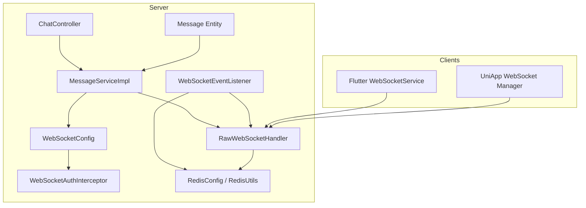

**Diagram sources**
- [ChatController.java:54-67](file://camp-channel-server/src/main/java/com/gdmec/campchannel/controller/ChatController.java#L54-L67)
- [MessageServiceImpl.java:44-94](file://camp-channel-server/src/main/java/com/gdmec/campchannel/service/impl/MessageServiceImpl.java#L44-L94)
- [WebSocketConfig.java:18-35](file://camp-channel-server/src/main/java/com/gdmec/campchannel/config/WebSocketConfig.java#L18-L35)
- [WebSocketAuthInterceptor.java:22-44](file://camp-channel-server/src/main/java/com/gdmec/campchannel/config/WebSocketAuthInterceptor.java#L22-L44)
- [WebSocketEventListener.java:32-62](file://camp-channel-server/src/main/java/com/gdmec/campchannel/config/WebSocketEventListener.java#L32-L62)
- [RawWebSocketHandler.java:42-102](file://camp-channel-server/src/main/java/com/gdmec/campchannel/config/RawWebSocketHandler.java#L42-L102)
- [RedisConfig.java:20-45](file://camp-channel-server/src/main/java/com/gdmec/campchannel/config/RedisConfig.java#L20-L45)
- [RedisUtils.java:67-95](file://camp-channel-server/src/main/java/com/gdmec/campchannel/common/utils/RedisUtils.java#L67-L95)
- [Message.java:15-38](file://camp-channel-server/src/main/java/com/gdmec/campchannel/entity/Message.java#L15-L38)
- [websocket_service.dart:1-125](file://camp-channel-client-flutter/lib/core/services/websocket_service.dart#L1-L125)
- [websocket.ts:44-121](file://camp-channel-client-uniapp/src/utils/websocket.ts#L44-L121)

**Section sources**
- [application.yml:31-42](file://camp-channel-server/src/main/resources/application.yml#L31-L42)
- [schema.sql:103-115](file://camp-channel-server/src/main/resources/db/schema.sql#L103-L115)

## Core Components
- Message persistence and delivery:
  - MessageServiceImpl persists messages to the database and broadcasts them to both STOMP and raw WebSocket channels.
  - ChatController exposes REST endpoints to send messages and manage read receipts.
- WebSocket channels:
  - STOMP WebSocket (Spring Messaging) for PC/web clients.
  - Raw WebSocket for Flutter/UniApp clients.
- Online presence and notifications:
  - WebSocketEventListener tracks connection events and notifies friends via both channels.
  - RawWebSocketHandler manages raw WebSocket sessions and online status propagation.
- Redis utilities:
  - RedisConfig configures JSON serialization for RedisTemplate.
  - RedisUtils provides primitives for online presence keys and sliding-window rate limiting.

**Section sources**
- [MessageServiceImpl.java:44-94](file://camp-channel-server/src/main/java/com/gdmec/campchannel/service/impl/MessageServiceImpl.java#L44-L94)
- [ChatController.java:54-67](file://camp-channel-server/src/main/java/com/gdmec/campchannel/controller/ChatController.java#L54-L67)
- [WebSocketEventListener.java:32-62](file://camp-channel-server/src/main/java/com/gdmec/campchannel/config/WebSocketEventListener.java#L32-L62)
- [RawWebSocketHandler.java:42-102](file://camp-channel-server/src/main/java/com/gdmec/campchannel/config/RawWebSocketHandler.java#L42-L102)
- [WebSocketConfig.java:18-35](file://camp-channel-server/src/main/java/com/gdmec/campchannel/config/WebSocketConfig.java#L18-L35)
- [WebSocketAuthInterceptor.java:22-44](file://camp-channel-server/src/main/java/com/gdmec/campchannel/config/WebSocketAuthInterceptor.java#L22-L44)
- [RedisConfig.java:20-45](file://camp-channel-server/src/main/java/com/gdmec/campchannel/config/RedisConfig.java#L20-L45)
- [RedisUtils.java:67-95](file://camp-channel-server/src/main/java/com/gdmec/campchannel/common/utils/RedisUtils.java#L67-L95)

## Architecture Overview
The system integrates REST APIs, message persistence, and dual-channel real-time delivery. STOMP is used for PC/web clients; a raw WebSocket is used for Flutter/UniApp. Online presence is propagated to friends via both channels. Redis is used for online status and rate limiting.

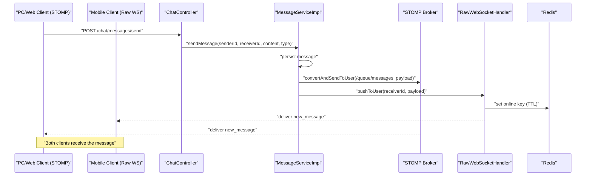

**Diagram sources**
- [ChatController.java:54-67](file://camp-channel-server/src/main/java/com/gdmec/campchannel/controller/ChatController.java#L54-L67)
- [MessageServiceImpl.java:44-94](file://camp-channel-server/src/main/java/com/gdmec/campchannel/service/impl/MessageServiceImpl.java#L44-L94)
- [WebSocketConfig.java:24-28](file://camp-channel-server/src/main/java/com/gdmec/campchannel/config/WebSocketConfig.java#L24-L28)
- [RawWebSocketHandler.java:119-129](file://camp-channel-server/src/main/java/com/gdmec/campchannel/config/RawWebSocketHandler.java#L119-L129)

## Detailed Component Analysis

### WebSocketEventListener: Connection Events and Presence Notifications
- Tracks STOMP connection/disconnect events and updates Redis online presence.
- Notifies friends via both raw WebSocket and STOMP user queues upon online/offline transitions.
- Provides a static method to check online status using Redis.

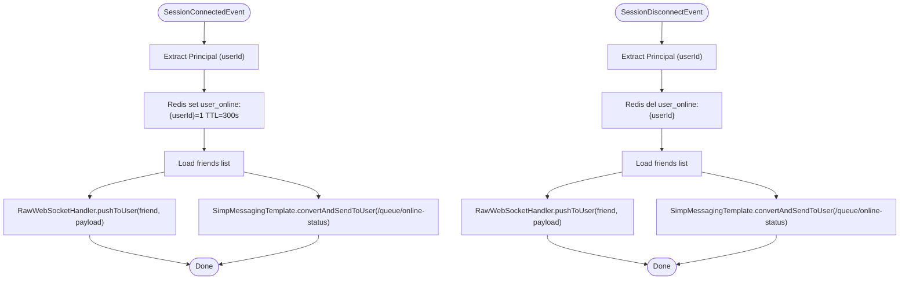

**Diagram sources**
- [WebSocketEventListener.java:32-62](file://camp-channel-server/src/main/java/com/gdmec/campchannel/config/WebSocketEventListener.java#L32-L62)
- [WebSocketEventListener.java:68-89](file://camp-channel-server/src/main/java/com/gdmec/campchannel/config/WebSocketEventListener.java#L68-L89)
- [RawWebSocketHandler.java:143-149](file://camp-channel-server/src/main/java/com/gdmec/campchannel/config/RawWebSocketHandler.java#L143-L149)

**Section sources**
- [WebSocketEventListener.java:32-62](file://camp-channel-server/src/main/java/com/gdmec/campchannel/config/WebSocketEventListener.java#L32-L62)
- [WebSocketEventListener.java:64-66](file://camp-channel-server/src/main/java/com/gdmec/campchannel/config/WebSocketEventListener.java#L64-L66)
- [WebSocketEventListener.java:68-89](file://camp-channel-server/src/main/java/com/gdmec/campchannel/config/WebSocketEventListener.java#L68-L89)

### RawWebSocketHandler: Raw WebSocket Management and Broadcasting
- Authenticates sessions via JWT from query parameter and maintains a concurrent map of user sessions.
- Implements ping/pong handling and cleanup on disconnect/transport error.
- Provides pushToUser and pushToUsers for targeted and broadcast delivery.
- Builds online status payloads and notifies friends.

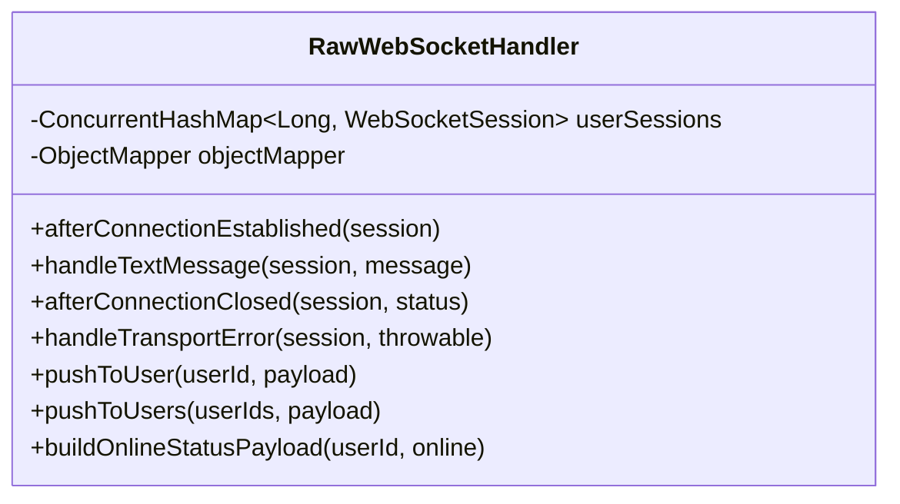

**Diagram sources**
- [RawWebSocketHandler.java:24-171](file://camp-channel-server/src/main/java/com/gdmec/campchannel/config/RawWebSocketHandler.java#L24-L171)

**Section sources**
- [RawWebSocketHandler.java:42-102](file://camp-channel-server/src/main/java/com/gdmec/campchannel/config/RawWebSocketHandler.java#L42-L102)
- [RawWebSocketHandler.java:119-138](file://camp-channel-server/src/main/java/com/gdmec/campchannel/config/RawWebSocketHandler.java#L119-L138)
- [RawWebSocketHandler.java:143-149](file://camp-channel-server/src/main/java/com/gdmec/campchannel/config/RawWebSocketHandler.java#L143-L149)

### MessageServiceImpl: Message Sending, Read Receipts, and Offline Handling
- Persists messages and enriches payload with sender info.
- Sends via STOMP to the receiver’s user queue for PC/web clients.
- Sends via Raw WebSocket to the receiver for Flutter/UniApp clients.
- Supports read receipts: marks as read and pushes a “message_read” event to the sender.
- Supports recalling messages within a time window.
- Retrieves chat history and marks incoming messages from friends as read.

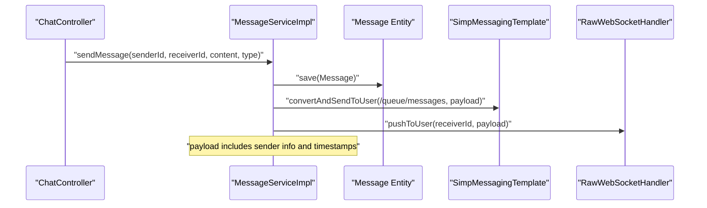

**Diagram sources**
- [ChatController.java:54-67](file://camp-channel-server/src/main/java/com/gdmec/campchannel/controller/ChatController.java#L54-L67)
- [MessageServiceImpl.java:44-94](file://camp-channel-server/src/main/java/com/gdmec/campchannel/service/impl/MessageServiceImpl.java#L44-L94)

**Section sources**
- [MessageServiceImpl.java:44-94](file://camp-channel-server/src/main/java/com/gdmec/campchannel/service/impl/MessageServiceImpl.java#L44-L94)
- [MessageServiceImpl.java:184-203](file://camp-channel-server/src/main/java/com/gdmec/campchannel/service/impl/MessageServiceImpl.java#L184-L203)
- [MessageServiceImpl.java:96-120](file://camp-channel-server/src/main/java/com/gdmec/campchannel/service/impl/MessageServiceImpl.java#L96-L120)
- [MessageServiceImpl.java:122-143](file://camp-channel-server/src/main/java/com/gdmec/campchannel/service/impl/MessageServiceImpl.java#L122-L143)

### ChatController: REST API for Message Operations
- Exposes endpoints to send messages, recall messages, fetch chat history, get unread counts, and mark all as read.
- Uses WebSocketEventListener to check online status and RedisUtils for presence queries.

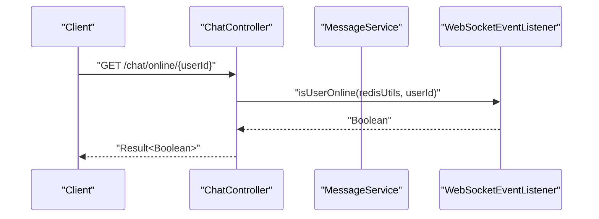

**Diagram sources**
- [ChatController.java:32-52](file://camp-channel-server/src/main/java/com/gdmec/campchannel/controller/ChatController.java#L32-L52)
- [WebSocketEventListener.java:64-66](file://camp-channel-server/src/main/java/com/gdmec/campchannel/config/WebSocketEventListener.java#L64-L66)

**Section sources**
- [ChatController.java:32-52](file://camp-channel-server/src/main/java/com/gdmec/campchannel/controller/ChatController.java#L32-L52)
- [ChatController.java:54-67](file://camp-channel-server/src/main/java/com/gdmec/campchannel/controller/ChatController.java#L54-L67)
- [ChatController.java:81-89](file://camp-channel-server/src/main/java/com/gdmec/campchannel/controller/ChatController.java#L81-L89)
- [ChatController.java:135-156](file://camp-channel-server/src/main/java/com/gdmec/campchannel/controller/ChatController.java#L135-L156)

### Message Entity and Persistence
- Message table supports sender/receiver, content, type, status, read flag, and timestamps.
- Indexes optimize queries by sender/receiver pairs and creation time.

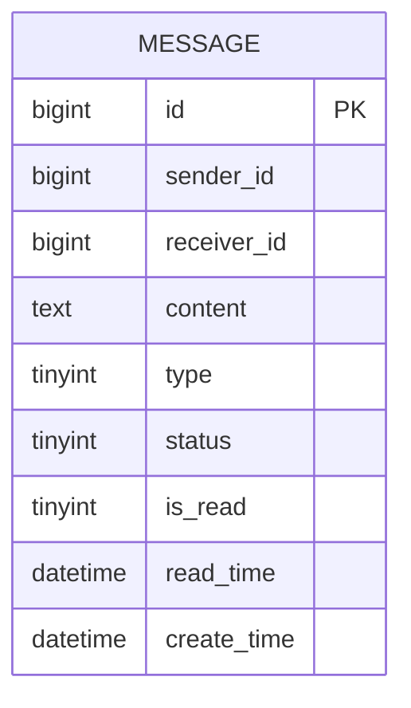

**Diagram sources**
- [schema.sql:103-115](file://camp-channel-server/src/main/resources/db/schema.sql#L103-L115)
- [Message.java:15-38](file://camp-channel-server/src/main/java/com/gdmec/campchannel/entity/Message.java#L15-L38)

**Section sources**
- [schema.sql:103-115](file://camp-channel-server/src/main/resources/db/schema.sql#L103-L115)
- [Message.java:15-38](file://camp-channel-server/src/main/java/com/gdmec/campchannel/entity/Message.java#L15-L38)

### WebSocket Broker and Authentication
- WebSocketConfig enables STOMP broker and registers SockJS endpoint.
- WebSocketAuthInterceptor extracts JWT from Authorization header and sets the user principal for STOMP CONNECT frames.

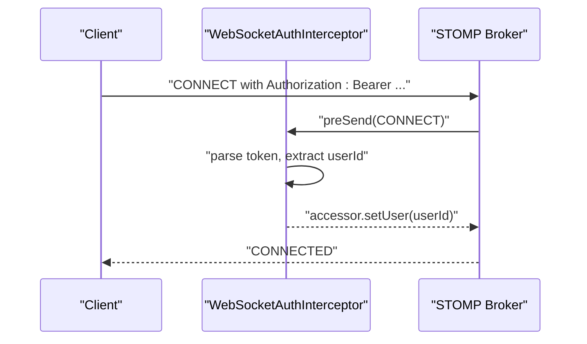

**Diagram sources**
- [WebSocketConfig.java:31-35](file://camp-channel-server/src/main/java/com/gdmec/campchannel/config/WebSocketConfig.java#L31-L35)
- [WebSocketAuthInterceptor.java:22-44](file://camp-channel-server/src/main/java/com/gdmec/campchannel/config/WebSocketAuthInterceptor.java#L22-L44)

**Section sources**
- [WebSocketConfig.java:18-35](file://camp-channel-server/src/main/java/com/gdmec/campchannel/config/WebSocketConfig.java#L18-L35)
- [WebSocketAuthInterceptor.java:22-44](file://camp-channel-server/src/main/java/com/gdmec/campchannel/config/WebSocketAuthInterceptor.java#L22-L44)

### Redis Integration: Online Presence and Rate Limiting
- Online presence: Keys like “user_online:{userId}” with short TTLs.
- Rate limiting: Sliding window implementation using ZSETs to guard operations.

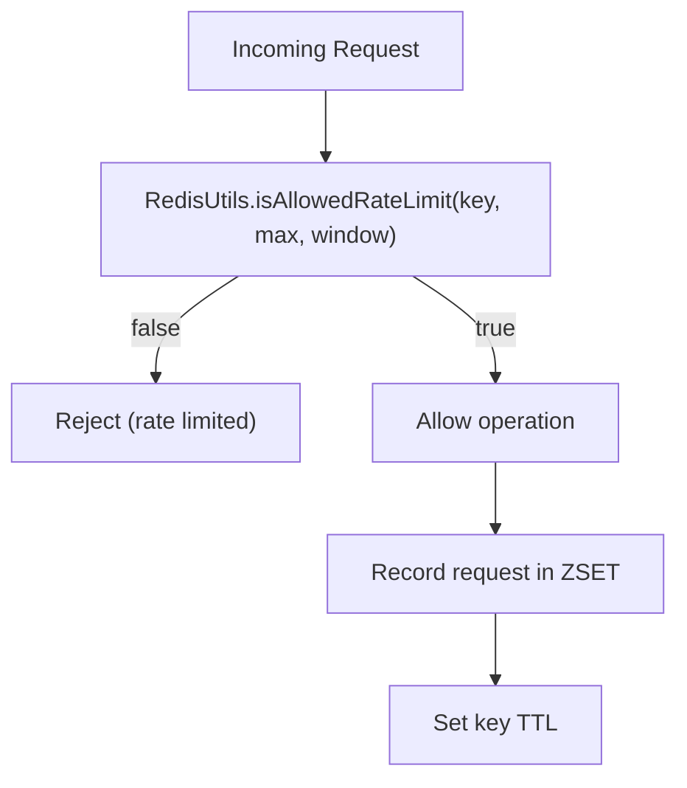

**Diagram sources**
- [RedisUtils.java:142-168](file://camp-channel-server/src/main/java/com/gdmec/campchannel/common/utils/RedisUtils.java#L142-L168)
- [WebSocketEventListener.java:38-39](file://camp-channel-server/src/main/java/com/gdmec/campchannel/config/WebSocketEventListener.java#L38-L39)
- [RawWebSocketHandler.java:66-66](file://camp-channel-server/src/main/java/com/gdmec/campchannel/config/RawWebSocketHandler.java#L66-L66)

**Section sources**
- [RedisConfig.java:20-45](file://camp-channel-server/src/main/java/com/gdmec/campchannel/config/RedisConfig.java#L20-L45)
- [RedisUtils.java:67-95](file://camp-channel-server/src/main/java/com/gdmec/campchannel/common/utils/RedisUtils.java#L67-L95)
- [RedisUtils.java:142-168](file://camp-channel-server/src/main/java/com/gdmec/campchannel/common/utils/RedisUtils.java#L142-L168)
- [WebSocketEventListener.java:38-39](file://camp-channel-server/src/main/java/com/gdmec/campchannel/config/WebSocketEventListener.java#L38-L39)
- [RawWebSocketHandler.java:66-66](file://camp-channel-server/src/main/java/com/gdmec/campchannel/config/RawWebSocketHandler.java#L66-L66)

### Client-Side WebSocket Handling
- Flutter:
  - Singleton WebSocketService connects to raw WebSocket, handles ping/pong, dispatches by message type, and reconnects on close/error.
- UniApp:
  - WebSocket manager connects to raw WebSocket with token in query, parses messages, and routes by type.

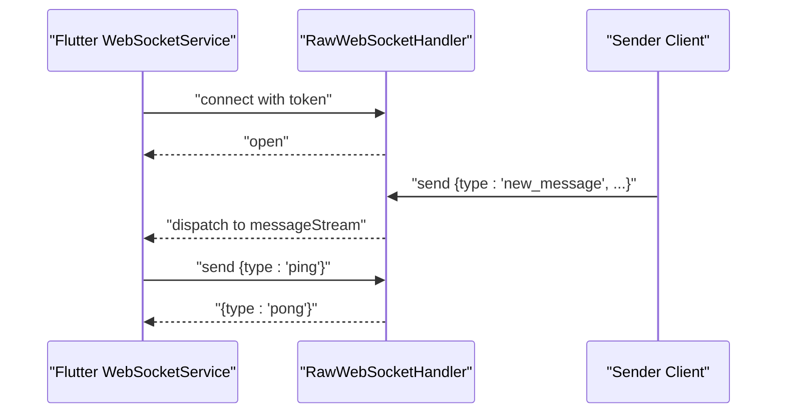

**Diagram sources**
- [websocket_service.dart:1-125](file://camp-channel-client-flutter/lib/core/services/websocket_service.dart#L1-L125)
- [websocket.ts:44-121](file://camp-channel-client-uniapp/src/utils/websocket.ts#L44-L121)
- [RawWebSocketHandler.java:77-88](file://camp-channel-server/src/main/java/com/gdmec/campchannel/config/RawWebSocketHandler.java#L77-L88)

**Section sources**
- [websocket_service.dart:1-125](file://camp-channel-client-flutter/lib/core/services/websocket_service.dart#L1-L125)
- [websocket.ts:44-121](file://camp-channel-client-uniapp/src/utils/websocket.ts#L44-L121)

## Dependency Analysis
- MessageServiceImpl depends on:
  - SimpMessagingTemplate for STOMP delivery.
  - RawWebSocketHandler for raw WebSocket delivery.
  - UserMapper for sender enrichment.
  - EmailService for optional email alerts.
- WebSocketEventListener depends on:
  - RedisUtils for online presence.
  - FriendshipService to notify friends.
  - RawWebSocketHandler for raw WebSocket notifications.
- RawWebSocketHandler depends on:
  - JwtUtils for authentication.
  - RedisUtils for online presence.
  - FriendshipService to notify friends.

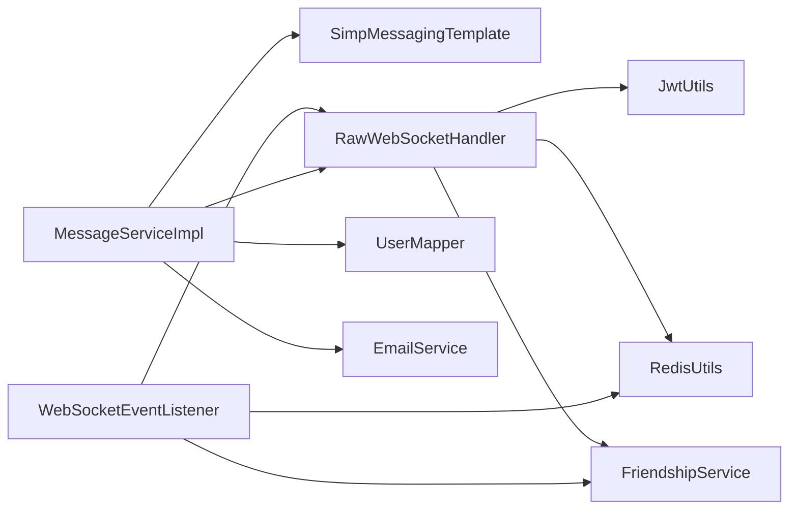

**Diagram sources**
- [MessageServiceImpl.java:36-40](file://camp-channel-server/src/main/java/com/gdmec/campchannel/service/impl/MessageServiceImpl.java#L36-L40)
- [WebSocketEventListener.java:21-28](file://camp-channel-server/src/main/java/com/gdmec/campchannel/config/WebSocketEventListener.java#L21-L28)
- [RawWebSocketHandler.java:30-37](file://camp-channel-server/src/main/java/com/gdmec/campchannel/config/RawWebSocketHandler.java#L30-L37)

**Section sources**
- [MessageServiceImpl.java:36-40](file://camp-channel-server/src/main/java/com/gdmec/campchannel/service/impl/MessageServiceImpl.java#L36-L40)
- [WebSocketEventListener.java:21-28](file://camp-channel-server/src/main/java/com/gdmec/campchannel/config/WebSocketEventListener.java#L21-L28)
- [RawWebSocketHandler.java:30-37](file://camp-channel-server/src/main/java/com/gdmec/campchannel/config/RawWebSocketHandler.java#L30-L37)

## Performance Considerations
- High-volume broadcasting:
  - Prefer batched pushes where feasible; avoid per-friend loops if unnecessary.
  - Use Redis for presence checks to minimize DB queries.
- Connection scaling:
  - STOMP broker is configured with simple broker prefixes; ensure adequate thread pools and connection limits.
  - Raw WebSocket sessions are stored in memory; consider clustering or sticky sessions behind load balancers.
- Latency reduction:
  - Keep message payloads minimal; only include necessary fields.
  - Offload email alerts asynchronously if needed.
- Rate limiting:
  - Use RedisUtils sliding window to protect endpoints and prevent abuse.

[No sources needed since this section provides general guidance]

## Troubleshooting Guide
- Clients not receiving messages:
  - Verify WebSocket connections are established and authenticated.
  - Confirm STOMP user destinations and raw WebSocket user IDs match.
- Read receipts not delivered:
  - Ensure the receiver’s session exists for raw WebSocket and that the sender ID is correctly set.
- Online status not updating:
  - Check Redis connectivity and TTLs; ensure connection/disconnect listeners are firing.
- Duplicate messages:
  - Implement client-side deduplication using message IDs.
- Recalling messages:
  - Confirm the 2-minute time window and that the current user is the sender.

**Section sources**
- [MessageServiceImpl.java:122-143](file://camp-channel-server/src/main/java/com/gdmec/campchannel/service/impl/MessageServiceImpl.java#L122-L143)
- [WebSocketEventListener.java:32-62](file://camp-channel-server/src/main/java/com/gdmec/campchannel/config/WebSocketEventListener.java#L32-L62)
- [RawWebSocketHandler.java:119-129](file://camp-channel-server/src/main/java/com/gdmec/campchannel/config/RawWebSocketHandler.java#L119-L129)

## Conclusion
The system delivers reliable, real-time chat messages across two channels with robust online presence propagation and Redis-backed utilities. MessageServiceImpl centralizes persistence and dual-channel delivery, while WebSocketEventListener and RawWebSocketHandler coordinate connection lifecycle and presence notifications. Read receipts and offline handling are integrated, and the architecture supports scaling with careful attention to connection management and rate limiting.

[No sources needed since this section summarizes without analyzing specific files]

## Appendices

### Message Ordering Guarantees
- Single-conversation ordering:
  - Database INSERT order and STOMP user queues preserve ordering for a given receiver.
- Across multiple receivers:
  - No cross-user ordering guarantee; rely on client-side ordering per conversation.

**Section sources**
- [MessageServiceImpl.java:44-94](file://camp-channel-server/src/main/java/com/gdmec/campchannel/service/impl/MessageServiceImpl.java#L44-L94)
- [WebSocketConfig.java:24-28](file://camp-channel-server/src/main/java/com/gdmec/campchannel/config/WebSocketConfig.java#L24-L28)

### Duplicate Detection
- Recommended approach:
  - Use a client-side message ID map keyed by (senderId, receiverId, messageId) to suppress duplicates.
  - Server-side deduplication can be added using Redis sets keyed by conversation.

**Section sources**
- [RawWebSocketHandler.java:119-129](file://camp-channel-server/src/main/java/com/gdmec/campchannel/config/RawWebSocketHandler.java#L119-L129)

### Message Persistence Strategies
- Relational persistence:
  - Use the message table with indexes on sender/receiver pairs and timestamps.
- Caching:
  - Cache recent conversations and unread counts in Redis with appropriate TTLs.

**Section sources**
- [schema.sql:103-115](file://camp-channel-server/src/main/resources/db/schema.sql#L103-L115)
- [RedisUtils.java:67-95](file://camp-channel-server/src/main/java/com/gdmec/campchannel/common/utils/RedisUtils.java#L67-L95)

### Client Notification Mechanisms
- STOMP:
  - Deliver to user-specific queue for PC/web clients.
- Raw WebSocket:
  - Deliver to active sessions for Flutter/UniApp clients.

**Section sources**
- [WebSocketConfig.java:24-28](file://camp-channel-server/src/main/java/com/gdmec/campchannel/config/WebSocketConfig.java#L24-L28)
- [RawWebSocketHandler.java:119-129](file://camp-channel-server/src/main/java/com/gdmec/campchannel/config/RawWebSocketHandler.java#L119-L129)