# Message Management and Persistence

<cite>
**Referenced Files in This Document**
- [Message.java](file://camp-channel-server/src/main/java/com/gdmec/campchannel/entity/Message.java)
- [MessageService.java](file://camp-channel-server/src/main/java/com/gdmec/campchannel/service/MessageService.java)
- [MessageServiceImpl.java](file://camp-channel-server/src/main/java/com/gdmec/campchannel/service/impl/MessageServiceImpl.java)
- [MessageMapper.java](file://camp-channel-server/src/main/java/com/gdmec/campchannel/mapper/MessageMapper.java)
- [schema.sql](file://camp-channel-server/src/main/resources/db/schema.sql)
- [ChatController.java](file://camp-channel-server/src/main/java/com/gdmec/campchannel/controller/ChatController.java)
- [WebSocketConfig.java](file://camp-channel-server/src/main/java/com/gdmec/campchannel/config/WebSocketConfig.java)
- [RawWebSocketHandler.java](file://camp-channel-server/src/main/java/com/gdmec/campchannel/config/RawWebSocketHandler.java)
- [application.yml](file://camp-channel-server/src/main/resources/application.yml)
- [SensitiveWordFilter.java](file://camp-channel-server/src/main/java/com/gdmec/campchannel/common/filter/SensitiveWordFilter.java)
- [sensitive_words.txt](file://camp-channel-server/src/main/resources/sensitive_words.txt)
- [GroupMessage.java](file://camp-channel-server/src/main/java/com/gdmec/campchannel/entity/GroupMessage.java)
</cite>

## Table of Contents
1. [Introduction](#introduction)
2. [Project Structure](#project-structure)
3. [Core Components](#core-components)
4. [Architecture Overview](#architecture-overview)
5. [Detailed Component Analysis](#detailed-component-analysis)
6. [Dependency Analysis](#dependency-analysis)
7. [Performance Considerations](#performance-considerations)
8. [Security and Access Control](#security-and-access-control)
9. [Message Lifecycle and Cleanup](#message-lifecycle-and-cleanup)
10. [Real-time Delivery and Persistence Relationship](#real-time-delivery-and-persistence-relationship)
11. [Troubleshooting Guide](#troubleshooting-guide)
12. [Conclusion](#conclusion)

## Introduction
This document explains the message management and persistence system for single-user chat in the campus channel server. It covers the Message entity, message types, and data relationships; the MessageService interface and MessageServiceImpl implementation including sending, retrieval, recall, and read receipts; the MyBatis-Plus persistence layer and database schema; concrete examples of CRUD operations, chat history retrieval, and recall; message lifecycle from creation to archival; security considerations including content validation and access control; and the relationship between persistence and real-time delivery. It also includes performance optimization techniques for storage, retrieval, and pagination.

## Project Structure
The message subsystem centers around:
- Entity: Message
- Mapper: MessageMapper (MyBatis-Plus)
- Service: MessageService and MessageServiceImpl
- Controller: ChatController (REST endpoints)
- Real-time: STOMP WebSocket (Spring Messaging) and Raw WebSocket (custom handler)
- Persistence: MySQL schema with indexes
- Security: Sensitive word filtering and JWT-based authentication

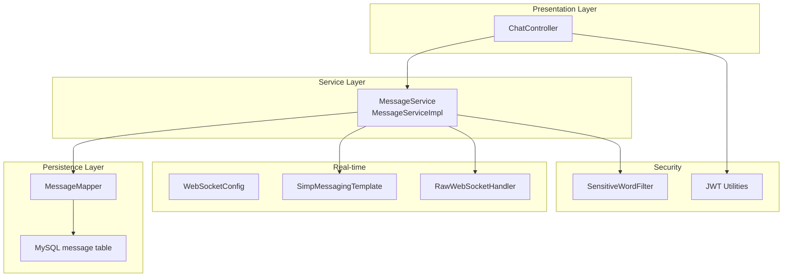

**Diagram sources**
- [ChatController.java:1-166](file://camp-channel-server/src/main/java/com/gdmec/campchannel/controller/ChatController.java#L1-L166)
- [MessageService.java:1-44](file://camp-channel-server/src/main/java/com/gdmec/campchannel/service/MessageService.java#L1-L44)
- [MessageServiceImpl.java:1-220](file://camp-channel-server/src/main/java/com/gdmec/campchannel/service/impl/MessageServiceImpl.java#L1-L220)
- [MessageMapper.java:1-10](file://camp-channel-server/src/main/java/com/gdmec/campchannel/mapper/MessageMapper.java#L1-L10)
- [schema.sql:103-115](file://camp-channel-server/src/main/resources/db/schema.sql#L103-L115)
- [WebSocketConfig.java:1-36](file://camp-channel-server/src/main/java/com/gdmec/campchannel/config/WebSocketConfig.java#L1-L36)
- [RawWebSocketHandler.java:1-171](file://camp-channel-server/src/main/java/com/gdmec/campchannel/config/RawWebSocketHandler.java#L1-L171)
- [SensitiveWordFilter.java:1-166](file://camp-channel-server/src/main/java/com/gdmec/campchannel/common/filter/SensitiveWordFilter.java#L1-L166)

**Section sources**
- [ChatController.java:1-166](file://camp-channel-server/src/main/java/com/gdmec/campchannel/controller/ChatController.java#L1-L166)
- [MessageService.java:1-44](file://camp-channel-server/src/main/java/com/gdmec/campchannel/service/MessageService.java#L1-L44)
- [MessageServiceImpl.java:1-220](file://camp-channel-server/src/main/java/com/gdmec/campchannel/service/impl/MessageServiceImpl.java#L1-L220)
- [MessageMapper.java:1-10](file://camp-channel-server/src/main/java/com/gdmec/campchannel/mapper/MessageMapper.java#L1-L10)
- [schema.sql:103-115](file://camp-channel-server/src/main/resources/db/schema.sql#L103-L115)
- [WebSocketConfig.java:1-36](file://camp-channel-server/src/main/java/com/gdmec/campchannel/config/WebSocketConfig.java#L1-L36)
- [RawWebSocketHandler.java:1-171](file://camp-channel-server/src/main/java/com/gdmec/campchannel/config/RawWebSocketHandler.java#L1-L171)
- [SensitiveWordFilter.java:1-166](file://camp-channel-server/src/main/java/com/gdmec/campchannel/common/filter/SensitiveWordFilter.java#L1-L166)

## Core Components
- Message entity: encapsulates sender/receiver, content, type, status, read flags, timestamps, and transient user metadata for rendering.
- MessageService interface: defines operations for sending, retrieving chat history, recalling messages, fetching conversations, unread counts, and marking read.
- MessageServiceImpl: implements the above with transactional guarantees, real-time delivery via STOMP and Raw WebSocket, email alerts, and read receipts.
- MessageMapper: MyBatis-Plus mapper for Message entity.
- Database schema: message table with composite indexes optimized for chat queries.
- Controllers: ChatController exposes REST endpoints for chat operations.
- Real-time: WebSocketConfig enables STOMP broker; RawWebSocketHandler manages low-level WebSocket connections and broadcasts.

**Section sources**
- [Message.java:1-40](file://camp-channel-server/src/main/java/com/gdmec/campchannel/entity/Message.java#L1-L40)
- [MessageService.java:1-44](file://camp-channel-server/src/main/java/com/gdmec/campchannel/service/MessageService.java#L1-L44)
- [MessageServiceImpl.java:1-220](file://camp-channel-server/src/main/java/com/gdmec/campchannel/service/impl/MessageServiceImpl.java#L1-L220)
- [MessageMapper.java:1-10](file://camp-channel-server/src/main/java/com/gdmec/campchannel/mapper/MessageMapper.java#L1-L10)
- [schema.sql:103-115](file://camp-channel-server/src/main/resources/db/schema.sql#L103-L115)
- [ChatController.java:1-166](file://camp-channel-server/src/main/java/com/gdmec/campchannel/controller/ChatController.java#L1-L166)
- [WebSocketConfig.java:1-36](file://camp-channel-server/src/main/java/com/gdmec/campchannel/config/WebSocketConfig.java#L1-L36)
- [RawWebSocketHandler.java:1-171](file://camp-channel-server/src/main/java/com/gdmec/campchannel/config/RawWebSocketHandler.java#L1-L171)

## Architecture Overview
The system integrates REST APIs with real-time messaging and persistent storage. On send, the service persists the message and pushes it to the receiver via STOMP queues and Raw WebSocket. Retrieval uses paginated queries with automatic read marking. Recall updates status within a time window. Unread counts and read receipts are computed and delivered asynchronously.

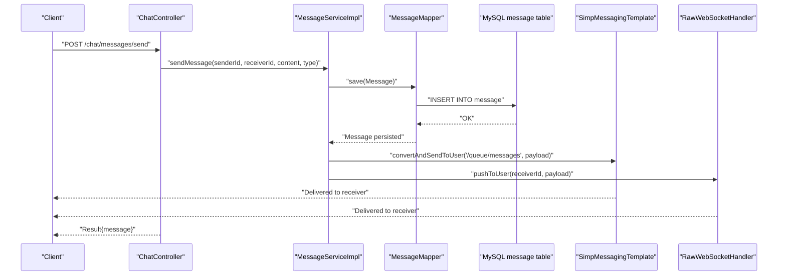

**Diagram sources**
- [ChatController.java:54-67](file://camp-channel-server/src/main/java/com/gdmec/campchannel/controller/ChatController.java#L54-L67)
- [MessageServiceImpl.java:44-94](file://camp-channel-server/src/main/java/com/gdmec/campchannel/service/impl/MessageServiceImpl.java#L44-L94)
- [MessageMapper.java:1-10](file://camp-channel-server/src/main/java/com/gdmec/campchannel/mapper/MessageMapper.java#L1-L10)
- [schema.sql:103-115](file://camp-channel-server/src/main/resources/db/schema.sql#L103-L115)
- [WebSocketConfig.java:24-28](file://camp-channel-server/src/main/java/com/gdmec/campchannel/config/WebSocketConfig.java#L24-L28)
- [RawWebSocketHandler.java:119-129](file://camp-channel-server/src/main/java/com/gdmec/campchannel/config/RawWebSocketHandler.java#L119-L129)

## Detailed Component Analysis

### Message Entity and Types
- Fields include identifiers, content, type, status, read flags, timestamps, and transient user metadata for UI rendering.
- Message types: 1=text, 2=emoji, 3=image, 4=video.
- Status: 1=normal, 2=recalled.
- Indexes on sender/receiver pairs and create_time optimize chat queries.

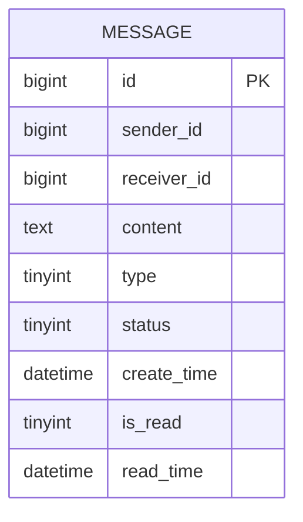

**Diagram sources**
- [schema.sql:103-115](file://camp-channel-server/src/main/resources/db/schema.sql#L103-L115)
- [Message.java:14-39](file://camp-channel-server/src/main/java/com/gdmec/campchannel/entity/Message.java#L14-L39)

**Section sources**
- [Message.java:1-40](file://camp-channel-server/src/main/java/com/gdmec/campchannel/entity/Message.java#L1-L40)
- [schema.sql:103-115](file://camp-channel-server/src/main/resources/db/schema.sql#L103-L115)

### MessageService Interface and Implementation
Key operations:
- sendMessage: persists and delivers real-time notifications to receiver; sends optional email alert.
- getChatHistory: paginated retrieval of conversation history; marks received messages as read.
- recallMessage: enforces sender ownership and 2-minute window; sets status to recalled.
- getConversations: retrieves each user’s most recent message per contact.
- getUnreadCount: counts unread messages for a contact.
- markAsRead and markAllAsRead: update read flags and optionally push read receipts.

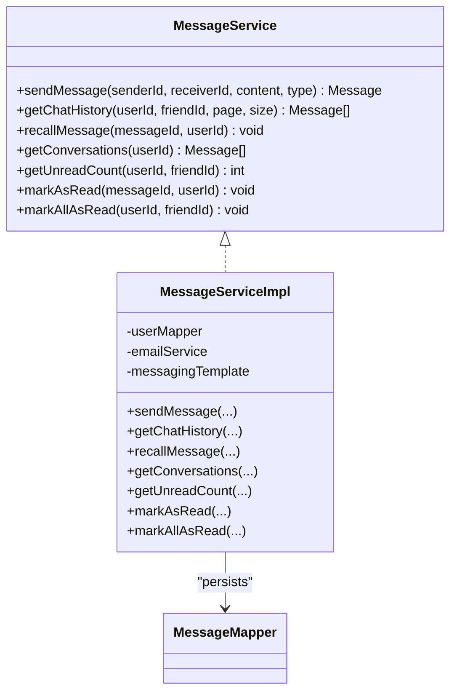

**Diagram sources**
- [MessageService.java:8-44](file://camp-channel-server/src/main/java/com/gdmec/campchannel/service/MessageService.java#L8-L44)
- [MessageServiceImpl.java:31-219](file://camp-channel-server/src/main/java/com/gdmec/campchannel/service/impl/MessageServiceImpl.java#L31-L219)
- [MessageMapper.java:8](file://camp-channel-server/src/main/java/com/gdmec/campchannel/mapper/MessageMapper.java#L8)

**Section sources**
- [MessageService.java:1-44](file://camp-channel-server/src/main/java/com/gdmec/campchannel/service/MessageService.java#L1-L44)
- [MessageServiceImpl.java:44-219](file://camp-channel-server/src/main/java/com/gdmec/campchannel/service/impl/MessageServiceImpl.java#L44-L219)

### Message Persistence Layer (MyBatis-Plus)
- MessageMapper extends BaseMapper<Message>, inheriting standard CRUD operations.
- MyBatis-Plus configuration in application.yml enables camelCase mapping and mapper scanning.
- Database schema defines indexes on (sender_id, receiver_id), (receiver_id, sender_id), and create_time to support chat queries.

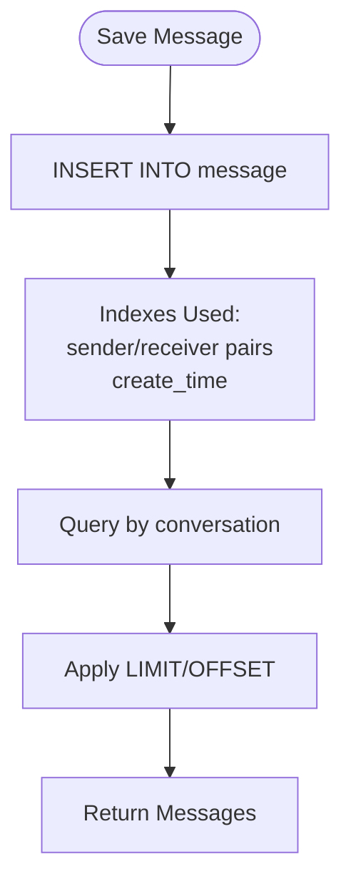

**Diagram sources**
- [MessageMapper.java:8](file://camp-channel-server/src/main/java/com/gdmec/campchannel/mapper/MessageMapper.java#L8)
- [application.yml:68-77](file://camp-channel-server/src/main/resources/application.yml#L68-L77)
- [schema.sql:103-115](file://camp-channel-server/src/main/resources/db/schema.sql#L103-L115)

**Section sources**
- [MessageMapper.java:1-10](file://camp-channel-server/src/main/java/com/gdmec/campchannel/mapper/MessageMapper.java#L1-L10)
- [application.yml:68-77](file://camp-channel-server/src/main/resources/application.yml#L68-L77)
- [schema.sql:103-115](file://camp-channel-server/src/main/resources/db/schema.sql#L103-L115)

### Chat History Retrieval and Pagination
- Query builds a symmetric condition for either direction of the conversation.
- Orders by create_time descending.
- Applies LIMIT with offset derived from page and size.
- Automatically marks received messages as read and updates read_time.

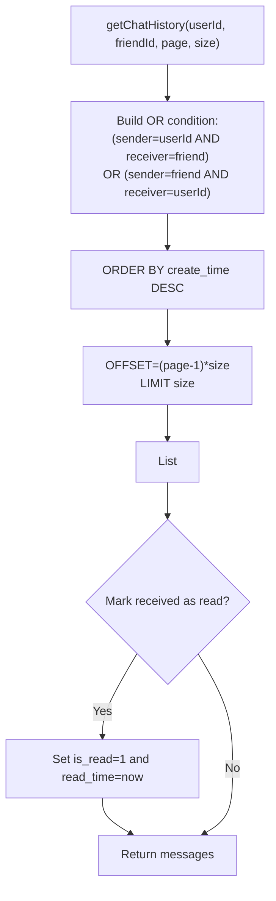

**Diagram sources**
- [MessageServiceImpl.java:96-120](file://camp-channel-server/src/main/java/com/gdmec/campchannel/service/impl/MessageServiceImpl.java#L96-L120)

**Section sources**
- [MessageServiceImpl.java:96-120](file://camp-channel-server/src/main/java/com/gdmec/campchannel/service/impl/MessageServiceImpl.java#L96-L120)

### Message Recall Functionality
- Validates existence and sender ownership.
- Enforces a 2-minute time window.
- Sets status to recalled and persists.

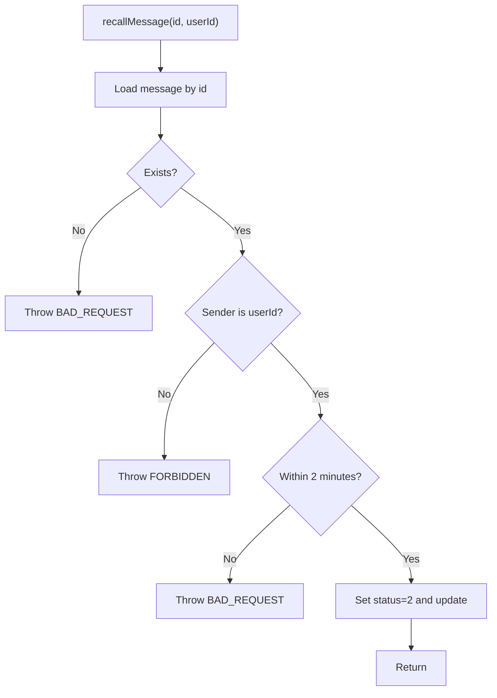

**Diagram sources**
- [MessageServiceImpl.java:122-143](file://camp-channel-server/src/main/java/com/gdmec/campchannel/service/impl/MessageServiceImpl.java#L122-L143)

**Section sources**
- [MessageServiceImpl.java:122-143](file://camp-channel-server/src/main/java/com/gdmec/campchannel/service/impl/MessageServiceImpl.java#L122-L143)

### Conversations and Unread Counts
- Conversations: scans user’s messages, deduplicates by other party, selects latest per contact, enriches with user metadata.
- Unread count: counts unread messages from a friend to current user.

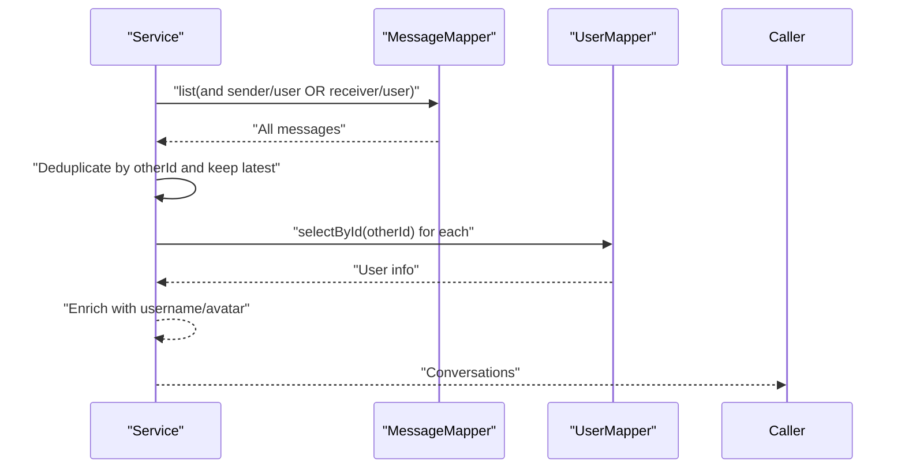

**Diagram sources**
- [MessageServiceImpl.java:145-173](file://camp-channel-server/src/main/java/com/gdmec/campchannel/service/impl/MessageServiceImpl.java#L145-L173)

**Section sources**
- [MessageServiceImpl.java:145-181](file://camp-channel-server/src/main/java/com/gdmec/campchannel/service/impl/MessageServiceImpl.java#L145-L181)

### Real-time Delivery Mechanisms
- STOMP: configured with a simple broker and user destination prefix; messages sent to receiver’s queue.
- Raw WebSocket: custom handler authenticates via JWT, maintains user sessions, and pushes JSON payloads.

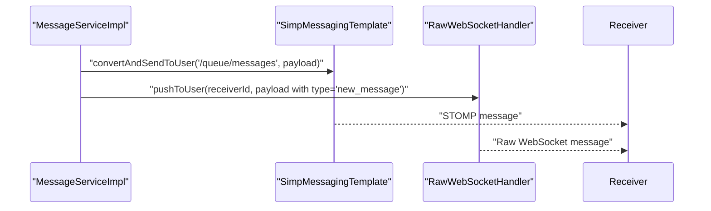

**Diagram sources**
- [WebSocketConfig.java:24-28](file://camp-channel-server/src/main/java/com/gdmec/campchannel/config/WebSocketConfig.java#L24-L28)
- [MessageServiceImpl.java:55-79](file://camp-channel-server/src/main/java/com/gdmec/campchannel/service/impl/MessageServiceImpl.java#L55-L79)
- [RawWebSocketHandler.java:119-129](file://camp-channel-server/src/main/java/com/gdmec/campchannel/config/RawWebSocketHandler.java#L119-L129)

**Section sources**
- [WebSocketConfig.java:1-36](file://camp-channel-server/src/main/java/com/gdmec/campchannel/config/WebSocketConfig.java#L1-L36)
- [MessageServiceImpl.java:55-79](file://camp-channel-server/src/main/java/com/gdmec/campchannel/service/impl/MessageServiceImpl.java#L55-L79)
- [RawWebSocketHandler.java:1-171](file://camp-channel-server/src/main/java/com/gdmec/campchannel/config/RawWebSocketHandler.java#L1-L171)

### REST API Examples
- Send message: POST /chat/messages/send
- Get chat history: GET /chat/history/{friendId}?page=&size=
- Recall message: POST /chat/messages/{messageId}/recall
- Get conversations: GET /chat/conversations
- Get unread count: GET /chat/unread/{friendId}
- Mark all as read: POST /chat/read-all/{friendId}

These endpoints delegate to MessageService methods and return standardized Result wrappers.

**Section sources**
- [ChatController.java:54-156](file://camp-channel-server/src/main/java/com/gdmec/campchannel/controller/ChatController.java#L54-L156)

## Dependency Analysis
- MessageServiceImpl depends on MessageMapper for persistence, UserMapper for enrichment, SimpMessagingTemplate for STOMP delivery, RawWebSocketHandler for direct WebSocket delivery, and EmailService for alerts.
- ChatController depends on MessageService and SecurityUser for authentication.
- WebSocketConfig and RawWebSocketHandler provide transport layers for real-time delivery.

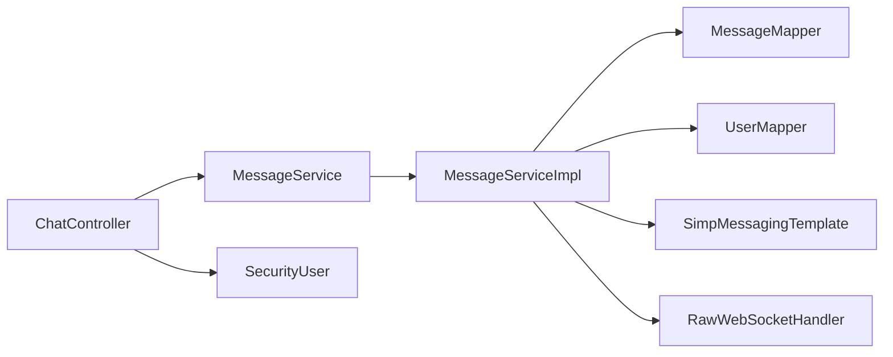

**Diagram sources**
- [ChatController.java:26-27](file://camp-channel-server/src/main/java/com/gdmec/campchannel/controller/ChatController.java#L26-L27)
- [MessageServiceImpl.java:33-40](file://camp-channel-server/src/main/java/com/gdmec/campchannel/service/impl/MessageServiceImpl.java#L33-L40)
- [WebSocketConfig.java:24-28](file://camp-channel-server/src/main/java/com/gdmec/campchannel/config/WebSocketConfig.java#L24-L28)
- [RawWebSocketHandler.java:119-129](file://camp-channel-server/src/main/java/com/gdmec/campchannel/config/RawWebSocketHandler.java#L119-L129)

**Section sources**
- [ChatController.java:1-166](file://camp-channel-server/src/main/java/com/gdmec/campchannel/controller/ChatController.java#L1-L166)
- [MessageServiceImpl.java:1-220](file://camp-channel-server/src/main/java/com/gdmec/campchannel/service/impl/MessageServiceImpl.java#L1-L220)

## Performance Considerations
- Database indexes:
  - Composite indexes on (sender_id, receiver_id) and (receiver_id, sender_id) support bidirectional chat queries.
  - Index on create_time supports chronological ordering and pagination.
- Pagination:
  - Use OFFSET/LIMIT with page and size parameters to avoid loading entire histories.
  - Consider cursor-based pagination for very large datasets to reduce OFFSET overhead.
- Query patterns:
  - Prefer indexed columns in WHERE clauses; leverage symmetric conditions for chat history.
  - Batch updates for markAllAsRead to minimize round-trips.
- Caching:
  - Cache frequently accessed user metadata (username, avatar) close to UI rendering.
- Connection pooling:
  - Tune HikariCP settings in application.yml for concurrent requests.
- Monitoring:
  - Track slow queries and long-running transactions.

**Section sources**
- [schema.sql:112-114](file://camp-channel-server/src/main/resources/db/schema.sql#L112-L114)
- [MessageServiceImpl.java:105-106](file://camp-channel-server/src/main/java/com/gdmec/campchannel/service/impl/MessageServiceImpl.java#L105-L106)
- [MessageServiceImpl.java:207-217](file://camp-channel-server/src/main/java/com/gdmec/campchannel/service/impl/MessageServiceImpl.java#L207-L217)
- [application.yml:18-24](file://camp-channel-server/src/main/resources/application.yml#L18-L24)

## Security and Access Control
- Authentication:
  - REST endpoints use JWT via SecurityUser for caller identity.
- Authorization:
  - Recall enforces sender ownership.
  - Mark-as-read enforces receiver-only updates.
- Content validation and filtering:
  - SensitiveWordFilter loads a DFA-based dictionary from sensitive_words.txt and can filter or detect sensitive content.
  - Apply filtering during sendMessage or before persisting to sanitize content.
- Transport security:
  - STOMP over SockJS and Raw WebSocket require token-based authentication in handlers.

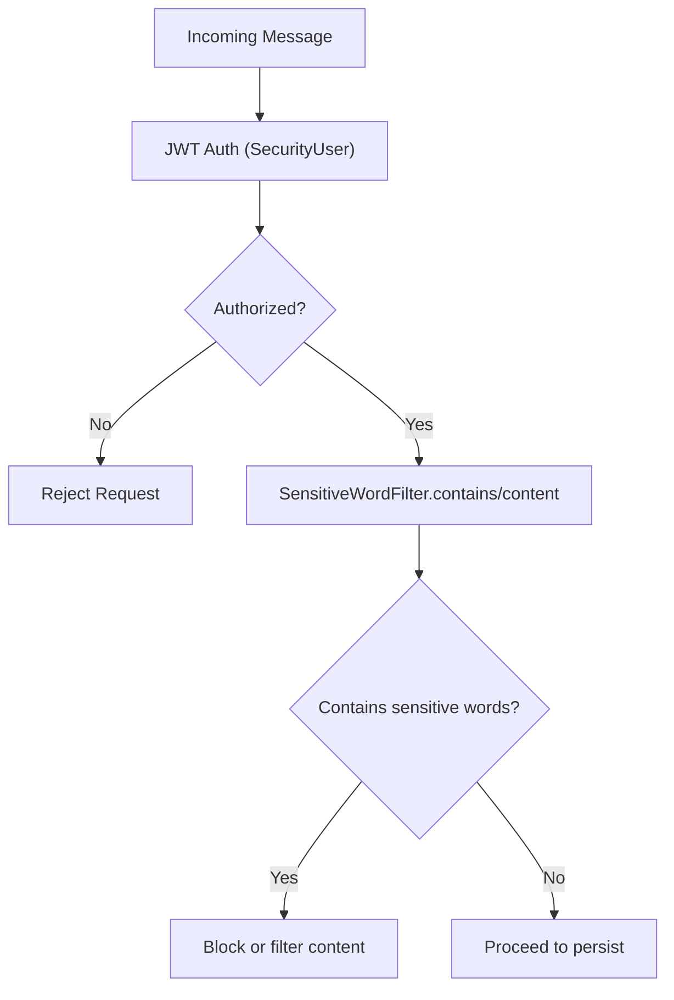

**Diagram sources**
- [ChatController.java:58](file://camp-channel-server/src/main/java/com/gdmec/campchannel/controller/ChatController.java#L58)
- [MessageServiceImpl.java:122-143](file://camp-channel-server/src/main/java/com/gdmec/campchannel/service/impl/MessageServiceImpl.java#L122-L143)
- [SensitiveWordFilter.java:40-64](file://camp-channel-server/src/main/java/com/gdmec/campchannel/common/filter/SensitiveWordFilter.java#L40-L64)
- [sensitive_words.txt:1-10](file://camp-channel-server/src/main/resources/sensitive_words.txt#L1-L10)

**Section sources**
- [ChatController.java:54-67](file://camp-channel-server/src/main/java/com/gdmec/campchannel/controller/ChatController.java#L54-L67)
- [MessageServiceImpl.java:122-143](file://camp-channel-server/src/main/java/com/gdmec/campchannel/service/impl/MessageServiceImpl.java#L122-L143)
- [SensitiveWordFilter.java:1-166](file://camp-channel-server/src/main/java/com/gdmec/campchannel/common/filter/SensitiveWordFilter.java#L1-L166)
- [sensitive_words.txt:1-10](file://camp-channel-server/src/main/resources/sensitive_words.txt#L1-L10)

## Message Lifecycle and Cleanup
- Creation: sendMessage persists with status=normal and is_read=0.
- Real-time delivery: STOMP and Raw WebSocket deliver immediately upon persistence.
- Retrieval: getChatHistory returns ordered messages and marks received messages as read.
- Recall: within 2 minutes, sender can recall; status transitions to recalled.
- Archival/cleanup:
  - No explicit archival process is implemented; consider adding periodic cleanup jobs to remove recalled or very old messages based on retention policies.
  - Index maintenance and statistics updates can be scheduled to maintain query performance.

**Section sources**
- [MessageServiceImpl.java:44-94](file://camp-channel-server/src/main/java/com/gdmec/campchannel/service/impl/MessageServiceImpl.java#L44-L94)
- [MessageServiceImpl.java:122-143](file://camp-channel-server/src/main/java/com/gdmec/campchannel/service/impl/MessageServiceImpl.java#L122-L143)
- [schema.sql:103-115](file://camp-channel-server/src/main/resources/db/schema.sql#L103-L115)

## Real-time Delivery and Persistence Relationship
- Persistence precedes delivery: a successful save triggers immediate real-time notifications.
- STOMP ensures reliable delivery to the receiver’s queue; Raw WebSocket provides an alternative for clients that do not use STOMP.
- Read receipts: markAsRead pushes a “message_read” event to the original sender via Raw WebSocket.

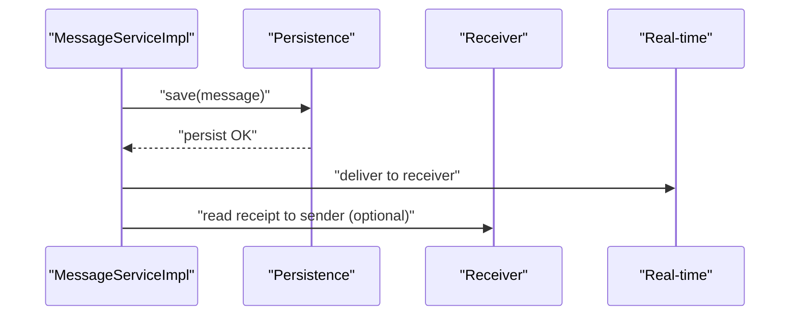

**Diagram sources**
- [MessageServiceImpl.java:55-79](file://camp-channel-server/src/main/java/com/gdmec/campchannel/service/impl/MessageServiceImpl.java#L55-L79)
- [MessageServiceImpl.java:184-203](file://camp-channel-server/src/main/java/com/gdmec/campchannel/service/impl/MessageServiceImpl.java#L184-L203)
- [RawWebSocketHandler.java:119-129](file://camp-channel-server/src/main/java/com/gdmec/campchannel/config/RawWebSocketHandler.java#L119-L129)

**Section sources**
- [MessageServiceImpl.java:55-79](file://camp-channel-server/src/main/java/com/gdmec/campchannel/service/impl/MessageServiceImpl.java#L55-L79)
- [MessageServiceImpl.java:184-203](file://camp-channel-server/src/main/java/com/gdmec/campchannel/service/impl/MessageServiceImpl.java#L184-L203)
- [RawWebSocketHandler.java:119-129](file://camp-channel-server/src/main/java/com/gdmec/campchannel/config/RawWebSocketHandler.java#L119-L129)

## Troubleshooting Guide
- WebSocket delivery failures:
  - STOMP delivery warnings are logged; verify user destination and broker configuration.
  - Raw WebSocket push failures are logged; ensure user session exists and is open.
- Recall errors:
  - Nonexistent messages, unauthorized recall attempts, and expired time windows trigger business exceptions.
- Email alerts:
  - Failures are logged but do not block message sending; verify email service configuration.
- Pagination anomalies:
  - Ensure page starts at 1 and size is reasonable; verify ORDER BY create_time and LIMIT/OFFSET logic.

**Section sources**
- [MessageServiceImpl.java:77-79](file://camp-channel-server/src/main/java/com/gdmec/campchannel/service/impl/MessageServiceImpl.java#L77-L79)
- [MessageServiceImpl.java:89-91](file://camp-channel-server/src/main/java/com/gdmec/campchannel/service/impl/MessageServiceImpl.java#L89-L91)
- [MessageServiceImpl.java:126-139](file://camp-channel-server/src/main/java/com/gdmec/campchannel/service/impl/MessageServiceImpl.java#L126-L139)

## Conclusion
The message management system combines robust persistence with efficient real-time delivery. The Message entity and schema are designed for chat-centric queries, while MessageService provides a comprehensive set of operations for sending, retrieving, recalling, and managing read states. Security is enforced through JWT-based authentication and optional sensitive word filtering. Performance is supported by strategic indexes and pagination, with room for further optimization via cursor-based pagination and scheduled cleanup jobs.