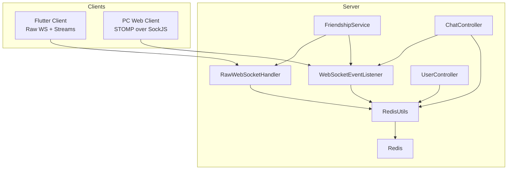
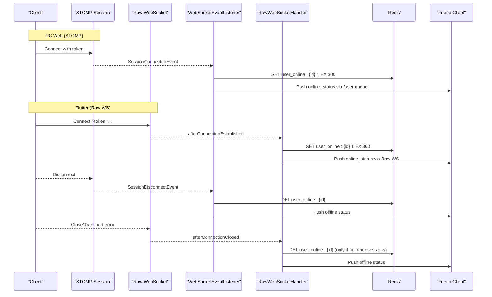
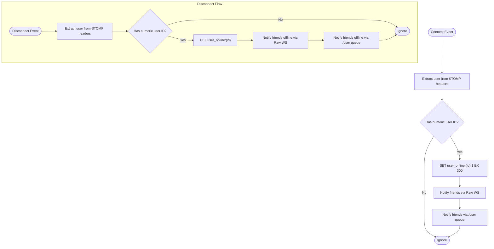
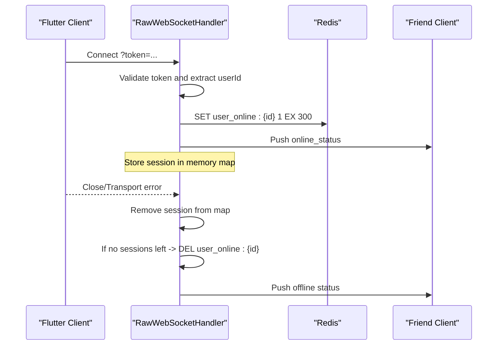
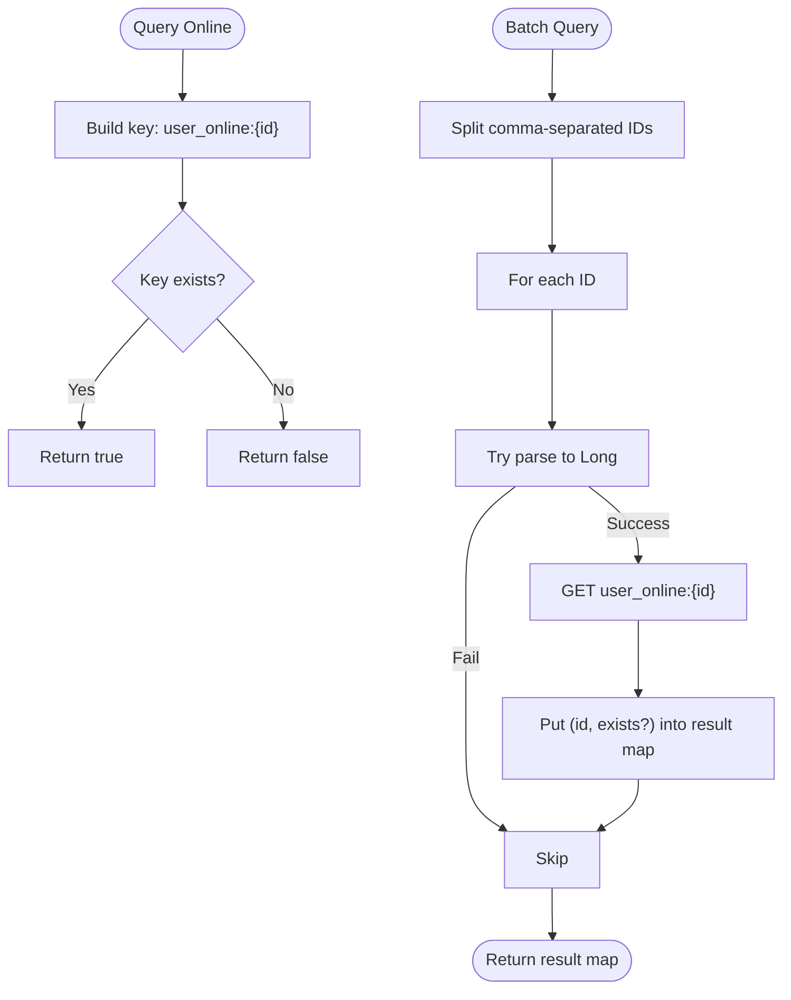
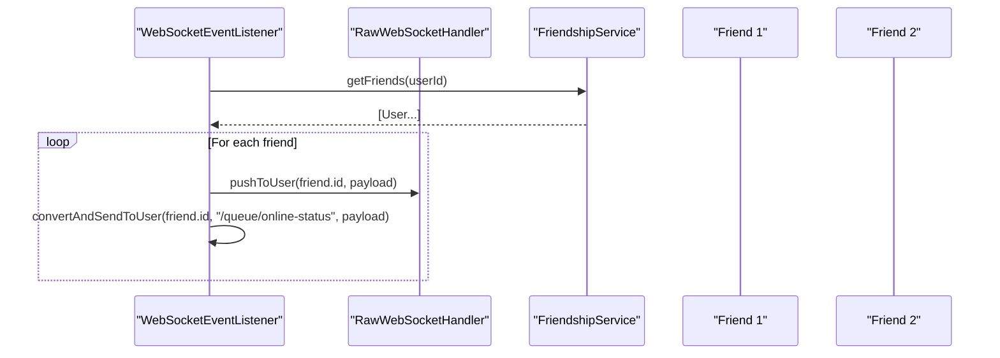
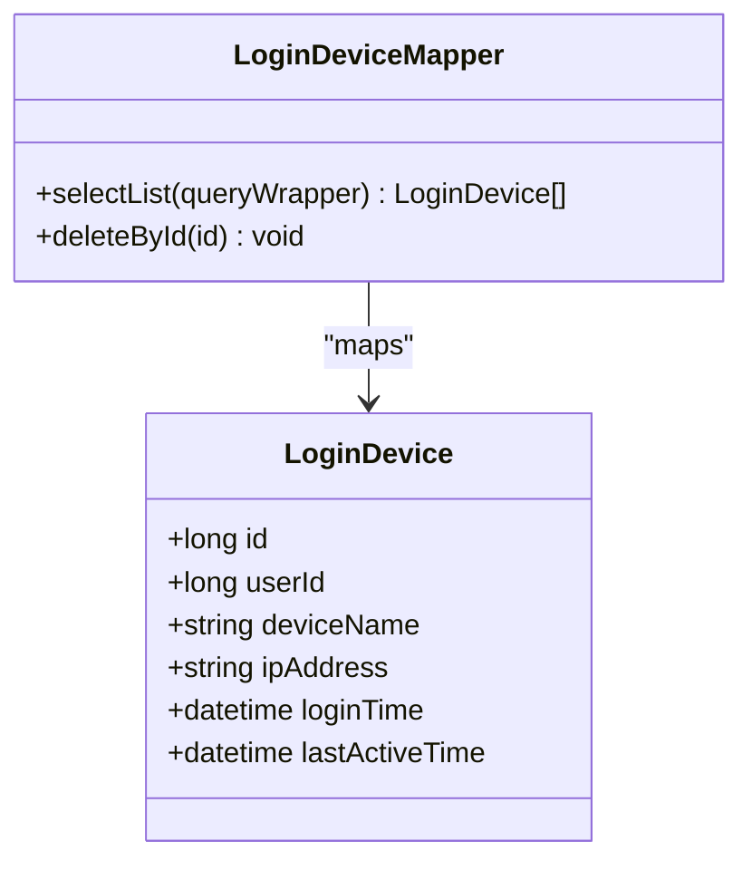
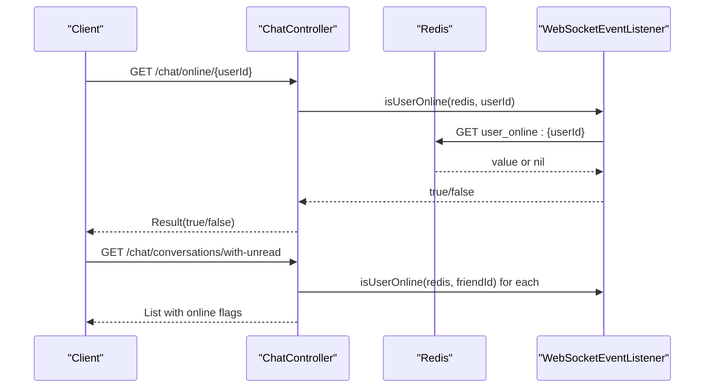
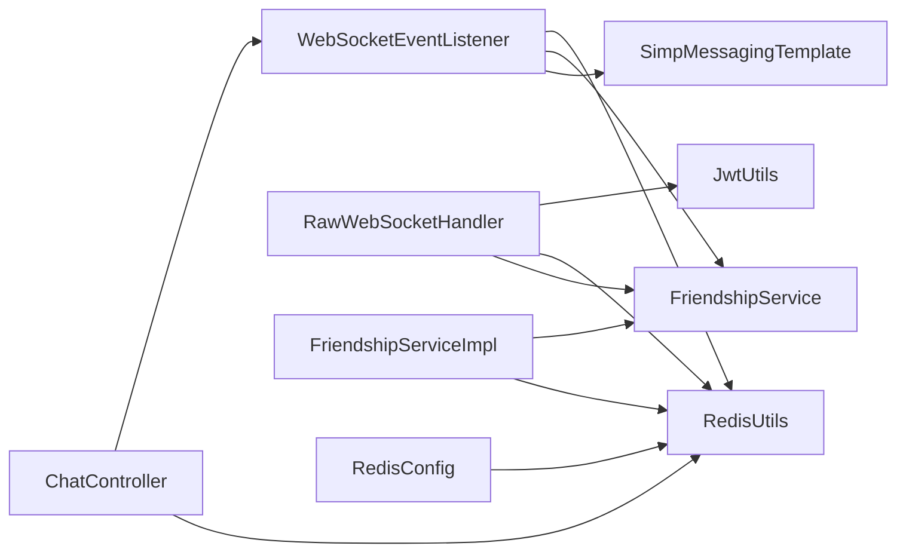

# Online Status Tracking and Presence

<cite>
**Referenced Files in This Document**
- [WebSocketEventListener.java](file://camp-channel-server/src/main/java/com/gdmec/campchannel/config/WebSocketEventListener.java)
- [RawWebSocketHandler.java](file://camp-channel-server/src/main/java/com/gdmec/campchannel/config/RawWebSocketHandler.java)
- [RedisUtils.java](file://camp-channel-server/src/main/java/com/gdmec/campchannel/common/utils/RedisUtils.java)
- [RedisConfig.java](file://camp-channel-server/src/main/java/com/gdmec/campchannel/config/RedisConfig.java)
- [FriendshipService.java](file://camp-channel-server/src/main/java/com/gdmec/campchannel/service/FriendshipService.java)
- [FriendshipServiceImpl.java](file://camp-channel-server/src/main/java/com/gdmec/campchannel/service/impl/FriendshipServiceImpl.java)
- [UserController.java](file://camp-channel-server/src/main/java/com/gdmec/campchannel/controller/UserController.java)
- [ChatController.java](file://camp-channel-server/src/main/java/com/gdmec/campchannel/controller/ChatController.java)
- [LoginDevice.java](file://camp-channel-server/src/main/java/com/gdmec/campchannel/entity/LoginDevice.java)
- [LoginDeviceMapper.java](file://camp-channel-server/src/main/java/com/gdmec/campchannel/mapper/LoginDeviceMapper.java)
- [application.yml](file://camp-channel-server/src/main/resources/application.yml)
- [websocket_service.dart](file://camp-channel-client-flutter/lib/core/services/websocket_service.dart)
- [ChatPage.vue](file://camp-channel-client-pc/src/pages/ChatPage.vue)
- [friend_list_page.dart](file://camp-channel-client-flutter/lib/pages/friend_list_page.dart)
</cite>

## Table of Contents
1. [Introduction](#introduction)
2. [Project Structure](#project-structure)
3. [Core Components](#core-components)
4. [Architecture Overview](#architecture-overview)
5. [Detailed Component Analysis](#detailed-component-analysis)
6. [Dependency Analysis](#dependency-analysis)
7. [Performance Considerations](#performance-considerations)
8. [Troubleshooting Guide](#troubleshooting-guide)
9. [Conclusion](#conclusion)
10. [Appendices](#appendices)

## Introduction
This document explains the online status tracking and presence system used by the platform. It covers how WebSocket connections are used to detect user online/offline events, how Redis is leveraged to maintain presence state, and how real-time presence updates are synchronized across clients. It also documents the LoginDevice entity’s role in tracking sessions across multiple devices, and how online status integrates with chat functionality such as friend lists and conversation displays.

## Project Structure
The presence system spans server-side Spring components and client-side integrations:
- WebSocket event listeners and handlers manage connection lifecycle and broadcast presence updates.
- Redis-backed utilities persist online indicators with short TTLs.
- Services and controllers expose REST endpoints for online status queries and batch checks.
- Clients subscribe to real-time updates via both raw WebSocket and STOMP/SockJS.

**Diagram sources**
- [WebSocketEventListener.java:1-91](file://camp-channel-server/src/main/java/com/gdmec/campchannel/config/WebSocketEventListener.java#L1-L91)
- [RawWebSocketHandler.java:1-171](file://camp-channel-server/src/main/java/com/gdmec/campchannel/config/RawWebSocketHandler.java#L1-L171)
- [RedisUtils.java:1-170](file://camp-channel-server/src/main/java/com/gdmec/campchannel/common/utils/RedisUtils.java#L1-L170)
- [FriendshipService.java:1-55](file://camp-channel-server/src/main/java/com/gdmec/campchannel/service/FriendshipService.java#L1-L55)
- [ChatController.java:1-166](file://camp-channel-server/src/main/java/com/gdmec/campchannel/controller/ChatController.java#L1-L166)
- [UserController.java:1-393](file://camp-channel-server/src/main/java/com/gdmec/campchannel/controller/UserController.java#L1-L393)

**Section sources**
- [application.yml:31-42](file://camp-channel-server/src/main/resources/application.yml#L31-L42)

## Core Components
- WebSocketEventListener: Reacts to STOMP session connect/disconnect events, sets Redis online markers with TTL, and notifies friends via both raw WebSocket and STOMP user queues.
- RawWebSocketHandler: Manages raw WebSocket connections, authenticates via JWT from query string, tracks per-user sessions, and mirrors online state in Redis.
- RedisUtils: Provides Redis operations including string keys, TTL, and sliding-window rate limiting.
- FriendshipService and FriendshipServiceImpl: Retrieve friend lists used to fan-out presence notifications.
- ChatController: Exposes REST endpoints to query single and batch online status.
- LoginDevice and LoginDeviceMapper: Persist device-level login records for multi-device session tracking.

**Section sources**
- [WebSocketEventListener.java:1-91](file://camp-channel-server/src/main/java/com/gdmec/campchannel/config/WebSocketEventListener.java#L1-L91)
- [RawWebSocketHandler.java:1-171](file://camp-channel-server/src/main/java/com/gdmec/campchannel/config/RawWebSocketHandler.java#L1-L171)
- [RedisUtils.java:1-170](file://camp-channel-server/src/main/java/com/gdmec/campchannel/common/utils/RedisUtils.java#L1-L170)
- [FriendshipService.java:1-55](file://camp-channel-server/src/main/java/com/gdmec/campchannel/service/FriendshipService.java#L1-L55)
- [FriendshipServiceImpl.java:150-176](file://camp-channel-server/src/main/java/com/gdmec/campchannel/service/impl/FriendshipServiceImpl.java#L150-L176)
- [ChatController.java:32-52](file://camp-channel-server/src/main/java/com/gdmec/campchannel/controller/ChatController.java#L32-L52)
- [LoginDevice.java:1-27](file://camp-channel-server/src/main/java/com/gdmec/campchannel/entity/LoginDevice.java#L1-L27)
- [LoginDeviceMapper.java:1-10](file://camp-channel-server/src/main/java/com/gdmec/campchannel/mapper/LoginDeviceMapper.java#L1-L10)

## Architecture Overview
The presence system combines two WebSocket transports:
- STOMP over SockJS for PC web clients.
- Raw WebSocket for Flutter clients.

Both transports trigger Redis-based online markers with TTL. When a user connects or disconnects, the system:
- Writes/Deletes a Redis key with a short TTL.
- Retrieves friend lists and pushes presence updates to each friend’s active connections.

**Diagram sources**
- [WebSocketEventListener.java:32-62](file://camp-channel-server/src/main/java/com/gdmec/campchannel/config/WebSocketEventListener.java#L32-L62)
- [RawWebSocketHandler.java:41-102](file://camp-channel-server/src/main/java/com/gdmec/campchannel/config/RawWebSocketHandler.java#L41-L102)
- [ChatController.java:32-52](file://camp-channel-server/src/main/java/com/gdmec/campchannel/controller/ChatController.java#L32-L52)

## Detailed Component Analysis

### WebSocketEventListener
Responsibilities:
- On connect: extract user from STOMP headers, set Redis online marker with TTL, notify friends via raw WebSocket and STOMP user queues.
- On disconnect: clear Redis online marker, notify friends of offline status.
- Utility method to check online status using Redis.

Key behaviors:
- Uses a Redis key prefix for online markers.
- Builds a standardized payload for presence updates.
- Sends to both raw WebSocket and STOMP user queues to support multiple client types.

**Diagram sources**
- [WebSocketEventListener.java:32-62](file://camp-channel-server/src/main/java/com/gdmec/campchannel/config/WebSocketEventListener.java#L32-L62)

**Section sources**
- [WebSocketEventListener.java:30-90](file://camp-channel-server/src/main/java/com/gdmec/campchannel/config/WebSocketEventListener.java#L30-L90)

### RawWebSocketHandler
Responsibilities:
- Authenticate via JWT from query string.
- Track active sessions per user in memory.
- On connect: set online marker in Redis with TTL, notify friends.
- On close/transport error: remove session and clear Redis marker only if no remaining sessions, notify friends offline.
- Provide push utilities to send JSON payloads to specific users or lists.

**Diagram sources**
- [RawWebSocketHandler.java:41-114](file://camp-channel-server/src/main/java/com/gdmec/campchannel/config/RawWebSocketHandler.java#L41-L114)

**Section sources**
- [RawWebSocketHandler.java:24-171](file://camp-channel-server/src/main/java/com/gdmec/campchannel/config/RawWebSocketHandler.java#L24-L171)

### Redis-based Presence System
- Online marker key format: user_online:{userId}.
- TTL: 300 seconds (5 minutes) to tolerate brief network hiccups.
- Presence checks: direct GET on the online key.
- Batch checks: iterate provided IDs and query Redis for each.
- Expiration handling: relies on Redis TTL to auto-clean stale entries.

**Diagram sources**
- [WebSocketEventListener.java:64-66](file://camp-channel-server/src/main/java/com/gdmec/campchannel/config/WebSocketEventListener.java#L64-L66)
- [ChatController.java:38-52](file://camp-channel-server/src/main/java/com/gdmec/campchannel/controller/ChatController.java#L38-L52)

**Section sources**
- [WebSocketEventListener.java:30-66](file://camp-channel-server/src/main/java/com/gdmec/campchannel/config/WebSocketEventListener.java#L30-L66)
- [ChatController.java:32-52](file://camp-channel-server/src/main/java/com/gdmec/campchannel/controller/ChatController.java#L32-L52)
- [RedisUtils.java:67-95](file://camp-channel-server/src/main/java/com/gdmec/campchannel/common/utils/RedisUtils.java#L67-L95)

### Friendship Integration and Fan-out
Presence updates are sent to a user’s friends:
- Fetch friend list via FriendshipService.
- For each friend, push presence payload to:
  - Raw WebSocket (for Flutter).
  - STOMP user queue (for PC web).

**Diagram sources**
- [WebSocketEventListener.java:68-89](file://camp-channel-server/src/main/java/com/gdmec/campchannel/config/WebSocketEventListener.java#L68-L89)
- [RawWebSocketHandler.java:151-162](file://camp-channel-server/src/main/java/com/gdmec/campchannel/config/RawWebSocketHandler.java#L151-L162)
- [FriendshipService.java:33-34](file://camp-channel-server/src/main/java/com/gdmec/campchannel/service/FriendshipService.java#L33-L34)

**Section sources**
- [WebSocketEventListener.java:68-89](file://camp-channel-server/src/main/java/com/gdmec/campchannel/config/WebSocketEventListener.java#L68-L89)
- [RawWebSocketHandler.java:151-162](file://camp-channel-server/src/main/java/com/gdmec/campchannel/config/RawWebSocketHandler.java#L151-L162)
- [FriendshipServiceImpl.java:150-176](file://camp-channel-server/src/main/java/com/gdmec/campchannel/service/impl/FriendshipServiceImpl.java#L150-L176)

### LoginDevice Entity and Multi-device Sessions
- Purpose: Track login devices for a user, including device name, IP address, login time, and last active time.
- Role in presence: While LoginDevice does not directly store online state, it enables:
  - Device-level management (listing devices, remote logout).
  - Detecting concurrent sessions across devices.
  - Supporting audit and security policies.

**Diagram sources**
- [LoginDevice.java:1-27](file://camp-channel-server/src/main/java/com/gdmec/campchannel/entity/LoginDevice.java#L1-L27)
- [LoginDeviceMapper.java:1-10](file://camp-channel-server/src/main/java/com/gdmec/campchannel/mapper/LoginDeviceMapper.java#L1-L10)

**Section sources**
- [LoginDevice.java:10-26](file://camp-channel-server/src/main/java/com/gdmec/campchannel/entity/LoginDevice.java#L10-L26)
- [UserController.java:356-378](file://camp-channel-server/src/main/java/com/gdmec/campchannel/controller/UserController.java#L356-L378)

### Online Status in Chat Functionality
- Single user query: GET /chat/online/{userId} returns boolean.
- Batch query: GET /chat/online/batch?id=1,2,3 returns map of id to online status.
- Conversation list: GET /chat/conversations/with-unread includes online status for each contact.
- Real-time updates: Clients subscribe to:
  - Flutter: Raw WebSocket online_status events.
  - PC web: STOMP /user/queue/online-status.

**Diagram sources**
- [ChatController.java:32-52](file://camp-channel-server/src/main/java/com/gdmec/campchannel/controller/ChatController.java#L32-L52)
- [ChatController.java:100-123](file://camp-channel-server/src/main/java/com/gdmec/campchannel/controller/ChatController.java#L100-L123)
- [WebSocketEventListener.java:64-66](file://camp-channel-server/src/main/java/com/gdmec/campchannel/config/WebSocketEventListener.java#L64-L66)

**Section sources**
- [ChatController.java:32-52](file://camp-channel-server/src/main/java/com/gdmec/campchannel/controller/ChatController.java#L32-L52)
- [ChatController.java:100-123](file://camp-channel-server/src/main/java/com/gdmec/campchannel/controller/ChatController.java#L100-L123)

### Client Integrations
- Flutter client subscribes to online_status events via Raw WebSocket and renders online indicators.
- PC web client subscribes to /user/queue/online-status via STOMP and updates UI accordingly.

**Section sources**
- [websocket_service.dart:23-30](file://camp-channel-client-flutter/lib/core/services/websocket_service.dart#L23-L30)
- [ChatPage.vue:96-120](file://camp-channel-client-pc/src/pages/ChatPage.vue#L96-L120)
- [friend_list_page.dart:283-300](file://camp-channel-client-flutter/lib/pages/friend_list_page.dart#L283-L300)

## Dependency Analysis
- WebSocketEventListener depends on:
  - RedisUtils for online marker operations.
  - FriendshipService to fetch friend lists.
  - SimpMessagingTemplate for STOMP user queue broadcasts.
- RawWebSocketHandler depends on:
  - JwtUtils for token parsing.
  - RedisUtils for online marker operations.
  - FriendshipService to notify friends.
- ChatController depends on:
  - WebSocketEventListener utility for online checks.
  - RedisUtils for batch queries.
- RedisConfig configures RedisTemplate serialization.

**Diagram sources**
- [WebSocketEventListener.java:21-28](file://camp-channel-server/src/main/java/com/gdmec/campchannel/config/WebSocketEventListener.java#L21-L28)
- [RawWebSocketHandler.java:30-37](file://camp-channel-server/src/main/java/com/gdmec/campchannel/config/RawWebSocketHandler.java#L30-L37)
- [ChatController.java:26-30](file://camp-channel-server/src/main/java/com/gdmec/campchannel/controller/ChatController.java#L26-L30)
- [FriendshipServiceImpl.java:25-38](file://camp-channel-server/src/main/java/com/gdmec/campchannel/service/impl/FriendshipServiceImpl.java#L25-L38)
- [RedisConfig.java:20-45](file://camp-channel-server/src/main/java/com/gdmec/campchannel/config/RedisConfig.java#L20-L45)

**Section sources**
- [WebSocketEventListener.java:21-28](file://camp-channel-server/src/main/java/com/gdmec/campchannel/config/WebSocketEventListener.java#L21-L28)
- [RawWebSocketHandler.java:30-37](file://camp-channel-server/src/main/java/com/gdmec/campchannel/config/RawWebSocketHandler.java#L30-L37)
- [ChatController.java:26-30](file://camp-channel-server/src/main/java/com/gdmec/campchannel/controller/ChatController.java#L26-L30)
- [FriendshipServiceImpl.java:25-38](file://camp-channel-server/src/main/java/com/gdmec/campchannel/service/impl/FriendshipServiceImpl.java#L25-L38)
- [RedisConfig.java:20-45](file://camp-channel-server/src/main/java/com/gdmec/campchannel/config/RedisConfig.java#L20-L45)

## Performance Considerations
- Redis TTL strategy: Short TTL (5 minutes) balances accuracy with cleanup overhead. Consider adjusting based on expected session churn.
- Fan-out cost: Presence updates fan out to each friend’s active connections. For users with many friends, consider batching or rate-limiting notifications.
- Connection tracking:
  - STOMP: Event-driven connect/disconnect ensures minimal polling.
  - Raw WebSocket: Maintains in-memory session map keyed by userId; clears Redis only when no sessions remain.
- Serialization: RedisConfig uses JSON serializer for values; keep payloads small (current payload is minimal).
- Batch queries: ChatController’s batch endpoint aggregates results server-side, reducing client-side round-trips.
- Rate limiting: RedisUtils includes a sliding window limiter suitable for guarding expensive operations; consider applying similar patterns to presence-related endpoints if needed.

[No sources needed since this section provides general guidance]

## Troubleshooting Guide
Common issues and remedies:
- Presence not updating:
  - Verify WebSocket connections are established and authenticated.
  - Confirm Redis connectivity and that TTL keys are being written/deleted.
- Offline indicator persists:
  - Check transport error handling in RawWebSocketHandler; ensure afterConnectionClosed removes sessions and clears Redis when no sessions remain.
- STOMP offline notifications missing:
  - Ensure clients subscribe to /user/queue/online-status.
- Batch queries returning empty/false:
  - Confirm userIds are numeric and within expected range.
- Redis connectivity failures:
  - Review application.yml Redis settings and network configuration.

**Section sources**
- [RawWebSocketHandler.java:90-114](file://camp-channel-server/src/main/java/com/gdmec/campchannel/config/RawWebSocketHandler.java#L90-L114)
- [application.yml:31-42](file://camp-channel-server/src/main/resources/application.yml#L31-L42)
- [ChatPage.vue:96-120](file://camp-channel-client-pc/src/pages/ChatPage.vue#L96-L120)

## Conclusion
The presence system leverages dual WebSocket transports and Redis to deliver accurate, real-time online status across clients. WebSocketEventListener and RawWebSocketHandler synchronize presence state, while Redis provides lightweight persistence with automatic expiration. FriendshipService powers targeted fan-out notifications, and REST endpoints enable both single and batch online checks. Together, these components integrate tightly with chat features to enrich user experiences with live presence indicators.

[No sources needed since this section summarizes without analyzing specific files]

## Appendices

### API Definitions
- GET /chat/online/{userId}
  - Description: Query whether a user is online.
  - Response: Boolean indicating online status.
- GET /chat/online/batch
  - Description: Batch query online status for a comma-separated list of user IDs.
  - Query param: userIds (comma-separated).
  - Response: Map of {userId: boolean}.

**Section sources**
- [ChatController.java:32-52](file://camp-channel-server/src/main/java/com/gdmec/campchannel/controller/ChatController.java#L32-L52)

### Client Subscription Examples
- Flutter:
  - Subscribes to online_status events via Raw WebSocket and updates UI with online dot and label.
- PC Web:
  - Subscribes to /user/queue/online-status via STOMP and updates presence indicators.

**Section sources**
- [websocket_service.dart:23-30](file://camp-channel-client-flutter/lib/core/services/websocket_service.dart#L23-L30)
- [ChatPage.vue:96-120](file://camp-channel-client-pc/src/pages/ChatPage.vue#L96-L120)
- [friend_list_page.dart:283-300](file://camp-channel-client-flutter/lib/pages/friend_list_page.dart#L283-L300)