# Real-time Communication System

<cite>
**Referenced Files in This Document**
- [WebSocketConfig.java](file://camp-channel-server/src/main/java/com/gdmec/campchannel/config/WebSocketConfig.java)
- [RawWebSocketConfig.java](file://camp-channel-server/src/main/java/com/gdmec/campchannel/config/RawWebSocketConfig.java)
- [RawWebSocketHandler.java](file://camp-channel-server/src/main/java/com/gdmec/campchannel/config/RawWebSocketHandler.java)
- [WebSocketEventListener.java](file://camp-channel-server/src/main/java/com/gdmec/campchannel/config/WebSocketEventListener.java)
- [RedisConfig.java](file://camp-channel-server/src/main/java/com/gdmec/campchannel/config/RedisConfig.java)
- [ChatController.java](file://camp-channel-server/src/main/java/com/gdmec/campchannel/controller/ChatController.java)
- [GroupMessageController.java](file://camp-channel-server/src/main/java/com/gdmec/campchannel/controller/GroupMessageController.java)
- [MessageServiceImpl.java](file://camp-channel-server/src/main/java/com/gdmec/campchannel/service/impl/MessageServiceImpl.java)
- [GroupMessageServiceImpl.java](file://camp-channel-server/src/main/java/com/gdmec/campchannel/service/impl/GroupMessageServiceImpl.java)
- [RedisUtils.java](file://camp-channel-server/src/main/java/com/gdmec/campchannel/common/utils/RedisUtils.java)
- [application.yml](file://camp-channel-server/src/main/resources/application.yml)
- [ChatPage.vue](file://camp-channel-client-pc/src/pages/ChatPage.vue)
- [websocket.ts](file://camp-channel-client-uniapp/src/utils/websocket.ts)
- [main.dart](file://camp-channel-client-flutter/lib/main.dart)
</cite>

## Table of Contents
1. [Introduction](#introduction)
2. [Project Structure](#project-structure)
3. [Core Components](#core-components)
4. [Architecture Overview](#architecture-overview)
5. [Detailed Component Analysis](#detailed-component-analysis)
6. [Dependency Analysis](#dependency-analysis)
7. [Performance Considerations](#performance-considerations)
8. [Troubleshooting Guide](#troubleshooting-guide)
9. [Conclusion](#conclusion)
10. [Appendices](#appendices)

## Introduction
This document explains the real-time communication system architecture built on WebSocket technology. It covers one-on-one and group chat implementations, WebSocket configuration with STOMP endpoints, message broadcasting patterns, Redis-backed online status tracking, and real-time UI updates across Vue.js, UniApp, and Flutter clients. It also documents message persistence, delivery confirmation mechanisms, and operational guidance for connection management, ordering guarantees, offline handling, scaling, memory management, and monitoring.

## Project Structure
The real-time system spans a Spring Boot backend and three frontend clients:
- Backend: WebSocket configuration, STOMP broker, raw WebSocket handler, controllers, services, Redis utilities, and application configuration.
- Frontends:
  - Vue.js desktop client using STOMP over SockJS for real-time updates.
  - UniApp mini-program client using raw WebSocket for cross-platform compatibility.
  - Flutter mobile client integrating WebSocket connectivity and routing.

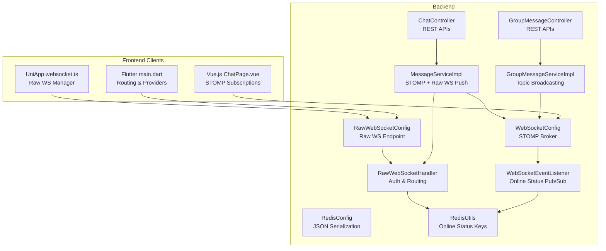

**Diagram sources**
- [WebSocketConfig.java:13-35](file://camp-channel-server/src/main/java/com/gdmec/campchannel/config/WebSocketConfig.java#L13-L35)
- [RawWebSocketConfig.java:10-22](file://camp-channel-server/src/main/java/com/gdmec/campchannel/config/RawWebSocketConfig.java#L10-L22)
- [RawWebSocketHandler.java:24-171](file://camp-channel-server/src/main/java/com/gdmec/campchannel/config/RawWebSocketHandler.java#L24-L171)
- [WebSocketEventListener.java:19-91](file://camp-channel-server/src/main/java/com/gdmec/campchannel/config/WebSocketEventListener.java#L19-L91)
- [ChatController.java:24-166](file://camp-channel-server/src/main/java/com/gdmec/campchannel/controller/ChatController.java#L24-L166)
- [GroupMessageController.java:21-71](file://camp-channel-server/src/main/java/com/gdmec/campchannel/controller/GroupMessageController.java#L21-L71)
- [MessageServiceImpl.java:31-220](file://camp-channel-server/src/main/java/com/gdmec/campchannel/service/impl/MessageServiceImpl.java#L31-L220)
- [GroupMessageServiceImpl.java:26-127](file://camp-channel-server/src/main/java/com/gdmec/campchannel/service/impl/GroupMessageServiceImpl.java#L26-L127)
- [RedisConfig.java:18-46](file://camp-channel-server/src/main/java/com/gdmec/campchannel/config/RedisConfig.java#L18-L46)
- [RedisUtils.java:17-170](file://camp-channel-server/src/main/java/com/gdmec/campchannel/common/utils/RedisUtils.java#L17-L170)
- [ChatPage.vue:89-127](file://camp-channel-client-pc/src/pages/ChatPage.vue#L89-L127)
- [websocket.ts:23-129](file://camp-channel-client-uniapp/src/utils/websocket.ts#L23-L129)
- [main.dart:21-122](file://camp-channel-client-flutter/lib/main.dart#L21-L122)

**Section sources**
- [WebSocketConfig.java:13-35](file://camp-channel-server/src/main/java/com/gdmec/campchannel/config/WebSocketConfig.java#L13-L35)
- [RawWebSocketConfig.java:10-22](file://camp-channel-server/src/main/java/com/gdmec/campchannel/config/RawWebSocketConfig.java#L10-L22)
- [RawWebSocketHandler.java:24-171](file://camp-channel-server/src/main/java/com/gdmec/campchannel/config/RawWebSocketHandler.java#L24-L171)
- [WebSocketEventListener.java:19-91](file://camp-channel-server/src/main/java/com/gdmec/campchannel/config/WebSocketEventListener.java#L19-L91)
- [ChatController.java:24-166](file://camp-channel-server/src/main/java/com/gdmec/campchannel/controller/ChatController.java#L24-L166)
- [GroupMessageController.java:21-71](file://camp-channel-server/src/main/java/com/gdmec/campchannel/controller/GroupMessageController.java#L21-L71)
- [MessageServiceImpl.java:31-220](file://camp-channel-server/src/main/java/com/gdmec/campchannel/service/impl/MessageServiceImpl.java#L31-L220)
- [GroupMessageServiceImpl.java:26-127](file://camp-channel-server/src/main/java/com/gdmec/campchannel/service/impl/GroupMessageServiceImpl.java#L26-L127)
- [RedisConfig.java:18-46](file://camp-channel-server/src/main/java/com/gdmec/campchannel/config/RedisConfig.java#L18-L46)
- [RedisUtils.java:17-170](file://camp-channel-server/src/main/java/com/gdmec/campchannel/common/utils/RedisUtils.java#L17-L170)
- [application.yml:31-42](file://camp-channel-server/src/main/resources/application.yml#L31-L42)
- [ChatPage.vue:89-127](file://camp-channel-client-pc/src/pages/ChatPage.vue#L89-L127)
- [websocket.ts:23-129](file://camp-channel-client-uniapp/src/utils/websocket.ts#L23-L129)
- [main.dart:21-122](file://camp-channel-client-flutter/lib/main.dart#L21-L122)

## Core Components
- STOMP WebSocket stack for browser/desktop clients:
  - WebSocket configuration enables a simple broker for topics and queues, with user-specific destinations and application prefixes.
  - Authentication interceptor ensures requests are bound to a principal.
  - STOMP endpoint exposed via SockJS for broad browser compatibility.
- Raw WebSocket stack for mobile/mini-program clients:
  - Dedicated raw WebSocket endpoint secured via JWT token in query string.
  - Session management, authentication, and online status propagation.
- Controllers:
  - REST endpoints for one-on-one chat (send, history, recall, unread counts, read receipts).
  - REST endpoints for group messages (send, fetch, recall).
- Services:
  - One-on-one messaging pushes via STOMP user queue and raw WebSocket for dual-client support.
  - Group messaging publishes to topic channels for scalable broadcast.
- Redis:
  - JSON serialization for values, sliding window rate limiting, and online status keys with TTL.

**Section sources**
- [WebSocketConfig.java:13-35](file://camp-channel-server/src/main/java/com/gdmec/campchannel/config/WebSocketConfig.java#L13-L35)
- [RawWebSocketConfig.java:10-22](file://camp-channel-server/src/main/java/com/gdmec/campchannel/config/RawWebSocketConfig.java#L10-L22)
- [RawWebSocketHandler.java:24-171](file://camp-channel-server/src/main/java/com/gdmec/campchannel/config/RawWebSocketHandler.java#L24-L171)
- [ChatController.java:24-166](file://camp-channel-server/src/main/java/com/gdmec/campchannel/controller/ChatController.java#L24-L166)
- [GroupMessageController.java:21-71](file://camp-channel-server/src/main/java/com/gdmec/campchannel/controller/GroupMessageController.java#L21-L71)
- [MessageServiceImpl.java:31-220](file://camp-channel-server/src/main/java/com/gdmec/campchannel/service/impl/MessageServiceImpl.java#L31-L220)
- [GroupMessageServiceImpl.java:26-127](file://camp-channel-server/src/main/java/com/gdmec/campchannel/service/impl/GroupMessageServiceImpl.java#L26-L127)
- [RedisConfig.java:18-46](file://camp-channel-server/src/main/java/com/gdmec/campchannel/config/RedisConfig.java#L18-L46)
- [RedisUtils.java:17-170](file://camp-channel-server/src/main/java/com/gdmec/campchannel/common/utils/RedisUtils.java#L17-L170)

## Architecture Overview
The system supports two complementary real-time pathways:
- STOMP over SockJS for Vue.js desktop client:
  - Messages delivered to user-specific queues.
  - Online status updates broadcast to user queues.
- Raw WebSocket for Flutter and UniApp:
  - JWT-authenticated connections with custom JSON protocol.
  - Online status and message delivery pushed to individual sessions.

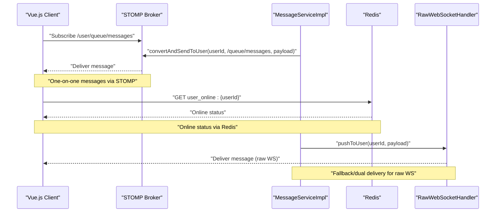

**Diagram sources**
- [WebSocketConfig.java:24-28](file://camp-channel-server/src/main/java/com/gdmec/campchannel/config/WebSocketConfig.java#L24-L28)
- [MessageServiceImpl.java:55-76](file://camp-channel-server/src/main/java/com/gdmec/campchannel/service/impl/MessageServiceImpl.java#L55-L76)
- [WebSocketEventListener.java:32-46](file://camp-channel-server/src/main/java/com/gdmec/campchannel/config/WebSocketEventListener.java#L32-L46)
- [RawWebSocketHandler.java:119-129](file://camp-channel-server/src/main/java/com/gdmec/campchannel/config/RawWebSocketHandler.java#L119-L129)

## Detailed Component Analysis

### STOMP WebSocket Configuration and Message Broker
- Enables a simple broker for topics and queues.
- Application destination prefix and user destination prefix define routing semantics.
- Registers a STOMP endpoint with SockJS for cross-browser compatibility.

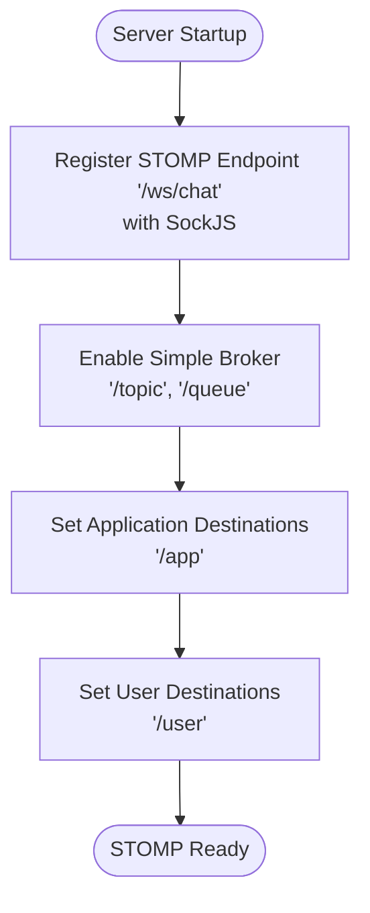

**Diagram sources**
- [WebSocketConfig.java:24-28](file://camp-channel-server/src/main/java/com/gdmec/campchannel/config/WebSocketConfig.java#L24-L28)
- [WebSocketConfig.java:31-35](file://camp-channel-server/src/main/java/com/gdmec/campchannel/config/WebSocketConfig.java#L31-L35)

**Section sources**
- [WebSocketConfig.java:13-35](file://camp-channel-server/src/main/java/com/gdmec/campchannel/config/WebSocketConfig.java#L13-L35)

### Raw WebSocket Endpoint and Authentication
- Dedicated raw WebSocket endpoint for clients that cannot use STOMP/SockJS.
- Authentication via JWT token in query string; sessions mapped by user ID.
- Maintains concurrent session map and sets Redis online status with TTL.
- Broadcasts online/offline status to friends via both raw WebSocket and STOMP user queues.

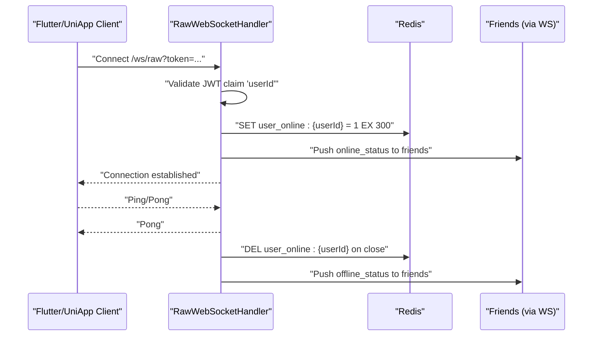

**Diagram sources**
- [RawWebSocketHandler.java:41-102](file://camp-channel-server/src/main/java/com/gdmec/campchannel/config/RawWebSocketHandler.java#L41-L102)
- [RawWebSocketHandler.java:151-162](file://camp-channel-server/src/main/java/com/gdmec/campchannel/config/RawWebSocketHandler.java#L151-L162)
- [WebSocketEventListener.java:32-62](file://camp-channel-server/src/main/java/com/gdmec/campchannel/config/WebSocketEventListener.java#L32-L62)

**Section sources**
- [RawWebSocketConfig.java:10-22](file://camp-channel-server/src/main/java/com/gdmec/campchannel/config/RawWebSocketConfig.java#L10-L22)
- [RawWebSocketHandler.java:24-171](file://camp-channel-server/src/main/java/com/gdmec/campchannel/config/RawWebSocketHandler.java#L24-L171)
- [WebSocketEventListener.java:19-91](file://camp-channel-server/src/main/java/com/gdmec/campchannel/config/WebSocketEventListener.java#L19-L91)

### One-on-One Messaging Flow
- REST endpoint accepts messages and persists them.
- Service sends via STOMP user queue for Vue.js clients and via raw WebSocket for Flutter/UniApp.
- Read receipts are pushed back to the sender via raw WebSocket upon read confirmation.

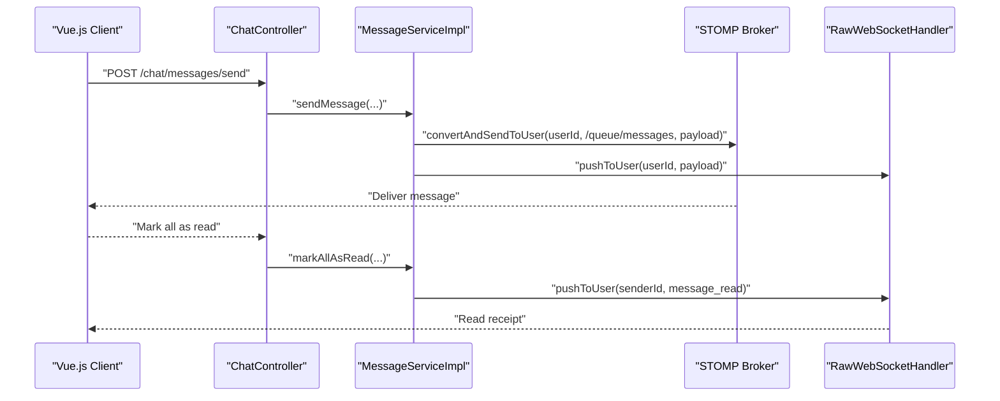

**Diagram sources**
- [ChatController.java:54-67](file://camp-channel-server/src/main/java/com/gdmec/campchannel/controller/ChatController.java#L54-L67)
- [MessageServiceImpl.java:44-94](file://camp-channel-server/src/main/java/com/gdmec/campchannel/service/impl/MessageServiceImpl.java#L44-L94)
- [MessageServiceImpl.java:184-203](file://camp-channel-server/src/main/java/com/gdmec/campchannel/service/impl/MessageServiceImpl.java#L184-L203)
- [ChatPage.vue:243-247](file://camp-channel-client-pc/src/pages/ChatPage.vue#L243-L247)

**Section sources**
- [ChatController.java:24-166](file://camp-channel-server/src/main/java/com/gdmec/campchannel/controller/ChatController.java#L24-L166)
- [MessageServiceImpl.java:31-220](file://camp-channel-server/src/main/java/com/gdmec/campchannel/service/impl/MessageServiceImpl.java#L31-L220)
- [ChatPage.vue:249-282](file://camp-channel-client-pc/src/pages/ChatPage.vue#L249-L282)

### Group Chat Messaging Flow
- REST endpoint validates membership and persists group message.
- Service publishes to a topic channel for all subscribers.
- Recall action updates message status and broadcasts recall signal to topic subscribers.

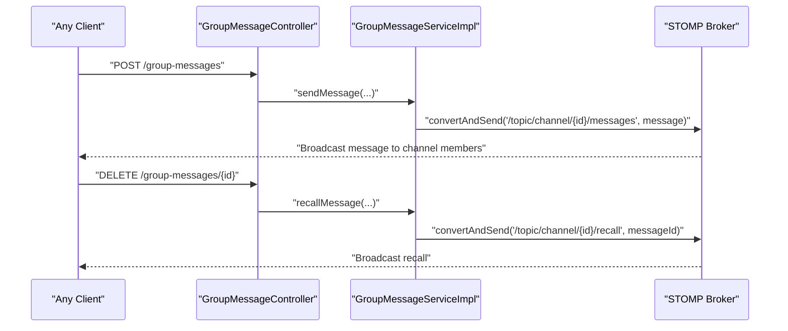

**Diagram sources**
- [GroupMessageController.java:26-40](file://camp-channel-server/src/main/java/com/gdmec/campchannel/controller/GroupMessageController.java#L26-L40)
- [GroupMessageServiceImpl.java:38-67](file://camp-channel-server/src/main/java/com/gdmec/campchannel/service/impl/GroupMessageServiceImpl.java#L38-L67)
- [GroupMessageServiceImpl.java:104-125](file://camp-channel-server/src/main/java/com/gdmec/campchannel/service/impl/GroupMessageServiceImpl.java#L104-L125)

**Section sources**
- [GroupMessageController.java:21-71](file://camp-channel-server/src/main/java/com/gdmec/campchannel/controller/GroupMessageController.java#L21-L71)
- [GroupMessageServiceImpl.java:26-127](file://camp-channel-server/src/main/java/com/gdmec/campchannel/service/impl/GroupMessageServiceImpl.java#L26-L127)

### Online Status Tracking and Propagation
- STOMP connect/disconnect events update Redis online keys with TTL.
- Event listener notifies friends via both raw WebSocket and STOMP user queues.
- Frontend queries batch online status via REST.

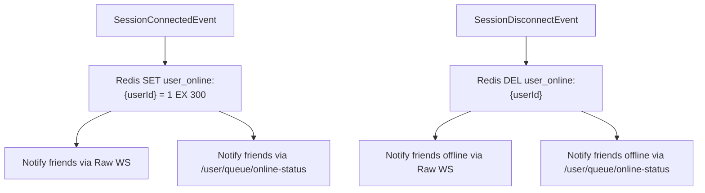

**Diagram sources**
- [WebSocketEventListener.java:32-62](file://camp-channel-server/src/main/java/com/gdmec/campchannel/config/WebSocketEventListener.java#L32-L62)
- [WebSocketEventListener.java:68-89](file://camp-channel-server/src/main/java/com/gdmec/campchannel/config/WebSocketEventListener.java#L68-L89)
- [ChatController.java:32-52](file://camp-channel-server/src/main/java/com/gdmec/campchannel/controller/ChatController.java#L32-L52)

**Section sources**
- [WebSocketEventListener.java:19-91](file://camp-channel-server/src/main/java/com/gdmec/campchannel/config/WebSocketEventListener.java#L19-L91)
- [ChatController.java:32-52](file://camp-channel-server/src/main/java/com/gdmec/campchannel/controller/ChatController.java#L32-L52)

### Client-Side Integration

#### Vue.js Desktop Client (STOMP)
- Establishes STOMP connection with optional Authorization header.
- Subscribes to user-specific queues for messages and online status.
- Updates UI in real-time and marks messages as read via REST.

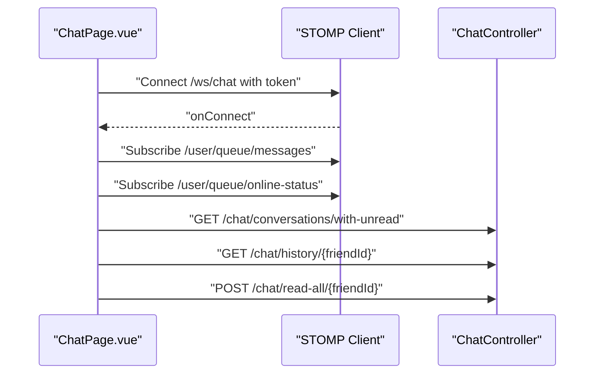

**Diagram sources**
- [ChatPage.vue:89-127](file://camp-channel-client-pc/src/pages/ChatPage.vue#L89-L127)
- [ChatPage.vue:202-247](file://camp-channel-client-pc/src/pages/ChatPage.vue#L202-L247)

**Section sources**
- [ChatPage.vue:65-344](file://camp-channel-client-pc/src/pages/ChatPage.vue#L65-L344)

#### UniApp Mini-Program Client (Raw WebSocket)
- Manages a singleton WebSocket manager with reconnection logic.
- Connects to raw endpoint with JWT token appended to query string.
- Dispatches messages to registered handlers by type.

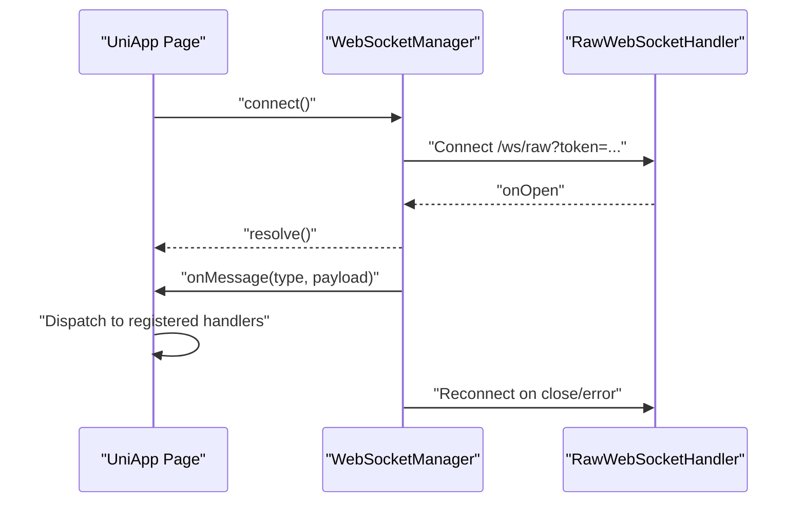

**Diagram sources**
- [websocket.ts:23-129](file://camp-channel-client-uniapp/src/utils/websocket.ts#L23-L129)
- [RawWebSocketHandler.java:41-102](file://camp-channel-server/src/main/java/com/gdmec/campchannel/config/RawWebSocketHandler.java#L41-L102)

**Section sources**
- [websocket.ts:1-268](file://camp-channel-client-uniapp/src/utils/websocket.ts#L1-L268)
- [RawWebSocketHandler.java:24-171](file://camp-channel-server/src/main/java/com/gdmec/campchannel/config/RawWebSocketHandler.java#L24-L171)

#### Flutter Client (Raw WebSocket)
- Application bootstrap initializes storage and providers.
- Uses raw WebSocket for real-time messaging alongside REST APIs.

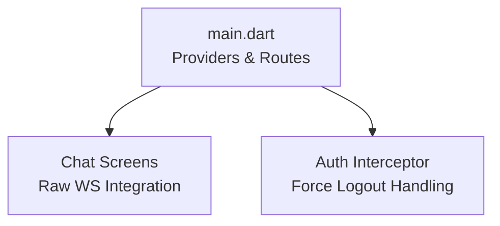

**Diagram sources**
- [main.dart:21-122](file://camp-channel-client-flutter/lib/main.dart#L21-L122)

**Section sources**
- [main.dart:21-122](file://camp-channel-client-flutter/lib/main.dart#L21-L122)

## Dependency Analysis
- Controllers depend on services for business logic and on Redis utilities for online status checks.
- Services depend on STOMP template for user/topic broadcasting and on raw WebSocket handler for dual delivery.
- WebSocket handlers depend on Redis utilities for online status and on friendship service for notifying friends.
- Redis configuration defines JSON serialization for values and keys.

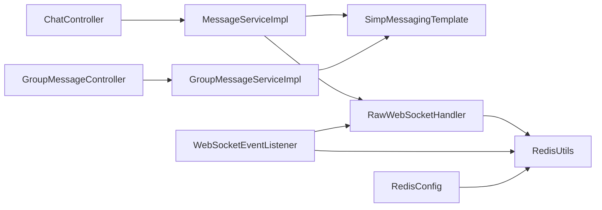

**Diagram sources**
- [ChatController.java:26-31](file://camp-channel-server/src/main/java/com/gdmec/campchannel/controller/ChatController.java#L26-L31)
- [GroupMessageController.java:23-24](file://camp-channel-server/src/main/java/com/gdmec/campchannel/controller/GroupMessageController.java#L23-L24)
- [MessageServiceImpl.java:39-40](file://camp-channel-server/src/main/java/com/gdmec/campchannel/service/impl/MessageServiceImpl.java#L39-L40)
- [GroupMessageServiceImpl.java](file://camp-channel-server/src/main/java/com/gdmec/campchannel/service/impl/GroupMessageServiceImpl.java#L35)
- [RawWebSocketHandler.java:30-37](file://camp-channel-server/src/main/java/com/gdmec/campchannel/config/RawWebSocketHandler.java#L30-L37)
- [WebSocketEventListener.java:21-28](file://camp-channel-server/src/main/java/com/gdmec/campchannel/config/WebSocketEventListener.java#L21-L28)
- [RedisConfig.java:20-45](file://camp-channel-server/src/main/java/com/gdmec/campchannel/config/RedisConfig.java#L20-L45)

**Section sources**
- [ChatController.java:24-166](file://camp-channel-server/src/main/java/com/gdmec/campchannel/controller/ChatController.java#L24-L166)
- [GroupMessageController.java:21-71](file://camp-channel-server/src/main/java/com/gdmec/campchannel/controller/GroupMessageController.java#L21-L71)
- [MessageServiceImpl.java:31-220](file://camp-channel-server/src/main/java/com/gdmec/campchannel/service/impl/MessageServiceImpl.java#L31-L220)
- [GroupMessageServiceImpl.java:26-127](file://camp-channel-server/src/main/java/com/gdmec/campchannel/service/impl/GroupMessageServiceImpl.java#L26-L127)
- [WebSocketEventListener.java:19-91](file://camp-channel-server/src/main/java/com/gdmec/campchannel/config/WebSocketEventListener.java#L19-L91)
- [RawWebSocketHandler.java:24-171](file://camp-channel-server/src/main/java/com/gdmec/campchannel/config/RawWebSocketHandler.java#L24-L171)
- [RedisConfig.java:18-46](file://camp-channel-server/src/main/java/com/gdmec/campchannel/config/RedisConfig.java#L18-L46)

## Performance Considerations
- Connection scaling:
  - STOMP/SockJS is optimized for browser environments; keep per-session overhead low.
  - Raw WebSocket reduces framing overhead for mobile/mini-programs.
- Memory management:
  - Maintain concurrent session maps keyed by user ID; ensure cleanup on close/transport error.
  - Avoid accumulating stale subscriptions; unsubscribe on component unmount.
- Redis usage:
  - Online status keys use short TTL; ensure consistent cleanup on disconnect.
  - Use JSON serialization for values to minimize parsing overhead.
- Broadcasting:
  - Prefer topic broadcasting for group messages; avoid per-user loops when unnecessary.
- Monitoring:
  - Track connection counts, message rates, and Redis key metrics.
  - Log transport errors and reconnection attempts for diagnostics.

[No sources needed since this section provides general guidance]

## Troubleshooting Guide
- Connection failures:
  - Verify STOMP endpoint and CORS settings; ensure SockJS is reachable.
  - For raw WebSocket, confirm JWT token presence and validity in query string.
- Message delivery gaps:
  - Confirm subscriptions to correct queues/topics; ensure user destinations match principal IDs.
  - Check service-level push logic for both STOMP and raw WebSocket paths.
- Online status anomalies:
  - Inspect Redis online keys and TTL; ensure event listeners set/clear keys on connect/disconnect.
- Offline handling:
  - REST endpoints provide chat history and unread counts; clients should poll or rely on push.
  - Implement exponential backoff for reconnection in raw WebSocket clients.

**Section sources**
- [RawWebSocketHandler.java:41-114](file://camp-channel-server/src/main/java/com/gdmec/campchannel/config/RawWebSocketHandler.java#L41-L114)
- [WebSocketEventListener.java:32-62](file://camp-channel-server/src/main/java/com/gdmec/campchannel/config/WebSocketEventListener.java#L32-L62)
- [ChatPage.vue:294-307](file://camp-channel-client-pc/src/pages/ChatPage.vue#L294-L307)
- [websocket.ts:232-253](file://camp-channel-client-uniapp/src/utils/websocket.ts#L232-L253)

## Conclusion
The system combines STOMP/SockJS for browser/desktop clients and raw WebSocket for mobile/mini-program clients, ensuring broad compatibility and efficient real-time delivery. Redis-backed online status tracking and dual delivery paths (STOMP + raw WebSocket) provide robust cross-platform messaging. Controllers and services encapsulate persistence and broadcasting, while frontend clients deliver responsive UI updates. Proper connection management, ordering via STOMP, and offline handling via REST complement the real-time pipeline for a resilient communication platform.

[No sources needed since this section summarizes without analyzing specific files]

## Appendices

### API Definitions

- One-on-one chat
  - GET /chat/online/{userId} → Boolean
  - GET /chat/online/batch → Map<Long, Boolean>
  - POST /chat/messages/send → Message
  - GET /chat/history/{friendId} → List<Message>
  - POST /chat/messages/{messageId}/recall → Void
  - GET /chat/conversations → List<Message>
  - GET /chat/conversations/with-unread → List<Map<String, Object>>
  - GET /chat/unread/{friendId} → Integer
  - POST /chat/read-all/{friendId} → Void

- Group messages
  - POST /group-messages → GroupMessage
  - GET /group-messages/{channelId} → List<GroupMessage>
  - DELETE /group-messages/{messageId} → Void

**Section sources**
- [ChatController.java:32-133](file://camp-channel-server/src/main/java/com/gdmec/campchannel/controller/ChatController.java#L32-L133)
- [GroupMessageController.java:26-61](file://camp-channel-server/src/main/java/com/gdmec/campchannel/controller/GroupMessageController.java#L26-L61)

### Configuration Highlights
- Redis connection and JSON serialization for values.
- Database and mail configuration for uploads and alerts.

**Section sources**
- [application.yml:31-42](file://camp-channel-server/src/main/resources/application.yml#L31-L42)
- [application.yml:13-24](file://camp-channel-server/src/main/resources/application.yml#L13-L24)
- [application.yml:49-66](file://camp-channel-server/src/main/resources/application.yml#L49-L66)