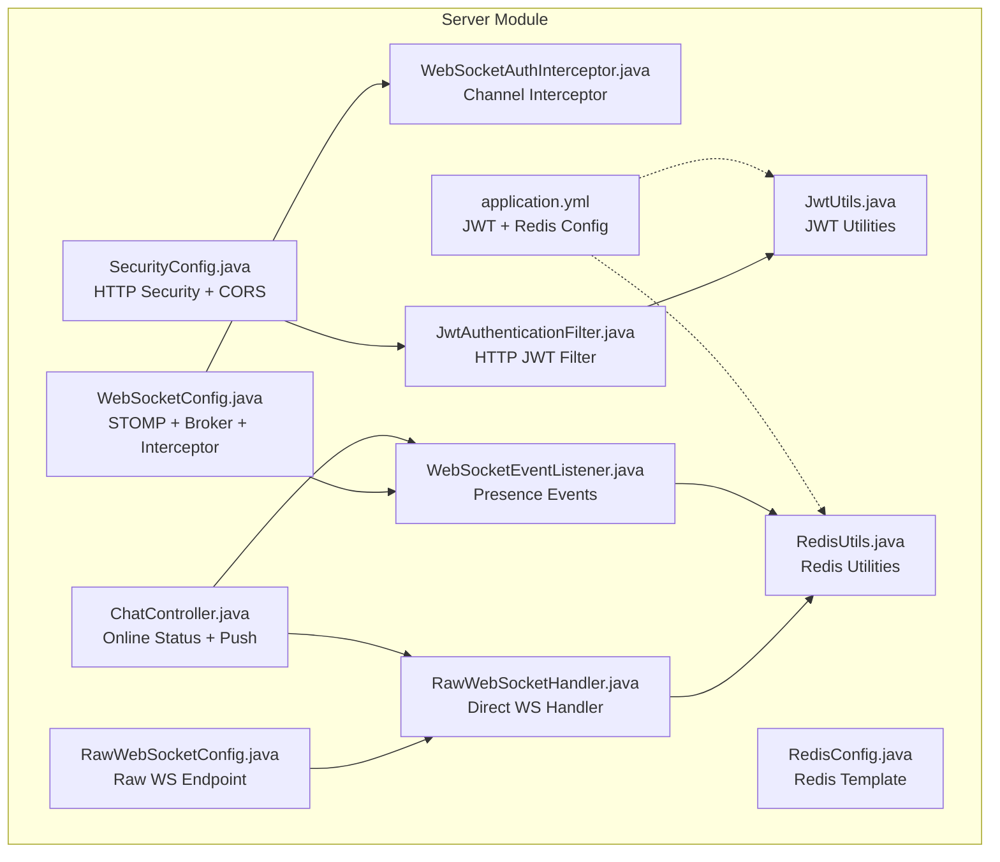
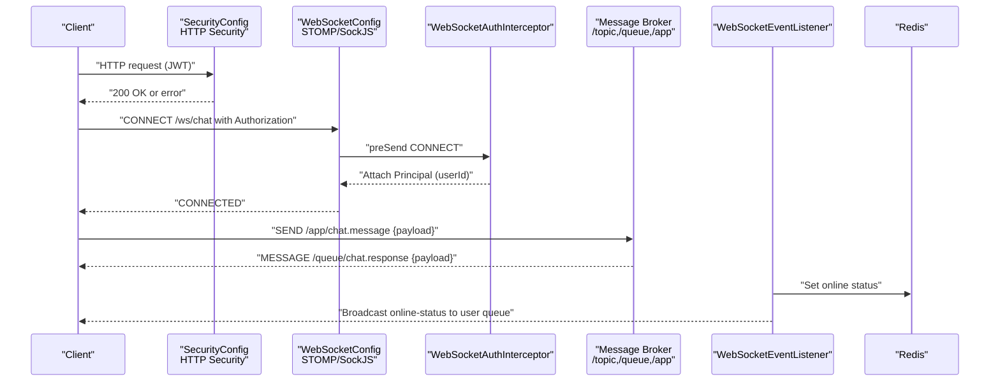
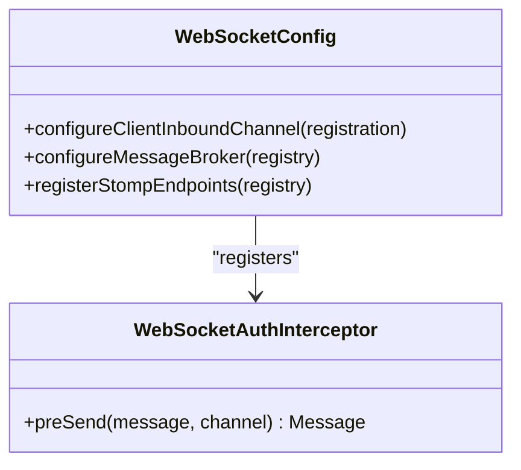
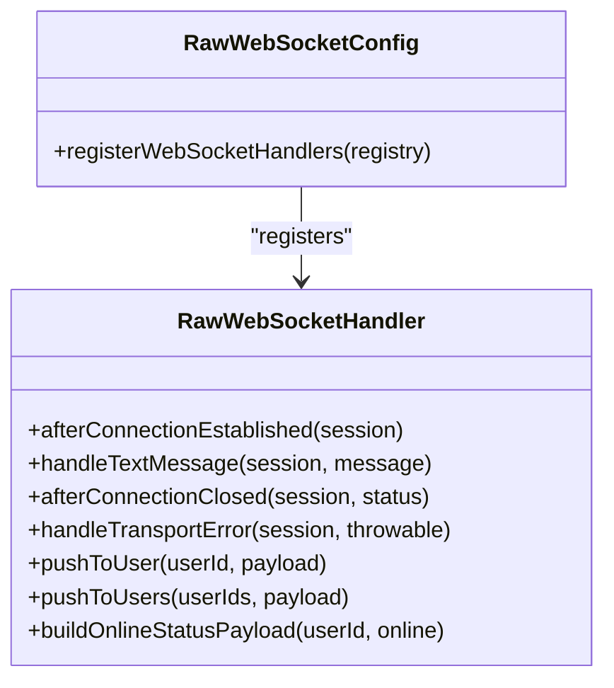
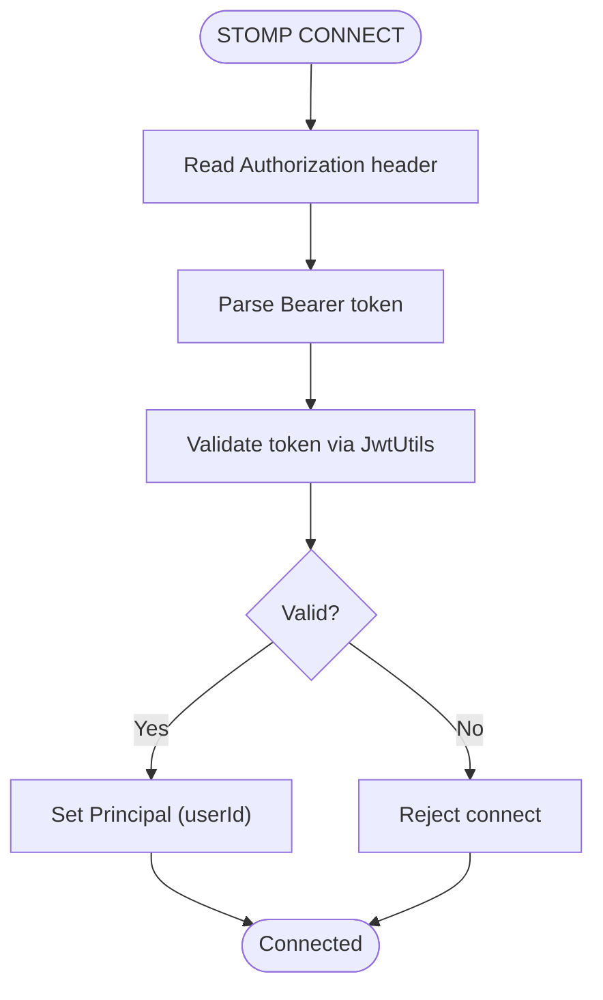
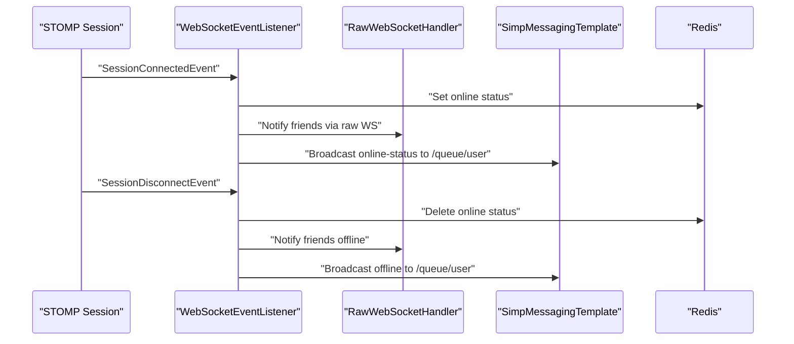
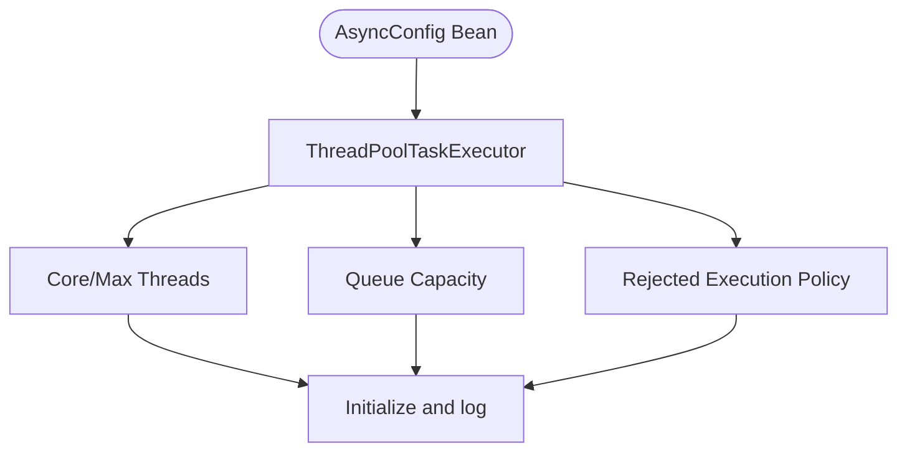
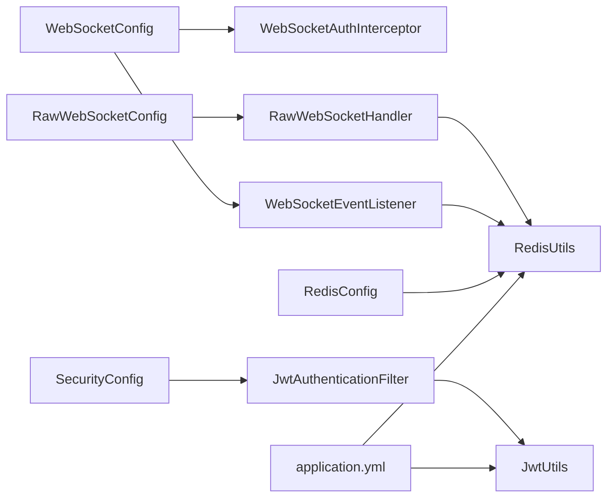

# WebSocket Architecture and Configuration

<cite>
**Referenced Files in This Document**
- [WebSocketConfig.java](file://camp-channel-server/src/main/java/com/gdmec/campchannel/config/WebSocketConfig.java)
- [RawWebSocketConfig.java](file://camp-channel-server/src/main/java/com/gdmec/campchannel/config/RawWebSocketConfig.java)
- [RawWebSocketHandler.java](file://camp-channel-server/src/main/java/com/gdmec/campchannel/config/RawWebSocketHandler.java)
- [WebSocketAuthInterceptor.java](file://camp-channel-server/src/main/java/com/gdmec/campchannel/config/WebSocketAuthInterceptor.java)
- [WebSocketEventListener.java](file://camp-channel-server/src/main/java/com/gdmec/campchannel/config/WebSocketEventListener.java)
- [SecurityConfig.java](file://camp-channel-server/src/main/java/com/gdmec/campchannel/config/SecurityConfig.java)
- [JwtAuthenticationFilter.java](file://camp-channel-server/src/main/java/com/gdmec/campchannel/security/JwtAuthenticationFilter.java)
- [JwtUtils.java](file://camp-channel-server/src/main/java/com/gdmec/campchannel/common/utils/JwtUtils.java)
- [RedisConfig.java](file://camp-channel-server/src/main/java/com/gdmec/campchannel/config/RedisConfig.java)
- [RedisUtils.java](file://camp-channel-server/src/main/java/com/gdmec/campchannel/common/utils/RedisUtils.java)
- [application.yml](file://camp-channel-server/src/main/resources/application.yml)
- [ChatController.java](file://camp-channel-server/src/main/java/com/gdmec/campchannel/controller/ChatController.java)
</cite>

## Table of Contents
1. [Introduction](#introduction)
2. [Project Structure](#project-structure)
3. [Core Components](#core-components)
4. [Architecture Overview](#architecture-overview)
5. [Detailed Component Analysis](#detailed-component-analysis)
6. [Dependency Analysis](#dependency-analysis)
7. [Performance Considerations](#performance-considerations)
8. [Troubleshooting Guide](#troubleshooting-guide)
9. [Conclusion](#conclusion)
10. [Appendices](#appendices)

## Introduction
This document explains the WebSocket architecture and configuration used in the server module. It covers STOMP endpoint registration, message broker setup, and security interceptors; documents the RawWebSocketHandler implementation for direct WebSocket connections; details the WebSocketAuthInterceptor for authentication validation; and describes async configuration for concurrent WebSocket connections and message processing. It also addresses security considerations, Spring Security integration, performance tuning, and troubleshooting.

## Project Structure
The WebSocket subsystem is implemented in the server module under the config package, with supporting utilities and security filters. The configuration enables both STOMP over SockJS and raw WebSocket handlers, integrates with Spring Security, and leverages Redis for presence and rate limiting.

**Diagram sources**
- [WebSocketConfig.java](file://camp-channel-server/src/main/java/com/gdmec/campchannel/config/WebSocketConfig.java)
- [WebSocketAuthInterceptor.java](file://camp-channel-server/src/main/java/com/gdmec/campchannel/config/WebSocketAuthInterceptor.java)
- [WebSocketEventListener.java](file://camp-channel-server/src/main/java/com/gdmec/campchannel/config/WebSocketEventListener.java)
- [RawWebSocketConfig.java](file://camp-channel-server/src/main/java/com/gdmec/campchannel/config/RawWebSocketConfig.java)
- [RawWebSocketHandler.java](file://camp-channel-server/src/main/java/com/gdmec/campchannel/config/RawWebSocketHandler.java)
- [SecurityConfig.java](file://camp-channel-server/src/main/java/com/gdmec/campchannel/config/SecurityConfig.java)
- [JwtAuthenticationFilter.java](file://camp-channel-server/src/main/java/com/gdmec/campchannel/security/JwtAuthenticationFilter.java)
- [JwtUtils.java](file://camp-channel-server/src/main/java/com/gdmec/campchannel/common/utils/JwtUtils.java)
- [RedisConfig.java](file://camp-channel-server/src/main/java/com/gdmec/campchannel/config/RedisConfig.java)
- [RedisUtils.java](file://camp-channel-server/src/main/java/com/gdmec/campchannel/common/utils/RedisUtils.java)
- [application.yml](file://camp-channel-server/src/main/resources/application.yml)
- [ChatController.java](file://camp-channel-server/src/main/java/com/gdmec/campchannel/controller/ChatController.java)

**Section sources**
- [WebSocketConfig.java](file://camp-channel-server/src/main/java/com/gdmec/campchannel/config/WebSocketConfig.java)
- [RawWebSocketConfig.java](file://camp-channel-server/src/main/java/com/gdmec/campchannel/config/RawWebSocketConfig.java)
- [RawWebSocketHandler.java](file://camp-channel-server/src/main/java/com/gdmec/campchannel/config/RawWebSocketHandler.java)
- [WebSocketAuthInterceptor.java](file://camp-channel-server/src/main/java/com/gdmec/campchannel/config/WebSocketAuthInterceptor.java)
- [WebSocketEventListener.java](file://camp-channel-server/src/main/java/com/gdmec/campchannel/config/WebSocketEventListener.java)
- [SecurityConfig.java](file://camp-channel-server/src/main/java/com/gdmec/campchannel/config/SecurityConfig.java)
- [JwtAuthenticationFilter.java](file://camp-channel-server/src/main/java/com/gdmec/campchannel/security/JwtAuthenticationFilter.java)
- [JwtUtils.java](file://camp-channel-server/src/main/java/com/gdmec/campchannel/common/utils/JwtUtils.java)
- [RedisConfig.java](file://camp-channel-server/src/main/java/com/gdmec/campchannel/config/RedisConfig.java)
- [RedisUtils.java](file://camp-channel-server/src/main/java/com/gdmec/campchannel/common/utils/RedisUtils.java)
- [application.yml](file://camp-channel-server/src/main/resources/application.yml)
- [ChatController.java](file://camp-channel-server/src/main/java/com/gdmec/campchannel/controller/ChatController.java)

## Core Components
- STOMP WebSocket configuration with SockJS fallback, message broker destinations, and inbound channel interceptor for authentication.
- Raw WebSocket handler for direct text frames with token-based authentication and per-user session mapping.
- Presence and cross-channel notifications via Redis and event listeners.
- Spring Security integration for HTTP and WebSocket endpoints, including CORS and JWT-based authentication.
- Redis-backed utilities for online status and rate limiting.

**Section sources**
- [WebSocketConfig.java](file://camp-channel-server/src/main/java/com/gdmec/campchannel/config/WebSocketConfig.java)
- [WebSocketAuthInterceptor.java](file://camp-channel-server/src/main/java/com/gdmec/campchannel/config/WebSocketAuthInterceptor.java)
- [WebSocketEventListener.java](file://camp-channel-server/src/main/java/com/gdmec/campchannel/config/WebSocketEventListener.java)
- [RawWebSocketConfig.java](file://camp-channel-server/src/main/java/com/gdmec/campchannel/config/RawWebSocketConfig.java)
- [RawWebSocketHandler.java](file://camp-channel-server/src/main/java/com/gdmec/campchannel/config/RawWebSocketHandler.java)
- [SecurityConfig.java](file://camp-channel-server/src/main/java/com/gdmec/campchannel/config/SecurityConfig.java)
- [JwtAuthenticationFilter.java](file://camp-channel-server/src/main/java/com/gdmec/campchannel/security/JwtAuthenticationFilter.java)
- [RedisUtils.java](file://camp-channel-server/src/main/java/com/gdmec/campchannel/common/utils/RedisUtils.java)

## Architecture Overview
The system supports two WebSocket pathways:
- STOMP over SockJS for browser clients (PC/web): authenticated via Authorization header, routed via message broker prefixes.
- Raw WebSocket for native/mobile clients (Flutter): authenticated via query param token, direct JSON messaging, and per-user routing.

**Diagram sources**
- [SecurityConfig.java](file://camp-channel-server/src/main/java/com/gdmec/campchannel/config/SecurityConfig.java)
- [WebSocketConfig.java](file://camp-channel-server/src/main/java/com/gdmec/campchannel/config/WebSocketConfig.java)
- [WebSocketAuthInterceptor.java](file://camp-channel-server/src/main/java/com/gdmec/campchannel/config/WebSocketAuthInterceptor.java)
- [WebSocketEventListener.java](file://camp-channel-server/src/main/java/com/gdmec/campchannel/config/WebSocketEventListener.java)
- [application.yml](file://camp-channel-server/src/main/resources/application.yml)

## Detailed Component Analysis

### STOMP WebSocket Configuration
- Enables WebSocket message broker with inbound channel interceptor for authentication.
- Registers SockJS-enabled STOMP endpoint at /ws/chat with allowed origins.
- Configures message broker destinations: topics, queues, application prefixes, and user-specific destinations.

**Diagram sources**
- [WebSocketConfig.java](file://camp-channel-server/src/main/java/com/gdmec/campchannel/config/WebSocketConfig.java)
- [WebSocketAuthInterceptor.java](file://camp-channel-server/src/main/java/com/gdmec/campchannel/config/WebSocketAuthInterceptor.java)

**Section sources**
- [WebSocketConfig.java](file://camp-channel-server/src/main/java/com/gdmec/campchannel/config/WebSocketConfig.java)

### Raw WebSocket Configuration and Handler
- Raw WebSocket endpoint registered at /ws/raw with allowed origin patterns.
- Handler validates token from query string, maps sessions by user ID, and maintains online status in Redis.
- Supports ping/pong and targeted pushes to users; notifies friends upon online/offline transitions.

**Diagram sources**
- [RawWebSocketConfig.java](file://camp-channel-server/src/main/java/com/gdmec/campchannel/config/RawWebSocketConfig.java)
- [RawWebSocketHandler.java](file://camp-channel-server/src/main/java/com/gdmec/campchannel/config/RawWebSocketHandler.java)

**Section sources**
- [RawWebSocketConfig.java](file://camp-channel-server/src/main/java/com/gdmec/campchannel/config/RawWebSocketConfig.java)
- [RawWebSocketHandler.java](file://camp-channel-server/src/main/java/com/gdmec/campchannel/config/RawWebSocketHandler.java)

### Authentication and Security Integration
- STOMP CONNECT uses Authorization header; interceptor extracts token and sets a Principal with user ID.
- HTTP requests use JWT filter; for WebSocket endpoints, the HTTP filter does not apply because endpoints are permitted in security configuration.
- Security configuration permits /ws/** and /api/ws/**, enabling SockJS and raw WebSocket handshakes without HTTP authentication.

**Diagram sources**
- [WebSocketAuthInterceptor.java](file://camp-channel-server/src/main/java/com/gdmec/campchannel/config/WebSocketAuthInterceptor.java)
- [JwtUtils.java](file://camp-channel-server/src/main/java/com/gdmec/campchannel/common/utils/JwtUtils.java)
- [SecurityConfig.java](file://camp-channel-server/src/main/java/com/gdmec/campchannel/config/SecurityConfig.java)

**Section sources**
- [WebSocketAuthInterceptor.java](file://camp-channel-server/src/main/java/com/gdmec/campchannel/config/WebSocketAuthInterceptor.java)
- [JwtUtils.java](file://camp-channel-server/src/main/java/com/gdmec/campchannel/common/utils/JwtUtils.java)
- [SecurityConfig.java](file://camp-channel-server/src/main/java/com/gdmec/campchannel/config/SecurityConfig.java)

### Presence and Cross-Channel Notifications
- On STOMP connect/disconnect events, online status is stored in Redis and friends are notified via both raw WebSocket and STOMP user queues.
- Utility methods support checking online status and broadcasting presence updates.

**Diagram sources**
- [WebSocketEventListener.java](file://camp-channel-server/src/main/java/com/gdmec/campchannel/config/WebSocketEventListener.java)
- [RawWebSocketHandler.java](file://camp-channel-server/src/main/java/com/gdmec/campchannel/config/RawWebSocketHandler.java)
- [application.yml](file://camp-channel-server/src/main/resources/application.yml)

**Section sources**
- [WebSocketEventListener.java](file://camp-channel-server/src/main/java/com/gdmec/campchannel/config/WebSocketEventListener.java)
- [RawWebSocketHandler.java](file://camp-channel-server/src/main/java/com/gdmec/campchannel/config/RawWebSocketHandler.java)

### Message Routing Mechanisms
- STOMP routing:
  - Application destinations prefixed with /app.
  - Topic destinations prefixed with /topic for broadcasts.
  - User-specific destinations with /user for point-to-point delivery.
- Raw WebSocket routing:
  - Direct JSON payloads with a type field; currently supports ping/pong.
  - Static helpers to push messages to a single user or a list of users.

**Section sources**
- [WebSocketConfig.java](file://camp-channel-server/src/main/java/com/gdmec/campchannel/config/WebSocketConfig.java)
- [RawWebSocketHandler.java](file://camp-channel-server/src/main/java/com/gdmec/campchannel/config/RawWebSocketHandler.java)

### Connection Establishment Patterns
- STOMP over SockJS:
  - Connect to /ws/chat with Authorization header containing Bearer token.
  - Use /topic for broadcasts and /queue for personal queues.
- Raw WebSocket:
  - Connect to /ws/raw with token in query string (?token=...).
  - Send JSON messages with a type field; receive JSON responses.

**Section sources**
- [WebSocketConfig.java](file://camp-channel-server/src/main/java/com/gdmec/campchannel/config/WebSocketConfig.java)
- [RawWebSocketConfig.java](file://camp-channel-server/src/main/java/com/gdmec/campchannel/config/RawWebSocketConfig.java)
- [RawWebSocketHandler.java](file://camp-channel-server/src/main/java/com/gdmec/campchannel/config/RawWebSocketHandler.java)

### Async Configuration for Concurrent Connections
- Asynchronous processing is configured for email tasks with a thread pool executor.
- While this is not directly used by WebSocket handlers, it demonstrates async configuration patterns applicable to background tasks triggered by WebSocket events.

**Diagram sources**
- [AsyncConfig.java](file://camp-channel-server/src/main/java/com/gdmec/campchannel/config/AsyncConfig.java)

**Section sources**
- [AsyncConfig.java](file://camp-channel-server/src/main/java/com/gdmec/campchannel/config/AsyncConfig.java)

## Dependency Analysis
- WebSocketConfig depends on WebSocketAuthInterceptor for STOMP authentication.
- WebSocketEventListener depends on RedisUtils and SimpMessagingTemplate for presence and routing.
- RawWebSocketHandler depends on JwtUtils for token validation and RedisUtils for online status.
- SecurityConfig permits WebSocket endpoints and registers JwtAuthenticationFilter for HTTP JWT validation.
- RedisConfig and RedisUtils provide serialization and operations for presence and rate limiting.

**Diagram sources**
- [WebSocketConfig.java](file://camp-channel-server/src/main/java/com/gdmec/campchannel/config/WebSocketConfig.java)
- [WebSocketAuthInterceptor.java](file://camp-channel-server/src/main/java/com/gdmec/campchannel/config/WebSocketAuthInterceptor.java)
- [WebSocketEventListener.java](file://camp-channel-server/src/main/java/com/gdmec/campchannel/config/WebSocketEventListener.java)
- [RawWebSocketConfig.java](file://camp-channel-server/src/main/java/com/gdmec/campchannel/config/RawWebSocketConfig.java)
- [RawWebSocketHandler.java](file://camp-channel-server/src/main/java/com/gdmec/campchannel/config/RawWebSocketHandler.java)
- [SecurityConfig.java](file://camp-channel-server/src/main/java/com/gdmec/campchannel/config/SecurityConfig.java)
- [JwtAuthenticationFilter.java](file://camp-channel-server/src/main/java/com/gdmec/campchannel/security/JwtAuthenticationFilter.java)
- [JwtUtils.java](file://camp-channel-server/src/main/java/com/gdmec/campchannel/common/utils/JwtUtils.java)
- [RedisConfig.java](file://camp-channel-server/src/main/java/com/gdmec/campchannel/config/RedisConfig.java)
- [RedisUtils.java](file://camp-channel-server/src/main/java/com/gdmec/campchannel/common/utils/RedisUtils.java)
- [application.yml](file://camp-channel-server/src/main/resources/application.yml)

**Section sources**
- [WebSocketConfig.java](file://camp-channel-server/src/main/java/com/gdmec/campchannel/config/WebSocketConfig.java)
- [WebSocketAuthInterceptor.java](file://camp-channel-server/src/main/java/com/gdmec/campchannel/config/WebSocketAuthInterceptor.java)
- [WebSocketEventListener.java](file://camp-channel-server/src/main/java/com/gdmec/campchannel/config/WebSocketEventListener.java)
- [RawWebSocketConfig.java](file://camp-channel-server/src/main/java/com/gdmec/campchannel/config/RawWebSocketConfig.java)
- [RawWebSocketHandler.java](file://camp-channel-server/src/main/java/com/gdmec/campchannel/config/RawWebSocketHandler.java)
- [SecurityConfig.java](file://camp-channel-server/src/main/java/com/gdmec/campchannel/config/SecurityConfig.java)
- [JwtAuthenticationFilter.java](file://camp-channel-server/src/main/java/com/gdmec/campchannel/security/JwtAuthenticationFilter.java)
- [JwtUtils.java](file://camp-channel-server/src/main/java/com/gdmec/campchannel/common/utils/JwtUtils.java)
- [RedisConfig.java](file://camp-channel-server/src/main/java/com/gdmec/campchannel/config/RedisConfig.java)
- [RedisUtils.java](file://camp-channel-server/src/main/java/com/gdmec/campchannel/common/utils/RedisUtils.java)
- [application.yml](file://camp-channel-server/src/main/resources/application.yml)

## Performance Considerations
- Connection limits and concurrency:
  - STOMP/SockJS relies on Spring WebSocket container defaults; tune via server configuration if needed.
  - Raw WebSocket handler uses a concurrent map keyed by user ID; consider partitioning or sharding for very high concurrency.
- Memory management:
  - Keep per-session payloads small; avoid retaining large buffers.
  - Use Redis TTLs for presence keys to prevent memory leaks.
- Throughput:
  - Offload heavy operations to async executors (e.g., AsyncConfig) to keep WebSocket threads responsive.
- Redis performance:
  - Use appropriate key naming and TTLs; batch notifications where possible.
- Network:
  - Enable compression and keep-alive for long-lived connections.

[No sources needed since this section provides general guidance]

## Troubleshooting Guide
Common WebSocket issues and resolutions:
- STOMP CONNECT fails with policy violation:
  - Ensure Authorization header is present and starts with Bearer.
  - Verify token validity via JwtUtils.
- Raw WebSocket handshake closes immediately:
  - Confirm token query parameter is present and valid.
  - Check server logs for authentication warnings.
- Online status not updating:
  - Verify Redis connectivity and key prefix usage.
  - Ensure WebSocket event listeners are firing on connect/disconnect.
- Messages not delivered to user queues:
  - Confirm user destination prefix and routing logic.
  - Validate that the user is connected and the queue exists.
- CORS or preflight errors:
  - Confirm SecurityConfig allows /ws/** and /api/ws/**.
  - Ensure allowed origin patterns match client origin.

**Section sources**
- [WebSocketAuthInterceptor.java](file://camp-channel-server/src/main/java/com/gdmec/campchannel/config/WebSocketAuthInterceptor.java)
- [RawWebSocketHandler.java](file://camp-channel-server/src/main/java/com/gdmec/campchannel/config/RawWebSocketHandler.java)
- [WebSocketEventListener.java](file://camp-channel-server/src/main/java/com/gdmec/campchannel/config/WebSocketEventListener.java)
- [SecurityConfig.java](file://camp-channel-server/src/main/java/com/gdmec/campchannel/config/SecurityConfig.java)
- [application.yml](file://camp-channel-server/src/main/resources/application.yml)

## Conclusion
The WebSocket subsystem combines STOMP over SockJS and a raw WebSocket handler to serve diverse clients. STOMP provides structured messaging with Spring’s message broker, while raw WebSocket offers lightweight, direct communication with token-based authentication. Spring Security permits WebSocket endpoints and delegates HTTP authentication to JWT filters. Redis powers presence and cross-channel notifications. With proper configuration and monitoring, the system supports scalable real-time communication.

[No sources needed since this section summarizes without analyzing specific files]

## Appendices

### Configuration Reference
- JWT configuration (application.yml):
  - Secret, expiration, header name, and token prefix.
- Redis configuration (application.yml and RedisConfig):
  - Host, port, database, timeout, and connection pool settings; RedisTemplate serialization.

**Section sources**
- [application.yml](file://camp-channel-server/src/main/resources/application.yml)
- [RedisConfig.java](file://camp-channel-server/src/main/java/com/gdmec/campchannel/config/RedisConfig.java)
- [RedisUtils.java](file://camp-channel-server/src/main/java/com/gdmec/campchannel/common/utils/RedisUtils.java)

### Example Usage References
- STOMP client connects to /ws/chat with Authorization header.
- Raw WebSocket client connects to /ws/raw with token query parameter.
- Controllers demonstrate online status checks and targeted message receipts.

**Section sources**
- [WebSocketConfig.java](file://camp-channel-server/src/main/java/com/gdmec/campchannel/config/WebSocketConfig.java)
- [RawWebSocketConfig.java](file://camp-channel-server/src/main/java/com/gdmec/campchannel/config/RawWebSocketConfig.java)
- [ChatController.java](file://camp-channel-server/src/main/java/com/gdmec/campchannel/controller/ChatController.java)