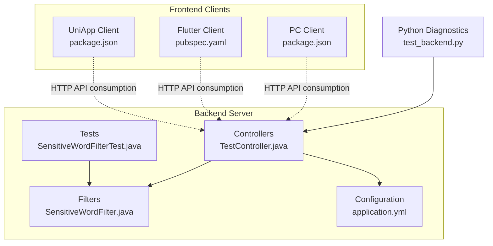
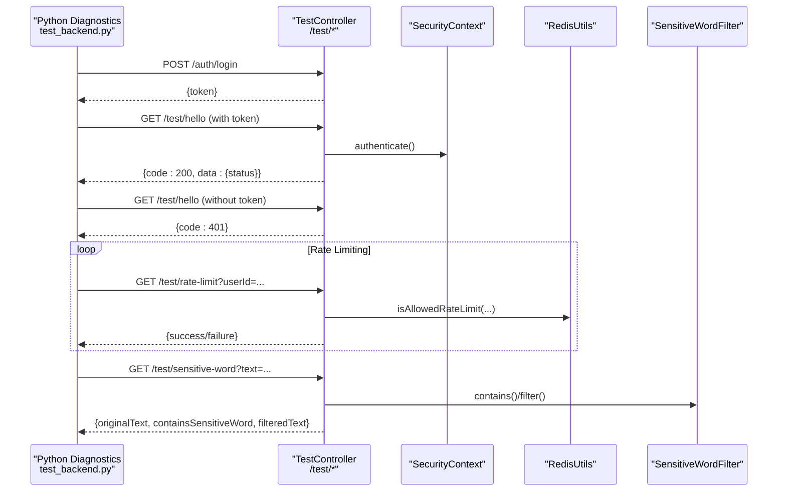
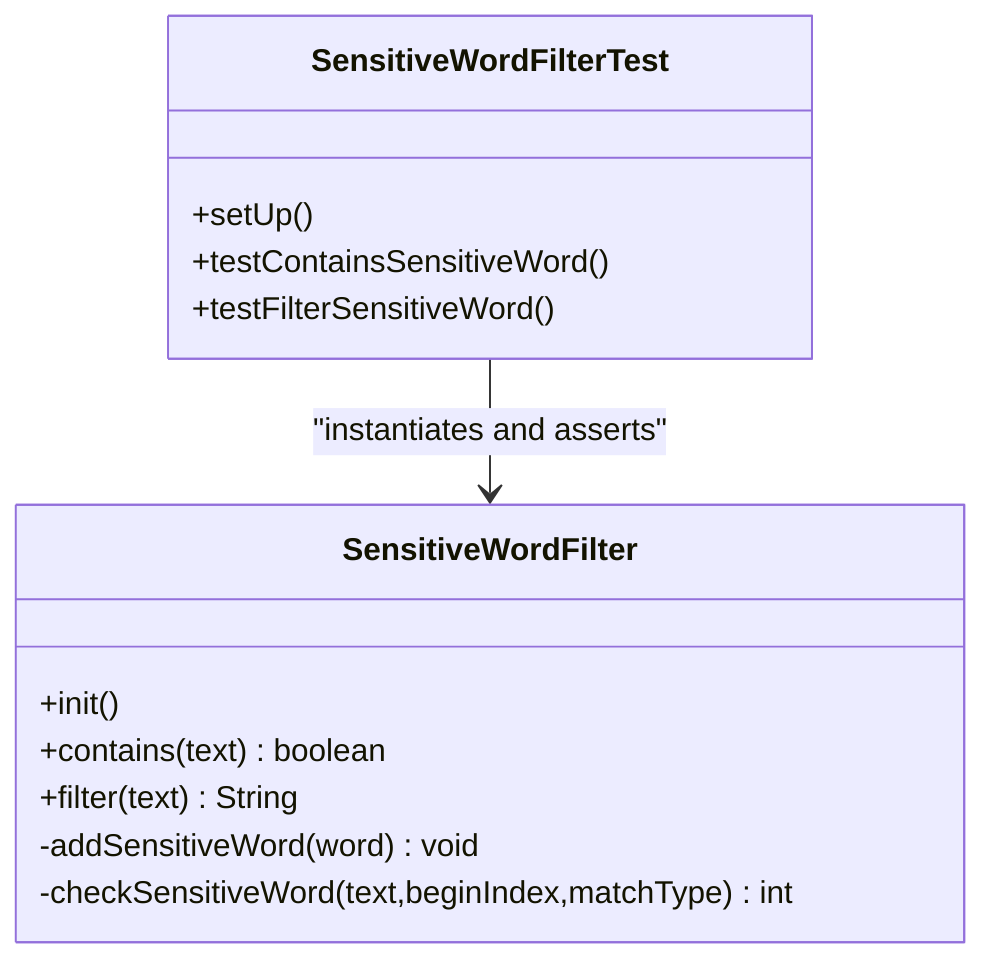
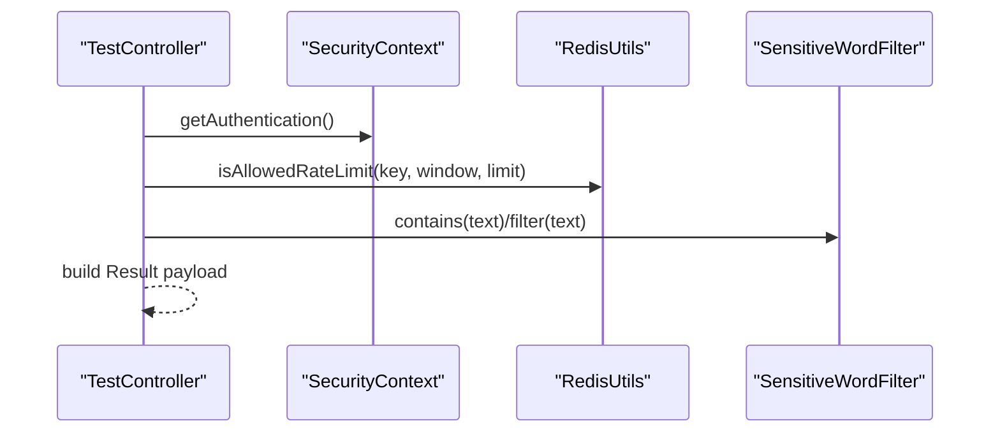
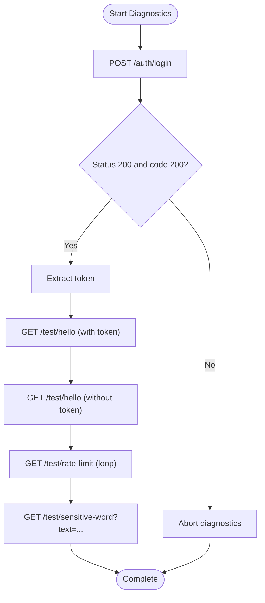
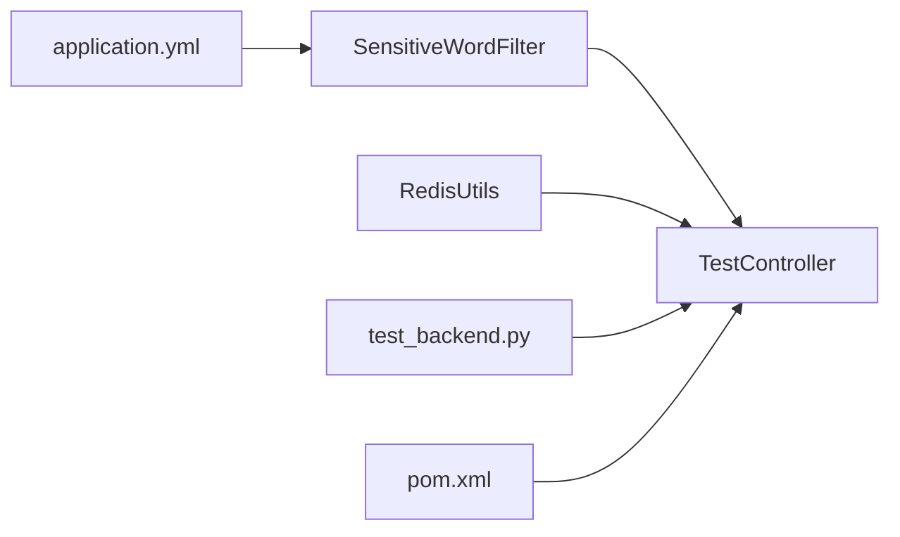

# Testing Strategy

<cite>
**Referenced Files in This Document**
- [SensitiveWordFilter.java](file://camp-channel-server/src/main/java/com/gdmec/campchannel/common/filter/SensitiveWordFilter.java)
- [SensitiveWordFilterTest.java](file://camp-channel-server/src/test/java/com/gdmec/campchannel/SensitiveWordFilterTest.java)
- [TestController.java](file://camp-channel-server/src/main/java/com/gdmec/campchannel/controller/TestController.java)
- [application.yml](file://camp-channel-server/src/main/resources/application.yml)
- [pom.xml](file://camp-channel-server/pom.xml)
- [test_backend.py](file://test_backend.py)
- [package.json (PC client)](file://camp-channel-client-pc/package.json)
- [pubspec.yaml (Flutter client)](file://camp-channel-client-flutter/pubspec.yaml)
- [package.json (UniApp client)](file://camp-channel-client-uniapp/package.json)
</cite>

## Table of Contents
1. [Introduction](#introduction)
2. [Project Structure](#project-structure)
3. [Core Components](#core-components)
4. [Architecture Overview](#architecture-overview)
5. [Detailed Component Analysis](#detailed-component-analysis)
6. [Dependency Analysis](#dependency-analysis)
7. [Performance Considerations](#performance-considerations)
8. [Troubleshooting Guide](#troubleshooting-guide)
9. [Conclusion](#conclusion)
10. [Appendices](#appendices)

## Introduction
This document defines a comprehensive testing strategy for the Camp Channel platform, covering backend unit and integration tests, API-level smoke diagnostics, and frontend component testing approaches across the PC, Flutter, and UniApp clients. It explains how to configure test environments, manage test data, isolate test runs, and integrate testing with CI/CD pipelines. The strategy emphasizes layered reliability: pure unit tests for isolated logic, controller-level integration tests for API behavior, and end-to-end diagnostics for real-world scenarios.

## Project Structure
The platform comprises:
- Backend server built with Spring Boot, containing controllers, services, filters, and persistence layers.
- Three frontend clients:
  - PC client (Vue 3 + TypeScript)
  - Flutter client (Dart)
  - UniApp client (Vue 3 + TypeScript)
- A Python script for backend API diagnostics.

**Diagram sources**
- [TestController.java:1-72](file://camp-channel-server/src/main/java/com/gdmec/campchannel/controller/TestController.java#L1-L72)
- [SensitiveWordFilter.java:1-166](file://camp-channel-server/src/main/java/com/gdmec/campchannel/common/filter/SensitiveWordFilter.java#L1-L166)
- [application.yml:1-119](file://camp-channel-server/src/main/resources/application.yml#L1-L119)
- [SensitiveWordFilterTest.java:1-51](file://camp-channel-server/src/test/java/com/gdmec/campchannel/SensitiveWordFilterTest.java#L1-L51)
- [test_backend.py:1-102](file://test_backend.py#L1-L102)
- [package.json (PC client):1-28](file://camp-channel-client-pc/package.json#L1-L28)
- [pubspec.yaml (Flutter client):1-38](file://camp-channel-client-flutter/pubspec.yaml#L1-L38)
- [package.json (UniApp client):1-29](file://camp-channel-client-uniapp/package.json#L1-L29)

**Section sources**
- [pom.xml:1-227](file://camp-channel-server/pom.xml#L1-L227)
- [application.yml:1-119](file://camp-channel-server/src/main/resources/application.yml#L1-L119)

## Core Components
- Backend unit test for SensitiveWordFilter demonstrates pure unit testing without Spring context initialization, focusing on DFA logic and resource loading.
- TestController exposes endpoints for JWT verification, Redis-based rate limiting, and DFA-sensitive-word filtering, enabling API-level diagnostics.
- Frontend clients depend on HTTP APIs; they can be tested with component/unit tests and integration tests that mock HTTP requests.

Key testing capabilities:
- Pure unit tests for filter logic and resource-driven initialization.
- Controller-level tests for endpoint behavior and security integration.
- API diagnostics script for smoke testing and regression checks.

**Section sources**
- [SensitiveWordFilterTest.java:1-51](file://camp-channel-server/src/test/java/com/gdmec/campchannel/SensitiveWordFilterTest.java#L1-L51)
- [SensitiveWordFilter.java:1-166](file://camp-channel-server/src/main/java/com/gdmec/campchannel/common/filter/SensitiveWordFilter.java#L1-L166)
- [TestController.java:1-72](file://camp-channel-server/src/main/java/com/gdmec/campchannel/controller/TestController.java#L1-L72)
- [test_backend.py:1-102](file://test_backend.py#L1-L102)

## Architecture Overview
The testing architecture spans three layers:
- Unit Layer: Filter logic and utilities tested independently.
- Integration Layer: Controllers and services under realistic but controlled environment conditions.
- API Layer: End-to-end diagnostics validating JWT, rate limiting, and filtering via HTTP.

**Diagram sources**
- [test_backend.py:1-102](file://test_backend.py#L1-L102)
- [TestController.java:1-72](file://camp-channel-server/src/main/java/com/gdmec/campchannel/controller/TestController.java#L1-L72)

## Detailed Component Analysis

### Backend Unit Testing: SensitiveWordFilter
- Purpose: Validate DFA-based sensitive word detection and replacement without initializing the Spring context.
- Approach:
  - Instantiate the filter and inject the sensitive words resource using reflection to bypass constructor wiring.
  - Run assertions on contains() and filter() behaviors.
- Benefits:
  - Fast, deterministic tests.
  - Isolated from database, Redis, and security layers.

**Diagram sources**
- [SensitiveWordFilter.java:1-166](file://camp-channel-server/src/main/java/com/gdmec/campchannel/common/filter/SensitiveWordFilter.java#L1-L166)
- [SensitiveWordFilterTest.java:1-51](file://camp-channel-server/src/test/java/com/gdmec/campchannel/SensitiveWordFilterTest.java#L1-L51)

**Section sources**
- [SensitiveWordFilterTest.java:1-51](file://camp-channel-server/src/test/java/com/gdmec/campchannel/SensitiveWordFilterTest.java#L1-L51)
- [SensitiveWordFilter.java:1-166](file://camp-channel-server/src/main/java/com/gdmec/campchannel/common/filter/SensitiveWordFilter.java#L1-L166)

### Backend Integration Testing: TestController
- Purpose: Expose endpoints for JWT verification, Redis-based rate limiting, and DFA-sensitive-word filtering.
- Tests should cover:
  - Unauthenticated access yields 401.
  - Authenticated access returns user info and success status.
  - Rate limiting blocks after threshold.
  - DFA filtering detects and replaces sensitive terms.
- Mocking strategy:
  - Inject a test Redis client or stub RedisUtils behavior.
  - Use @WebMvcTest or @Import for lightweight controller testing.

**Diagram sources**
- [TestController.java:1-72](file://camp-channel-server/src/main/java/com/gdmec/campchannel/controller/TestController.java#L1-L72)

**Section sources**
- [TestController.java:1-72](file://camp-channel-server/src/main/java/com/gdmec/campchannel/controller/TestController.java#L1-L72)

### API Testing Methodologies
- Use the Python diagnostics script to:
  - Authenticate and capture tokens.
  - Call protected endpoints and assert 200 with expected fields.
  - Verify 401 for unauthenticated requests.
  - Exercise rate limiting and DFA filtering.
- Extend with pytest or similar for structured test suites and fixtures.

**Diagram sources**
- [test_backend.py:1-102](file://test_backend.py#L1-L102)

**Section sources**
- [test_backend.py:1-102](file://test_backend.py#L1-L102)

### Frontend Component Testing Strategies
- PC Client (Vue 3 + TypeScript):
  - Unit tests for composables and components using Vitest/Vue Test Utils.
  - Mock axios or HTTP client to simulate API responses.
  - Snapshot and interaction tests for UI components.
- Flutter Client (Dart):
  - Widget tests and integration tests using flutter_test.
  - Mock Dio network calls and SharedPreferences for state.
- UniApp Client (Vue 3 + TypeScript):
  - Similar to PC client; mock HTTP and Pinia stores for predictable tests.

Recommended tooling:
- PC: vitest, @vue/test-utils
- Flutter: flutter_test, mockito
- UniApp: vitest, uni-app test helpers

**Section sources**
- [package.json (PC client):1-28](file://camp-channel-client-pc/package.json#L1-L28)
- [pubspec.yaml (Flutter client):1-38](file://camp-channel-client-flutter/pubspec.yaml#L1-L38)
- [package.json (UniApp client):1-29](file://camp-channel-client-uniapp/package.json#L1-L29)

### Database Integration Tests
- Use test containers for MySQL and Redis to spin up isolated instances per test suite.
- Initialize schema via Flyway/Migrations and seed minimal test data.
- Prefer transaction rollback or truncate between tests to maintain isolation.
- Keep integration tests fast; group related tests and parallelize safely.

[No sources needed since this section provides general guidance]

### Configuration Options for Test Environments
- Backend:
  - Switch to test profile and in-memory databases/Redis for speed.
  - Override application.yml properties for test-specific ports and credentials.
- Frontends:
  - Configure baseURL to point to test backend endpoints.
  - Set environment variables for API keys and feature flags during CI.

**Section sources**
- [application.yml:1-119](file://camp-channel-server/src/main/resources/application.yml#L1-L119)
- [pom.xml:1-227](file://camp-channel-server/pom.xml#L1-L227)

### Continuous Integration Setup and Automated Pipelines
- Build and test matrix:
  - Backend: compile, unit tests, integration tests with test containers.
  - Frontends: lint, type-check, unit tests, snapshot tests.
- Artifacts and reports:
  - Publish JUnit XML for backend tests.
  - Publish coverage reports for frontend tests.
- Gatekeeping:
  - Require unit and integration tests to pass before merging.
  - Optional: enforce code coverage thresholds.

[No sources needed since this section provides general guidance]

## Dependency Analysis
- SensitiveWordFilter depends on configuration for the sensitive words resource and is used by TestController.
- TestController depends on RedisUtils for rate limiting and SensitiveWordFilter for content filtering.
- Python diagnostics depends on backend endpoints and tokens.

**Diagram sources**
- [SensitiveWordFilter.java:1-166](file://camp-channel-server/src/main/java/com/gdmec/campchannel/common/filter/SensitiveWordFilter.java#L1-L166)
- [TestController.java:1-72](file://camp-channel-server/src/main/java/com/gdmec/campchannel/controller/TestController.java#L1-L72)
- [application.yml:1-119](file://camp-channel-server/src/main/resources/application.yml#L1-L119)
- [pom.xml:1-227](file://camp-channel-server/pom.xml#L1-L227)
- [test_backend.py:1-102](file://test_backend.py#L1-L102)

**Section sources**
- [SensitiveWordFilter.java:1-166](file://camp-channel-server/src/main/java/com/gdmec/campchannel/common/filter/SensitiveWordFilter.java#L1-L166)
- [TestController.java:1-72](file://camp-channel-server/src/main/java/com/gdmec/campchannel/controller/TestController.java#L1-L72)
- [application.yml:1-119](file://camp-channel-server/src/main/resources/application.yml#L1-L119)
- [pom.xml:1-227](file://camp-channel-server/pom.xml#L1-L227)
- [test_backend.py:1-102](file://test_backend.py#L1-L102)

## Performance Considerations
- Unit tests: Keep filter initialization lightweight; avoid heavy IO in unit tests.
- Integration tests: Use in-memory databases and Redis; minimize warm-up time.
- API diagnostics: Batch requests thoughtfully; add delays to respect rate limits.
- Frontend tests: Mock network calls; avoid real HTTP traffic to reduce flakiness.

[No sources needed since this section provides general guidance]

## Troubleshooting Guide
Common issues and resolutions:
- Test data isolation:
  - Use separate test databases or schemas; truncate tables between tests.
- Mock object management:
  - Centralize mocks in beforeEach hooks; avoid global state.
- Rate limiting failures:
  - Reset Redis keys or use deterministic userIds in tests.
- Flaky tests:
  - Add jitter/backoff; ensure deterministic ordering; avoid time-dependent assertions without mocks.
- CI pipeline failures:
  - Capture and archive logs; ensure environment variables are present; validate Docker availability for test containers.

[No sources needed since this section provides general guidance]

## Conclusion
The Camp Channel platform’s testing strategy combines pure unit tests for core logic, controller-level integration tests for API behavior, and end-to-end diagnostics for production-like validation. By isolating test data, managing mocks effectively, and integrating with CI/CD, teams can ensure reliable releases across backend and frontend clients.

[No sources needed since this section summarizes without analyzing specific files]

## Appendices

### Appendix A: Backend Testing Checklist
- Unit tests for SensitiveWordFilter and other filter/logic components.
- Controller tests for TestController endpoints.
- API diagnostics script executed in CI.
- Test containers for database and Redis.
- Coverage and artifact publishing.

**Section sources**
- [SensitiveWordFilterTest.java:1-51](file://camp-channel-server/src/test/java/com/gdmec/campchannel/SensitiveWordFilterTest.java#L1-L51)
- [TestController.java:1-72](file://camp-channel-server/src/main/java/com/gdmec/campchannel/controller/TestController.java#L1-L72)
- [test_backend.py:1-102](file://test_backend.py#L1-L102)
- [pom.xml:1-227](file://camp-channel-server/pom.xml#L1-L227)