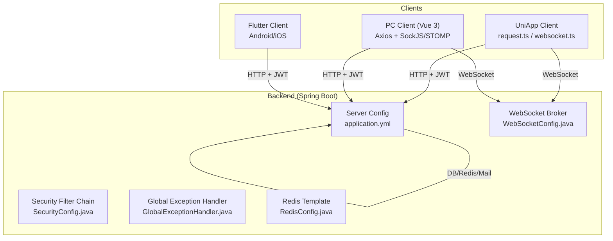
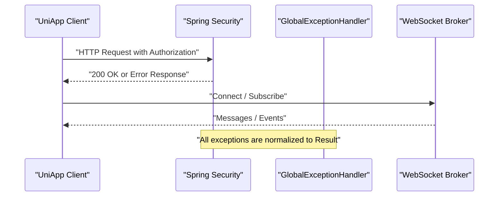
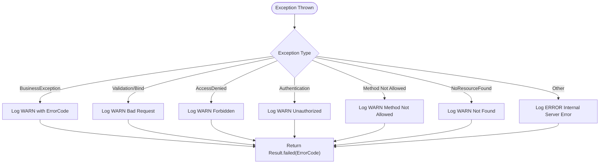
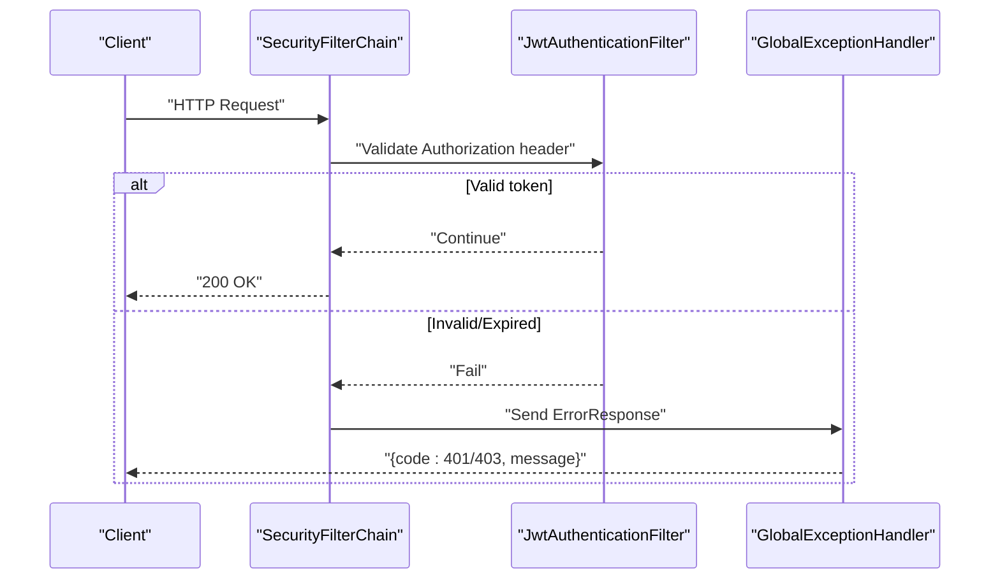
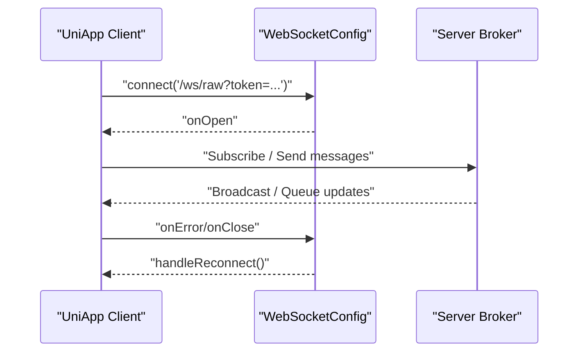
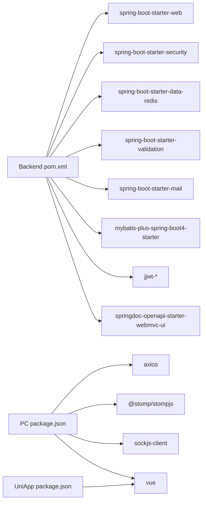

# Troubleshooting and FAQ

<cite>
**Referenced Files in This Document**
- [application.yml](file://camp-channel-server/src/main/resources/application.yml)
- [GlobalExceptionHandler.java](file://camp-channel-server/src/main/java/com/gdmec/campchannel/common/exception/GlobalExceptionHandler.java)
- [BusinessException.java](file://camp-channel-server/src/main/java/com/gdmec/campchannel/common/exception/BusinessException.java)
- [ErrorCode.java](file://camp-channel-server/src/main/java/com/gdmec/campchannel/common/api/ErrorCode.java)
- [SecurityConfig.java](file://camp-channel-server/src/main/java/com/gdmec/campchannel/config/SecurityConfig.java)
- [WebSocketConfig.java](file://camp-channel-server/src/main/java/com/gdmec/campchannel/config/WebSocketConfig.java)
- [RedisConfig.java](file://camp-channel-server/src/main/java/com/gdmec/campchannel/config/RedisConfig.java)
- [request.ts](file://camp-channel-client-uniapp/src/utils/request.ts)
- [websocket.ts](file://camp-channel-client-uniapp/src/utils/websocket.ts)
- [pom.xml](file://camp-channel-server/pom.xml)
- [mvnw.cmd](file://camp-channel-server/mvnw.cmd)
- [package.json (PC)](file://camp-channel-client-pc/package.json)
- [package.json (UniApp)](file://camp-channel-client-uniapp/package.json)
</cite>

## Table of Contents
1. [Introduction](#introduction)
2. [Project Structure](#project-structure)
3. [Core Components](#core-components)
4. [Architecture Overview](#architecture-overview)
5. [Detailed Component Analysis](#detailed-component-analysis)
6. [Dependency Analysis](#dependency-analysis)
7. [Performance Considerations](#performance-considerations)
8. [Troubleshooting Guide](#troubleshooting-guide)
9. [Conclusion](#conclusion)
10. [Appendices](#appendices)

## Introduction
This document provides a comprehensive troubleshooting guide and FAQ for the Camp Channel platform. It focuses on diagnosing and resolving development environment problems, backend service issues, and frontend client problems. It covers database connectivity, authentication, WebSocket real-time communication, and cross-platform build errors. It also documents error handling and logging mechanisms, debugging tools and techniques, monitoring approaches, configuration options for development versus production, and escalation procedures.

## Project Structure
The platform consists of:
- A Spring Boot backend server exposing REST APIs and WebSocket endpoints, configured via application.yml.
- A Vue 3 PC client using Axios and SockJS/STOMP for real-time features.
- A UniApp client supporting H5 and Mini Program targets, with dedicated network and WebSocket utilities.
- A Flutter client for mobile platforms.

**Diagram sources**
- [application.yml:1-119](file://camp-channel-server/src/main/resources/application.yml#L1-L119)
- [SecurityConfig.java:52-105](file://camp-channel-server/src/main/java/com/gdmec/campchannel/config/SecurityConfig.java#L52-L105)
- [GlobalExceptionHandler.java:24-122](file://camp-channel-server/src/main/java/com/gdmec/campchannel/common/exception/GlobalExceptionHandler.java#L24-L122)
- [WebSocketConfig.java:11-36](file://camp-channel-server/src/main/java/com/gdmec/campchannel/config/WebSocketConfig.java#L11-L36)
- [RedisConfig.java:17-47](file://camp-channel-server/src/main/java/com/gdmec/campchannel/config/RedisConfig.java#L17-L47)
- [request.ts:1-112](file://camp-channel-client-uniapp/src/utils/request.ts#L1-L112)
- [websocket.ts:1-268](file://camp-channel-client-uniapp/src/utils/websocket.ts#L1-L268)

**Section sources**
- [application.yml:1-119](file://camp-channel-server/src/main/resources/application.yml#L1-L119)
- [SecurityConfig.java:52-105](file://camp-channel-server/src/main/java/com/gdmec/campchannel/config/SecurityConfig.java#L52-L105)
- [GlobalExceptionHandler.java:24-122](file://camp-channel-server/src/main/java/com/gdmec/campchannel/common/exception/GlobalExceptionHandler.java#L24-L122)
- [WebSocketConfig.java:11-36](file://camp-channel-server/src/main/java/com/gdmec/campchannel/config/WebSocketConfig.java#L11-L36)
- [RedisConfig.java:17-47](file://camp-channel-server/src/main/java/com/gdmec/campchannel/config/RedisConfig.java#L17-L47)
- [request.ts:1-112](file://camp-channel-client-uniapp/src/utils/request.ts#L1-L112)
- [websocket.ts:1-268](file://camp-channel-client-uniapp/src/utils/websocket.ts#L1-L268)

## Core Components
- Backend configuration and services:
  - Database, Redis, mail, logging, and API path configuration are defined centrally.
  - Security filter chain enforces JWT-based authentication and CORS.
  - Global exception handler standardizes error responses.
  - WebSocket broker exposes STOMP/SockJS endpoints and user destinations.
  - Redis template serializes keys/values for caching and pub/sub.
- Frontend clients:
  - UniApp client encapsulates HTTP requests and WebSocket connections with retry and handler management.
  - PC client integrates Axios and SockJS/STOMP for real-time messaging.

**Section sources**
- [application.yml:1-119](file://camp-channel-server/src/main/resources/application.yml#L1-L119)
- [SecurityConfig.java:52-105](file://camp-channel-server/src/main/java/com/gdmec/campchannel/config/SecurityConfig.java#L52-L105)
- [GlobalExceptionHandler.java:24-122](file://camp-channel-server/src/main/java/com/gdmec/campchannel/common/exception/GlobalExceptionHandler.java#L24-L122)
- [WebSocketConfig.java:11-36](file://camp-channel-server/src/main/java/com/gdmec/campchannel/config/WebSocketConfig.java#L11-L36)
- [RedisConfig.java:17-47](file://camp-channel-server/src/main/java/com/gdmec/campchannel/config/RedisConfig.java#L17-L47)
- [request.ts:1-112](file://camp-channel-client-uniapp/src/utils/request.ts#L1-L112)
- [websocket.ts:1-268](file://camp-channel-client-uniapp/src/utils/websocket.ts#L1-L268)

## Architecture Overview
The system follows a layered architecture:
- Clients communicate with the backend over HTTPS using JWT bearer tokens.
- REST endpoints serve CRUD and business operations.
- WebSocket endpoints provide real-time chat and notifications.
- Security filters enforce authentication and authorization.
- Global exception handler ensures consistent error responses.
- Logging is configured to file and console for diagnostics.

**Diagram sources**
- [SecurityConfig.java:52-105](file://camp-channel-server/src/main/java/com/gdmec/campchannel/config/SecurityConfig.java#L52-L105)
- [GlobalExceptionHandler.java:24-122](file://camp-channel-server/src/main/java/com/gdmec/campchannel/common/exception/GlobalExceptionHandler.java#L24-L122)
- [WebSocketConfig.java:11-36](file://camp-channel-server/src/main/java/com/gdmec/campchannel/config/WebSocketConfig.java#L11-L36)
- [request.ts:1-112](file://camp-channel-client-uniapp/src/utils/request.ts#L1-L112)
- [websocket.ts:1-268](file://camp-channel-client-uniapp/src/utils/websocket.ts#L1-L268)

## Detailed Component Analysis

### Backend Error Handling and Logging
- GlobalExceptionHandler standardizes responses for business exceptions, validation errors, authentication/authorization failures, unsupported methods, resource-not-found, and unknown errors.
- Logging levels are configured for application packages, Spring Web, Security, Redis, MyBatis, and mail providers, with file and console outputs.

**Diagram sources**
- [GlobalExceptionHandler.java:24-122](file://camp-channel-server/src/main/java/com/gdmec/campchannel/common/exception/GlobalExceptionHandler.java#L24-L122)
- [ErrorCode.java:8-60](file://camp-channel-server/src/main/java/com/gdmec/campchannel/common/api/ErrorCode.java#L8-L60)

**Section sources**
- [GlobalExceptionHandler.java:24-122](file://camp-channel-server/src/main/java/com/gdmec/campchannel/common/exception/GlobalExceptionHandler.java#L24-L122)
- [BusinessException.java:9-28](file://camp-channel-server/src/main/java/com/gdmec/campchannel/common/exception/BusinessException.java#L9-L28)
- [ErrorCode.java:8-60](file://camp-channel-server/src/main/java/com/gdmec/campchannel/common/api/ErrorCode.java#L8-L60)
- [application.yml:101-119](file://camp-channel-server/src/main/resources/application.yml#L101-L119)

### Authentication and Authorization
- SecurityConfig disables CSRF, enables CORS, permits public endpoints (login/register/code, Swagger, uploads), and requires authentication for other routes.
- JWT filter is registered before the default form filter to validate tokens.
- Unauthorized and forbidden scenarios return standardized JSON responses.

**Diagram sources**
- [SecurityConfig.java:52-105](file://camp-channel-server/src/main/java/com/gdmec/campchannel/config/SecurityConfig.java#L52-L105)
- [GlobalExceptionHandler.java:76-91](file://camp-channel-server/src/main/java/com/gdmec/campchannel/common/exception/GlobalExceptionHandler.java#L76-L91)

**Section sources**
- [SecurityConfig.java:52-105](file://camp-channel-server/src/main/java/com/gdmec/campchannel/config/SecurityConfig.java#L52-L105)
- [GlobalExceptionHandler.java:76-91](file://camp-channel-server/src/main/java/com/gdmec/campchannel/common/exception/GlobalExceptionHandler.java#L76-L91)

### WebSocket Real-Time Communication
- WebSocketConfig registers STOMP endpoints with SockJS and sets up simple broker prefixes and user destinations.
- The UniApp client connects via raw WebSocket for Mini Program environments and includes automatic reconnection with exponential backoff and handler dispatching.

**Diagram sources**
- [WebSocketConfig.java:11-36](file://camp-channel-server/src/main/java/com/gdmec/campchannel/config/WebSocketConfig.java#L11-L36)
- [websocket.ts:23-129](file://camp-channel-client-uniapp/src/utils/websocket.ts#L23-L129)

**Section sources**
- [WebSocketConfig.java:11-36](file://camp-channel-server/src/main/java/com/gdmec/campchannel/config/WebSocketConfig.java#L11-L36)
- [websocket.ts:1-268](file://camp-channel-client-uniapp/src/utils/websocket.ts#L1-L268)

### Database Connectivity and Initialization
- application.yml defines MySQL JDBC URL, credentials, HikariCP pool settings, and SQL initialization mode.
- Ensure the database is reachable, credentials are correct, and schema initialization runs on startup.

**Section sources**
- [application.yml:13-30](file://camp-channel-server/src/main/resources/application.yml#L13-L30)

### Redis Integration
- RedisConfig configures Jackson2Json serialization for keys/values and applies serializers to RedisTemplate.
- Verify Redis connectivity and credentials in application.yml.

**Section sources**
- [RedisConfig.java:17-47](file://camp-channel-server/src/main/java/com/gdmec/campchannel/config/RedisConfig.java#L17-L47)
- [application.yml:31-43](file://camp-channel-server/src/main/resources/application.yml#L31-L43)

### Logging and Monitoring
- Logging is configured to output to console and file with timestamps, thread, level, logger, and message.
- Use the log file path for production monitoring and alerting.

**Section sources**
- [application.yml:101-119](file://camp-channel-server/src/main/resources/application.yml#L101-L119)

## Dependency Analysis
- Backend dependencies include Spring Web, Security, Data Redis, Validation, Mail, MyBatis-Plus, JWT, and OpenAPI/Swagger.
- Client dependencies include Vue 3, Axios, SockJS/STOMP, and related types.

**Diagram sources**
- [pom.xml:32-135](file://camp-channel-server/pom.xml#L32-L135)
- [package.json (PC):10-26](file://camp-channel-client-pc/package.json#L10-L26)
- [package.json (UniApp):10-28](file://camp-channel-client-uniapp/package.json#L10-L28)

**Section sources**
- [pom.xml:32-135](file://camp-channel-server/pom.xml#L32-L135)
- [package.json (PC):10-26](file://camp-channel-client-pc/package.json#L10-L26)
- [package.json (UniApp):10-28](file://camp-channel-client-uniapp/package.json#L10-L28)

## Performance Considerations
- Tune HikariCP pool sizes and timeouts in application.yml for database load.
- Adjust Redis pool settings and connection timeout for caching and pub/sub throughput.
- Limit concurrent WebSocket connections and implement rate limiting for frequent operations.
- Enable gzip/HTTP compression and optimize static asset delivery for clients.

[No sources needed since this section provides general guidance]

## Troubleshooting Guide

### Development Environment Setup
- Verify JAVA_HOME and Java version compatibility with Spring Boot 4 and Java 26.
- Ensure Maven Wrapper is available and can run builds.
- Confirm IDE plugin configurations and dependency resolution.

Diagnostic commands:
- Build and run the backend using Maven Wrapper.
- Start the backend and verify the API base path and port.

Resolution steps:
- If Maven fails due to missing JAVA_HOME, set JAVA_HOME to a valid JDK path.
- If wrapper download fails, check network proxy and TLS settings.
- If dependency injection fails, refresh Maven dependencies and rebuild.

**Section sources**
- [mvnw.cmd:60-80](file://camp-channel-server/mvnw.cmd#L60-L80)
- [pom.xml:20-30](file://camp-channel-server/pom.xml#L20-L30)

### Backend Service Issues
Common symptoms:
- 401 Unauthorized after login.
- 403 Forbidden on protected endpoints.
- 404 Not Found for API routes.
- 500 Internal Server Error with stack traces.

Diagnosis:
- Check SecurityConfig permitAll patterns and JWT filter registration.
- Review GlobalExceptionHandler mappings for the thrown exception type.
- Inspect application.yml for correct datasource, Redis, and mail settings.

Resolution steps:
- For 401/403, verify Authorization header presence and token validity.
- For 404, confirm endpoint path matches configured context-path and route definitions.
- For 500, review logs for Business Exceptions and stack traces.

**Section sources**
- [SecurityConfig.java:52-105](file://camp-channel-server/src/main/java/com/gdmec/campchannel/config/SecurityConfig.java#L52-L105)
- [GlobalExceptionHandler.java:76-121](file://camp-channel-server/src/main/java/com/gdmec/campchannel/common/exception/GlobalExceptionHandler.java#L76-L121)
- [application.yml:13-66](file://camp-channel-server/src/main/resources/application.yml#L13-L66)

### Frontend Client Problems
Common symptoms:
- Network requests fail with “network connection failed”.
- Login succeeds but immediately logs out due to token expiry or device kick.
- WebSocket fails to connect or disconnects frequently.

Diagnosis:
- Check BASE_URL and Authorization header injection in request.ts.
- Verify handleForceLogout logic for 401/1009 responses.
- Inspect WebSocketManager connect/send/onMessage/reconnect logic in websocket.ts.

Resolution steps:
- Ensure backend is running and reachable at the configured BASE_URL.
- On 401/1009, clear local storage tokens and redirect to login.
- For WebSocket, confirm raw endpoint URL construction and token query parameter.

**Section sources**
- [request.ts:27-84](file://camp-channel-client-uniapp/src/utils/request.ts#L27-L84)
- [request.ts:86-112](file://camp-channel-client-uniapp/src/utils/request.ts#L86-L112)
- [websocket.ts:23-129](file://camp-channel-client-uniapp/src/utils/websocket.ts#L23-L129)
- [websocket.ts:230-253](file://camp-channel-client-uniapp/src/utils/websocket.ts#L230-L253)

### Database Connection Failures
Symptoms:
- Application fails to start with database connection errors.
- SQL initialization fails or schema not applied.

Diagnosis:
- Verify JDBC URL, username, and password in application.yml.
- Confirm MySQL service is running and accessible.
- Check HikariCP pool settings and timeouts.

Resolution steps:
- Update credentials and URL to match local/remote database.
- Increase connection-timeout and max-lifetime if needed.
- Run schema initialization script manually if “always” mode fails.

**Section sources**
- [application.yml:13-30](file://camp-channel-server/src/main/resources/application.yml#L13-L30)

### Authentication Problems
Symptoms:
- Login returns unauthorized or forbidden.
- Users receive “device force logout” messages.

Diagnosis:
- Confirm login endpoints are permitted in SecurityConfig.
- Check JWT secret, expiration, and header configuration.
- Review ErrorCode for device-kick and credential errors.

Resolution steps:
- Ensure Authorization header uses the configured header name and token prefix.
- Rotate JWT secret and update clients if compromised.
- Clear conflicting sessions and re-authenticate.

**Section sources**
- [SecurityConfig.java:63-73](file://camp-channel-server/src/main/java/com/gdmec/campchannel/config/SecurityConfig.java#L63-L73)
- [application.yml:78-83](file://camp-channel-server/src/main/resources/application.yml#L78-L83)
- [ErrorCode.java:28-28](file://camp-channel-server/src/main/java/com/gdmec/campchannel/common/api/ErrorCode.java#L28-L28)

### WebSocket Connection Issues
Symptoms:
- WebSocket fails to connect or drops unexpectedly.
- Messages not delivered to handlers.

Diagnosis:
- Confirm WebSocket endpoint configuration and allowed origins.
- Validate token query parameter handling in client.
- Check reconnection attempts and exponential backoff.

Resolution steps:
- Ensure backend allows origin patterns and SockJS endpoints.
- Verify token is appended to the raw WebSocket URL.
- Monitor console logs for connection lifecycle events.

**Section sources**
- [WebSocketConfig.java:31-35](file://camp-channel-server/src/main/java/com/gdmec/campchannel/config/WebSocketConfig.java#L31-L35)
- [websocket.ts:40-50](file://camp-channel-client-uniapp/src/utils/websocket.ts#L40-L50)
- [websocket.ts:230-253](file://camp-channel-client-uniapp/src/utils/websocket.ts#L230-L253)

### Cross-Platform Build Errors
Symptoms:
- Vue/Vite build fails on PC client.
- UniApp build fails for H5/Mini Program targets.

Diagnosis:
- Check Node.js and npm versions compatible with dependencies.
- Review package.json scripts and dependency versions.

Resolution steps:
- Install Node.js LTS and update npm.
- Run dependency install and rebuild.
- For UniApp, ensure platform-specific plugins and SDKs are installed.

**Section sources**
- [package.json (PC):5-9](file://camp-channel-client-pc/package.json#L5-L9)
- [package.json (UniApp):5-10](file://camp-channel-client-uniapp/package.json#L5-L10)

### Error Handling and Logging Mechanisms
- All exceptions are caught by GlobalExceptionHandler and returned as unified Result structures.
- Logging levels are set per package; increase verbosity for debugging.
- Log file path is configured for persistent logs.

Resolution steps:
- Tail the log file and search for WARN/ERROR entries.
- Temporarily raise log levels for specific packages during investigations.

**Section sources**
- [GlobalExceptionHandler.java:24-122](file://camp-channel-server/src/main/java/com/gdmec/campchannel/common/exception/GlobalExceptionHandler.java#L24-L122)
- [application.yml:101-119](file://camp-channel-server/src/main/resources/application.yml#L101-L119)

### Debugging Tools and Techniques
- Use curl or Postman to test REST endpoints with Authorization headers.
- Enable Spring DevTools for hot reload during development.
- Inspect browser/network tab for failed requests and WebSocket frames.
- Use WebSocket testing tools to validate raw endpoints.

**Section sources**
- [SecurityConfig.java:52-105](file://camp-channel-server/src/main/java/com/gdmec/campchannel/config/SecurityConfig.java#L52-L105)
- [pom.xml:125-127](file://camp-channel-server/pom.xml#L125-L127)

### Monitoring Approaches for Production Systems
- Ship logs to centralized logging (e.g., ELK, Splunk) and set alerts for error rates.
- Expose health endpoints and metrics via Actuator (if enabled).
- Monitor database and Redis latency and connection counts.
- Track WebSocket connection counts and message throughput.

**Section sources**
- [application.yml:101-119](file://camp-channel-server/src/main/resources/application.yml#L101-L119)

### Configuration Options: Development vs Production
- Development:
  - Allow all origins for CORS.
  - Enable Swagger UI and OpenAPI docs.
  - Keep logging levels verbose.
- Production:
  - Restrict CORS origins to trusted domains.
  - Disable Swagger UI and OpenAPI docs.
  - Reduce log verbosity and enable structured logging.

**Section sources**
- [SecurityConfig.java:113-124](file://camp-channel-server/src/main/java/com/gdmec/campchannel/config/SecurityConfig.java#L113-L124)
- [application.yml:85-92](file://camp-channel-server/src/main/resources/application.yml#L85-L92)
- [application.yml:101-119](file://camp-channel-server/src/main/resources/application.yml#L101-L119)

### Error Reporting Mechanisms and Support Procedures
- Use ErrorCode enumeration to categorize and report issues consistently.
- Capture client-side error messages and include request IDs where available.
- Escalation procedure:
  - Tier 1: Self-service logs and basic checks.
  - Tier 2: Backend logs, DB/Redis connectivity tests.
  - Tier 3: Full-stack tracing, WebSocket diagnostics, and capacity review.

**Section sources**
- [ErrorCode.java:8-60](file://camp-channel-server/src/main/java/com/gdmec/campchannel/common/api/ErrorCode.java#L8-L60)
- [GlobalExceptionHandler.java:24-122](file://camp-channel-server/src/main/java/com/gdmec/campchannel/common/exception/GlobalExceptionHandler.java#L24-L122)

### User-Facing Issues
- Login problems:
  - Verify credentials and account status.
  - Check for device-kick and force logout prompts.
- Content loading failures:
  - Confirm uploads/base URLs and static file serving.
- Real-time communication issues:
  - Validate WebSocket connectivity and token propagation.

**Section sources**
- [request.ts:57-73](file://camp-channel-client-uniapp/src/utils/request.ts#L57-L73)
- [request.ts:86-112](file://camp-channel-client-uniapp/src/utils/request.ts#L86-L112)
- [websocket.ts:68-121](file://camp-channel-client-uniapp/src/utils/websocket.ts#L68-L121)

### Best Practices for Issue Tracking, Escalation, and Preventive Maintenance
- Track incidents with severity, affected endpoints, and reproduction steps.
- Maintain runbooks for common failures (DB/Redis down, JWT misconfiguration, WebSocket storms).
- Schedule periodic preventive maintenance: DB index checks, Redis memory tuning, certificate renewal.

**Section sources**
- [application.yml:13-43](file://camp-channel-server/src/main/resources/application.yml#L13-L43)
- [application.yml:101-119](file://camp-channel-server/src/main/resources/application.yml#L101-L119)

## Conclusion
This guide consolidates troubleshooting strategies across the Camp Channel platform’s backend and multiple frontends. By leveraging standardized error handling, robust logging, and clear diagnostic flows, teams can quickly isolate and resolve environment, backend, and client-side issues. Adopt the recommended configuration practices and monitoring approaches to maintain reliability and accelerate incident response.

## Appendices

### Quick Diagnostic Commands
- Backend build and run:
  - [mvnw.cmd:178-185](file://camp-channel-server/mvnw.cmd#L178-L185)
- Check database connectivity:
  - [application.yml:13-17](file://camp-channel-server/src/main/resources/application.yml#L13-L17)
- Verify WebSocket endpoint:
  - [WebSocketConfig.java:31-35](file://camp-channel-server/src/main/java/com/gdmec/campchannel/config/WebSocketConfig.java#L31-L35)
- Inspect client request flow:
  - [request.ts:27-84](file://camp-channel-client-uniapp/src/utils/request.ts#L27-L84)
- Inspect WebSocket lifecycle:
  - [websocket.ts:23-129](file://camp-channel-client-uniapp/src/utils/websocket.ts#L23-L129)