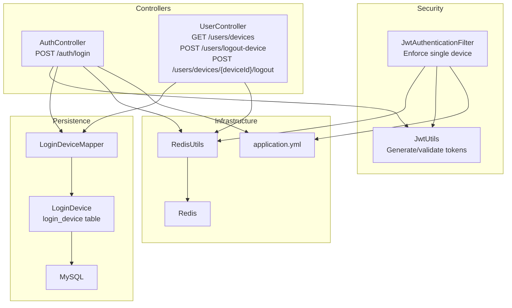
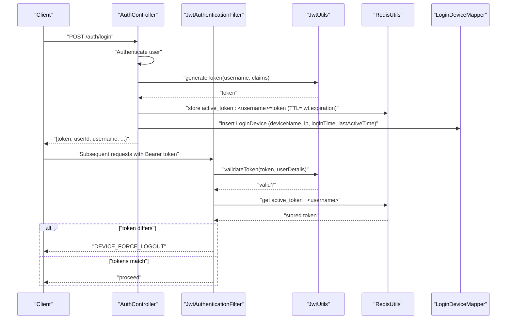
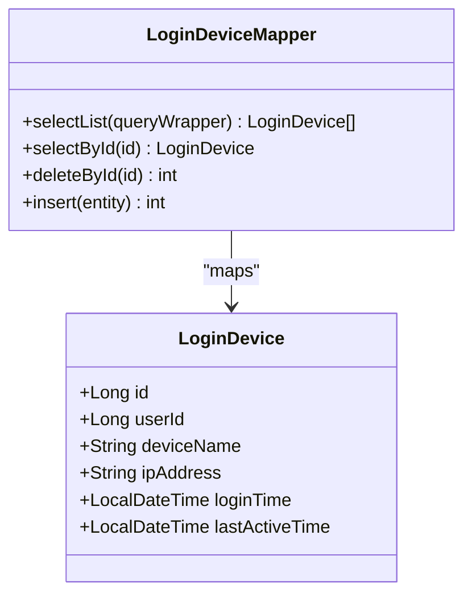
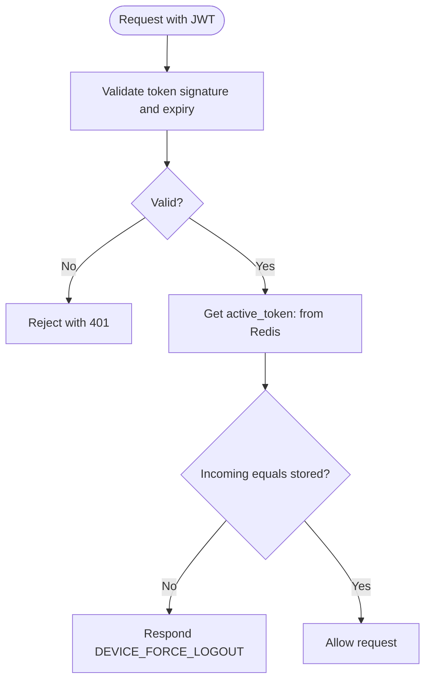
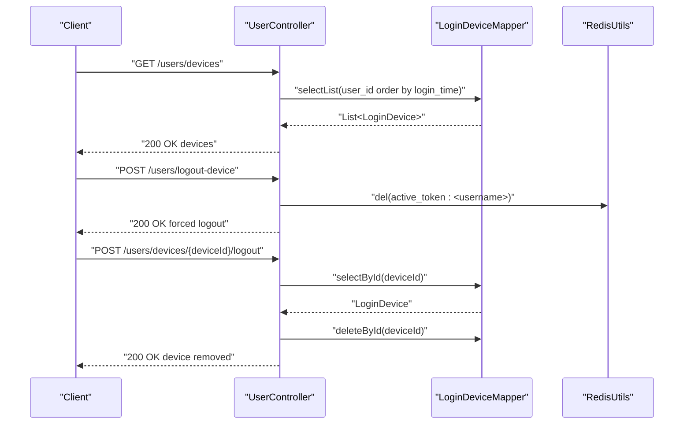
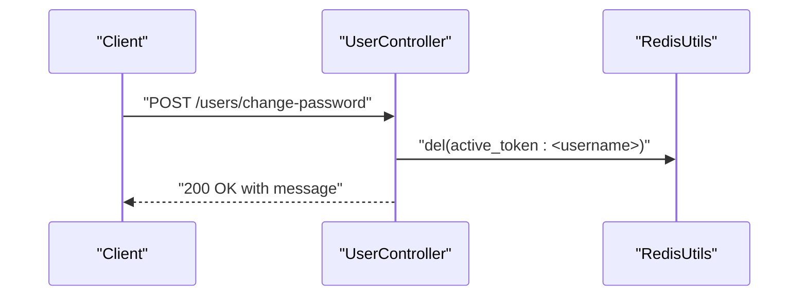
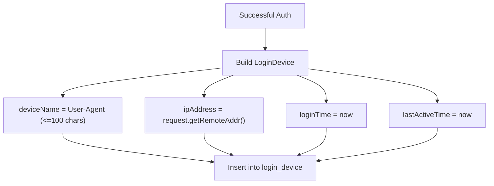
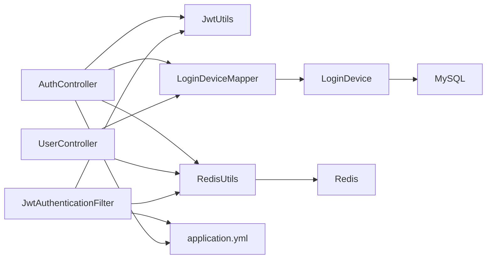

# Device Management and Session Control

<cite>
**Referenced Files in This Document**
- [LoginDevice.java](file://camp-channel-server/src/main/java/com/gdmec/campchannel/entity/LoginDevice.java)
- [LoginDeviceMapper.java](file://camp-channel-server/src/main/java/com/gdmec/campchannel/mapper/LoginDeviceMapper.java)
- [UserController.java](file://camp-channel-server/src/main/java/com/gdmec/campchannel/controller/UserController.java)
- [AuthController.java](file://camp-channel-server/src/main/java/com/gdmec/campchannel/controller/AuthController.java)
- [JwtAuthenticationFilter.java](file://camp-channel-server/src/main/java/com/gdmec/campchannel/security/JwtAuthenticationFilter.java)
- [JwtUtils.java](file://camp-channel-server/src/main/java/com/gdmec/campchannel/common/utils/JwtUtils.java)
- [RedisUtils.java](file://camp-channel-server/src/main/java/com/gdmec/campchannel/common/utils/RedisUtils.java)
- [application.yml](file://camp-channel-server/src/main/resources/application.yml)
- [schema.sql](file://camp-channel-server/src/main/resources/db/schema.sql)
</cite>

## Table of Contents
1. [Introduction](#introduction)
2. [Project Structure](#project-structure)
3. [Core Components](#core-components)
4. [Architecture Overview](#architecture-overview)
5. [Detailed Component Analysis](#detailed-component-analysis)
6. [Dependency Analysis](#dependency-analysis)
7. [Performance Considerations](#performance-considerations)
8. [Troubleshooting Guide](#troubleshooting-guide)
9. [Conclusion](#conclusion)

## Introduction
This document explains the device management and session control system implemented in the backend server. It covers:
- Multi-device login tracking via the LoginDevice entity and database table
- Session management across devices using JWT and Redis
- Remote device logout for single-device login enforcement and security
- Forced logout of all devices upon password changes
- Security considerations including suspicious login detection and automated cleanup
- Practical API endpoints for device discovery and remote logout

## Project Structure
The device/session control functionality spans several layers:
- Entity and persistence: LoginDevice and LoginDeviceMapper
- Controllers: AuthController (login and device recording), UserController (device listing and remote logout)
- Security: JwtAuthenticationFilter (single-device enforcement), JwtUtils (token generation/validation)
- Infrastructure: Redis via RedisUtils and application.yml configuration

**Diagram sources**
- [AuthController.java:124-207](file://camp-channel-server/src/main/java/com/gdmec/campchannel/controller/AuthController.java#L124-L207)
- [UserController.java:348-378](file://camp-channel-server/src/main/java/com/gdmec/campchannel/controller/UserController.java#L348-L378)
- [JwtAuthenticationFilter.java:42-100](file://camp-channel-server/src/main/java/com/gdmec/campchannel/security/JwtAuthenticationFilter.java#L42-L100)
- [JwtUtils.java:66-83](file://camp-channel-server/src/main/java/com/gdmec/campchannel/common/utils/JwtUtils.java#L66-L83)
- [RedisUtils.java:17-168](file://camp-channel-server/src/main/java/com/gdmec/campchannel/common/utils/RedisUtils.java#L17-L168)
- [LoginDeviceMapper.java:7-9](file://camp-channel-server/src/main/java/com/gdmec/campchannel/mapper/LoginDeviceMapper.java#L7-L9)
- [LoginDevice.java:10-26](file://camp-channel-server/src/main/java/com/gdmec/campchannel/entity/LoginDevice.java#L10-L26)
- [application.yml:31-42](file://camp-channel-server/src/main/resources/application.yml#L31-L42)

**Section sources**
- [AuthController.java:124-207](file://camp-channel-server/src/main/java/com/gdmec/campchannel/controller/AuthController.java#L124-L207)
- [UserController.java:348-378](file://camp-channel-server/src/main/java/com/gdmec/campchannel/controller/UserController.java#L348-L378)
- [JwtAuthenticationFilter.java:42-100](file://camp-channel-server/src/main/java/com/gdmec/campchannel/security/JwtAuthenticationFilter.java#L42-L100)
- [JwtUtils.java:66-83](file://camp-channel-server/src/main/java/com/gdmec/campchannel/common/utils/JwtUtils.java#L66-L83)
- [RedisUtils.java:17-168](file://camp-channel-server/src/main/java/com/gdmec/campchannel/common/utils/RedisUtils.java#L17-L168)
- [LoginDeviceMapper.java:7-9](file://camp-channel-server/src/main/java/com/gdmec/campchannel/mapper/LoginDeviceMapper.java#L7-L9)
- [LoginDevice.java:10-26](file://camp-channel-server/src/main/java/com/gdmec/campchannel/entity/LoginDevice.java#L10-L26)
- [application.yml:31-42](file://camp-channel-server/src/main/resources/application.yml#L31-L42)

## Core Components
- LoginDevice entity and table: Stores per-login device metadata including user association, device name, IP address, and timestamps.
- LoginDeviceMapper: MyBatis mapper for LoginDevice persistence.
- AuthController.login: On successful authentication, generates JWT, enforces single-device login by storing the latest token in Redis, and records the login device.
- JwtAuthenticationFilter: During each request, validates the JWT and enforces single-device login by comparing the incoming token against the active token stored in Redis.
- UserController endpoints:
  - GET /users/devices: Lists all login devices for the authenticated user.
  - POST /users/logout-device: Forces logout of all devices by clearing the active token in Redis.
  - POST /users/devices/{deviceId}/logout: Removes a specific device record (remote logout of that device).
- RedisUtils: Provides Redis operations including key-value storage, TTL management, and sliding window rate limiting.
- JwtUtils: Generates and validates JWT tokens with configurable expiration and header scheme.

**Section sources**
- [LoginDevice.java:10-26](file://camp-channel-server/src/main/java/com/gdmec/campchannel/entity/LoginDevice.java#L10-L26)
- [LoginDeviceMapper.java:7-9](file://camp-channel-server/src/main/java/com/gdmec/campchannel/mapper/LoginDeviceMapper.java#L7-L9)
- [AuthController.java:176-206](file://camp-channel-server/src/main/java/com/gdmec/campchannel/controller/AuthController.java#L176-L206)
- [JwtAuthenticationFilter.java:79-96](file://camp-channel-server/src/main/java/com/gdmec/campchannel/security/JwtAuthenticationFilter.java#L79-L96)
- [UserController.java:356-378](file://camp-channel-server/src/main/java/com/gdmec/campchannel/controller/UserController.java#L356-L378)
- [RedisUtils.java:17-168](file://camp-channel-server/src/main/java/com/gdmec/campchannel/common/utils/RedisUtils.java#L17-L168)
- [JwtUtils.java:66-83](file://camp-channel-server/src/main/java/com/gdmec/campchannel/common/utils/JwtUtils.java#L66-L83)

## Architecture Overview
The system enforces single-device login and tracks devices across platforms and browsers. The flow below illustrates the login and enforcement process.

**Diagram sources**
- [AuthController.java:176-206](file://camp-channel-server/src/main/java/com/gdmec/campchannel/controller/AuthController.java#L176-L206)
- [JwtAuthenticationFilter.java:79-96](file://camp-channel-server/src/main/java/com/gdmec/campchannel/security/JwtAuthenticationFilter.java#L79-L96)
- [JwtUtils.java:66-83](file://camp-channel-server/src/main/java/com/gdmec/campchannel/common/utils/JwtUtils.java#L66-L83)
- [RedisUtils.java:67-95](file://camp-channel-server/src/main/java/com/gdmec/campchannel/common/utils/RedisUtils.java#L67-L95)
- [LoginDeviceMapper.java:7-9](file://camp-channel-server/src/main/java/com/gdmec/campchannel/mapper/LoginDeviceMapper.java#L7-L9)

## Detailed Component Analysis

### LoginDevice Entity and Persistence
- Purpose: Persist per-login device metadata for audit and remote logout.
- Fields:
  - id: Auto-increment primary key
  - userId: Foreign key to user
  - deviceName: Captured from User-Agent header (truncated to 100 chars)
  - ipAddress: Client IP from request
  - loginTime: First login timestamp
  - lastActiveTime: Updated on each login
- Persistence: MyBatis mapper handles CRUD; table schema supports indexing on user_id.

**Diagram sources**
- [LoginDevice.java:10-26](file://camp-channel-server/src/main/java/com/gdmec/campchannel/entity/LoginDevice.java#L10-L26)
- [LoginDeviceMapper.java:7-9](file://camp-channel-server/src/main/java/com/gdmec/campchannel/mapper/LoginDeviceMapper.java#L7-L9)

**Section sources**
- [LoginDevice.java:10-26](file://camp-channel-server/src/main/java/com/gdmec/campchannel/entity/LoginDevice.java#L10-L26)
- [schema.sql:163-172](file://camp-channel-server/src/main/resources/db/schema.sql#L163-L172)
- [LoginDeviceMapper.java:7-9](file://camp-channel-server/src/main/java/com/gdmec/campchannel/mapper/LoginDeviceMapper.java#L7-L9)

### Single-Device Login Enforcement
- Active token storage: After successful login, the server stores the latest JWT in Redis under the key pattern active_token:<username> with TTL equal to the JWT expiration.
- Request-time enforcement: The filter compares the incoming token with the stored active token. If they differ, the request is rejected with a device-force-logout error.

**Diagram sources**
- [JwtAuthenticationFilter.java:79-96](file://camp-channel-server/src/main/java/com/gdmec/campchannel/security/JwtAuthenticationFilter.java#L79-L96)
- [JwtUtils.java:80-83](file://camp-channel-server/src/main/java/com/gdmec/campchannel/common/utils/JwtUtils.java#L80-L83)
- [RedisUtils.java:67-95](file://camp-channel-server/src/main/java/com/gdmec/campchannel/common/utils/RedisUtils.java#L67-L95)

**Section sources**
- [JwtAuthenticationFilter.java:79-96](file://camp-channel-server/src/main/java/com/gdmec/campchannel/security/JwtAuthenticationFilter.java#L79-L96)
- [JwtUtils.java:80-83](file://camp-channel-server/src/main/java/com/gdmec/campchannel/common/utils/JwtUtils.java#L80-L83)
- [RedisUtils.java:67-95](file://camp-channel-server/src/main/java/com/gdmec/campchannel/common/utils/RedisUtils.java#L67-L95)

### Device Discovery and Remote Logout APIs
- GET /users/devices
  - Returns a list of LoginDevice entries for the authenticated user, ordered by login time descending.
- POST /users/logout-device
  - Forces logout of all devices by deleting the active token key for the user in Redis.
- POST /users/devices/{deviceId}/logout
  - Deletes a specific LoginDevice record if it belongs to the authenticated user.

**Diagram sources**
- [UserController.java:356-378](file://camp-channel-server/src/main/java/com/gdmec/campchannel/controller/UserController.java#L356-L378)
- [LoginDeviceMapper.java:7-9](file://camp-channel-server/src/main/java/com/gdmec/campchannel/mapper/LoginDeviceMapper.java#L7-L9)
- [RedisUtils.java:51-63](file://camp-channel-server/src/main/java/com/gdmec/campchannel/common/utils/RedisUtils.java#L51-L63)

**Section sources**
- [UserController.java:356-378](file://camp-channel-server/src/main/java/com/gdmec/campchannel/controller/UserController.java#L356-L378)
- [LoginDeviceMapper.java:7-9](file://camp-channel-server/src/main/java/com/gdmec/campchannel/mapper/LoginDeviceMapper.java#L7-L9)
- [RedisUtils.java:51-63](file://camp-channel-server/src/main/java/com/gdmec/campchannel/common/utils/RedisUtils.java#L51-L63)

### Password Change and Global Logout
- When a user changes their password, the server deletes the active token key for that user, forcing all devices to re-authenticate.

**Diagram sources**
- [UserController.java:320-346](file://camp-channel-server/src/main/java/com/gdmec/campchannel/controller/UserController.java#L320-L346)
- [RedisUtils.java:51-63](file://camp-channel-server/src/main/java/com/gdmec/campchannel/common/utils/RedisUtils.java#L51-L63)

**Section sources**
- [UserController.java:320-346](file://camp-channel-server/src/main/java/com/gdmec/campchannel/controller/UserController.java#L320-L346)
- [RedisUtils.java:51-63](file://camp-channel-server/src/main/java/com/gdmec/campchannel/common/utils/RedisUtils.java#L51-L63)

### Device Metadata Collection During Login
- Device name: Captured from the User-Agent header and truncated to 100 characters.
- IP address: Retrieved from the request’s remote address.
- Timestamps: loginTime and lastActiveTime set to current time.

**Diagram sources**
- [AuthController.java:192-203](file://camp-channel-server/src/main/java/com/gdmec/campchannel/controller/AuthController.java#L192-L203)
- [schema.sql:163-172](file://camp-channel-server/src/main/resources/db/schema.sql#L163-L172)

**Section sources**
- [AuthController.java:192-203](file://camp-channel-server/src/main/java/com/gdmec/campchannel/controller/AuthController.java#L192-L203)
- [schema.sql:163-172](file://camp-channel-server/src/main/resources/db/schema.sql#L163-L172)

## Dependency Analysis
- Controllers depend on:
  - JwtUtils for token operations
  - RedisUtils for active token storage and cleanup
  - LoginDeviceMapper for device records
- JwtAuthenticationFilter depends on:
  - JwtUtils for validation
  - RedisUtils for active token retrieval
- Redis configuration is defined in application.yml.

**Diagram sources**
- [AuthController.java:176-206](file://camp-channel-server/src/main/java/com/gdmec/campchannel/controller/AuthController.java#L176-L206)
- [UserController.java:356-378](file://camp-channel-server/src/main/java/com/gdmec/campchannel/controller/UserController.java#L356-L378)
- [JwtAuthenticationFilter.java:79-96](file://camp-channel-server/src/main/java/com/gdmec/campchannel/security/JwtAuthenticationFilter.java#L79-L96)
- [JwtUtils.java:66-83](file://camp-channel-server/src/main/java/com/gdmec/campchannel/common/utils/JwtUtils.java#L66-L83)
- [RedisUtils.java:67-95](file://camp-channel-server/src/main/java/com/gdmec/campchannel/common/utils/RedisUtils.java#L67-L95)
- [LoginDeviceMapper.java:7-9](file://camp-channel-server/src/main/java/com/gdmec/campchannel/mapper/LoginDeviceMapper.java#L7-L9)
- [LoginDevice.java:10-26](file://camp-channel-server/src/main/java/com/gdmec/campchannel/entity/LoginDevice.java#L10-L26)
- [application.yml:31-42](file://camp-channel-server/src/main/resources/application.yml#L31-L42)

**Section sources**
- [AuthController.java:176-206](file://camp-channel-server/src/main/java/com/gdmec/campchannel/controller/AuthController.java#L176-L206)
- [UserController.java:356-378](file://camp-channel-server/src/main/java/com/gdmec/campchannel/controller/UserController.java#L356-L378)
- [JwtAuthenticationFilter.java:79-96](file://camp-channel-server/src/main/java/com/gdmec/campchannel/security/JwtAuthenticationFilter.java#L79-L96)
- [JwtUtils.java:66-83](file://camp-channel-server/src/main/java/com/gdmec/campchannel/common/utils/JwtUtils.java#L66-L83)
- [RedisUtils.java:67-95](file://camp-channel-server/src/main/java/com/gdmec/campchannel/common/utils/RedisUtils.java#L67-L95)
- [LoginDeviceMapper.java:7-9](file://camp-channel-server/src/main/java/com/gdmec/campchannel/mapper/LoginDeviceMapper.java#L7-L9)
- [LoginDevice.java:10-26](file://camp-channel-server/src/main/java/com/gdmec/campchannel/entity/LoginDevice.java#L10-L26)
- [application.yml:31-42](file://camp-channel-server/src/main/resources/application.yml#L31-L42)

## Performance Considerations
- Redis hot keys: The active_token:<username> key is accessed on every request. Consider sharding by username prefix or using Redis Cluster to distribute load.
- Token TTL alignment: The active token TTL matches JWT expiration, ensuring automatic cleanup without manual eviction.
- Device record growth: Over time, the login_device table may grow. Consider periodic archiving or pruning older records.
- Rate limiting: RedisUtils includes a sliding window limiter suitable for protecting sensitive endpoints.

[No sources needed since this section provides general guidance]

## Troubleshooting Guide
- Symptom: Immediate logout after new device login
  - Cause: New token replaces the previous active token in Redis; existing device is kicked.
  - Action: Inform users that single-device login is enforced.
- Symptom: Remote logout does not take effect
  - Cause: Redis connectivity or key mismatch.
  - Action: Verify Redis availability and that the active token key exists for the user.
- Symptom: Device list empty
  - Cause: No prior login recorded or records pruned.
  - Action: Confirm login occurred and device records exist in the database.
- Symptom: Password change appears ineffective
  - Cause: Old tokens remain valid until expiration.
  - Action: Confirm the active token was deleted and clients re-authenticate.

**Section sources**
- [JwtAuthenticationFilter.java:79-96](file://camp-channel-server/src/main/java/com/gdmec/campchannel/security/JwtAuthenticationFilter.java#L79-L96)
- [RedisUtils.java:51-63](file://camp-channel-server/src/main/java/com/gdmec/campchannel/common/utils/RedisUtils.java#L51-L63)
- [UserController.java:320-346](file://camp-channel-server/src/main/java/com/gdmec/campchannel/controller/UserController.java#L320-L346)

## Conclusion
The system implements robust device management and session control:
- Single-device login enforcement via Redis-stored active tokens
- Persistent device records for visibility and remote logout
- Secure password change behavior that forces global logout
- Practical APIs for device discovery and targeted/forced logout
- Configurable JWT and Redis settings for production deployment