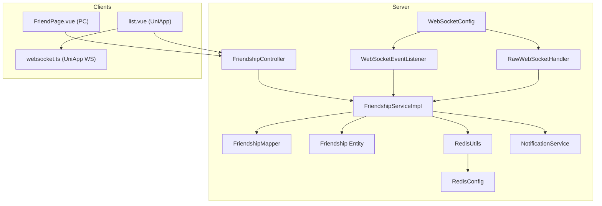
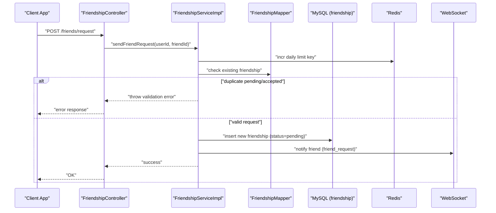
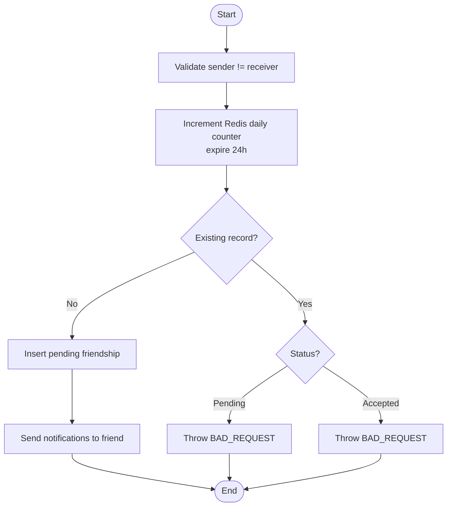
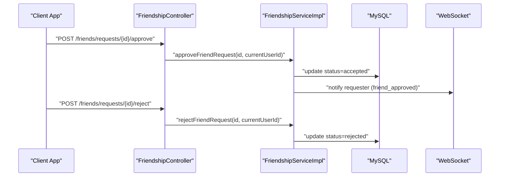
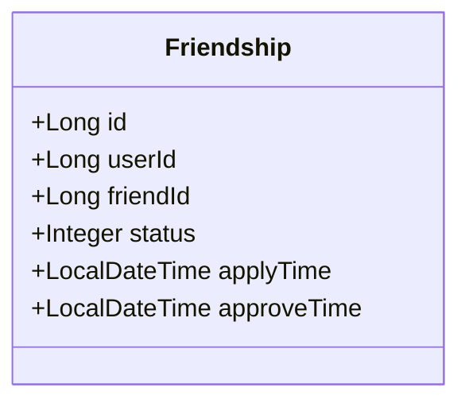
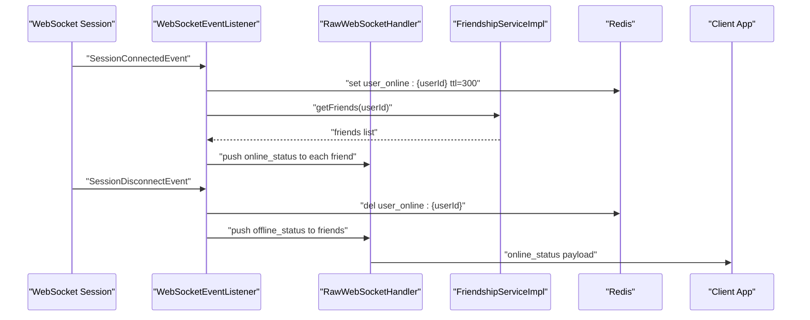
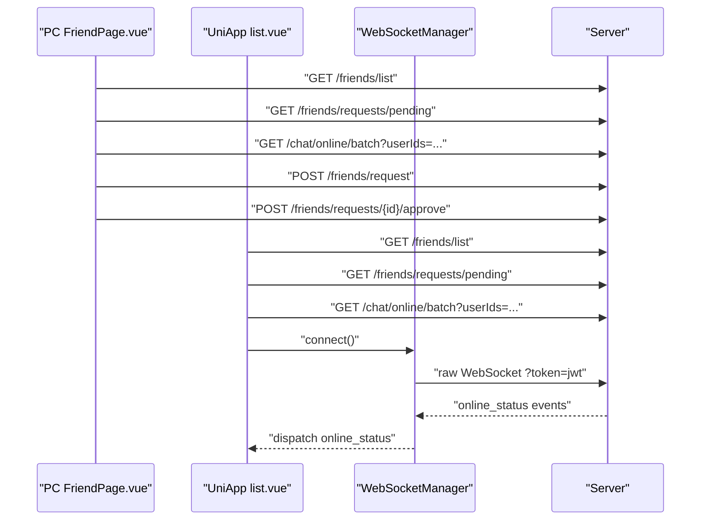
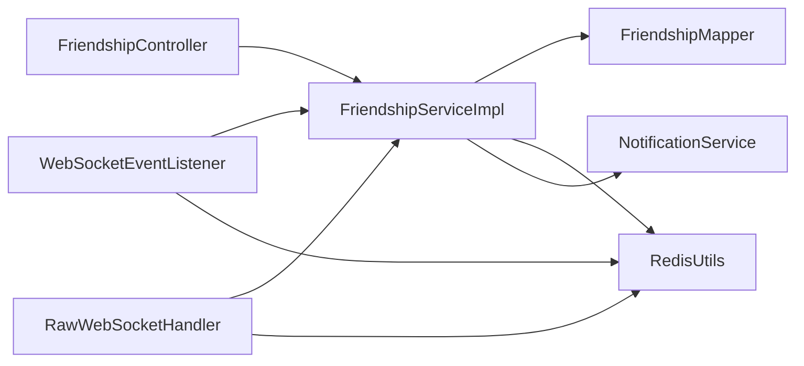

# Friend System and Social Features

<cite>
**Referenced Files in This Document**
- [FriendshipController.java](file://camp-channel-server/src/main/java/com/gdmec/campchannel/controller/FriendshipController.java)
- [FriendshipServiceImpl.java](file://camp-channel-server/src/main/java/com/gdmec/campchannel/service/impl/FriendshipServiceImpl.java)
- [Friendship.java](file://camp-channel-server/src/main/java/com/gdmec/campchannel/entity/Friendship.java)
- [FriendshipMapper.java](file://camp-channel-server/src/main/java/com/gdmec/campchannel/mapper/FriendshipMapper.java)
- [schema.sql](file://camp-channel-server/src/main/resources/db/schema.sql)
- [WebSocketConfig.java](file://camp-channel-server/src/main/java/com/gdmec/campchannel/config/WebSocketConfig.java)
- [WebSocketEventListener.java](file://camp-channel-server/src/main/java/com/gdmec/campchannel/config/WebSocketEventListener.java)
- [RawWebSocketHandler.java](file://camp-channel-server/src/main/java/com/gdmec/campchannel/config/RawWebSocketHandler.java)
- [RedisUtils.java](file://camp-channel-server/src/main/java/com/gdmec/campchannel/common/utils/RedisUtils.java)
- [RedisConfig.java](file://camp-channel-server/src/main/java/com/gdmec/campchannel/config/RedisConfig.java)
- [NotificationService.java](file://camp-channel-server/src/main/java/com/gdmec/campchannel/service/NotificationService.java)
- [FriendPage.vue](file://camp-channel-client-pc/src/pages/FriendPage.vue)
- [list.vue](file://camp-channel-client-uniapp/src/pages/friend/list.vue)
- [websocket.ts](file://camp-channel-client-uniapp/src/utils/websocket.ts)
</cite>

## Table of Contents
1. [Introduction](#introduction)
2. [Project Structure](#project-structure)
3. [Core Components](#core-components)
4. [Architecture Overview](#architecture-overview)
5. [Detailed Component Analysis](#detailed-component-analysis)
6. [Dependency Analysis](#dependency-analysis)
7. [Performance Considerations](#performance-considerations)
8. [Troubleshooting Guide](#troubleshooting-guide)
9. [Conclusion](#conclusion)
10. [Appendices](#appendices)

## Introduction
This document explains the friend system and social features implemented in the backend and integrated across the PC web and UniApp clients. It covers the complete friend request workflow (sending, acceptance, rejection), friendship status management (pending, accepted, blocked), real-time online presence tracking, synchronization of friend lists, WebSocket integration for live updates, Redis caching, privacy controls, and operational safeguards such as rate limiting and validation rules.

## Project Structure
The friend system spans the Spring Boot server (controllers, services, persistence, WebSocket, Redis) and two frontend clients (PC web Vue and UniApp). The server exposes REST endpoints for friend operations and integrates with Redis for online presence and rate limiting, and with WebSocket for real-time notifications.

**Diagram sources**
- [FriendshipController.java:1-116](file://camp-channel-server/src/main/java/com/gdmec/campchannel/controller/FriendshipController.java#L1-L116)
- [FriendshipServiceImpl.java:1-251](file://camp-channel-server/src/main/java/com/gdmec/campchannel/service/impl/FriendshipServiceImpl.java#L1-L251)
- [FriendshipMapper.java:1-9](file://camp-channel-server/src/main/java/com/gdmec/campchannel/mapper/FriendshipMapper.java#L1-L9)
- [Friendship.java:1-26](file://camp-channel-server/src/main/java/com/gdmec/campchannel/entity/Friendship.java#L1-L26)
- [WebSocketConfig.java:1-36](file://camp-channel-server/src/main/java/com/gdmec/campchannel/config/WebSocketConfig.java#L1-L36)
- [WebSocketEventListener.java:1-91](file://camp-channel-server/src/main/java/com/gdmec/campchannel/config/WebSocketEventListener.java#L1-L91)
- [RawWebSocketHandler.java:1-171](file://camp-channel-server/src/main/java/com/gdmec/campchannel/config/RawWebSocketHandler.java#L1-L171)
- [RedisUtils.java:1-170](file://camp-channel-server/src/main/java/com/gdmec/campchannel/common/utils/RedisUtils.java#L1-L170)
- [RedisConfig.java:1-47](file://camp-channel-server/src/main/java/com/gdmec/campchannel/config/RedisConfig.java#L1-L47)
- [NotificationService.java:1-34](file://camp-channel-server/src/main/java/com/gdmec/campchannel/service/NotificationService.java#L1-L34)
- [FriendPage.vue:1-244](file://camp-channel-client-pc/src/pages/FriendPage.vue#L1-L244)
- [list.vue:1-423](file://camp-channel-client-uniapp/src/pages/friend/list.vue#L1-L423)
- [websocket.ts:1-268](file://camp-channel-client-uniapp/src/utils/websocket.ts#L1-L268)

**Section sources**
- [FriendshipController.java:1-116](file://camp-channel-server/src/main/java/com/gdmec/campchannel/controller/FriendshipController.java#L1-L116)
- [schema.sql:91-101](file://camp-channel-server/src/main/resources/db/schema.sql#L91-L101)

## Core Components
- REST endpoints for friend operations exposed by the controller.
- Service layer implementing business rules, validation, rate limiting, and persistence.
- Persistence model and mapper for the friendship table.
- WebSocket configuration and handlers for real-time online status updates.
- Redis utilities and configuration for caching and rate limiting.
- Clients consuming endpoints and subscribing to WebSocket events.

**Section sources**
- [FriendshipController.java:27-110](file://camp-channel-server/src/main/java/com/gdmec/campchannel/controller/FriendshipController.java#L27-L110)
- [FriendshipServiceImpl.java:40-250](file://camp-channel-server/src/main/java/com/gdmec/campchannel/service/impl/FriendshipServiceImpl.java#L40-L250)
- [Friendship.java:10-26](file://camp-channel-server/src/main/java/com/gdmec/campchannel/entity/Friendship.java#L10-L26)
- [FriendshipMapper.java:1-9](file://camp-channel-server/src/main/java/com/gdmec/campchannel/mapper/FriendshipMapper.java#L1-L9)
- [WebSocketConfig.java:11-36](file://camp-channel-server/src/main/java/com/gdmec/campchannel/config/WebSocketConfig.java#L11-L36)
- [WebSocketEventListener.java:18-91](file://camp-channel-server/src/main/java/com/gdmec/campchannel/config/WebSocketEventListener.java#L18-L91)
- [RawWebSocketHandler.java:24-171](file://camp-channel-server/src/main/java/com/gdmec/campchannel/config/RawWebSocketHandler.java#L24-L171)
- [RedisUtils.java:17-170](file://camp-channel-server/src/main/java/com/gdmec/campchannel/common/utils/RedisUtils.java#L17-L170)
- [RedisConfig.java:17-47](file://camp-channel-server/src/main/java/com/gdmec/campchannel/config/RedisConfig.java#L17-L47)

## Architecture Overview
The system separates concerns across controller, service, persistence, and transport layers. Controllers expose REST endpoints; services encapsulate business logic and integrate with Redis and Notification services; WebSocket listeners and handlers broadcast online status to friends; Redis caches online presence and enforces rate limits.

**Diagram sources**
- [FriendshipController.java:34-42](file://camp-channel-server/src/main/java/com/gdmec/campchannel/controller/FriendshipController.java#L34-L42)
- [FriendshipServiceImpl.java:42-91](file://camp-channel-server/src/main/java/com/gdmec/campchannel/service/impl/FriendshipServiceImpl.java#L42-L91)
- [FriendshipMapper.java:1-9](file://camp-channel-server/src/main/java/com/gdmec/campchannel/mapper/FriendshipMapper.java#L1-L9)
- [schema.sql:91-101](file://camp-channel-server/src/main/resources/db/schema.sql#L91-L101)
- [WebSocketEventListener.java:68-89](file://camp-channel-server/src/main/java/com/gdmec/campchannel/config/WebSocketEventListener.java#L68-L89)

## Detailed Component Analysis

### REST API Endpoints for Friends
The controller defines endpoints for searching users, sending friend requests, retrieving pending requests, approving/rejecting requests, fetching friends, deleting friends, and blocking/unblocking friends.

- GET /friends/search?keyword=searchTerm
- POST /friends/request (body: { friendId })
- GET /friends/requests/pending
- POST /friends/requests/{requestId}/approve
- POST /friends/requests/{requestId}/reject
- GET /friends/list
- DELETE /friends/{friendId}
- POST /friends/{friendId}/block
- POST /friends/{friendId}/unblock

These endpoints are implemented in the controller and delegate to the service layer for business logic and persistence.

**Section sources**
- [FriendshipController.java:27-110](file://camp-channel-server/src/main/java/com/gdmec/campchannel/controller/FriendshipController.java#L27-L110)

### Friend Request Workflow
The workflow includes sending, accepting, and rejecting friend requests with validation and notifications.

**Diagram sources**
- [FriendshipServiceImpl.java:42-91](file://camp-channel-server/src/main/java/com/gdmec/campchannel/service/impl/FriendshipServiceImpl.java#L42-L91)
- [NotificationService.java:10-13](file://camp-channel-server/src/main/java/com/gdmec/campchannel/service/NotificationService.java#L10-L13)

**Section sources**
- [FriendshipServiceImpl.java:42-91](file://camp-channel-server/src/main/java/com/gdmec/campchannel/service/impl/FriendshipServiceImpl.java#L42-L91)

### Acceptance and Rejection of Requests
Acceptance sets the status to accepted and notifies the requester. Rejection sets the status to rejected. Both operations validate ownership and state transitions.

**Diagram sources**
- [FriendshipController.java:53-71](file://camp-channel-server/src/main/java/com/gdmec/campchannel/controller/FriendshipController.java#L53-L71)
- [FriendshipServiceImpl.java:95-139](file://camp-channel-server/src/main/java/com/gdmec/campchannel/service/impl/FriendshipServiceImpl.java#L95-L139)
- [NotificationService.java:10-13](file://camp-channel-server/src/main/java/com/gdmec/campchannel/service/NotificationService.java#L10-L13)

**Section sources**
- [FriendshipController.java:53-71](file://camp-channel-server/src/main/java/com/gdmec/campchannel/controller/FriendshipController.java#L53-L71)
- [FriendshipServiceImpl.java:95-139](file://camp-channel-server/src/main/java/com/gdmec/campchannel/service/impl/FriendshipServiceImpl.java#L95-L139)

### Friendship Status Management
Friendship statuses:
- 0: Pending
- 1: Accepted
- 2: Rejected
- 3: Blocked (custom extension)

Blocked users remain in the friendship table but are marked as blocked. They can be unblocked to restore to accepted.

**Diagram sources**
- [Friendship.java:10-26](file://camp-channel-server/src/main/java/com/gdmec/campchannel/entity/Friendship.java#L10-L26)
- [schema.sql:91-101](file://camp-channel-server/src/main/resources/db/schema.sql#L91-L101)

**Section sources**
- [FriendshipServiceImpl.java:212-250](file://camp-channel-server/src/main/java/com/gdmec/campchannel/service/impl/FriendshipServiceImpl.java#L212-L250)
- [schema.sql:91-101](file://camp-channel-server/src/main/resources/db/schema.sql#L91-L101)

### Online Presence Tracking and Real-Time Updates
Online presence is tracked using Redis with a time-to-live key. WebSocket listeners and handlers broadcast online/offline status to friends via both raw WebSocket and STOMP queues.

**Diagram sources**
- [WebSocketEventListener.java:32-62](file://camp-channel-server/src/main/java/com/gdmec/campchannel/config/WebSocketEventListener.java#L32-L62)
- [RawWebSocketHandler.java:41-102](file://camp-channel-server/src/main/java/com/gdmec/campchannel/config/RawWebSocketHandler.java#L41-L102)
- [WebSocketConfig.java:18-35](file://camp-channel-server/src/main/java/com/gdmec/campchannel/config/WebSocketConfig.java#L18-L35)

**Section sources**
- [WebSocketEventListener.java:32-62](file://camp-channel-server/src/main/java/com/gdmec/campchannel/config/WebSocketEventListener.java#L32-L62)
- [RawWebSocketHandler.java:41-102](file://camp-channel-server/src/main/java/com/gdmec/campchannel/config/RawWebSocketHandler.java#L41-L102)
- [WebSocketConfig.java:18-35](file://camp-channel-server/src/main/java/com/gdmec/campchannel/config/WebSocketConfig.java#L18-L35)

### Client Integration and Real-Time Updates
- PC web client (Vue) fetches friend lists and pending requests, polls online status, and subscribes to WebSocket events.
- UniApp client fetches friend lists, polls online status, connects to raw WebSocket for online status events, and handles reconnection.

**Diagram sources**
- [FriendPage.vue:146-185](file://camp-channel-client-pc/src/pages/FriendPage.vue#L146-L185)
- [list.vue:97-161](file://camp-channel-client-uniapp/src/pages/friend/list.vue#L97-L161)
- [websocket.ts:23-129](file://camp-channel-client-uniapp/src/utils/websocket.ts#L23-L129)

**Section sources**
- [FriendPage.vue:146-185](file://camp-channel-client-pc/src/pages/FriendPage.vue#L146-L185)
- [list.vue:97-161](file://camp-channel-client-uniapp/src/pages/friend/list.vue#L97-L161)
- [websocket.ts:23-129](file://camp-channel-client-uniapp/src/utils/websocket.ts#L23-L129)

### Privacy Controls and Visibility
- Friend lists are visible only to authenticated users.
- Online presence is broadcast to friends only; non-friends do not receive status updates.
- The system does not implement per-user privacy toggles for friend list visibility; visibility is implicit to authenticated users with accepted friendships.

**Section sources**
- [WebSocketEventListener.java:68-89](file://camp-channel-server/src/main/java/com/gdmec/campchannel/config/WebSocketEventListener.java#L68-L89)
- [RawWebSocketHandler.java:151-162](file://camp-channel-server/src/main/java/com/gdmec/campchannel/config/RawWebSocketHandler.java#L151-L162)

### Implementation Details and Validation Rules
- Duplicate friend requests: Prevented by checking existing records and their status.
- Mutual friend detection: Achieved by querying both directions (user_id=userId AND friend_id=other OR vice versa).
- Friend removal: Requires an accepted friendship; otherwise, a validation error is thrown.
- Spam prevention: Daily friend request limit enforced via Redis with a sliding-window-like increment and expiration.
- Friend count limitations: Enforced by the daily limit rule; additional limits can be introduced at the service level if needed.

**Section sources**
- [FriendshipServiceImpl.java:47-54](file://camp-channel-server/src/main/java/com/gdmec/campchannel/service/impl/FriendshipServiceImpl.java#L47-L54)
- [FriendshipServiceImpl.java:196-210](file://camp-channel-server/src/main/java/com/gdmec/campchannel/service/impl/FriendshipServiceImpl.java#L196-L210)
- [FriendshipServiceImpl.java:212-250](file://camp-channel-server/src/main/java/com/gdmec/campchannel/service/impl/FriendshipServiceImpl.java#L212-L250)

### Performance Optimization Strategies
- Efficient querying:
  - Use indexed columns (friend_id, status) for friend queries.
  - Batch retrieval of friend profiles using selectBatchIds to minimize round trips.
- Redis caching:
  - Store online presence with TTL to avoid frequent DB reads.
  - Use Redis for rate limiting keys with expirable counters.
- WebSocket scalability:
  - Broadcast to friends via both raw WebSocket and STOMP queues to support multiple client types.
  - Keep WebSocket connections lightweight; push minimal payloads (online_status).

**Section sources**
- [schema.sql:91-101](file://camp-channel-server/src/main/resources/db/schema.sql#L91-L101)
- [FriendshipServiceImpl.java:150-176](file://camp-channel-server/src/main/java/com/gdmec/campchannel/service/impl/FriendshipServiceImpl.java#L150-L176)
- [WebSocketEventListener.java:68-89](file://camp-channel-server/src/main/java/com/gdmec/campchannel/config/WebSocketEventListener.java#L68-L89)
- [RawWebSocketHandler.java:151-162](file://camp-channel-server/src/main/java/com/gdmec/campchannel/config/RawWebSocketHandler.java#L151-L162)

## Dependency Analysis
The service layer depends on Redis utilities for rate limiting and online presence, on the friendship mapper for persistence, and on notification services for user alerts. WebSocket listeners depend on the service to fetch friends and on Redis for online checks.

**Diagram sources**
- [FriendshipController.java:24-25](file://camp-channel-server/src/main/java/com/gdmec/campchannel/controller/FriendshipController.java#L24-L25)
- [FriendshipServiceImpl.java:28-38](file://camp-channel-server/src/main/java/com/gdmec/campchannel/service/impl/FriendshipServiceImpl.java#L28-L38)
- [WebSocketEventListener.java:21-28](file://camp-channel-server/src/main/java/com/gdmec/campchannel/config/WebSocketEventListener.java#L21-L28)
- [RawWebSocketHandler.java:30-37](file://camp-channel-server/src/main/java/com/gdmec/campchannel/config/RawWebSocketHandler.java#L30-L37)

**Section sources**
- [FriendshipServiceImpl.java:28-38](file://camp-channel-server/src/main/java/com/gdmec/campchannel/service/impl/FriendshipServiceImpl.java#L28-L38)
- [WebSocketEventListener.java:21-28](file://camp-channel-server/src/main/java/com/gdmec/campchannel/config/WebSocketEventListener.java#L21-L28)
- [RawWebSocketHandler.java:30-37](file://camp-channel-server/src/main/java/com/gdmec/campchannel/config/RawWebSocketHandler.java#L30-L37)

## Performance Considerations
- Index friend_id and status for fast filtering of pending/accepted/blocked requests.
- Use batched queries for friend profiles to reduce DB load.
- Keep online presence TTL aligned with heartbeat intervals to balance freshness and cost.
- Limit search result size to prevent heavy queries.
- Apply rate limiting at the edge (Redis) to protect backend from abuse.

[No sources needed since this section provides general guidance]

## Troubleshooting Guide
Common issues and resolutions:
- Duplicate friend requests: The service prevents duplicate pending/accepted requests; ensure UI hides “Add Friend” after sending a pending request.
- Mutual friend detection: Use bidirectional queries to confirm accepted relationships before enabling actions.
- Friend removal: Verify friendship exists and is accepted before attempting deletion.
- WebSocket online status not updating:
  - Confirm WebSocket connection includes a valid JWT token query parameter.
  - Ensure Redis connectivity and TTL settings for online keys.
  - Verify client subscriptions to online_status events.

**Section sources**
- [FriendshipServiceImpl.java:61-67](file://camp-channel-server/src/main/java/com/gdmec/campchannel/service/impl/FriendshipServiceImpl.java#L61-L67)
- [WebSocketEventListener.java:32-62](file://camp-channel-server/src/main/java/com/gdmec/campchannel/config/WebSocketEventListener.java#L32-L62)
- [RawWebSocketHandler.java:41-74](file://camp-channel-server/src/main/java/com/gdmec/campchannel/config/RawWebSocketHandler.java#L41-L74)
- [websocket.ts:44-50](file://camp-channel-client-uniapp/src/utils/websocket.ts#L44-L50)

## Conclusion
The friend system provides a robust foundation for social interactions with clear workflows for friend requests, explicit status management, and real-time online presence updates. Redis and WebSocket enable scalable, low-latency experiences across clients, while service-layer validations and rate limiting protect the system from misuse. Extending privacy controls or friend count caps can be added at the service level as requirements evolve.

[No sources needed since this section summarizes without analyzing specific files]

## Appendices

### API Endpoint Reference
- Search users: GET /friends/search?keyword={term}
- Send friend request: POST /friends/request
- Pending requests: GET /friends/requests/pending
- Approve request: POST /friends/requests/{requestId}/approve
- Reject request: POST /friends/requests/{requestId}/reject
- Get friends: GET /friends/list
- Delete friend: DELETE /friends/{friendId}
- Block friend: POST /friends/{friendId}/block
- Unblock friend: POST /friends/{friendId}/unblock

**Section sources**
- [FriendshipController.java:27-110](file://camp-channel-server/src/main/java/com/gdmec/campchannel/controller/FriendshipController.java#L27-L110)