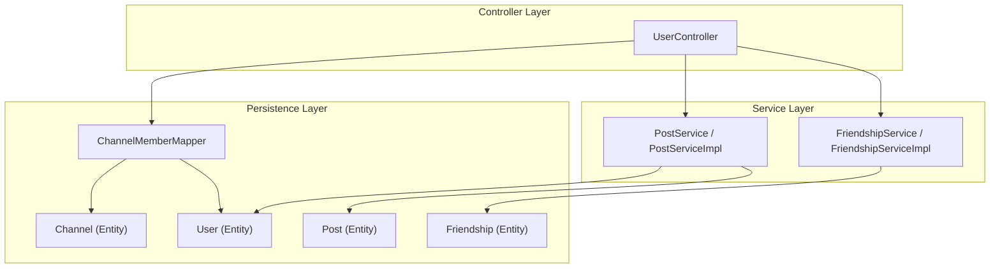
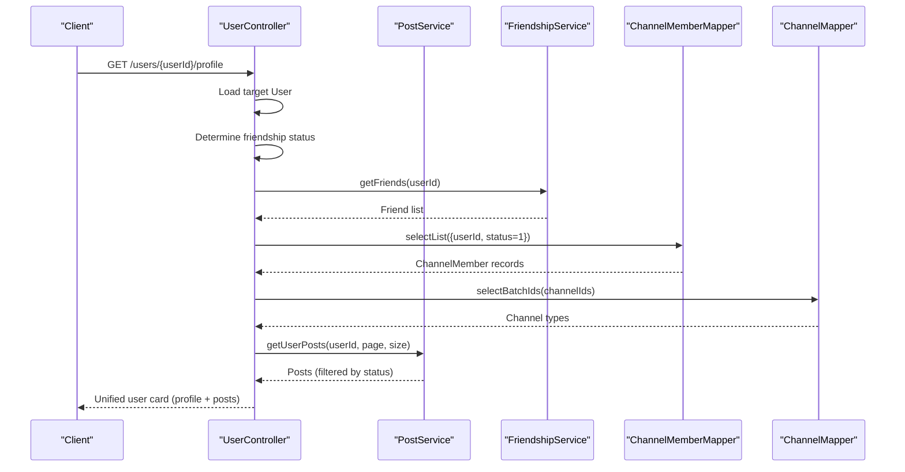
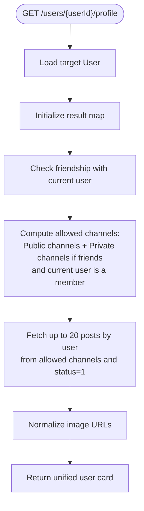
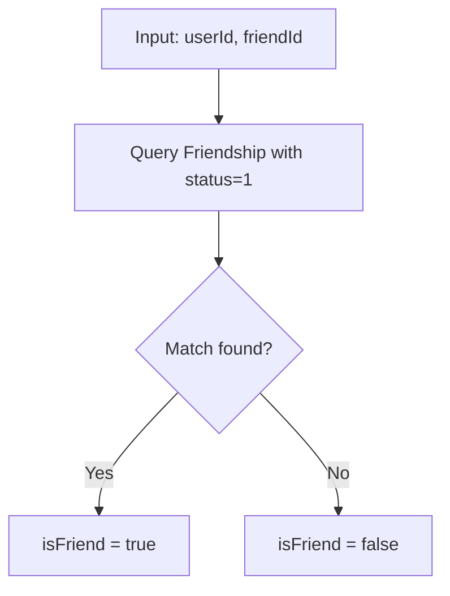
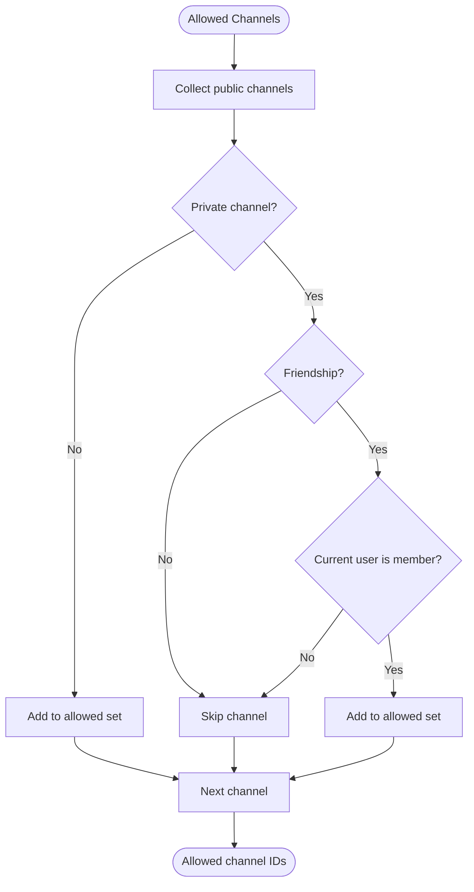
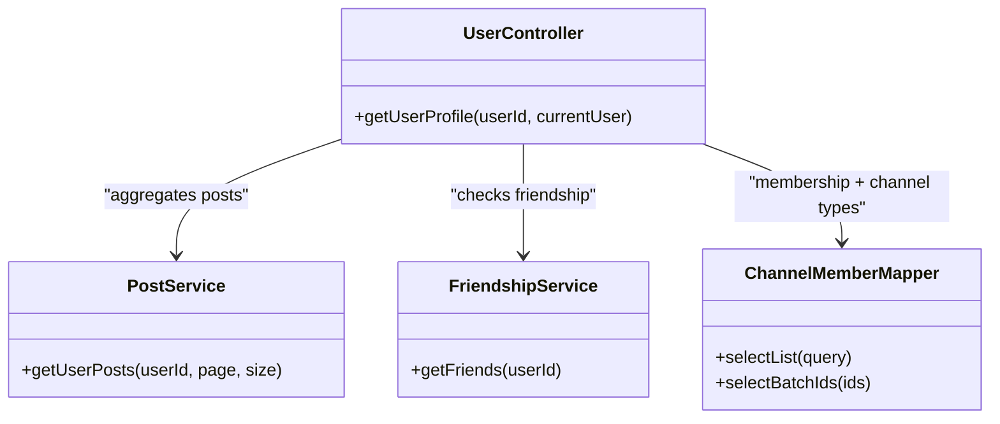
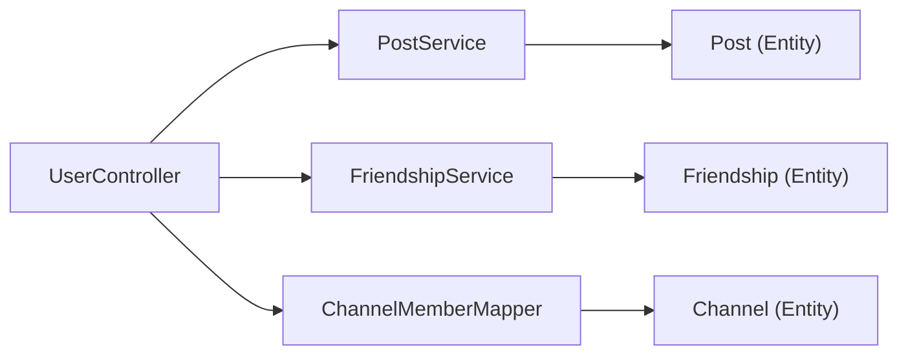
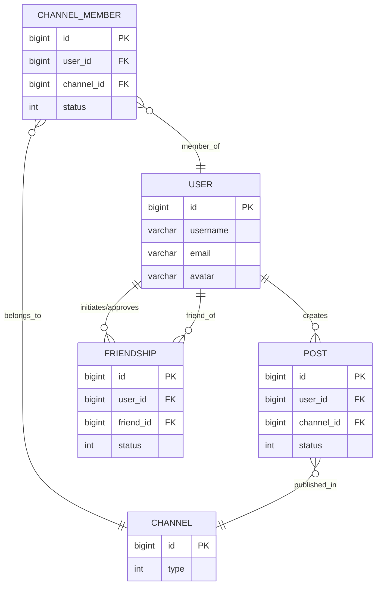

# User Analytics and Integration Features

<cite>
**Referenced Files in This Document**
- [UserController.java](file://camp-channel-server/src/main/java/com/gdmec/campchannel/controller/UserController.java)
- [PostService.java](file://camp-channel-server/src/main/java/com/gdmec/campchannel/service/PostService.java)
- [PostServiceImpl.java](file://camp-channel-server/src/main/java/com/gdmec/campchannel/service/impl/PostServiceImpl.java)
- [FriendshipService.java](file://camp-channel-server/src/main/java/com/gdmec/campchannel/service/FriendshipService.java)
- [FriendshipServiceImpl.java](file://camp-channel-server/src/main/java/com/gdmec/campchannel/service/impl/FriendshipServiceImpl.java)
- [ChannelMemberMapper.java](file://camp-channel-server/src/main/java/com/gdmec/campchannel/mapper/ChannelMemberMapper.java)
- [Channel.java](file://camp-channel-server/src/main/java/com/gdmec/campchannel/entity/Channel.java)
- [ChannelMember.java](file://camp-channel-server/src/main/java/com/gdmec/campchannel/entity/ChannelMember.java)
- [Friendship.java](file://camp-channel-server/src/main/java/com/gdmec/campchannel/entity/Friendship.java)
- [Post.java](file://camp-channel-server/src/main/java/com/gdmec/campchannel/entity/Post.java)
- [User.java](file://camp-channel-server/src/main/java/com/gdmec/campchannel/entity/User.java)
</cite>

## Table of Contents
1. [Introduction](#introduction)
2. [Project Structure](#project-structure)
3. [Core Components](#core-components)
4. [Architecture Overview](#architecture-overview)
5. [Detailed Component Analysis](#detailed-component-analysis)
6. [Dependency Analysis](#dependency-analysis)
7. [Performance Considerations](#performance-considerations)
8. [Troubleshooting Guide](#troubleshooting-guide)
9. [Conclusion](#conclusion)
10. [Appendices](#appendices)

## Introduction
This document explains the user analytics and integration features within the user management system, focusing on:
- User profile aggregation that combines post counts, friend counts, and channel memberships into unified user cards
- Privacy-aware content sharing respecting channel privacy settings when displaying user posts on profiles
- Integration between user profiles and channel membership data to determine visibility based on friendship status and channel type
- Concrete examples of the getUserProfile endpoint and its data aggregation across PostService, FriendshipService, and ChannelMemberMapper
- Algorithms for friend relationship determination and allowed content visibility
- Performance optimization techniques for aggregating user statistics and caching frequently accessed user data
- The relationship between user analytics and content discovery features

## Project Structure
The user analytics and integration features are primarily implemented in the server module under the Java package com.gdmec.campchannel. The key components involved are:
- Controller: UserController orchestrates user-related endpoints and integrates multiple services
- Services: PostService, FriendshipService, and their implementations
- Mappers: ChannelMemberMapper for channel membership queries
- Entities: User, Post, Channel, ChannelMember, Friendship

**Diagram sources**
- [UserController.java:113-227](file://camp-channel-server/src/main/java/com/gdmec/campchannel/controller/UserController.java#L113-L227)
- [PostService.java:1-49](file://camp-channel-server/src/main/java/com/gdmec/campchannel/service/PostService.java#L1-L49)
- [PostServiceImpl.java:1-387](file://camp-channel-server/src/main/java/com/gdmec/campchannel/service/impl/PostServiceImpl.java#L1-L387)
- [FriendshipService.java:1-55](file://camp-channel-server/src/main/java/com/gdmec/campchannel/service/FriendshipService.java#L1-L55)
- [FriendshipServiceImpl.java:1-251](file://camp-channel-server/src/main/java/com/gdmec/campchannel/service/impl/FriendshipServiceImpl.java#L1-L251)
- [ChannelMemberMapper.java:1-9](file://camp-channel-server/src/main/java/com/gdmec/campchannel/mapper/ChannelMemberMapper.java#L1-L9)
- [Channel.java:1-32](file://camp-channel-server/src/main/java/com/gdmec/campchannel/entity/Channel.java#L1-L32)
- [User.java:1-42](file://camp-channel-server/src/main/java/com/gdmec/campchannel/entity/User.java#L1-L42)
- [Post.java:1-58](file://camp-channel-server/src/main/java/com/gdmec/campchannel/entity/Post.java#L1-L58)
- [Friendship.java:1-26](file://camp-channel-server/src/main/java/com/gdmec/campchannel/entity/Friendship.java#L1-L26)

**Section sources**
- [UserController.java:113-227](file://camp-channel-server/src/main/java/com/gdmec/campchannel/controller/UserController.java#L113-L227)

## Core Components
- UserController.getUserProfile: Aggregates user profile data, determines friendship status, computes allowed channel memberships, filters posts by privacy rules, and returns a unified user card
- PostService.getUserPosts: Provides user-specific posts used for profile aggregation
- FriendshipService.getFriends: Supplies friend relationships used to compute visibility for private channels
- ChannelMemberMapper: Retrieves channel memberships for a user to determine allowed channels
- Channel and ChannelMember entities: Define channel privacy types and membership records

Key responsibilities:
- Aggregate post count and friend count for the current user’s own profile
- Determine friendship status between the requester and target user
- Compute allowed channels considering public/private channel types and friendship/member status
- Filter posts by allowed channels and visibility rules
- Return a unified user card with profile metadata and filtered posts

**Section sources**
- [UserController.java:73-100](file://camp-channel-server/src/main/java/com/gdmec/campchannel/controller/UserController.java#L73-L100)
- [UserController.java:113-227](file://camp-channel-server/src/main/java/com/gdmec/campchannel/controller/UserController.java#L113-L227)
- [PostService.java:30-33](file://camp-channel-server/src/main/java/com/gdmec/campchannel/service/PostService.java#L30-L33)
- [FriendshipService.java:31-34](file://camp-channel-server/src/main/java/com/gdmec/campchannel/service/FriendshipService.java#L31-L34)
- [ChannelMemberMapper.java:1-9](file://camp-channel-server/src/main/java/com/gdmec/campchannel/mapper/ChannelMemberMapper.java#L1-L9)
- [Channel.java:23](file://camp-channel-server/src/main/java/com/gdmec/campchannel/entity/Channel.java#L23)

## Architecture Overview
The user analytics pipeline integrates multiple services and mappers to produce a privacy-aware user profile card.

**Diagram sources**
- [UserController.java:113-227](file://camp-channel-server/src/main/java/com/gdmec/campchannel/controller/UserController.java#L113-L227)
- [PostService.java:30-33](file://camp-channel-server/src/main/java/com/gdmec/campchannel/service/PostService.java#L30-L33)
- [FriendshipService.java:31-34](file://camp-channel-server/src/main/java/com/gdmec/campchannel/service/FriendshipService.java#L31-L34)
- [ChannelMemberMapper.java:1-9](file://camp-channel-server/src/main/java/com/gdmec/campchannel/mapper/ChannelMemberMapper.java#L1-L9)

## Detailed Component Analysis

### User Profile Aggregation Endpoint
The getUserProfile endpoint performs:
- Target user lookup and sanitization
- Friendship determination between requester and target user
- Allowed channel computation based on channel types and membership
- Post filtering by allowed channels and visibility rules
- Image URL normalization for post media

**Diagram sources**
- [UserController.java:113-227](file://camp-channel-server/src/main/java/com/gdmec/campchannel/controller/UserController.java#L113-L227)

**Section sources**
- [UserController.java:113-227](file://camp-channel-server/src/main/java/com/gdmec/campchannel/controller/UserController.java#L113-L227)

### Friendship Relationship Determination
Friendship status is determined by querying the Friendship table with bidirectional conditions and a status filter. The algorithm:
- Accepts either (userId, friendId) or (friendId, userId) pairs
- Filters only accepted friendships (status=1)
- Returns true if any matching record exists

**Diagram sources**
- [UserController.java:134-141](file://camp-channel-server/src/main/java/com/gdmec/campchannel/controller/UserController.java#L134-L141)
- [FriendshipService.java:151-176](file://camp-channel-server/src/main/java/com/gdmec/campchannel/service/FriendshipService.java#L151-L176)

**Section sources**
- [UserController.java:134-141](file://camp-channel-server/src/main/java/com/gdmec/campchannel/controller/UserController.java#L134-L141)
- [FriendshipServiceImpl.java:150-176](file://camp-channel-server/src/main/java/com/gdmec/campchannel/service/impl/FriendshipServiceImpl.java#L150-L176)

### Allowed Content Visibility Algorithm
Visibility is computed per channel:
- Public channels (type=1): always allowed
- Private channels (type=2): allowed only if friendship=true AND current user is a member
- Posts are filtered by status=1 and limited to recent 20

**Diagram sources**
- [UserController.java:144-186](file://camp-channel-server/src/main/java/com/gdmec/campchannel/controller/UserController.java#L144-L186)
- [Channel.java:23](file://camp-channel-server/src/main/java/com/gdmec/campchannel/entity/Channel.java#L23)

**Section sources**
- [UserController.java:144-186](file://camp-channel-server/src/main/java/com/gdmec/campchannel/controller/UserController.java#L144-L186)
- [Channel.java:23](file://camp-channel-server/src/main/java/com/gdmec/campchannel/entity/Channel.java#L23)

### Data Aggregation Across Services
The getUserProfile endpoint integrates:
- PostService.getUserPosts for recent posts
- FriendshipService.getFriends for friend relationships
- ChannelMemberMapper for membership records
- ChannelMapper for channel type resolution

**Diagram sources**
- [UserController.java:113-227](file://camp-channel-server/src/main/java/com/gdmec/campchannel/controller/UserController.java#L113-L227)
- [PostService.java:30-33](file://camp-channel-server/src/main/java/com/gdmec/campchannel/service/PostService.java#L30-L33)
- [FriendshipService.java:31-34](file://camp-channel-server/src/main/java/com/gdmec/campchannel/service/FriendshipService.java#L31-L34)
- [ChannelMemberMapper.java:1-9](file://camp-channel-server/src/main/java/com/gdmec/campchannel/mapper/ChannelMemberMapper.java#L1-L9)

**Section sources**
- [UserController.java:113-227](file://camp-channel-server/src/main/java/com/gdmec/campchannel/controller/UserController.java#L113-L227)
- [PostServiceImpl.java:242-282](file://camp-channel-server/src/main/java/com/gdmec/campchannel/service/impl/PostServiceImpl.java#L242-L282)
- [FriendshipServiceImpl.java:150-176](file://camp-channel-server/src/main/java/com/gdmec/campchannel/service/impl/FriendshipServiceImpl.java#L150-L176)

### Privacy-Aware Content Sharing
- Public channels: posts visible to all
- Private channels: posts visible only to friends who are also members
- Status filtering ensures only approved posts appear
- Recent post limit prevents excessive data transfer

**Section sources**
- [UserController.java:144-223](file://camp-channel-server/src/main/java/com/gdmec/campchannel/controller/UserController.java#L144-L223)
- [Post.java:32](file://camp-channel-server/src/main/java/com/gdmec/campchannel/entity/Post.java#L32)

### User Analytics and Content Discovery
- User profile cards feed content discovery by exposing recent posts and friend relationships
- Privacy controls ensure only appropriate content is shown, aligning analytics with user preferences
- The unified user card can be consumed by frontend clients to power profile pages and social feeds

[No sources needed since this section synthesizes previously analyzed components]

## Dependency Analysis
The getUserProfile endpoint depends on:
- PostService for retrieving user posts
- FriendshipService for checking friend relationships
- ChannelMemberMapper for membership and channel type resolution
- ChannelMapper for channel type lookup

**Diagram sources**
- [UserController.java:113-227](file://camp-channel-server/src/main/java/com/gdmec/campchannel/controller/UserController.java#L113-L227)
- [PostService.java:30-33](file://camp-channel-server/src/main/java/com/gdmec/campchannel/service/PostService.java#L30-L33)
- [FriendshipService.java:31-34](file://camp-channel-server/src/main/java/com/gdmec/campchannel/service/FriendshipService.java#L31-L34)
- [ChannelMemberMapper.java:1-9](file://camp-channel-server/src/main/java/com/gdmec/campchannel/mapper/ChannelMemberMapper.java#L1-L9)

**Section sources**
- [UserController.java:113-227](file://camp-channel-server/src/main/java/com/gdmec/campchannel/controller/UserController.java#L113-L227)

## Performance Considerations
Optimization techniques for user statistics aggregation and caching:
- Batch channel type resolution: Use selectBatchIds to minimize database round-trips when resolving channel types
- Limit post fetch: Cap posts to recent 20 to reduce payload size and improve response latency
- Friendship checks: Use a single query with bidirectional conditions to avoid multiple round-trips
- Membership verification: Confirm membership before including private channel posts to prevent unnecessary queries
- Caching strategies: Cache frequently accessed user data (e.g., profile metadata) and membership lists to reduce repeated computations
- Indexing recommendations: Ensure indexes on user_id, channel_id, status, and timestamps in relevant tables to optimize queries

[No sources needed since this section provides general guidance]

## Troubleshooting Guide
Common issues and resolutions:
- Unauthorized or missing user: Ensure proper authentication and that the target user exists
- Empty or limited posts: Verify channel privacy settings, friendship status, and membership; confirm post status filtering
- Incorrect friendship detection: Validate Friendship query conditions and status values
- Slow response times: Review batch operations and consider adding caching for frequent reads

**Section sources**
- [UserController.java:119-122](file://camp-channel-server/src/main/java/com/gdmec/campchannel/controller/UserController.java#L119-L122)
- [UserController.java:188-223](file://camp-channel-server/src/main/java/com/gdmec/campchannel/controller/UserController.java#L188-L223)
- [FriendshipServiceImpl.java:150-176](file://camp-channel-server/src/main/java/com/gdmec/campchannel/service/impl/FriendshipServiceImpl.java#L150-L176)

## Conclusion
The user analytics and integration features combine user profile aggregation, privacy-aware content visibility, and efficient data retrieval across services. By leveraging batch operations, friendship checks, and channel membership rules, the system produces unified user cards that respect privacy while enabling rich content discovery experiences.

[No sources needed since this section summarizes without analyzing specific files]

## Appendices
- Entity relationships used in aggregation:
  - User → Post (one-to-many via user_id)
  - User → Friendship (bidirectional via user_id/friend_id)
  - ChannelMember links users to channels
  - Channel defines privacy type affecting visibility

**Diagram sources**
- [User.java:14-31](file://camp-channel-server/src/main/java/com/gdmec/campchannel/entity/User.java#L14-L31)
- [Post.java:18-26](file://camp-channel-server/src/main/java/com/gdmec/campchannel/entity/Post.java#L18-L26)
- [ChannelMember.java:18-24](file://camp-channel-server/src/main/java/com/gdmec/campchannel/entity/ChannelMember.java#L18-L24)
- [Channel.java:23](file://camp-channel-server/src/main/java/com/gdmec/campchannel/entity/Channel.java#L23)
- [Friendship.java:17-21](file://camp-channel-server/src/main/java/com/gdmec/campchannel/entity/Friendship.java#L17-L21)