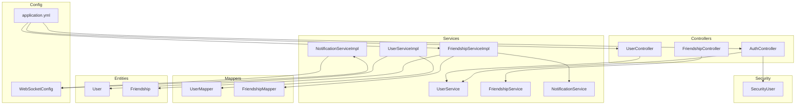
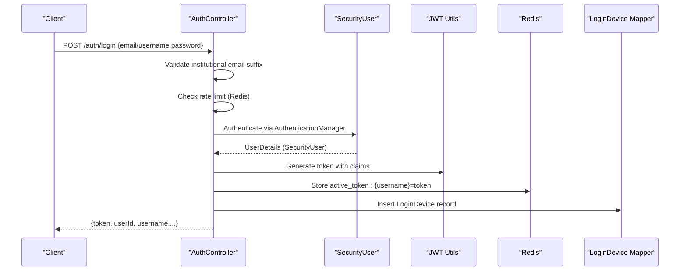
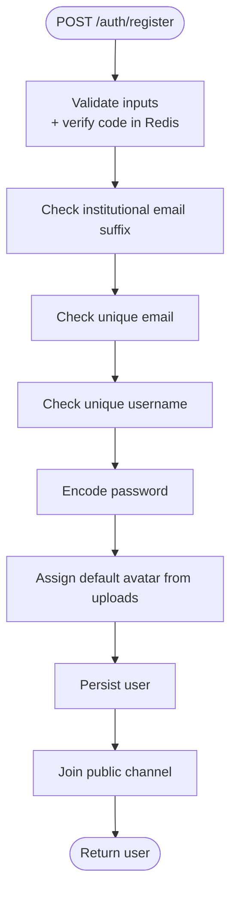
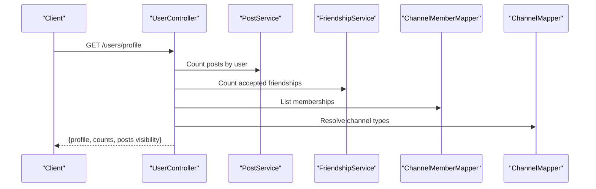
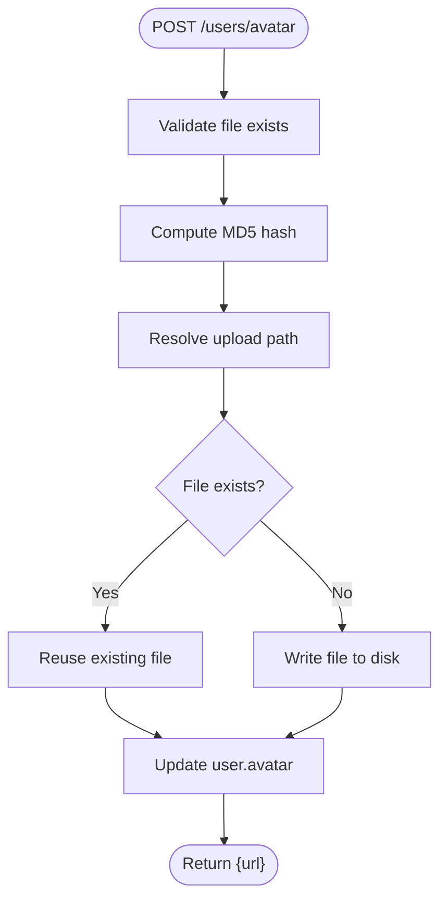
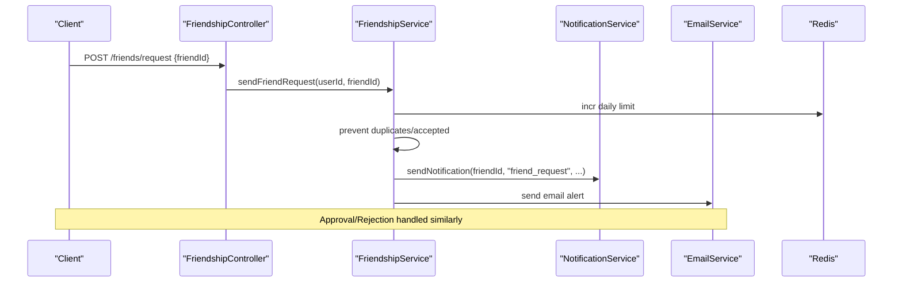
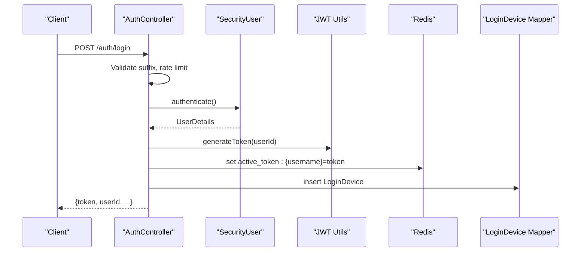
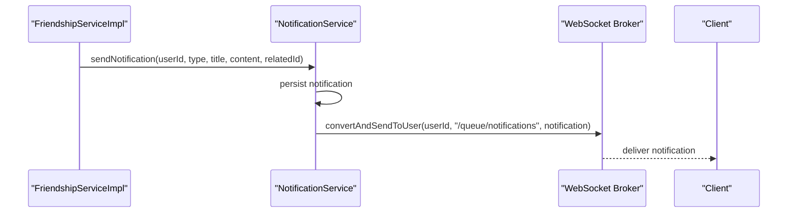
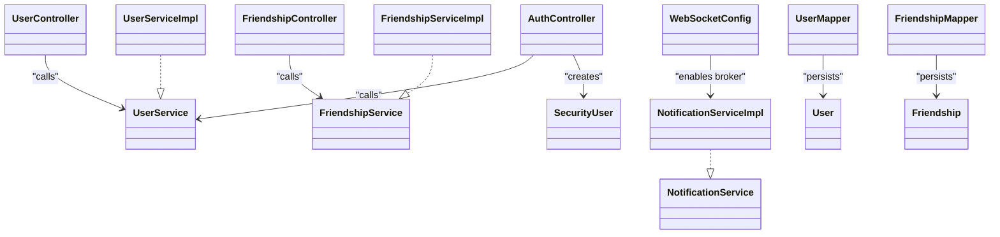

# User Management System

<cite>
**Referenced Files in This Document**
- [UserController.java](file://camp-channel-server/src/main/java/com/gdmec/campchannel/controller/UserController.java)
- [UserService.java](file://camp-channel-server/src/main/java/com/gdmec/campchannel/service/UserService.java)
- [UserServiceImpl.java](file://camp-channel-server/src/main/java/com/gdmec/campchannel/service/impl/UserServiceImpl.java)
- [User.java](file://camp-channel-server/src/main/java/com/gdmec/campchannel/entity/User.java)
- [UserMapper.java](file://camp-channel-server/src/main/java/com/gdmec/campchannel/mapper/UserMapper.java)
- [FriendshipController.java](file://camp-channel-server/src/main/java/com/gdmec/campchannel/controller/FriendshipController.java)
- [FriendshipService.java](file://camp-channel-server/src/main/java/com/gdmec/campchannel/service/FriendshipService.java)
- [FriendshipServiceImpl.java](file://camp-channel-server/src/main/java/com/gdmec/campchannel/service/impl/FriendshipServiceImpl.java)
- [Friendship.java](file://camp-channel-server/src/main/java/com/gdmec/campchannel/entity/Friendship.java)
- [FriendshipMapper.java](file://camp-channel-server/src/main/java/com/gdmec/campchannel/mapper/FriendshipMapper.java)
- [AuthController.java](file://camp-channel-server/src/main/java/com/gdmec/campchannel/controller/AuthController.java)
- [SecurityUser.java](file://camp-channel-server/src/main/java/com/gdmec/campchannel/security/SecurityUser.java)
- [WebSocketConfig.java](file://camp-channel-server/src/main/java/com/gdmec/campchannel/config/WebSocketConfig.java)
- [NotificationService.java](file://camp-channel-server/src/main/java/com/gdmec/campchannel/service/NotificationService.java)
- [NotificationServiceImpl.java](file://camp-channel-server/src/main/java/com/gdmec/campchannel/service/impl/NotificationServiceImpl.java)
- [application.yml](file://camp-channel-server/src/main/resources/application.yml)
</cite>

## Table of Contents
1. [Introduction](#introduction)
2. [Project Structure](#project-structure)
3. [Core Components](#core-components)
4. [Architecture Overview](#architecture-overview)
5. [Detailed Component Analysis](#detailed-component-analysis)
6. [Dependency Analysis](#dependency-analysis)
7. [Performance Considerations](#performance-considerations)
8. [Troubleshooting Guide](#troubleshooting-guide)
9. [Conclusion](#conclusion)
10. [Appendices](#appendices)

## Introduction
This document explains the user management system implemented in the backend server. It covers user registration with institutional email validation, profile management, avatar upload with deduplication, and the friend system including friend requests, acceptance workflows, and dynamic notifications. It also documents configuration options for validation rules, avatar storage policies, and privacy settings, and clarifies integration points with the authentication system and the real-time notification system.

## Project Structure
The user management system spans controllers, services, data access layers, entities, and configuration. Controllers expose REST endpoints; services encapsulate business logic; data access layers manage persistence; entities define domain models; and configuration defines runtime behavior such as JWT, Redis, and upload policies.

**Diagram sources**
- [UserController.java:34-393](file://camp-channel-server/src/main/java/com/gdmec/campchannel/controller/UserController.java#L34-L393)
- [FriendshipController.java:22-116](file://camp-channel-server/src/main/java/com/gdmec/campchannel/controller/FriendshipController.java#L22-L116)
- [AuthController.java:41-247](file://camp-channel-server/src/main/java/com/gdmec/campchannel/controller/AuthController.java#L41-L247)
- [UserService.java:6-22](file://camp-channel-server/src/main/java/com/gdmec/campchannel/service/UserService.java#L6-L22)
- [UserServiceImpl.java:25-107](file://camp-channel-server/src/main/java/com/gdmec/campchannel/service/impl/UserServiceImpl.java#L25-L107)
- [FriendshipService.java:9-55](file://camp-channel-server/src/main/java/com/gdmec/campchannel/service/FriendshipService.java#L9-L55)
- [FriendshipServiceImpl.java:26-251](file://camp-channel-server/src/main/java/com/gdmec/campchannel/service/impl/FriendshipServiceImpl.java#L26-L251)
- [UserMapper.java:8-9](file://camp-channel-server/src/main/java/com/gdmec/campchannel/mapper/UserMapper.java#L8-L9)
- [FriendshipMapper.java:8-9](file://camp-channel-server/src/main/java/com/gdmec/campchannel/mapper/FriendshipMapper.java#L8-L9)
- [User.java:12-42](file://camp-channel-server/src/main/java/com/gdmec/campchannel/entity/User.java#L12-L42)
- [Friendship.java:12-26](file://camp-channel-server/src/main/java/com/gdmec/campchannel/entity/Friendship.java#L12-L26)
- [SecurityUser.java:17-66](file://camp-channel-server/src/main/java/com/gdmec/campchannel/security/SecurityUser.java#L17-L66)
- [WebSocketConfig.java:13-36](file://camp-channel-server/src/main/java/com/gdmec/campchannel/config/WebSocketConfig.java#L13-L36)
- [NotificationService.java:8-34](file://camp-channel-server/src/main/java/com/gdmec/campchannel/service/NotificationService.java#L8-L34)
- [NotificationServiceImpl.java:18-95](file://camp-channel-server/src/main/java/com/gdmec/campchannel/service/impl/NotificationServiceImpl.java#L18-L95)
- [application.yml:1-119](file://camp-channel-server/src/main/resources/application.yml#L1-L119)

**Section sources**
- [application.yml:1-119](file://camp-channel-server/src/main/resources/application.yml#L1-L119)

## Core Components
- User registration and profile management:
  - Registration enforces institutional email suffix, uniqueness checks, password encoding, default avatar assignment, and automatic enrollment in a public channel.
  - Profile endpoints expose current user info, profile cards, updates, password changes, and device management.
- Friend system:
  - Search users, send/reject/approve friend requests, list friends, delete friends, and block/unblock friend dynamics.
  - Notifications are sent via WebSocket and persisted for later retrieval.
- Authentication and session:
  - Login validates institutional email suffix, enforces rate limits, generates JWT tokens, and records login devices.
  - Single-device login enforcement via Redis active token.
- Real-time synchronization:
  - WebSocket broker configuration enables per-user queue notifications for friend-related events.

**Section sources**
- [UserServiceImpl.java:46-105](file://camp-channel-server/src/main/java/com/gdmec/campchannel/service/impl/UserServiceImpl.java#L46-L105)
- [UserController.java:63-393](file://camp-channel-server/src/main/java/com/gdmec/campchannel/controller/UserController.java#L63-L393)
- [FriendshipServiceImpl.java:40-251](file://camp-channel-server/src/main/java/com/gdmec/campchannel/service/impl/FriendshipServiceImpl.java#L40-L251)
- [AuthController.java:93-207](file://camp-channel-server/src/main/java/com/gdmec/campchannel/controller/AuthController.java#L93-L207)
- [WebSocketConfig.java:13-36](file://camp-channel-server/src/main/java/com/gdmec/campchannel/config/WebSocketConfig.java#L13-L36)

## Architecture Overview
The system follows layered architecture:
- Presentation layer: REST controllers handle HTTP requests.
- Application layer: Services implement business logic and orchestrate cross-domain operations.
- Persistence layer: MyBatis-Plus mappers and repositories manage data access.
- Integration layer: Redis for caching and rate limiting; SMTP for email alerts; WebSocket for real-time notifications.

**Diagram sources**
- [AuthController.java:124-207](file://camp-channel-server/src/main/java/com/gdmec/campchannel/controller/AuthController.java#L124-L207)
- [SecurityUser.java:17-66](file://camp-channel-server/src/main/java/com/gdmec/campchannel/security/SecurityUser.java#L17-L66)
- [application.yml:78-84](file://camp-channel-server/src/main/resources/application.yml#L78-L84)

## Detailed Component Analysis

### User Registration and Institutional Email Validation
- Registration endpoint requires verification code stored in Redis and enforces:
  - Institutional email suffix validation.
  - Uniqueness of email and username.
  - Password encoding via configured encoder.
  - Default avatar selection from local uploads.
  - Automatic membership in a predefined public channel.

**Diagram sources**
- [AuthController.java:93-122](file://camp-channel-server/src/main/java/com/gdmec/campchannel/controller/AuthController.java#L93-L122)
- [UserServiceImpl.java:46-105](file://camp-channel-server/src/main/java/com/gdmec/campchannel/service/impl/UserServiceImpl.java#L46-L105)

**Section sources**
- [AuthController.java:93-122](file://camp-channel-server/src/main/java/com/gdmec/campchannel/controller/AuthController.java#L93-L122)
- [UserServiceImpl.java:46-105](file://camp-channel-server/src/main/java/com/gdmec/campchannel/service/impl/UserServiceImpl.java#L46-L105)

### Profile Management and Privacy Controls
- Current user info and profile card endpoints:
  - Fetch counts of posts and friends.
  - Determine friendship status between users.
  - Restrict visibility of private channel posts to friends only.
- Update profile supports partial updates for username, avatar, email, and email notification preference.
- Password change validates old password, encodes new password, and forces re-authentication by clearing active token.

**Diagram sources**
- [UserController.java:75-227](file://camp-channel-server/src/main/java/com/gdmec/campchannel/controller/UserController.java#L75-L227)

**Section sources**
- [UserController.java:75-227](file://camp-channel-server/src/main/java/com/gdmec/campchannel/controller/UserController.java#L75-L227)
- [User.java:39-42](file://camp-channel-server/src/main/java/com/gdmec/campchannel/entity/User.java#L39-L42)

### Avatar Upload with Deduplication
- Endpoint accepts a file, computes MD5 hash, stores only if unique, and updates user avatar URL.
- Returns standardized response with uploaded URL.

**Diagram sources**
- [UserController.java:229-289](file://camp-channel-server/src/main/java/com/gdmec/campchannel/controller/UserController.java#L229-L289)

**Section sources**
- [UserController.java:229-289](file://camp-channel-server/src/main/java/com/gdmec/campchannel/controller/UserController.java#L229-L289)
- [application.yml:95-98](file://camp-channel-server/src/main/resources/application.yml#L95-L98)

### Friend System: Requests, Acceptance, and Blocking
- Request lifecycle:
  - Daily request cap enforced via Redis.
  - Duplicate or existing accepted requests are rejected.
  - On send: persist request, notify recipient via WebSocket, and email alert.
  - Approve: set status to accepted and notify sender.
  - Reject: set status to rejected.
  - Delete friend: remove accepted relationship.
  - Block/unblock: toggle relationship status to blocked and restore to accepted respectively.

**Diagram sources**
- [FriendshipController.java:34-90](file://camp-channel-server/src/main/java/com/gdmec/campchannel/controller/FriendshipController.java#L34-L90)
- [FriendshipServiceImpl.java:40-91](file://camp-channel-server/src/main/java/com/gdmec/campchannel/service/impl/FriendshipServiceImpl.java#L40-L91)
- [NotificationServiceImpl.java:26-51](file://camp-channel-server/src/main/java/com/gdmec/campchannel/service/impl/NotificationServiceImpl.java#L26-L51)

**Section sources**
- [FriendshipController.java:27-110](file://camp-channel-server/src/main/java/com/gdmec/campchannel/controller/FriendshipController.java#L27-L110)
- [FriendshipServiceImpl.java:40-251](file://camp-channel-server/src/main/java/com/gdmec/campchannel/service/impl/FriendshipServiceImpl.java#L40-L251)
- [NotificationServiceImpl.java:26-51](file://camp-channel-server/src/main/java/com/gdmec/campchannel/service/impl/NotificationServiceImpl.java#L26-L51)

### Authentication and Session Management
- Login validates institutional email suffix, enforces password error caps, authenticates via Spring Security, generates JWT, stores active token in Redis, and records login device.
- Single-device enforcement ensures only the latest token remains valid.

**Diagram sources**
- [AuthController.java:124-207](file://camp-channel-server/src/main/java/com/gdmec/campchannel/controller/AuthController.java#L124-L207)
- [SecurityUser.java:17-66](file://camp-channel-server/src/main/java/com/gdmec/campchannel/security/SecurityUser.java#L17-L66)
- [application.yml:78-84](file://camp-channel-server/src/main/resources/application.yml#L78-L84)

**Section sources**
- [AuthController.java:124-207](file://camp-channel-server/src/main/java/com/gdmec/campchannel/controller/AuthController.java#L124-L207)
- [SecurityUser.java:17-66](file://camp-channel-server/src/main/java/com/gdmec/campchannel/security/SecurityUser.java#L17-L66)

### Real-Time Communication and Notification Synchronization
- WebSocket configuration enables STOMP endpoints and per-user queues.
- Notification service persists notifications and pushes them to the user’s queue via WebSocket when online.

**Diagram sources**
- [WebSocketConfig.java:18-35](file://camp-channel-server/src/main/java/com/gdmec/campchannel/config/WebSocketConfig.java#L18-L35)
- [NotificationServiceImpl.java:26-51](file://camp-channel-server/src/main/java/com/gdmec/campchannel/service/impl/NotificationServiceImpl.java#L26-L51)

**Section sources**
- [WebSocketConfig.java:18-35](file://camp-channel-server/src/main/java/com/gdmec/campchannel/config/WebSocketConfig.java#L18-L35)
- [NotificationServiceImpl.java:26-51](file://camp-channel-server/src/main/java/com/gdmec/campchannel/service/impl/NotificationServiceImpl.java#L26-L51)

## Dependency Analysis
- Controllers depend on services for business logic.
- Services depend on mappers for persistence and on Redis for caching/rate limiting.
- Notification service integrates with WebSocket messaging template for real-time delivery.
- Entities define the schema for users and friendships.

**Diagram sources**
- [UserController.java:34-393](file://camp-channel-server/src/main/java/com/gdmec/campchannel/controller/UserController.java#L34-L393)
- [FriendshipController.java:22-116](file://camp-channel-server/src/main/java/com/gdmec/campchannel/controller/FriendshipController.java#L22-L116)
- [AuthController.java:41-247](file://camp-channel-server/src/main/java/com/gdmec/campchannel/controller/AuthController.java#L41-L247)
- [UserService.java:6-22](file://camp-channel-server/src/main/java/com/gdmec/campchannel/service/UserService.java#L6-L22)
- [UserServiceImpl.java:25-107](file://camp-channel-server/src/main/java/com/gdmec/campchannel/service/impl/UserServiceImpl.java#L25-L107)
- [FriendshipService.java:9-55](file://camp-channel-server/src/main/java/com/gdmec/campchannel/service/FriendshipService.java#L9-L55)
- [FriendshipServiceImpl.java:26-251](file://camp-channel-server/src/main/java/com/gdmec/campchannel/service/impl/FriendshipServiceImpl.java#L26-L251)
- [NotificationService.java:8-34](file://camp-channel-server/src/main/java/com/gdmec/campchannel/service/NotificationService.java#L8-L34)
- [NotificationServiceImpl.java:18-95](file://camp-channel-server/src/main/java/com/gdmec/campchannel/service/impl/NotificationServiceImpl.java#L18-L95)
- [User.java:12-42](file://camp-channel-server/src/main/java/com/gdmec/campchannel/entity/User.java#L12-L42)
- [Friendship.java:12-26](file://camp-channel-server/src/main/java/com/gdmec/campchannel/entity/Friendship.java#L12-L26)
- [UserMapper.java:8-9](file://camp-channel-server/src/main/java/com/gdmec/campchannel/mapper/UserMapper.java#L8-L9)
- [FriendshipMapper.java:8-9](file://camp-channel-server/src/main/java/com/gdmec/campchannel/mapper/FriendshipMapper.java#L8-L9)
- [SecurityUser.java:17-66](file://camp-channel-server/src/main/java/com/gdmec/campchannel/security/SecurityUser.java#L17-L66)
- [WebSocketConfig.java:13-36](file://camp-channel-server/src/main/java/com/gdmec/campchannel/config/WebSocketConfig.java#L13-L36)

**Section sources**
- [UserServiceImpl.java:25-107](file://camp-channel-server/src/main/java/com/gdmec/campchannel/service/impl/UserServiceImpl.java#L25-L107)
- [FriendshipServiceImpl.java:26-251](file://camp-channel-server/src/main/java/com/gdmec/campchannel/service/impl/FriendshipServiceImpl.java#L26-L251)
- [NotificationServiceImpl.java:18-95](file://camp-channel-server/src/main/java/com/gdmec/campchannel/service/impl/NotificationServiceImpl.java#L18-L95)

## Performance Considerations
- Rate limiting and caps:
  - Daily friend request limit via Redis with TTL.
  - Password error attempts capped with temporary lock.
- Efficient queries:
  - Use of MyBatis-Plus query wrappers and batch operations for friend lists and channel membership.
- Storage:
  - Avatar deduplication reduces disk usage by storing only unique files.
- Real-time delivery:
  - WebSocket broker delivers notifications only when clients are connected.

[No sources needed since this section provides general guidance]

## Troubleshooting Guide
Common issues and resolutions:
- Email validation failures:
  - Institutional suffix mismatch during login or registration triggers invalid email suffix errors.
- Duplicate account creation:
  - Registration prevents duplicate emails and usernames; ensure uniqueness checks are satisfied.
- Password change requiring re-login:
  - Active token is cleared after password change; clients must re-authenticate.
- Friend request throttling:
  - Exceeding daily limit raises too-many-requests; wait until the next day or reduce requests.
- Notification delivery:
  - WebSocket push failures are logged; ensure the user is connected and the broker is configured.

**Section sources**
- [AuthController.java:137-147](file://camp-channel-server/src/main/java/com/gdmec/campchannel/controller/AuthController.java#L137-L147)
- [UserServiceImpl.java:49-58](file://camp-channel-server/src/main/java/com/gdmec/campchannel/service/impl/UserServiceImpl.java#L49-L58)
- [FriendshipServiceImpl.java:47-54](file://camp-channel-server/src/main/java/com/gdmec/campchannel/service/impl/FriendshipServiceImpl.java#L47-L54)
- [NotificationServiceImpl.java:47-49](file://camp-channel-server/src/main/java/com/gdmec/campchannel/service/impl/NotificationServiceImpl.java#L47-L49)

## Conclusion
The user management system integrates robust validation, secure authentication, flexible profile management, efficient friend operations, and real-time notifications. Configuration in application.yml centralizes policy controls for uploads, JWT, and Redis. The layered design promotes maintainability and scalability for user-centric features.

[No sources needed since this section summarizes without analyzing specific files]

## Appendices

### Configuration Options
- Upload and storage:
  - Local upload path for avatars and images.
- JWT:
  - Secret, expiration, header, and token prefix.
- Redis:
  - Host, port, database, and timeouts used for caching and rate limiting.
- Mail:
  - SMTP settings for sending verification codes and alerts.

**Section sources**
- [application.yml:95-98](file://camp-channel-server/src/main/resources/application.yml#L95-L98)
- [application.yml:78-84](file://camp-channel-server/src/main/resources/application.yml#L78-L84)
- [application.yml:31-43](file://camp-channel-server/src/main/resources/application.yml#L31-L43)
- [application.yml:49-67](file://camp-channel-server/src/main/resources/application.yml#L49-L67)