# User Registration and Profile Management

<cite>
**Referenced Files in This Document**
- [UserController.java](file://camp-channel-server/src/main/java/com/gdmec/campchannel/controller/UserController.java)
- [AuthController.java](file://camp-channel-server/src/main/java/com/gdmec/campchannel/controller/AuthController.java)
- [UserServiceImpl.java](file://camp-channel-server/src/main/java/com/gdmec/campchannel/service/impl/UserServiceImpl.java)
- [User.java](file://camp-channel-server/src/main/java/com/gdmec/campchannel/entity/User.java)
- [SecurityConfig.java](file://camp-channel-server/src/main/java/com/gdmec/campchannel/config/SecurityConfig.java)
- [JwtAuthenticationFilter.java](file://camp-channel-server/src/main/java/com/gdmec/campchannel/security/JwtAuthenticationFilter.java)
- [CustomUserDetailsService.java](file://camp-channel-server/src/main/java/com/gdmec/campchannel/security/CustomUserDetailsService.java)
- [JwtUtils.java](file://camp-channel-server/src/main/java/com/gdmec/campchannel/common/utils/JwtUtils.java)
- [RedisUtils.java](file://camp-channel-server/src/main/java/com/gdmec/campchannel/common/utils/RedisUtils.java)
- [RedisConfig.java](file://camp-channel-server/src/main/java/com/gdmec/campchannel/config/RedisConfig.java)
- [EmailServiceImpl.java](file://camp-channel-server/src/main/java/com/gdmec/campchannel/service/impl/EmailServiceImpl.java)
- [application.yml](file://camp-channel-server/src/main/resources/application.yml)
- [AvatarController.java](file://camp-channel-server/src/main/java/com/gdmec/campchannel/controller/AvatarController.java)
</cite>

## Table of Contents
1. [Introduction](#introduction)
2. [Project Structure](#project-structure)
3. [Core Components](#core-components)
4. [Architecture Overview](#architecture-overview)
5. [Detailed Component Analysis](#detailed-component-analysis)
6. [Dependency Analysis](#dependency-analysis)
7. [Performance Considerations](#performance-considerations)
8. [Troubleshooting Guide](#troubleshooting-guide)
9. [Conclusion](#conclusion)

## Introduction
This document provides comprehensive documentation for user registration and profile management functionality, focusing on Guangdong Polytechnic Institute student accounts (@stu.gdmec.edu.cn). It covers the complete registration workflow (verification code delivery, email domain validation, password encoding, and initial setup), profile management (username updates, email changes, personal info modifications), and avatar upload with deduplication via MD5 hashing. It also documents security considerations (password encryption, input validation, email domain restrictions), duplicate prevention, profile integrity, Redis-based session management, and the integration with the authentication system.

## Project Structure
The user registration and profile management features span several layers:
- Controllers expose REST endpoints for authentication, user profile management, and avatar handling.
- Services encapsulate business logic including validation, password encoding, and initial user setup.
- Security configuration integrates JWT-based stateless authentication with Redis for single-device login enforcement.
- Utilities provide JWT generation/validation and Redis operations.
- Configuration defines application-wide settings including upload paths, JWT parameters, and mail settings.

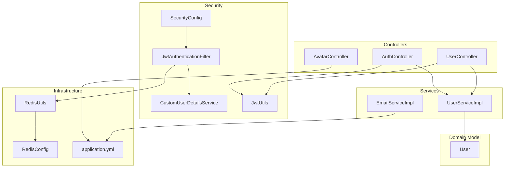

**Diagram sources**
- [AuthController.java:1-247](file://camp-channel-server/src/main/java/com/gdmec/campchannel/controller/AuthController.java#L1-L247)
- [UserController.java:1-393](file://camp-channel-server/src/main/java/com/gdmec/campchannel/controller/UserController.java#L1-L393)
- [AvatarController.java:1-60](file://camp-channel-server/src/main/java/com/gdmec/campchannel/controller/AvatarController.java#L1-L60)
- [UserServiceImpl.java:1-107](file://camp-channel-server/src/main/java/com/gdmec/campchannel/service/impl/UserServiceImpl.java#L1-L107)
- [EmailServiceImpl.java:1-70](file://camp-channel-server/src/main/java/com/gdmec/campchannel/service/impl/EmailServiceImpl.java#L1-L70)
- [SecurityConfig.java:1-137](file://camp-channel-server/src/main/java/com/gdmec/campchannel/config/SecurityConfig.java#L1-L137)
- [JwtAuthenticationFilter.java:1-113](file://camp-channel-server/src/main/java/com/gdmec/campchannel/security/JwtAuthenticationFilter.java#L1-L113)
- [CustomUserDetailsService.java:1-47](file://camp-channel-server/src/main/java/com/gdmec/campchannel/security/CustomUserDetailsService.java#L1-L47)
- [JwtUtils.java:1-85](file://camp-channel-server/src/main/java/com/gdmec/campchannel/common/utils/JwtUtils.java#L1-L85)
- [RedisUtils.java:1-170](file://camp-channel-server/src/main/java/com/gdmec/campchannel/common/utils/RedisUtils.java#L1-L170)
- [RedisConfig.java:1-47](file://camp-channel-server/src/main/java/com/gdmec/campchannel/config/RedisConfig.java#L1-L47)
- [application.yml:1-119](file://camp-channel-server/src/main/resources/application.yml#L1-L119)
- [User.java:1-42](file://camp-channel-server/src/main/java/com/gdmec/campchannel/entity/User.java#L1-L42)

**Section sources**
- [AuthController.java:1-247](file://camp-channel-server/src/main/java/com/gdmec/campchannel/controller/AuthController.java#L1-L247)
- [UserController.java:1-393](file://camp-channel-server/src/main/java/com/gdmec/campchannel/controller/UserController.java#L1-L393)
- [UserServiceImpl.java:1-107](file://camp-channel-server/src/main/java/com/gdmec/campchannel/service/impl/UserServiceImpl.java#L1-L107)
- [SecurityConfig.java:1-137](file://camp-channel-server/src/main/java/com/gdmec/campchannel/config/SecurityConfig.java#L1-L137)
- [JwtAuthenticationFilter.java:1-113](file://camp-channel-server/src/main/java/com/gdmec/campchannel/security/JwtAuthenticationFilter.java#L1-L113)
- [CustomUserDetailsService.java:1-47](file://camp-channel-server/src/main/java/com/gdmec/campchannel/security/CustomUserDetailsService.java#L1-L47)
- [JwtUtils.java:1-85](file://camp-channel-server/src/main/java/com/gdmec/campchannel/common/utils/JwtUtils.java#L1-L85)
- [RedisUtils.java:1-170](file://camp-channel-server/src/main/java/com/gdmec/campchannel/common/utils/RedisUtils.java#L1-L170)
- [RedisConfig.java:1-47](file://camp-channel-server/src/main/java/com/gdmec/campchannel/config/RedisConfig.java#L1-L47)
- [application.yml:1-119](file://camp-channel-server/src/main/resources/application.yml#L1-L119)
- [User.java:1-42](file://camp-channel-server/src/main/java/com/gdmec/campchannel/entity/User.java#L1-L42)

## Core Components
- AuthController: Handles email verification code generation and user registration, enforcing @stu.gdmec.edu.cn domain validation and rate limiting.
- UserController: Manages current user retrieval, profile queries, profile updates, password changes, avatar uploads with deduplication, and device management.
- UserServiceImpl: Implements registration validation, duplicate prevention, password encoding, default avatar assignment, and automatic joining of a public channel.
- SecurityConfig and JwtAuthenticationFilter: Configure stateless JWT authentication and enforce single-device login via Redis.
- RedisUtils and RedisConfig: Provide Redis operations and serialization configuration for caching tokens and rate limits.
- JwtUtils: Generates and validates JWT tokens with configurable expiration and header format.
- EmailServiceImpl: Sends verification codes and alerts via configured SMTP settings.
- application.yml: Centralizes configuration for JWT, uploads, Redis, and mail.

**Section sources**
- [AuthController.java:93-122](file://camp-channel-server/src/main/java/com/gdmec/campchannel/controller/AuthController.java#L93-L122)
- [UserController.java:229-289](file://camp-channel-server/src/main/java/com/gdmec/campchannel/controller/UserController.java#L229-L289)
- [UserServiceImpl.java:48-105](file://camp-channel-server/src/main/java/com/gdmec/campchannel/service/impl/UserServiceImpl.java#L48-L105)
- [SecurityConfig.java:52-102](file://camp-channel-server/src/main/java/com/gdmec/campchannel/config/SecurityConfig.java#L52-L102)
- [JwtAuthenticationFilter.java:72-96](file://camp-channel-server/src/main/java/com/gdmec/campchannel/security/JwtAuthenticationFilter.java#L72-L96)
- [RedisUtils.java:142-168](file://camp-channel-server/src/main/java/com/gdmec/campchannel/common/utils/RedisUtils.java#L142-L168)
- [RedisConfig.java:20-45](file://camp-channel-server/src/main/java/com/gdmec/campchannel/config/RedisConfig.java#L20-L45)
- [JwtUtils.java:66-83](file://camp-channel-server/src/main/java/com/gdmec/campchannel/common/utils/JwtUtils.java#L66-L83)
- [EmailServiceImpl.java:46-50](file://camp-channel-server/src/main/java/com/gdmec/campchannel/service/impl/EmailServiceImpl.java#L46-L50)
- [application.yml:79-83](file://camp-channel-server/src/main/resources/application.yml#L79-L83)

## Architecture Overview
The system enforces institutional email validation for Guangdong Polytechnic Institute students and uses JWT for stateless authentication. Redis is leveraged for:
- Storing active tokens to support single-device login enforcement.
- Rate limiting verification code requests.
- Tracking login device records.

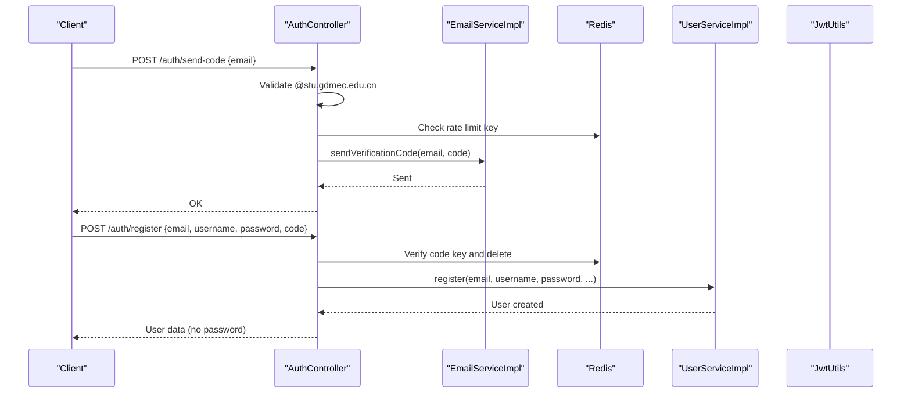

**Diagram sources**
- [AuthController.java:61-122](file://camp-channel-server/src/main/java/com/gdmec/campchannel/controller/AuthController.java#L61-L122)
- [EmailServiceImpl.java:46-50](file://camp-channel-server/src/main/java/com/gdmec/campchannel/service/impl/EmailServiceImpl.java#L46-L50)
- [UserServiceImpl.java:48-105](file://camp-channel-server/src/main/java/com/gdmec/campchannel/service/impl/UserServiceImpl.java#L48-L105)
- [RedisUtils.java:1-170](file://camp-channel-server/src/main/java/com/gdmec/campchannel/common/utils/RedisUtils.java#L1-L170)

## Detailed Component Analysis

### Institutional Email Validation for Guangdong Polytechnic Institute Students
- Domain restriction enforced during:
  - Verification code sending: rejects non-institute emails.
  - Registration: rejects non-institute emails and prevents duplicate registrations.
  - Login: restricts accepted credentials to @stu.gdmec.edu.cn domain.
- Duplicate prevention:
  - Checks for existing email and username before creation.
- Initial user setup:
  - Encodes password using BCrypt.
  - Assigns default avatar from local uploads.
  - Adds user to a public channel automatically.

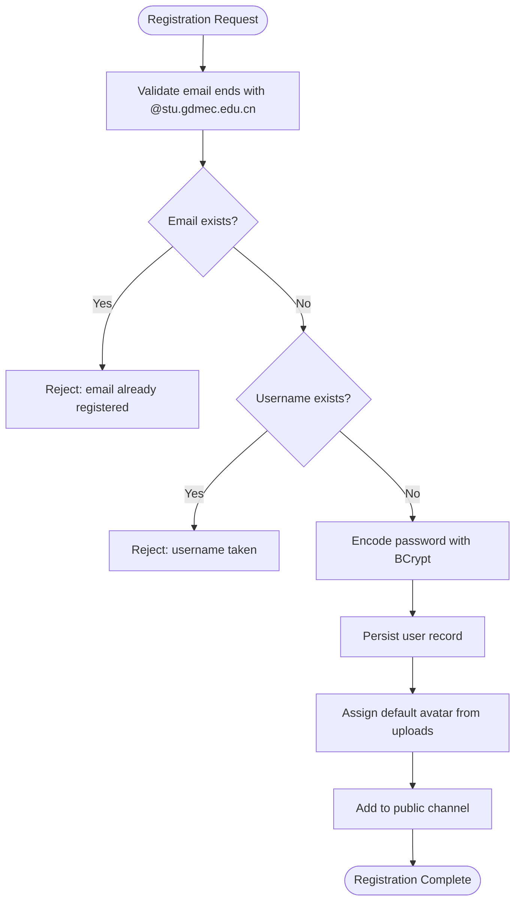

**Diagram sources**
- [UserServiceImpl.java:48-105](file://camp-channel-server/src/main/java/com/gdmec/campchannel/service/impl/UserServiceImpl.java#L48-L105)
- [AuthController.java:61-91](file://camp-channel-server/src/main/java/com/gdmec/campchannel/controller/AuthController.java#L61-L91)
- [AuthController.java:124-140](file://camp-channel-server/src/main/java/com/gdmec/campchannel/controller/AuthController.java#L124-L140)

**Section sources**
- [UserServiceImpl.java:48-105](file://camp-channel-server/src/main/java/com/gdmec/campchannel/service/impl/UserServiceImpl.java#L48-L105)
- [AuthController.java:61-91](file://camp-channel-server/src/main/java/com/gdmec/campchannel/controller/AuthController.java#L61-L91)
- [AuthController.java:124-140](file://camp-channel-server/src/main/java/com/gdmec/campchannel/controller/AuthController.java#L124-L140)

### User Registration Workflow
- Endpoint: POST /auth/register
- Steps:
  - Validate presence of email, username, password, and code.
  - Verify code against Redis key and expiry.
  - Persist user with encoded password and default avatar.
  - Return user object without password.

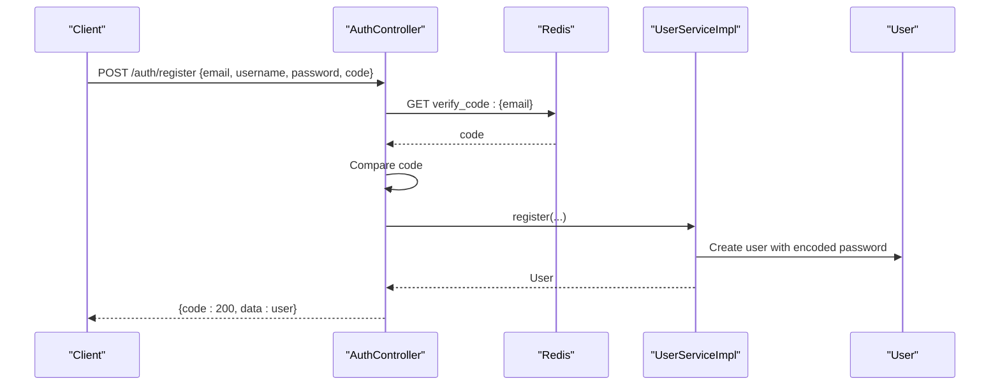

**Diagram sources**
- [AuthController.java:93-122](file://camp-channel-server/src/main/java/com/gdmec/campchannel/controller/AuthController.java#L93-L122)
- [UserServiceImpl.java:48-105](file://camp-channel-server/src/main/java/com/gdmec/campchannel/service/impl/UserServiceImpl.java#L48-L105)
- [User.java:25-26](file://camp-channel-server/src/main/java/com/gdmec/campchannel/entity/User.java#L25-L26)

**Section sources**
- [AuthController.java:93-122](file://camp-channel-server/src/main/java/com/gdmec/campchannel/controller/AuthController.java#L93-L122)
- [UserServiceImpl.java:48-105](file://camp-channel-server/src/main/java/com/gdmec/campchannel/service/impl/UserServiceImpl.java#L48-L105)

### Email Verification and Rate Limiting
- Endpoint: POST /auth/send-code
- Behavior:
  - Validates @stu.gdmec.edu.cn domain.
  - Checks rate limit key to prevent spam.
  - Stores code in Redis with expiry and sets a cooldown key.
  - Sends code via EmailServiceImpl.

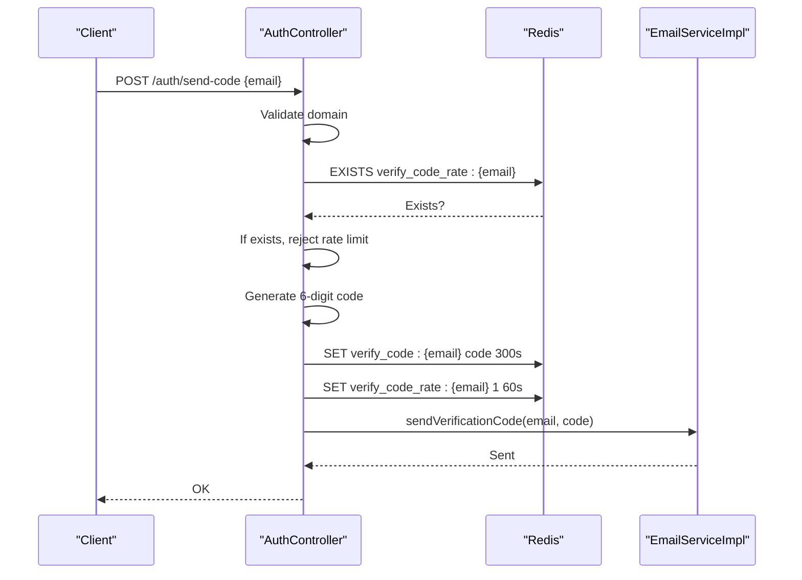

**Diagram sources**
- [AuthController.java:61-91](file://camp-channel-server/src/main/java/com/gdmec/campchannel/controller/AuthController.java#L61-L91)
- [EmailServiceImpl.java:46-50](file://camp-channel-server/src/main/java/com/gdmec/campchannel/service/impl/EmailServiceImpl.java#L46-L50)
- [RedisUtils.java:142-168](file://camp-channel-server/src/main/java/com/gdmec/campchannel/common/utils/RedisUtils.java#L142-L168)

**Section sources**
- [AuthController.java:61-91](file://camp-channel-server/src/main/java/com/gdmec/campchannel/controller/AuthController.java#L61-L91)
- [EmailServiceImpl.java:46-50](file://camp-channel-server/src/main/java/com/gdmec/campchannel/service/impl/EmailServiceImpl.java#L46-L50)
- [RedisUtils.java:142-168](file://camp-channel-server/src/main/java/com/gdmec/campchannel/common/utils/RedisUtils.java#L142-L168)

### Password Encoding with Spring Security
- PasswordEncoder: BCryptPasswordEncoder configured globally.
- Registration: Passwords are encoded before persistence.
- Login: Authentication compares BCrypt hashes.
- Password change: Requires current password match using encoder, then re-encodes and persists.

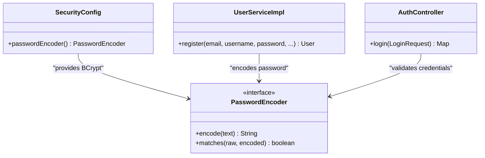

**Diagram sources**
- [SecurityConfig.java:42-45](file://camp-channel-server/src/main/java/com/gdmec/campchannel/config/SecurityConfig.java#L42-L45)
- [UserServiceImpl.java:63-63](file://camp-channel-server/src/main/java/com/gdmec/campchannel/service/impl/UserServiceImpl.java#L63-L63)
- [AuthController.java:150-169](file://camp-channel-server/src/main/java/com/gdmec/campchannel/controller/AuthController.java#L150-L169)

**Section sources**
- [SecurityConfig.java:42-45](file://camp-channel-server/src/main/java/com/gdmec/campchannel/config/SecurityConfig.java#L42-L45)
- [UserServiceImpl.java:63-63](file://camp-channel-server/src/main/java/com/gdmec/campchannel/service/impl/UserServiceImpl.java#L63-L63)
- [AuthController.java:150-169](file://camp-channel-server/src/main/java/com/gdmec/campchannel/controller/AuthController.java#L150-L169)

### Profile Management Features
- Retrieve current user: GET /users/me
- Retrieve profile with counts: GET /users/profile
- Update profile: PUT /users/me (supports username, avatar, email, emailNotify)
- Change password: POST /users/change-password (requires old password match)
- Remote device management: GET /users/devices and POST /users/devices/{deviceId}/logout
- Force logout all devices: POST /users/logout-device

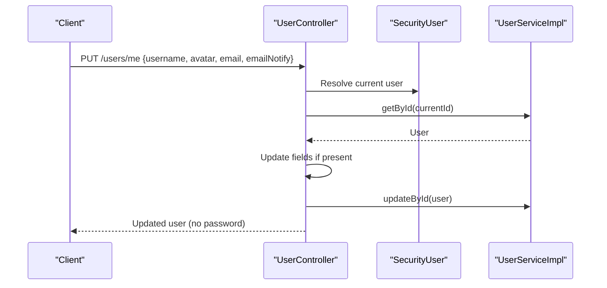

**Diagram sources**
- [UserController.java:291-318](file://camp-channel-server/src/main/java/com/gdmec/campchannel/controller/UserController.java#L291-L318)
- [UserServiceImpl.java:1-107](file://camp-channel-server/src/main/java/com/gdmec/campchannel/service/impl/UserServiceImpl.java#L1-L107)

**Section sources**
- [UserController.java:63-100](file://camp-channel-server/src/main/java/com/gdmec/campchannel/controller/UserController.java#L63-L100)
- [UserController.java:291-318](file://camp-channel-server/src/main/java/com/gdmec/campchannel/controller/UserController.java#L291-L318)
- [UserController.java:320-346](file://camp-channel-server/src/main/java/com/gdmec/campchannel/controller/UserController.java#L320-L346)
- [UserController.java:356-378](file://camp-channel-server/src/main/java/com/gdmec/campchannel/controller/UserController.java#L356-L378)

### Avatar Upload System with Deduplication
- Endpoint: POST /users/avatar
- Deduplication:
  - Computes MD5 hash of uploaded file bytes.
  - Stores file as {md5}.{ext} under uploads/avatars.
  - Skips writing if file already exists.
- Updates user avatar URL and persists.

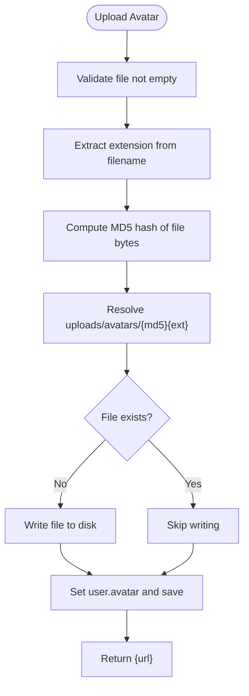

**Diagram sources**
- [UserController.java:229-289](file://camp-channel-server/src/main/java/com/gdmec/campchannel/controller/UserController.java#L229-L289)

**Section sources**
- [UserController.java:229-289](file://camp-channel-server/src/main/java/com/gdmec/campchannel/controller/UserController.java#L229-L289)

### Session Management and Single-Device Enforcement
- JWT configuration: header, token prefix, and expiration are configurable.
- Single-device enforcement:
  - On successful login, store active token in Redis keyed by username.
  - Subsequent requests validate JWT and compare with stored token; mismatch triggers forced logout.
- Device listing and remote logout endpoints support user-controlled sessions.

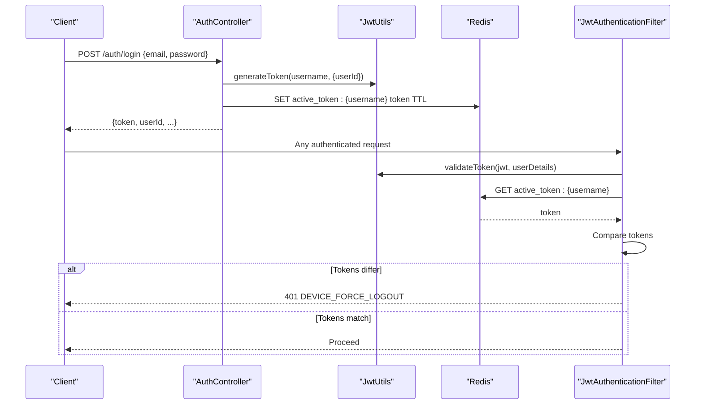

**Diagram sources**
- [AuthController.java:171-179](file://camp-channel-server/src/main/java/com/gdmec/campchannel/controller/AuthController.java#L171-L179)
- [JwtUtils.java:66-83](file://camp-channel-server/src/main/java/com/gdmec/campchannel/common/utils/JwtUtils.java#L66-L83)
- [JwtAuthenticationFilter.java:79-96](file://camp-channel-server/src/main/java/com/gdmec/campchannel/security/JwtAuthenticationFilter.java#L79-L96)
- [RedisUtils.java:1-170](file://camp-channel-server/src/main/java/com/gdmec/campchannel/common/utils/RedisUtils.java#L1-L170)

**Section sources**
- [application.yml:79-83](file://camp-channel-server/src/main/resources/application.yml#L79-L83)
- [AuthController.java:171-179](file://camp-channel-server/src/main/java/com/gdmec/campchannel/controller/AuthController.java#L171-L179)
- [JwtAuthenticationFilter.java:79-96](file://camp-channel-server/src/main/java/com/gdmec/campchannel/security/JwtAuthenticationFilter.java#L79-L96)
- [RedisUtils.java:1-170](file://camp-channel-server/src/main/java/com/gdmec/campchannel/common/utils/RedisUtils.java#L1-L170)

### Integration with Authentication System
- CustomUserDetailsService loads users by email or username and wraps them as SecurityUser for Spring Security.
- SecurityConfig permits unauthenticated access to /auth endpoints and enables stateless JWT filtering.
- JwtAuthenticationFilter extracts token from Authorization header, validates signature/expiry, and enforces single-device policy.

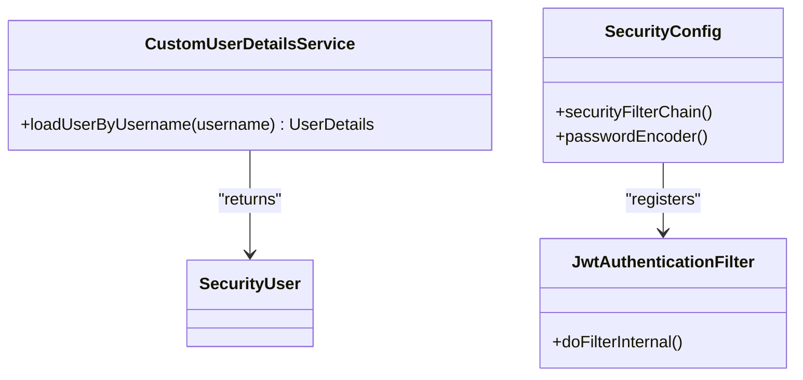

**Diagram sources**
- [CustomUserDetailsService.java:22-45](file://camp-channel-server/src/main/java/com/gdmec/campchannel/security/CustomUserDetailsService.java#L22-L45)
- [SecurityConfig.java:52-102](file://camp-channel-server/src/main/java/com/gdmec/campchannel/config/SecurityConfig.java#L52-L102)
- [JwtAuthenticationFilter.java:42-100](file://camp-channel-server/src/main/java/com/gdmec/campchannel/security/JwtAuthenticationFilter.java#L42-L100)

**Section sources**
- [CustomUserDetailsService.java:22-45](file://camp-channel-server/src/main/java/com/gdmec/campchannel/security/CustomUserDetailsService.java#L22-L45)
- [SecurityConfig.java:52-102](file://camp-channel-server/src/main/java/com/gdmec/campchannel/config/SecurityConfig.java#L52-L102)
- [JwtAuthenticationFilter.java:42-100](file://camp-channel-server/src/main/java/com/gdmec/campchannel/security/JwtAuthenticationFilter.java#L42-L100)

## Dependency Analysis
- Controllers depend on services for business logic and on utilities for JWT and Redis.
- Services depend on the entity model and PasswordEncoder.
- Security components depend on Redis for token validation and enforcement.
- Configuration ties JWT, Redis, and mail settings together.

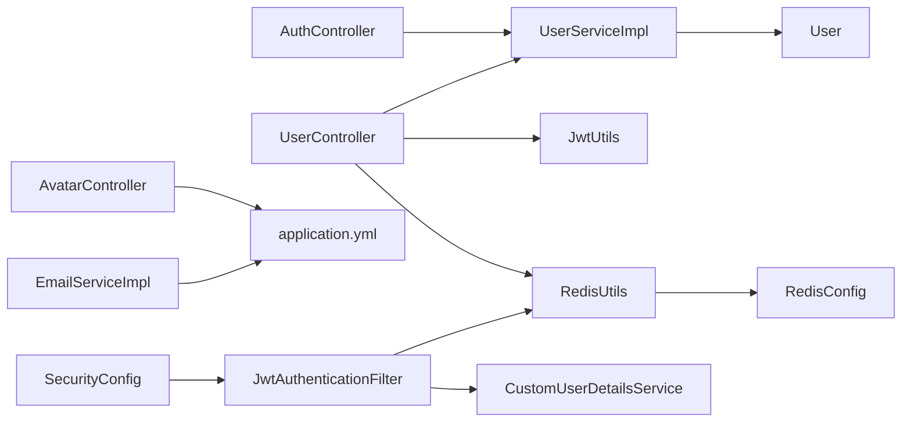

**Diagram sources**
- [AuthController.java:1-247](file://camp-channel-server/src/main/java/com/gdmec/campchannel/controller/AuthController.java#L1-L247)
- [UserController.java:1-393](file://camp-channel-server/src/main/java/com/gdmec/campchannel/controller/UserController.java#L1-L393)
- [UserServiceImpl.java:1-107](file://camp-channel-server/src/main/java/com/gdmec/campchannel/service/impl/UserServiceImpl.java#L1-L107)
- [JwtUtils.java:1-85](file://camp-channel-server/src/main/java/com/gdmec/campchannel/common/utils/JwtUtils.java#L1-L85)
- [RedisUtils.java:1-170](file://camp-channel-server/src/main/java/com/gdmec/campchannel/common/utils/RedisUtils.java#L1-L170)
- [SecurityConfig.java:1-137](file://camp-channel-server/src/main/java/com/gdmec/campchannel/config/SecurityConfig.java#L1-L137)
- [JwtAuthenticationFilter.java:1-113](file://camp-channel-server/src/main/java/com/gdmec/campchannel/security/JwtAuthenticationFilter.java#L1-L113)
- [CustomUserDetailsService.java:1-47](file://camp-channel-server/src/main/java/com/gdmec/campchannel/security/CustomUserDetailsService.java#L1-L47)
- [application.yml:1-119](file://camp-channel-server/src/main/resources/application.yml#L1-L119)
- [EmailServiceImpl.java:1-70](file://camp-channel-server/src/main/java/com/gdmec/campchannel/service/impl/EmailServiceImpl.java#L1-L70)
- [RedisConfig.java:1-47](file://camp-channel-server/src/main/java/com/gdmec/campchannel/config/RedisConfig.java#L1-L47)

**Section sources**
- [application.yml:79-83](file://camp-channel-server/src/main/resources/application.yml#L79-L83)
- [RedisConfig.java:20-45](file://camp-channel-server/src/main/java/com/gdmec/campchannel/config/RedisConfig.java#L20-L45)

## Performance Considerations
- Avatar deduplication reduces storage overhead by storing only unique files.
- Redis-based rate limiting avoids excessive outbound emails and protects the verification endpoint.
- JWT-based stateless authentication eliminates server-side session storage, improving scalability.
- File upload size limits are configured to prevent oversized payloads.

[No sources needed since this section provides general guidance]

## Troubleshooting Guide
- Registration fails with invalid email suffix:
  - Ensure the email ends with @stu.gdmec.edu.cn.
  - Verify the backend rejects non-institute domains at both send-code and register stages.
- Duplicate registration errors:
  - Check for existing email or username conflicts before attempting registration.
- Password change failures:
  - Confirm the old password matches the encoded value.
  - After changing, clients must re-authenticate as the active token is invalidated.
- Avatar upload issues:
  - Verify file is not empty and has a valid extension.
  - Confirm uploads/avatars directory is writable and Redis availability for deduplication.
- Single-device logout:
  - New logins overwrite the active token; previous devices receive unauthorized responses.

**Section sources**
- [AuthController.java:67-73](file://camp-channel-server/src/main/java/com/gdmec/campchannel/controller/AuthController.java#L67-L73)
- [AuthController.java:104-109](file://camp-channel-server/src/main/java/com/gdmec/campchannel/controller/AuthController.java#L104-L109)
- [UserServiceImpl.java:53-58](file://camp-channel-server/src/main/java/com/gdmec/campchannel/service/impl/UserServiceImpl.java#L53-L58)
- [UserController.java:335-345](file://camp-channel-server/src/main/java/com/gdmec/campchannel/controller/UserController.java#L335-L345)
- [UserController.java:235-237](file://camp-channel-server/src/main/java/com/gdmec/campchannel/controller/UserController.java#L235-L237)
- [JwtAuthenticationFilter.java:84-89](file://camp-channel-server/src/main/java/com/gdmec/campchannel/security/JwtAuthenticationFilter.java#L84-L89)

## Conclusion
The system provides a secure, institution-focused user registration pipeline with robust validation, password encoding, and avatar deduplication. JWT-based stateless authentication integrates tightly with Redis for single-device enforcement and device management. The profile management endpoints enable safe updates while preserving data integrity and preventing duplicates. Together, these components deliver a scalable and maintainable foundation for campus community user lifecycle management.