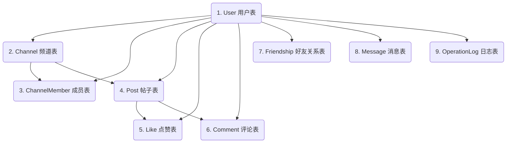

# Camp Channel 校园频道系统 V1.0 开发与架构设计计划

本项目旨在为广东机电职业技术学院在校学生构建一个专属的内容分享与社交闭环平台。基于《Camp Channel 校园频道系统 V1.0 需求文档》，本计划将整个系统的技术栈、模块结构、数据库结构、分步开发进度及测试验证方案进行系统化分解。

---

## 🛠️ 技术栈与架构设计

### 1. 技术底座
*   **后端服务**：
    *   框架：Spring Boot 3.x + Maven
    *   安全与认证：Spring Security 6.x + JWT + Redis（处理会话与单设备互踢）
    *   持久层：MyBatis-Plus + MySQL 8.0
    *   高并发/限流/缓存：Redis
    *   即时通讯/通知：WebSocket + SSE（Server-Sent Events）
    *   接口文档：Springdoc-openapi (Swagger)
*   **前端双端**：
    *   **PC端 / H5 / Android APP**：Flutter 3.x (单套代码，响应式布局适配)
        *   状态管理：Provider
        *   网络请求：Dio 封装（包含拦截器、Token自动刷新、重试机制）
    *   **微信小程序端**：UniApp + Vue3 + TypeScript + Vite
        *   状态管理：Pinia
        *   网络请求：uni-request 封装（统一拦截器）
*   **基础设施**：
    *   文件存储：本地模拟 OSS 存储（提供上传进度条与重试机制接口，为后续迁阿里云OSS预留抽象接口）

### 2. 系统核心防护与风控指标
*   **邮箱严格校验**：注册邮箱正则表达式强校验后缀 `@stu.gdmec.edu.cn`。
*   **限流机制 (Redis Sliding Window)**：
    *   发帖限制：同一用户 1 分钟最多发 3 帖（超限需图形验证码）。
    *   评论限制：同一用户 1 分钟最多评论 10 次。
    *   点赞限制：同一用户 1 分钟最多点赞 50 次。
    *   好友申请：每日最多发起 20 次。
*   **单点登录互踢**：使用 Redis 维护 `UserToken:UserId -> CurrentToken`。新登录生成新 Token 写入并作废旧 Token。旧 Token 请求接口返回 401 并包含特定状态码，触发前端强制下线并弹出“账号已在其他设备登录”提示。
*   **敏感词过滤**：本地 DFA (Deterministic Finite Automaton) 敏感词库过滤，命中敏感词的内容进入“待审核”状态，高危词直接拦截。

---

## 🗄️ 数据库表创建顺序与设计 (MySQL 8.0)

为避免外键依赖冲突，我们将严格按照依赖关系顺序创建表。

### 数据库建表顺序与 DDL 规划

1.  **`user` (用户表)**：系统核心基础表。
2.  **`channel` (频道表)**：帖子与成员依赖频道。
3.  **`channel_member` (频道成员关系表)**：依赖用户与频道。
4.  **`post` (帖子表)**：依赖用户与频道。
5.  **`post_like` (点赞表)**：依赖用户与帖子（含联合唯一索引 `uk_post_user`）。
6.  **`comment` (评论表)**：依赖用户、帖子及父评论（支持二级评论自关联）。
7.  **`friendship` (好友关系表)**：依赖两个用户（含联合唯一索引 `uk_user_friend`）。
8.  **`message` (聊天消息表)**：依赖发送方与接收方。
9.  **`operation_log` (系统操作日志表)**：依赖操作用户。

---

## 📅 分步开发计划 (Phases 2 ~ N)

根据“每次仅实现 1 个明确的功能模块”原则，我们将项目划分为 9 个开发阶段：

| 开发阶段 | 核心模块 | 实现内容 | 前后端依赖 / 数据库表 | 优先级 |
| :--- | :--- | :--- | :--- | :--- |
| **Phase 2** | **基础设施与安全骨架** | 搭建 Spring Boot 空白骨架，集成 Spring Security + JWT，配置 Redis，实现全局统一响应体、全局异常捕获器及敏感词 DFA 算法。同时配置 Flutter 及 UniApp 基础网络请求拦截器。 | 依赖：Redis, Maven 表：无 | ⭐⭐⭐⭐⭐ (高) |
| **Phase 3** | **用户注册与单点登录** | 实现 @stu.gdmec.edu.cn 邮箱强校验注册流程，登录验证，集成 Redis 实现同账号单点登录强踢机制、登录设备管理、连续 5 次密码错误锁定账户 30 分钟。 | 依赖：Phase 2 表：`user` | ⭐⭐⭐⭐⭐ (高) |
| **Phase 4** | **频道管理与搜索** | 实现公共频道及私人频道创建（第一版仅限管理员）、基于唯一编号（CH-xxxx-xxx）和名称的模糊搜索、私人频道“申请-审核-加入”流程。 | 依赖：Phase 3 表：`channel`, `channel_member` | ⭐⭐⭐⭐☆ (高) |
| **Phase 5** | **帖子发布与防刷限流** | 实现帖子流展示、基于 Redis 滑动窗口的发帖限流风控（1分钟≤3帖）、支持文字/图片/多图/视频上传（本地模拟OSS，带上传进度条与重试）、话题（#话题#）、@提及好友。 | 依赖：Phase 4 表：`post` | ⭐⭐⭐⭐⭐ (高) |
| **Phase 6** | **互动系统（点赞与评论）** | 帖子的点赞操作（1分钟≤50次防刷）、评论与二级回复（1分钟≤10次防刷）、删除自己发布的帖子/评论、帖子作者删除任何评论、删除帖子联级清除关联点赞和评论。 | 依赖：Phase 5 表：`post_like`, `comment` | ⭐⭐⭐⭐☆ (中) |
| **Phase 7** | **好友系统与云端聊天** | 好友搜索、加好友申请、同意/拒绝、单对单 WebSocket 实时聊天（文字/表情/图片/短视频）、聊天记录云端持久化存储、发送后 2 分钟内消息撤回机制。 | 依赖：Phase 3 表：`friendship`, `message` | ⭐⭐⭐⭐☆ (中) |
| **Phase 8** | **系统通知与个人中心** | 整合应用内实时通知（好友申请/同意、被@、新评论、点赞、频道审核结果）。实现个人中心与设置页面（姓名修改送审、密码修改、远程设备下线）。 | 依赖：Phase 6, 7 表：所有相关表 | ⭐⭐⭐☆☆ (低) |
| **Phase 9** | **管理员后台与审计** | Web后台管理端，提供用户禁用/启用/重置密码、频道管理审核、内容审核队列、违规举报处理、操作审计日志。 | 依赖：Phase 8 表：`operation_log` 等所有表 | ⭐⭐⭐☆☆ (低) |

---

## ⛔ 第一版不做的内容 (边界界定)

为确保 V1.0 的平稳、按期交付，以下功能明确在第一版中**不予实现**：
1.  ❌ **视频直播、语音消息**（仅支持 3 分钟以内视频上传及 30 秒以内聊天短视频）。
2.  ❌ **帖子置顶、精华标记、打赏功能**。
3.  ❌ **频道子版块/子分类**（每个频道仅有单一的帖子信息流）。
4.  ❌ **群聊功能**（仅限 1对1 好友聊天）。
5.  ❌ **消息已读回执**（后端不做已读回执更新，仅本地标记已读状态）。
6.  ❌ **第三方账号登录**（微信登录、手机号直接登录等，必须使用符合后缀要求的学校邮箱注册）。
7.  ❌ **内容推荐算法**（信息流完全按时间倒序拉取）。
8.  ❌ **端对端加密聊天**（移至 V2.0 规划）。

---

## 🛡️ 风险点与应对方案

| # | 风险描述 | 级别 | 应对策略 |
| :--- | :--- | :--- | :--- |
| **1** | **恶意高频请求导致系统崩溃** | 🔴 高 | 后端基于 Redis 滑动窗口对关键接口（发帖/评论/点赞/发送验证码）实现 IP 及用户维度的严格限流。超过阈值直接返回 `429 Too Many Requests`，前端拦截并在界面给出友好提示。 |
| **2** | **聊天长连接在大规模断网时重连风暴** | 🟡 中 | 前端 WebSocket 客户端使用**指数退避算法（Exponential Backoff）**进行断线重连，避免瞬间对服务器造成高并发冲击。 |
| **3** | **敏感词漏判导致校内言论合规风险** | 🔴 高 | 建立高敏感词自动拦截、中敏感词自动进人工审核队列机制。采用 DFA 高效过滤算法进行内存中匹配，确保单次发帖延迟在微秒级。 |
| **4** | **用户上传大视频/多图时网络中断导致体验极差** | 🟡 中 | 封装前端 Dio 拦截器和 UniApp 上传组件，将文件上传分割为分块或提供重试逻辑，并在 UI 界面实时呈现进度条。 |

---

## 🧪 测试与验证策略

### 1. 单元测试 (JUnit 5 + Mockito)
*   **覆盖率要求**：核心业务 Service 逻辑（如注册校验、限流风控、消息撤回超时校验）单元测试覆盖率需达到 **80%** 以上。
*   **Mock 对象**：对 Redis、OSS 客户端及外部服务交互进行 Mock，保证单元测试可独立、快速运行。

### 2. 即时通讯与并发测试
*   使用 Mock 工具测试 WebSocket 连接并发，验证异地登录踢人（双连接下，旧连接收到踢出 Frame 并断开）的原子性。

### 3. 多端端到端 (E2E) 手动用例验证
*   利用 Flutter 调试控制台与微信开发者工具，在每步交付中提供完备的手动验证表，包含输入参数、预期交互和实际接口返回。

---

## ❓ 待确认事项 (Open Questions)

> [!IMPORTANT]
> 请协助确认以下两个方案选择，以便在进入 Phase 2 开发时直接实施最符合您期望的架构设计。

### 问题 1: 文件存储与 OSS 模拟
由于本项目要求具备上传进度条和重试机制，第一版建议采用哪种文件存储方案？
*   **选项 A (推荐)**: **本地文件系统模拟 OSS**。后端在项目内创建挂载点（e.g., `uploads/`），通过标准的 HTTP POST 分块上传协议并返回进度，后期可无缝切换阿里云 OSS。
*   **选项 B**: **直接接入阿里云 OSS 客户端**。需在 Phase 2 提供您的 OSS AccessKey/Bucket 配置信息。

### 问题 2: 前端状态管理选型
根据前端技术栈约束，我们在多端开发中统一使用哪种方案？
*   **选项 A (推荐)**: **Flutter 端使用 `Provider` + UniApp 微信小程序端使用 `Pinia`**。结构清晰，上手极快。
*   **选项 B**: **Flutter 端使用 `Riverpod` + UniApp 微信小程序端使用 `Pinia`**。更强烈的响应式与测试友好度，但初期模板配置相对繁多。

---

> [!TIP]
> 确认上述设计与开发计划后，请您回复：**“确认计划，进入 Phase 2”**，我将为您启动 **Phase 2: 基础设施与安全骨架** 的落地编码工作。
